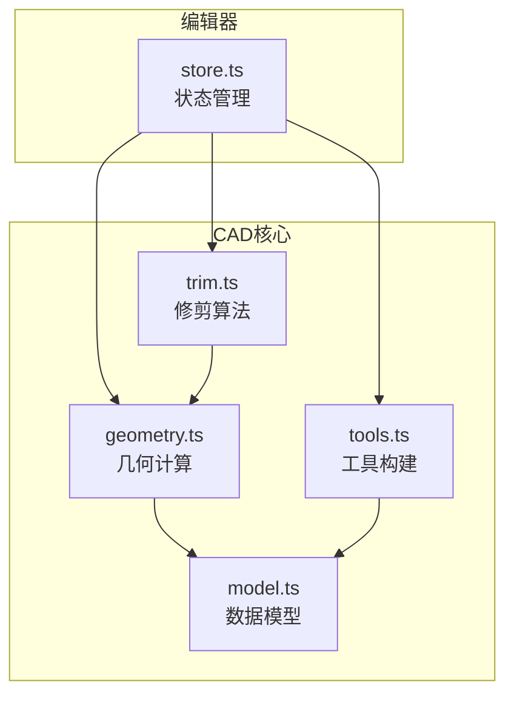
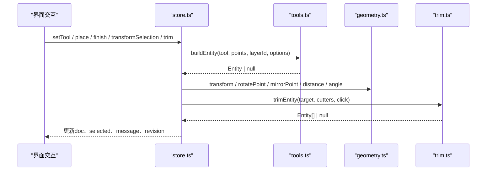
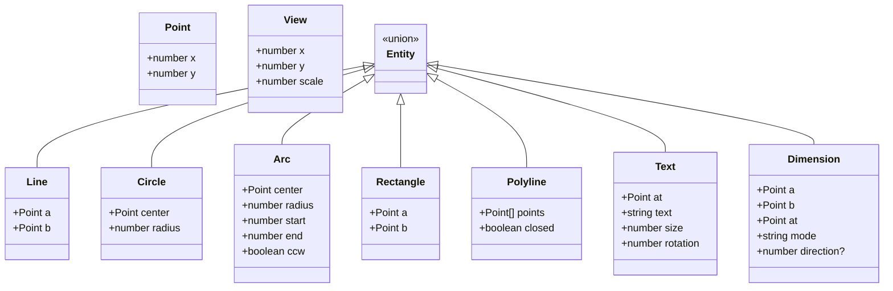
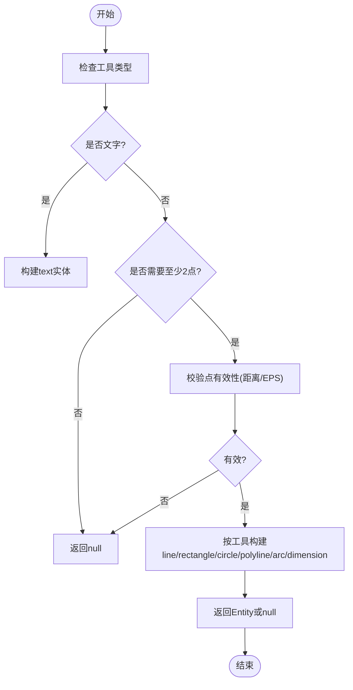
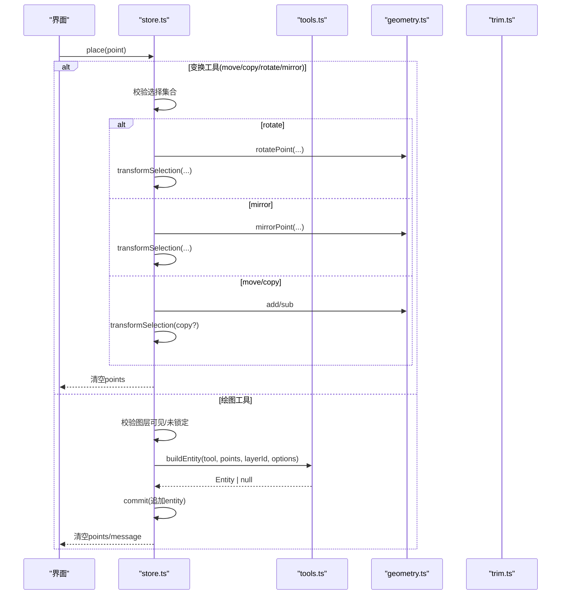
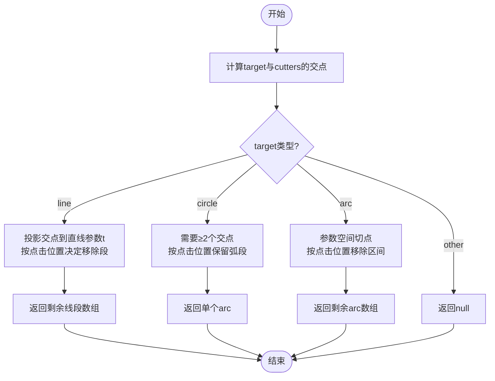
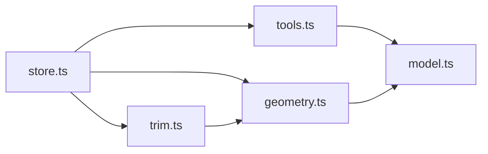

# API参考文档

<cite>
**本文引用的文件**   
- [geometry.ts](file://src/cad/geometry.ts)
- [tools.ts](file://src/cad/tools.ts)
- [store.ts](file://src/features/editor/store.ts)
- [model.ts](file://src/cad/model.ts)
- [trim.ts](file://src/cad/trim.ts)
</cite>

## 目录
1. [引言](#引言)
2. [项目结构](#项目结构)
3. [核心组件](#核心组件)
4. [架构总览](#架构总览)
5. [详细组件分析](#详细组件分析)
6. [依赖关系分析](#依赖关系分析)
7. [性能与复杂度](#性能与复杂度)
8. [错误处理与边界条件](#错误处理与边界条件)
9. [版本兼容性与迁移指南](#版本兼容性与迁移指南)
10. [结论](#结论)

## 引言
本API参考文档面向web-cad项目的开发者，系统性梳理CAD核心几何计算、工具系统以及编辑器状态管理三大模块的公共接口。文档涵盖：
- CAD核心引擎的几何计算API（点、向量、线段、圆、圆弧等）
- 工具系统的注册、提示、实体构建与执行流程
- 状态管理API（store操作方法、状态订阅、Action调用）
- 所有公共接口的参数说明、返回值类型和使用示例
- 错误处理、异常情况和边界条件的处理策略
- 版本兼容性与迁移建议

## 项目结构
本项目采用分层组织方式：
- cad层：几何计算、模型定义、工具逻辑、修剪算法
- features/editor：编辑器状态管理与交互流程
- io/storage：数据持久化与Schema校验（不在本次API范围）
- components/app：UI渲染与交互入口（不在本次API范围）

图表来源
- [geometry.ts:1-443](file://src/cad/geometry.ts#L1-L443)
- [model.ts:1-142](file://src/cad/model.ts#L1-L142)
- [tools.ts:1-126](file://src/cad/tools.ts#L1-L126)
- [trim.ts:1-129](file://src/cad/trim.ts#L1-L129)
- [store.ts:1-324](file://src/features/editor/store.ts#L1-L324)

章节来源
- [geometry.ts:1-443](file://src/cad/geometry.ts#L1-L443)
- [model.ts:1-142](file://src/cad/model.ts#L1-L142)
- [tools.ts:1-126](file://src/cad/tools.ts#L1-L126)
- [trim.ts:1-129](file://src/cad/trim.ts#L1-L129)
- [store.ts:1-324](file://src/features/editor/store.ts#L1-L324)

## 核心组件
本节概述各模块职责与对外暴露的关键能力：
- geometry.ts：提供点、向量、线段、圆、圆弧等几何对象的基础运算、坐标变换、求交、包围盒、吸附等能力
- model.ts：定义Point、Entity、Layer、View、Drawing、Tool等核心类型与工厂函数
- tools.ts：提供工具名称映射、操作提示、根据输入点构建实体的能力
- trim.ts：实现直线、圆、圆弧的修剪算法
- store.ts：基于Zustand的编辑器状态管理，封装视图、工具、选择、历史、变换、放置、修剪等操作

章节来源
- [geometry.ts:1-443](file://src/cad/geometry.ts#L1-L443)
- [model.ts:1-142](file://src/cad/model.ts#L1-L142)
- [tools.ts:1-126](file://src/cad/tools.ts#L1-L126)
- [trim.ts:1-129](file://src/cad/trim.ts#L1-L129)
- [store.ts:1-324](file://src/features/editor/store.ts#L1-L324)

## 架构总览
CAD核心引擎与编辑器通过清晰的接口协作：
- 几何计算为工具与修剪提供基础能力
- 工具系统根据用户输入构建实体
- 编辑器状态管理协调工具执行、实体创建、变换与修剪，并维护历史与视图

图表来源
- [store.ts:187-315](file://src/features/editor/store.ts#L187-L315)
- [tools.ts:49-125](file://src/cad/tools.ts#L49-L125)
- [geometry.ts:253-336](file://src/cad/geometry.ts#L253-L336)
- [trim.ts:21-128](file://src/cad/trim.ts#L21-L128)

## 详细组件分析

### CAD几何计算API（geometry.ts）
几何计算模块提供以下公共能力：
- 点与向量运算：add、sub、mul、dot、cross、distance、angle、normalize、polar
- 坐标变换：screenToWorld、worldToScreen、rotatePoint、transform
- 几何构造与属性：sweep、onArc、arcFromThree、corners、anchors、bounds、segments
- 求交与裁剪：lineIntersection、intersections、mirrorPoint
- 吸附与网格：snap

下表列出主要API的参数与返回类型（以类型描述为主，不展示代码内容）：

| API | 参数 | 返回类型 | 说明 |
| --- | --- | --- | --- |
| add(a, b) | a: Point, b: Point | Point | 向量加法 |
| sub(a, b) | a: Point, b: Point | Point | 向量减法 |
| mul(a, n) | a: Point, n: number | Point | 向量数乘 |
| dot(a, b) | a: Point, b: Point | number | 点积 |
| cross(a, b) | a: Point, b: Point | number | 叉积（二维） |
| distance(a, b) | a: Point, b: Point | number | 欧氏距离 |
| angle(p, center) | p: Point, center: Point | number | 极角（弧度） |
| normalize(n) | n: number | number | 角度归一化到[0, 2π) |
| polar(c, r, t) | c: Point, r: number, t: number | Point | 极坐标转笛卡尔 |
| screenToWorld(p, v, w, h) | p: Point, v: View, w: number, h: number | Point | 屏幕坐标转世界坐标 |
| worldToScreen(p, v, w, h) | p: Point, v: View, w: number, h: number | Point | 世界坐标转屏幕坐标 |
| sweep(e) | e: arc实体 | number | 圆弧扫过角度（带方向） |
| onArc(e, t) | e: arc实体, t: number | boolean | 角度t是否在圆弧范围内 |
| arcFromThree(a, mid, b) | a: Point, mid: Point, b: Point | arc对象或null | 三点确定圆弧 |
| corners(a, b) | a: Point, b: Point | Point[] | 矩形四角点 |
| anchors(e) | e: Entity | Point[] | 实体锚点集合 |
| bounds(e) | e: Entity | {minX,maxX,minY,maxY} | 实体包围盒 |
| snap(p, entities, scale, grid, objects, step, base?, ortho?) | 见下 | {point, snapped} | 吸附到网格/对象/正交 |
| rotatePoint(p, c, t) | p: Point, c: Point, t: number | Point | 绕中心旋转点 |
| transform(e, fn, rotation?, reflected?) | e: Entity, fn: (p)=>Point, rotation?: number, reflected?: boolean | Entity | 对实体进行变换（含旋转/镜像） |
| mirrorPoint(p, a, b) | p: Point, a: Point, b: Point | Point | 关于直线ab对称点 |
| segments(e) | e: Entity | [Point, Point][] | 将实体拆分为线段数组 |
| lineIntersection(a, b, c, d) | a,b,c,d: Point | Point[] | 两线段求交 |
| intersections(a, b) | a,b: Entity | Point[] | 两实体求交（含圆/圆弧） |

使用示例（概念性）：
- 计算两点距离：传入两个Point，返回number
- 屏幕坐标与世界坐标互转：传入View与画布宽高，得到对应坐标系下的Point
- 三点生成圆弧：传入三个Point，返回包含center、radius、start、end、ccw的对象或null（共线时返回null）
- 实体变换：对line、rectangle、polyline、circle、arc、text、dimension分别进行坐标变换；rectangle在旋转或镜像时会转为polyline
- 求交：先拆分实体为线段，再与圆/圆弧求交，过滤掉不在圆弧范围内的结果

边界与异常：
- 三点共线时arcFromThree返回null
- 线段平行或重合时lineIntersection返回空数组
- 半径为0或无效参数时，相关几何构造可能返回空集或退化结果
- 浮点误差通过EPS常量控制判断阈值

章节来源
- [geometry.ts:1-443](file://src/cad/geometry.ts#L1-L443)

#### 几何计算类图（概念映射）

图表来源
- [model.ts:1-45](file://src/cad/model.ts#L1-L45)

### 工具系统API（tools.ts）
工具系统提供：
- toolNames：工具标识到本地化名称的映射
- hint(tool, count)：根据当前工具与已采集点数返回操作提示
- buildEntity(tool, points, layerId, options)：根据工具与输入点构建实体

参数与返回类型：
- toolNames: Record<Tool, string>
- hint(tool: Tool, count: number): string
- buildEntity(tool: Tool, points: Point[], layerId: string, options: { text: string; size: number; mode: 'horizontal' | 'vertical' | 'aligned' }): Entity | null

行为说明：
- 不同工具需要不同数量的点：line/rectangle/circle需2点；arc/dimension需3点；text需1点；polyline可累积多点后finish
- 当输入点不足或无效（如两点重合、矩形边长为0）时返回null
- 文本为空字符串时返回null
- 三点圆弧共线时返回null

使用示例（概念性）：
- 绘制直线：传入起点与终点，返回line实体
- 绘制圆：传入圆心与圆周点，返回circle实体
- 三点圆弧：传入起点、经过点、终点，返回arc实体或null
- 尺寸标注：传入两点与标注位置，返回dimension实体

章节来源
- [tools.ts:1-126](file://src/cad/tools.ts#L1-L126)

#### 工具构建流程图

图表来源
- [tools.ts:49-125](file://src/cad/tools.ts#L49-L125)

### 状态管理API（store.ts）
编辑器状态管理基于Zustand，提供以下状态与方法：

状态字段：
- doc: Drawing | null
- history: Drawing[]
- future: Drawing[]
- revision: number
- selected: string[]
- activeLayer: string
- tool: Tool
- points: Point[]
- grid: boolean
- objects: boolean
- ortho: boolean
- gridStep: number
- cursor: Point
- message: string
- text: string
- textSize: number
- dimensionMode: 'horizontal' | 'vertical' | 'aligned'
- rotation: number

方法签名与语义：
- load(doc: Drawing): void — 加载图纸，重置历史、选择、工具等
- commit(change: (doc: Drawing) => Drawing): void — 提交变更，进行Schema校验并记录历史
- setView(view: View): void — 设置视图（平移/缩放）
- setTool(tool: Tool): void — 切换工具并清空points与message
- undo(): void — 撤销
- redo(): void — 重做
- remove(): void — 删除选中实体
- place(point: Point): void — 放置点（用于工具输入、变换基准点等）
- finish(): void — 完成折线构建
- trim(id: string, point: Point): void — 对目标实体执行修剪
- transformSelection(fn: (e: Entity) => Entity, copy?: boolean): void — 对选中实体应用变换（可选复制）

使用示例（概念性）：
- 切换工具：setTool('line')
- 放置点：place({x,y})，内部根据tool决定累积points或触发变换
- 完成折线：finish()，将points构建为polyline并提交
- 移动/复制/旋转/镜像：通过place两次点，内部调用transformSelection与geometry变换
- 修剪：trim(id, point)，内部调用trim.trimEntity并替换原实体

订阅与响应：
- 外部可通过useEditor订阅状态变化，监听doc、selected、message、revision等字段更新

错误与边界：
- 图层不可编辑（隐藏或锁定）时place/finish会提示并中止
- 未选择可编辑实体时transformSelection会提示
- 镜像轴两点重合时提示“需要两个不同点”
- 修剪无有效交点或目标不是直线/圆/圆弧时提示

章节来源
- [store.ts:17-47](file://src/features/editor/store.ts#L17-L47)
- [store.ts:48-316](file://src/features/editor/store.ts#L48-L316)
- [store.ts:317-323](file://src/features/editor/store.ts#L317-L323)

#### 状态管理序列图（以place为例）

图表来源
- [store.ts:187-286](file://src/features/editor/store.ts#L187-L286)
- [tools.ts:49-125](file://src/cad/tools.ts#L49-L125)
- [geometry.ts:253-336](file://src/cad/geometry.ts#L253-L336)

### 修剪算法API（trim.ts）
trimEntity(target, cutters, click)：
- 输入：target为目标实体；cutters为所有可见切割实体（排除自身）；click为点击位置
- 输出：Entity[] | null
- 支持目标类型：line、circle、arc；其他类型返回null
- 直线：计算与切割实体的交点，投影到直线上参数t，按点击位置决定移除哪一段，返回剩余段
- 圆：需要至少两个交点，按点击位置决定保留的弧段，返回单个arc
- 圆弧：计算参数空间上的切点，按点击位置决定移除区间，返回剩余弧段

边界与异常：
- 无交点或交点数量不足时返回null
- 浮点误差通过EPS与unique去重处理
- 圆弧方向与扫过角度由ccw与sweep决定

章节来源
- [trim.ts:1-129](file://src/cad/trim.ts#L1-L129)

#### 修剪算法流程图

图表来源
- [trim.ts:21-128](file://src/cad/trim.ts#L21-L128)

## 依赖关系分析
模块间依赖如下：
- store.ts依赖geometry.ts、tools.ts、trim.ts、model.ts
- tools.ts依赖geometry.ts、model.ts
- trim.ts依赖geometry.ts、model.ts
- geometry.ts依赖model.ts（类型）

图表来源
- [store.ts:1-15](file://src/features/editor/store.ts#L1-L15)
- [tools.ts:1-3](file://src/cad/tools.ts#L1-L3)
- [trim.ts:1-14](file://src/cad/trim.ts#L1-L14)
- [geometry.ts:1-1](file://src/cad/geometry.ts#L1-L1)

章节来源
- [store.ts:1-15](file://src/features/editor/store.ts#L1-L15)
- [tools.ts:1-3](file://src/cad/tools.ts#L1-L3)
- [trim.ts:1-14](file://src/cad/trim.ts#L1-L14)
- [geometry.ts:1-1](file://src/cad/geometry.ts#L1-L1)

## 性能与复杂度
- 几何求交intersections：对两条实体分别拆分为线段，再逐对求交，时间复杂度O(N*M)，其中N、M分别为两条实体的线段数；圆/圆弧还会增加额外的求交分支
- 修剪trimEntity：先计算所有切割实体与目标的交点，再进行参数空间排序与区间划分，复杂度取决于交点数量
- 吸附snap：遍历所有实体锚点，时间复杂度O(E)，E为实体锚点总数
- 变换transform：对实体属性进行常数时间操作（除rectangle转polyline外），整体O(1)
- 历史栈commit：每次提交保存前一个doc快照，历史长度限制为99条，避免无限增长

优化建议：
- 对大量实体的求交与吸附可考虑空间索引（如四叉树）减少比较次数
- 频繁变换时可批量合并transform以减少中间对象分配
- 对大图形集合的bounds计算可缓存增量更新

[本节为通用性能讨论，不直接分析具体文件]

## 错误处理与边界条件
- 数值精度：使用EPS常量进行浮点比较，避免误判
- 无效输入：
  - 三点共线时arcFromThree返回null
  - 两点重合或矩形边长为0时buildEntity返回null
  - 文本为空时buildEntity返回null
- 图层状态：
  - 图层隐藏或锁定时，place/finish会提示并中止
  - 变换工具在未选择可编辑实体时提示
- 镜像轴：两点重合时提示“需要两个不同点”
- 修剪：
  - 无有效交点或目标类型不支持时返回null
  - 圆需要至少两个交点才能确定保留弧段
- 数据校验：commit中对新doc进行drawingSchema.safeParse校验，失败时设置message提示

章节来源
- [tools.ts:64-125](file://src/cad/tools.ts#L64-L125)
- [store.ts:79-101](file://src/features/editor/store.ts#L79-L101)
- [store.ts:235-286](file://src/features/editor/store.ts#L235-L286)
- [store.ts:287-315](file://src/features/editor/store.ts#L287-L315)
- [trim.ts:29-128](file://src/cad/trim.ts#L29-L128)

## 版本兼容性与迁移指南
- 数据模型版本：Drawing.version固定为1，createDrawing与cloneDrawing均使用该版本
- 向后兼容：
  - 新增字段时应保持默认值与旧数据结构兼容
  - 对Entity联合类型的扩展应确保现有分支不受影响
- 迁移建议：
  - 若升级version，需在load/commit中检测并转换旧格式
  - 对Entity属性的增删应在transform与render路径中同步处理
  - 对Tool枚举的扩展需同步更新toolNames与hint逻辑

章节来源
- [model.ts:51-61](file://src/cad/model.ts#L51-L61)
- [model.ts:82-117](file://src/cad/model.ts#L82-L117)
- [model.ts:118-141](file://src/cad/model.ts#L118-L141)
- [tools.ts:5-19](file://src/cad/tools.ts#L5-L19)

## 结论
本API参考文档系统梳理了web-cad项目的CAD核心几何计算、工具系统与编辑器状态管理三大模块的公共接口与行为。通过明确的参数与返回类型说明、流程图与序列图辅助理解，以及详尽的错误处理与边界条件分析，开发者可以快速集成与扩展功能。建议在后续迭代中关注性能优化（空间索引、批量变换）与版本兼容性（数据模型与工具枚举扩展），以确保系统的稳定性与可维护性。