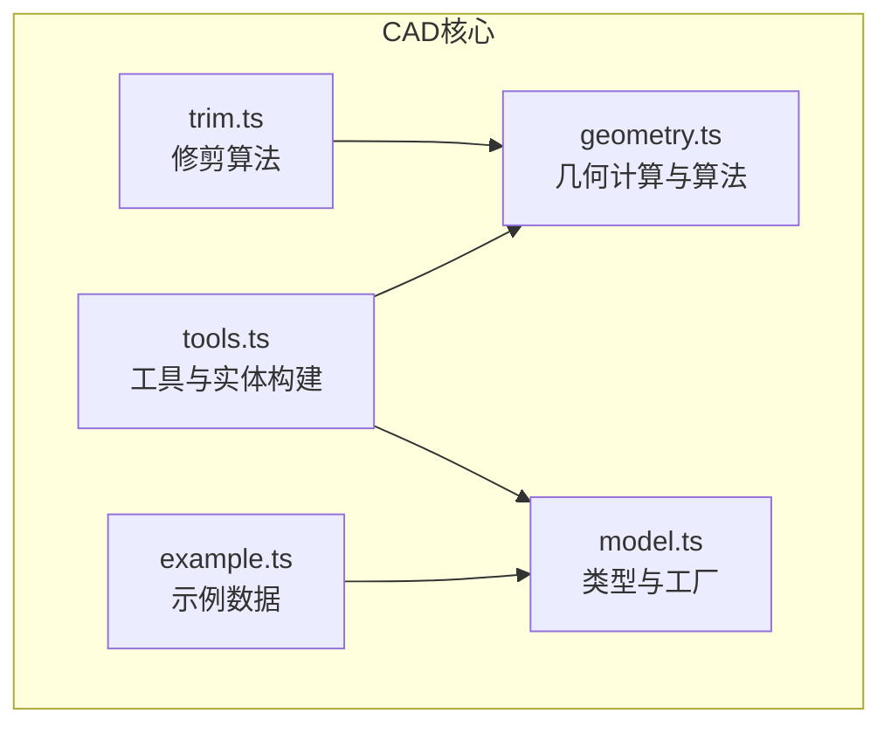
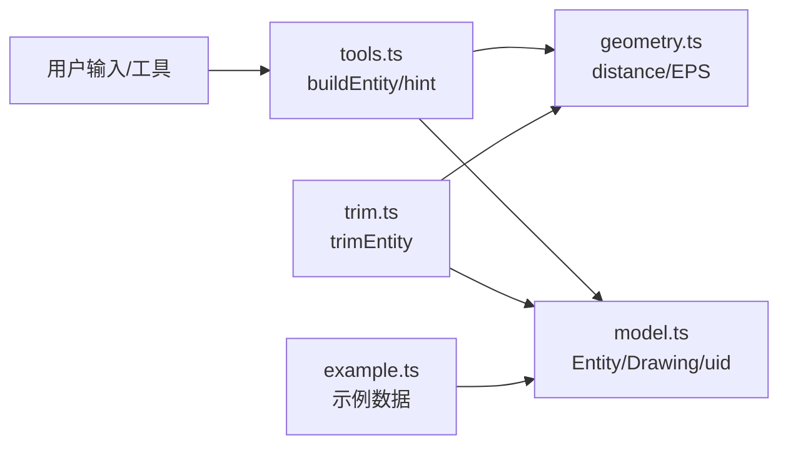
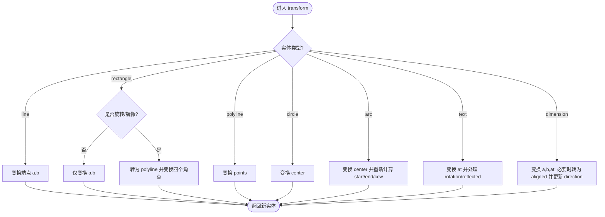
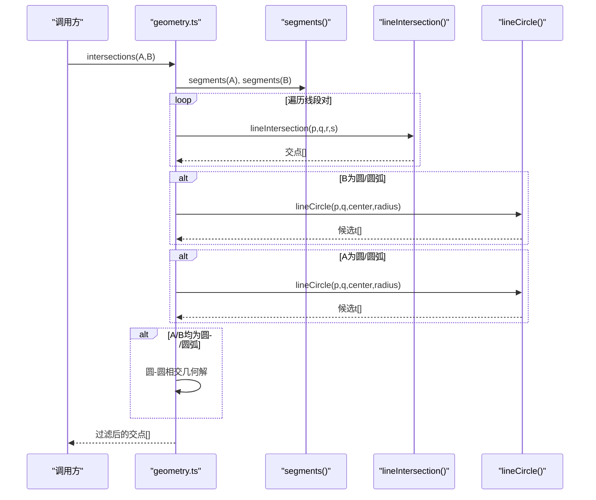
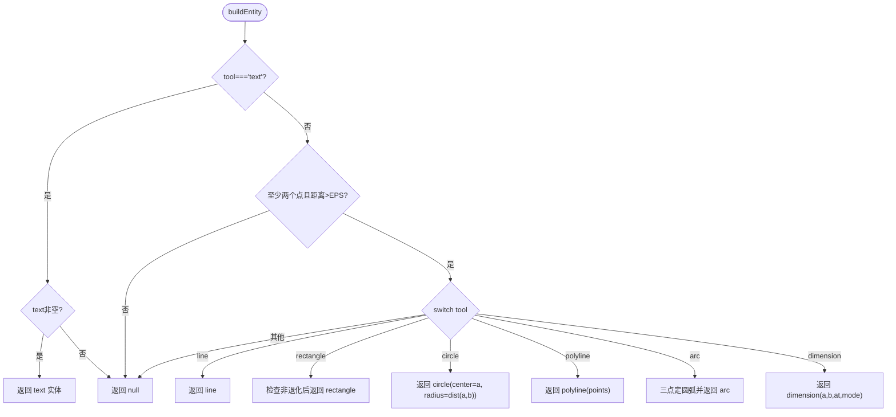
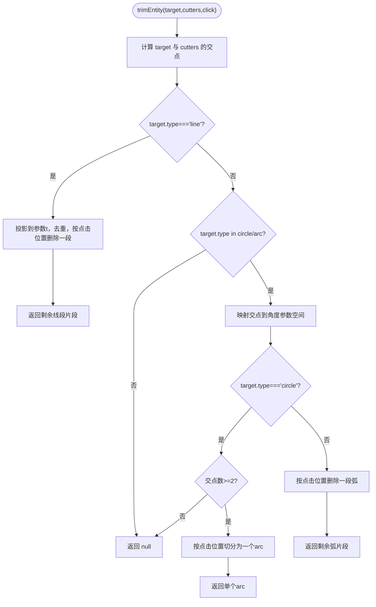
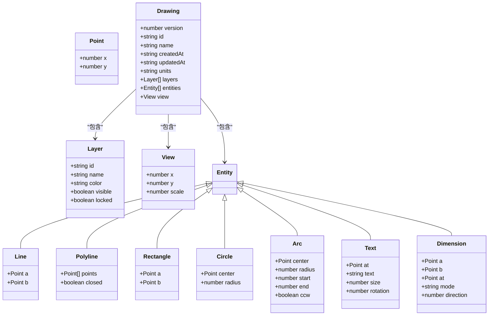
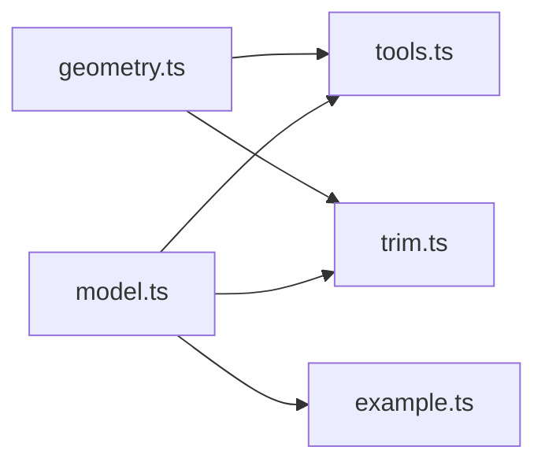

# CAD核心API

<cite>
**本文引用的文件**   
- [geometry.ts](file://src/cad/geometry.ts)
- [model.ts](file://src/cad/model.ts)
- [tools.ts](file://src/cad/tools.ts)
- [trim.ts](file://src/cad/trim.ts)
- [example.ts](file://src/cad/example.ts)
</cite>

## 目录
1. [简介](#简介)
2. [项目结构](#项目结构)
3. [核心组件](#核心组件)
4. [架构总览](#架构总览)
5. [详细组件分析](#详细组件分析)
6. [依赖关系分析](#依赖关系分析)
7. [性能与精度考量](#性能与精度考量)
8. [故障排查指南](#故障排查指南)
9. [结论](#结论)
10. [附录：几何公式与参数校验](#附录几何公式与参数校验)

## 简介
本文件为CAD核心引擎的API文档，聚焦于几何计算、实体类型系统与图纸对象。内容涵盖：
- 基础几何类型 Point、Vector（以Point表示）及其运算方法
- Entity实体类型系统：line、polyline、rectangle、circle、arc、text、dimension
- Drawing图纸对象结构与工厂函数 createDrawing、cloneDrawing
- 坐标变换、距离/角度计算、线段/圆/圆弧相交等核心算法
- 工具构建与修剪逻辑的使用说明

## 项目结构
本项目采用按功能域划分的模块组织方式，核心CAD逻辑集中在 src/cad 目录下：
- geometry.ts：几何数学库与通用算法
- model.ts：数据类型定义与图纸工厂
- tools.ts：工具提示与实体构建
- trim.ts：基于交点的修剪算法
- example.ts：示例数据构造

图表来源
- [geometry.ts:1-443](file://src/cad/geometry.ts#L1-L443)
- [model.ts:1-142](file://src/cad/model.ts#L1-L142)
- [tools.ts:1-126](file://src/cad/tools.ts#L1-L126)
- [trim.ts:1-129](file://src/cad/trim.ts#L1-L129)
- [example.ts:1-102](file://src/cad/example.ts#L1-L102)

章节来源
- [geometry.ts:1-443](file://src/cad/geometry.ts#L1-L443)
- [model.ts:1-142](file://src/cad/model.ts#L1-L142)
- [tools.ts:1-126](file://src/cad/tools.ts#L1-L126)
- [trim.ts:1-129](file://src/cad/trim.ts#L1-L129)
- [example.ts:1-102](file://src/cad/example.ts#L1-L102)

## 核心组件
本节概述核心API的职责边界与调用关系。

- 几何库（geometry.ts）
  - 提供点运算、向量运算、极坐标转换、屏幕/世界坐标互转、弧段扫描角、三点定圆弧、锚点提取、包围盒、吸附、旋转、镜像、线段化、线段/圆/圆弧求交等能力
- 模型与工厂（model.ts）
  - 定义 Point、Entity、View、Layer、Drawing、Tool 等类型
  - 提供 uid、createDrawing、cloneDrawing 工厂函数
- 工具与实体构建（tools.ts）
  - 提供工具名称映射、交互提示、buildEntity 根据工具与点击点生成实体
- 修剪（trim.ts）
  - 基于目标与裁剪边界的交点，对直线或圆/圆弧进行分段修剪

章节来源
- [geometry.ts:1-443](file://src/cad/geometry.ts#L1-L443)
- [model.ts:1-142](file://src/cad/model.ts#L1-L142)
- [tools.ts:1-126](file://src/cad/tools.ts#L1-L126)
- [trim.ts:1-129](file://src/cad/trim.ts#L1-L129)

## 架构总览
下图展示核心模块之间的依赖与数据流向：

图表来源
- [tools.ts:1-126](file://src/cad/tools.ts#L1-L126)
- [model.ts:1-142](file://src/cad/model.ts#L1-L142)
- [geometry.ts:1-443](file://src/cad/geometry.ts#L1-L443)
- [trim.ts:1-129](file://src/cad/trim.ts#L1-L129)
- [example.ts:1-102](file://src/cad/example.ts#L1-L102)

## 详细组件分析

### 基础几何类型与运算（Point/Vector）
- Point 类型：二维坐标 {x, y}
- 常用运算
  - 加减乘：add(a,b)、sub(a,b)、mul(a,n)
  - 点积/叉积：dot(a,b)、cross(a,b)
  - 距离/角度：distance(a,b)、angle(p,center)
  - 归一化角度：normalize(t)
  - 极坐标：polar(c,r,t)
- 复杂度
  - 上述运算均为 O(1)，无额外内存分配

使用建议
- 所有角度均以弧度表示，范围通过 normalize 归一化到 [0, 2π)
- 数值比较建议使用 EPS 容差

章节来源
- [geometry.ts:1-443](file://src/cad/geometry.ts#L1-L443)

### 坐标变换与视图
- 屏幕/世界坐标互转
  - screenToWorld(p, view, w, h)
  - worldToScreen(p, view, w, h)
- 旋转与镜像
  - rotatePoint(p, c, t)
  - mirrorPoint(p, a, b)
- 实体变换
  - transform(entity, fn, rotation=0, reflected=false)
    - 支持 line/polyline/rectangle/circle/arc/text/dimension 的坐标与角度更新
    - rectangle 在带旋转或镜像时退化为 polyline
    - dimension 在变换后可能转为 aligned 模式并更新 direction

图表来源
- [geometry.ts:253-328](file://src/cad/geometry.ts#L253-L328)

章节来源
- [geometry.ts:31-42](file://src/cad/geometry.ts#L31-L42)
- [geometry.ts:246-328](file://src/cad/geometry.ts#L246-L328)

### 实体类型系统（Entity）
- 公共属性（Base）
  - id、layerId、color?、strokeWidth
- 具体类型
  - line：{a, b}
  - polyline：{points[], closed}
  - rectangle：{a, b}
  - circle：{center, radius}
  - arc：{center, radius, start, end, ccw}
  - text：{at, text, size, rotation}
  - dimension：{a, b, at, mode, direction?}

辅助方法
- anchors(e)：返回实体的可吸附关键点集合
- bounds(e)：计算包围盒（考虑文字旋转、标注几何）
- segments(e)：将实体分解为线段数组，便于求交与渲染

章节来源
- [model.ts:18-45](file://src/cad/model.ts#L18-L45)
- [geometry.ts:112-190](file://src/cad/geometry.ts#L112-L190)
- [geometry.ts:337-360](file://src/cad/geometry.ts#L337-L360)

### 几何计算与求交
- 弧段相关
  - sweep(arc)：返回扫掠角（弧度）
  - onArc(arc, t)：判断角度 t 是否在弧段范围内
  - arcFromThree(a, mid, b)：三点确定圆弧（中心、半径、起止角、方向）
- 包围盒与锚点
  - corners(a,b)：矩形两对角点生成的四点
  - dimensionGeometry(d)：计算标注的投影点 p,q、中点、长度、旋转角度
- 吸附
  - snap(p, entities, scale, grid, objects, step, base?, ortho?)：网格/对象/正交吸附
- 线段/圆/圆弧求交
  - lineIntersection(a,b,c,d)：线段与线段求交
  - intersections(a,b)：综合求交（含圆/圆弧），过滤结果落在有效区间内

图表来源
- [geometry.ts:361-442](file://src/cad/geometry.ts#L361-L442)

章节来源
- [geometry.ts:43-72](file://src/cad/geometry.ts#L43-L72)
- [geometry.ts:81-111](file://src/cad/geometry.ts#L81-L111)
- [geometry.ts:191-245](file://src/cad/geometry.ts#L191-L245)
- [geometry.ts:361-442](file://src/cad/geometry.ts#L361-L442)

### 工具与实体构建（tools.ts）
- toolNames：工具名到中文显示名的映射
- hint(tool, count)：根据工具与当前点击次数返回交互提示
- buildEntity(tool, points, layerId, options)：根据工具与点击点序列构建实体
  - 文本：需要非空文本
  - 直线/矩形：两点需满足最小距离与矩形非退化条件
  - 圆：由圆心与圆周点确定半径
  - 折线：直接收集点集
  - 圆弧：三点确定圆弧，失败则返回 null
  - 标注：记录 a,b,at 与 mode

图表来源
- [tools.ts:49-125](file://src/cad/tools.ts#L49-L125)

章节来源
- [tools.ts:1-126](file://src/cad/tools.ts#L1-L126)

### 修剪算法（trim.ts）
- 输入：目标实体 target、裁剪边界 cutters、鼠标点击位置 click
- 输出：修剪后的实体片段列表或 null
- 行为
  - 直线：计算与裁剪边的交点参数 t，按点击位置决定删除哪一段，返回剩余片段
  - 圆/圆弧：将交点映射到角度参数空间，按点击位置决定删除区间；圆需至少两个交点才能分割为圆弧

图表来源
- [trim.ts:21-128](file://src/cad/trim.ts#L21-L128)

章节来源
- [trim.ts:1-129](file://src/cad/trim.ts#L1-L129)

### 图纸对象与工厂（model.ts）
- Drawing 结构
  - version、id、name、createdAt、updatedAt、units、layers、entities、view
- Layer 结构
  - id、name、color、visible、locked
- View 结构
  - x、y、scale
- 工厂函数
  - createDrawing(name?)：创建默认图纸，包含三个初始图层与默认视图
  - cloneDrawing(doc)：深拷贝并刷新ID、图层ID、实体ID与时间戳，追加副本后缀

图表来源
- [model.ts:1-61](file://src/cad/model.ts#L1-L61)

章节来源
- [model.ts:1-142](file://src/cad/model.ts#L1-L142)

### 示例数据（example.ts）
- 提供一组示例实体，包括多段线轮廓、同心圆、小圆阵列、矩形槽、参考轴线、水平/垂直标注与多行文字
- 用于演示不同实体类型的组合与布局

章节来源
- [example.ts:1-102](file://src/cad/example.ts#L1-L102)

## 依赖关系分析
- geometry.ts 被 tools.ts 与 trim.ts 引用，作为底层数学与几何算法库
- tools.ts 依赖 model.ts 的类型与 uid，以及 geometry.ts 的距离与EPS
- trim.ts 依赖 geometry.ts 的几何方法与 model.ts 的 uid
- example.ts 依赖 model.ts 的类型与 uid

图表来源
- [geometry.ts:1-443](file://src/cad/geometry.ts#L1-L443)
- [tools.ts:1-126](file://src/cad/tools.ts#L1-L126)
- [trim.ts:1-129](file://src/cad/trim.ts#L1-L129)
- [model.ts:1-142](file://src/cad/model.ts#L1-L142)
- [example.ts:1-102](file://src/cad/example.ts#L1-L102)

章节来源
- [geometry.ts:1-443](file://src/cad/geometry.ts#L1-L443)
- [tools.ts:1-126](file://src/cad/tools.ts#L1-L126)
- [trim.ts:1-129](file://src/cad/trim.ts#L1-L129)
- [model.ts:1-142](file://src/cad/model.ts#L1-L142)
- [example.ts:1-102](file://src/cad/example.ts#L1-L102)

## 性能与精度考量
- 浮点误差控制
  - 全局常量 EPS=1e-7 用于各类数值比较与区间判定
  - 角度归一化使用 normalize 避免跨 2π 分支问题
- 复杂度
  - 基本几何运算 O(1)
  - 求交 intersections 最坏情况 O(nm)，其中 n,m 分别为两端实体的线段数
  - 修剪 trimEntity 先求交再排序去重，整体复杂度受交点数量影响
- 优化建议
  - 对大量实体的求交/修剪，建议先做包围盒粗筛
  - 频繁使用的中间结果（如投影、法向量）可缓存

[本节为通用指导，不直接分析具体文件]

## 故障排查指南
- 无法创建实体
  - 检查两点距离是否小于 EPS（直线/矩形/圆）
  - 文本为空时 buildEntity 返回 null
  - 三点共线时 arcFromThree 返回 null
- 修剪无效
  - 直线需至少一个有效交点（严格在 (0,1) 区间）
  - 圆需至少两个交点才能分割
  - 点击位置未落入待删除区间时不会改变结果
- 坐标异常
  - 确认 screenToWorld/worldToScreen 的宽高与视图参数一致
  - 注意旋转与镜像对角度与方向的影响

章节来源
- [tools.ts:49-125](file://src/cad/tools.ts#L49-L125)
- [geometry.ts:55-72](file://src/cad/geometry.ts#L55-L72)
- [trim.ts:21-128](file://src/cad/trim.ts#L21-L128)

## 结论
该CAD核心API以简洁的几何原语为基础，构建了完整的实体类型体系与图纸管理。通过统一的坐标变换、求交与修剪能力，支撑了从绘制到编辑的核心工作流。建议在扩展新功能时优先复用 geometry.ts 中的基础运算，并在上层封装业务语义，以保持代码的一致性与可维护性。

[本节为总结性内容，不直接分析具体文件]

## 附录：几何公式与参数校验
- 点与向量
  - 加法/减法/数乘：add/sub/mul
  - 点积 dot(a,b)=ax·bx+ay·by
  - 叉积 cross(a,b)=ax·by−ay·bx
  - 距离 distance(a,b)=√((ax−bx)²+(ay−by)²)
  - 角度 angle(p,center)=atan2(py−cy,px−cx)
  - 极坐标 polar(c,r,t)=(cx+r·cos t, cy+r·sin t)
- 坐标变换
  - screenToWorld/worldToScreen：线性缩放与平移，Y轴翻转
  - rotatePoint：绕中心旋转矩阵
  - mirrorPoint：关于直线 ab 的对称点
- 弧与圆
  - sweep(arc)：ccw ? end-start : start-end（经 normalize）
  - onArc(arc,t)：判断 t 是否在扫掠角范围内（含EPS容差）
  - arcFromThree：利用叉积判别三点共线，求解圆心与半径，计算起止角与方向
- 标注几何
  - dimensionGeometry：根据 mode 计算投影点 p,q、中点、长度与旋转角度
- 求交
  - 线段-线段：参数方程求解，判别式 den=cross(u,v)，若接近0则平行
  - 线段-圆：二次方程判别式 disc，筛选 t∈[0,1]
  - 圆-圆：利用距离 d 与半径关系求解交点
- 参数校验规则
  - 所有涉及“相等”“在区间内”的比较均使用 EPS 容差
  - 角度统一归一化到 [0,2π)
  - 实体构建时对退化情况（零长度、共线）进行防御性处理

章节来源
- [geometry.ts:1-443](file://src/cad/geometry.ts#L1-L443)
- [tools.ts:49-125](file://src/cad/tools.ts#L49-L125)