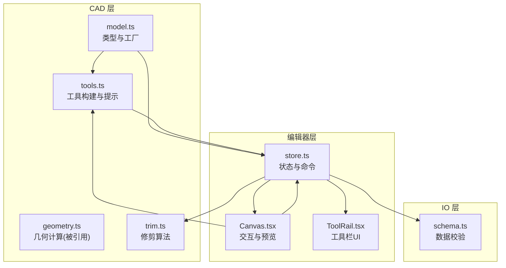
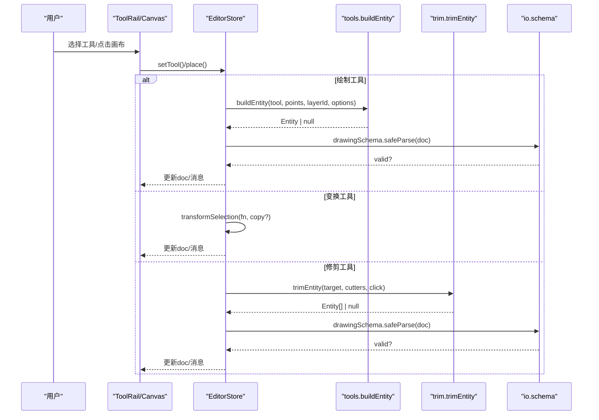
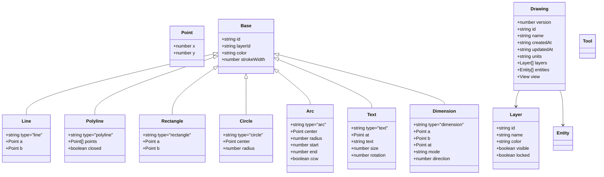
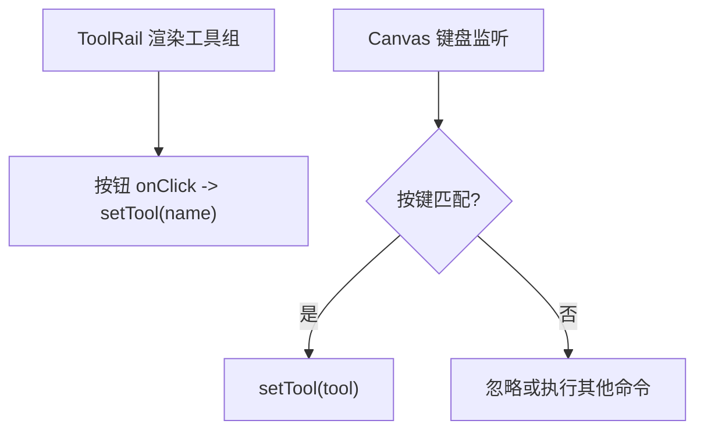
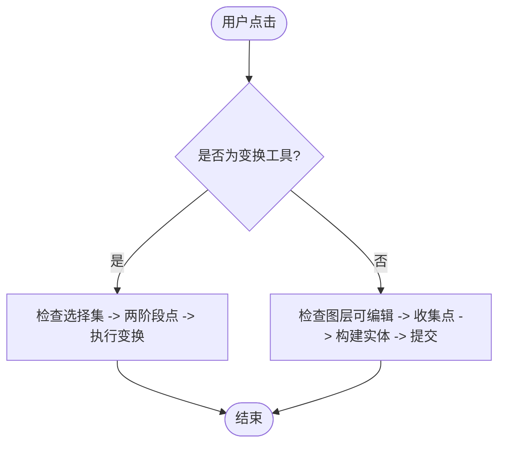
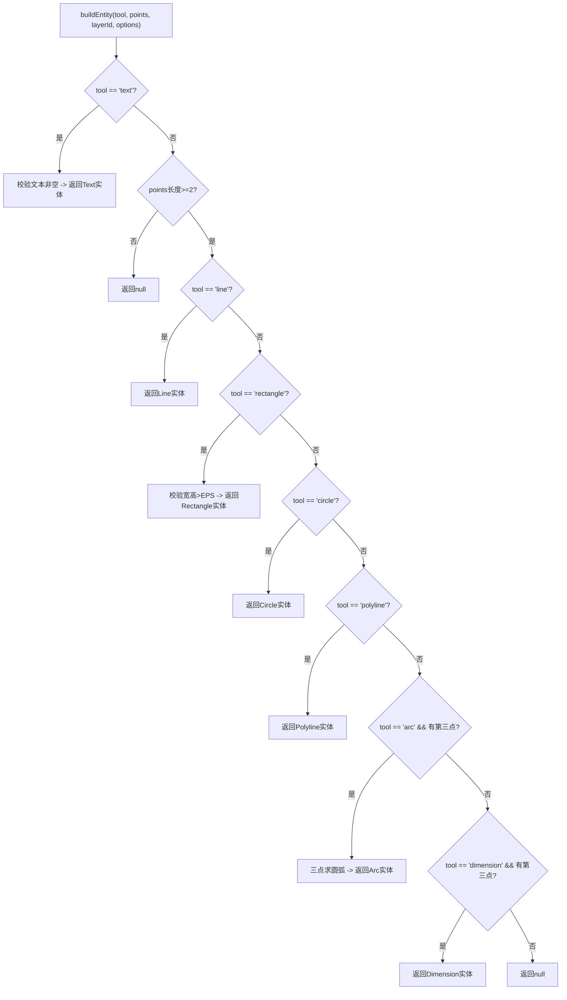
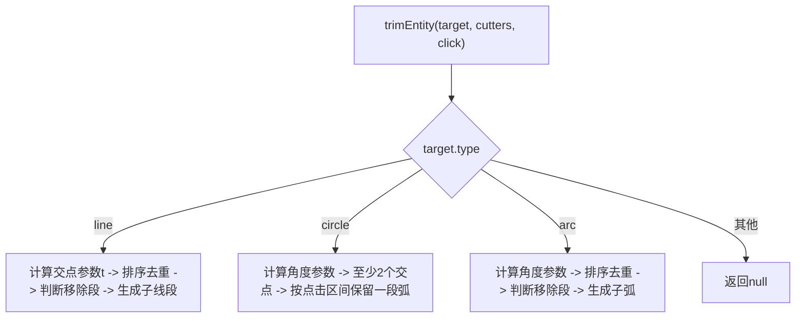
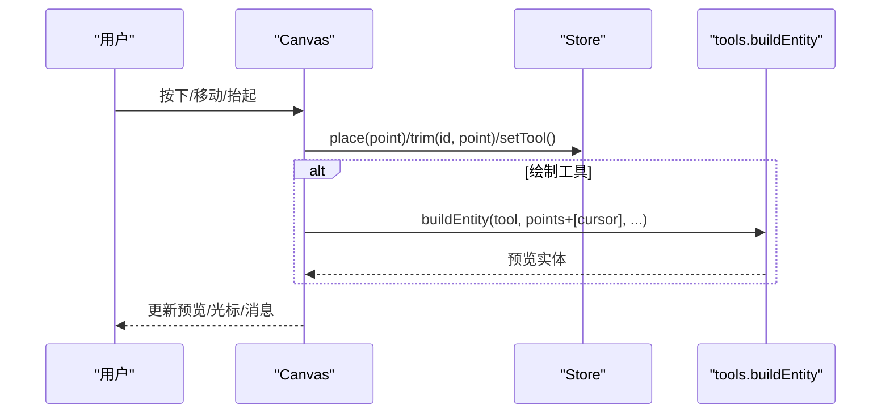
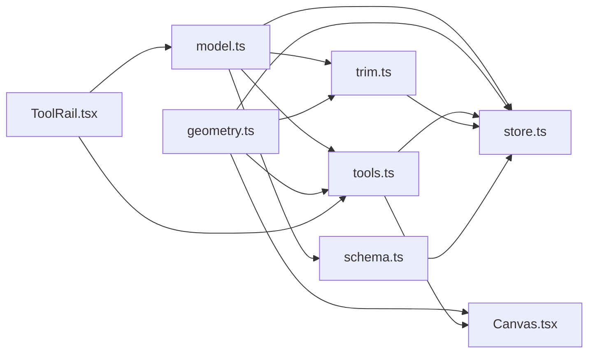

# 工具系统API

<cite>
**本文引用的文件**   
- [src/cad/model.ts](file://src/cad/model.ts)
- [src/cad/tools.ts](file://src/cad/tools.ts)
- [src/features/editor/store.ts](file://src/features/editor/store.ts)
- [src/features/editor/Canvas.tsx](file://src/features/editor/Canvas.tsx)
- [src/features/editor/ToolRail.tsx](file://src/features/editor/ToolRail.tsx)
- [src/cad/trim.ts](file://src/cad/trim.ts)
- [src/io/schema.ts](file://src/io/schema.ts)
</cite>

## 目录
1. [简介](#简介)
2. [项目结构](#项目结构)
3. [核心组件](#核心组件)
4. [架构总览](#架构总览)
5. [详细组件分析](#详细组件分析)
6. [依赖关系分析](#依赖关系分析)
7. [性能与扩展性](#性能与扩展性)
8. [故障排查指南](#故障排查指南)
9. [结论](#结论)
10. [附录：工具使用手册](#附录工具使用手册)

## 简介
本文件为绘图工具系统的完整 API 文档，聚焦于 Tool 类型定义、工具注册机制、执行流程、状态管理、用户交互处理与命令执行逻辑。文档覆盖 select、line、polyline、rectangle、circle、arc、text、dimension、move、copy、rotate、mirror、trim 等工具的接口规范，并提供工具扩展机制与批量操作示例说明。

## 项目结构
- 模型与类型定义位于 CAD 层，统一描述 Entity、Point、Layer、Drawing、Tool 等核心数据结构。
- 工具行为由工具构建函数与提示函数提供，负责将用户点击点序列转换为实体对象。
- 编辑器状态集中管理在 store 中，封装了工具切换、绘制、变换、修剪、撤销重做等命令。
- Canvas 组件负责鼠标/指针事件、拾取、预览、视图控制与键盘快捷键。
- ToolRail 组件负责工具栏 UI 展示与工具选择。
- trim 模块实现几何修剪算法。
- schema 模块对 Drawing/Entity 进行运行时校验，保证数据合法性。

图表来源
- [src/cad/model.ts:1-142](file://src/cad/model.ts#L1-L142)
- [src/cad/tools.ts:1-126](file://src/cad/tools.ts#L1-L126)
- [src/features/editor/store.ts:1-324](file://src/features/editor/store.ts#L1-L324)
- [src/features/editor/Canvas.tsx:1-652](file://src/features/editor/Canvas.tsx#L1-L652)
- [src/features/editor/ToolRail.tsx:1-96](file://src/features/editor/ToolRail.tsx#L1-L96)
- [src/cad/trim.ts:1-129](file://src/cad/trim.ts#L1-L129)
- [src/io/schema.ts:1-65](file://src/io/schema.ts#L1-L65)

章节来源
- [src/cad/model.ts:1-142](file://src/cad/model.ts#L1-L142)
- [src/cad/tools.ts:1-126](file://src/cad/tools.ts#L1-L126)
- [src/features/editor/store.ts:1-324](file://src/features/editor/store.ts#L1-L324)
- [src/features/editor/Canvas.tsx:1-652](file://src/features/editor/Canvas.tsx#L1-L652)
- [src/features/editor/ToolRail.tsx:1-96](file://src/features/editor/ToolRail.tsx#L1-L96)
- [src/cad/trim.ts:1-129](file://src/cad/trim.ts#L1-L129)
- [src/io/schema.ts:1-65](file://src/io/schema.ts#L1-L65)

## 核心组件
- Tool 类型：枚举所有可用工具，包括选择、绘制、注释、修改类工具。
- Entity 联合类型：描述直线、折线、矩形、圆、圆弧、文字、尺寸标注等实体。
- buildEntity：根据当前工具与已采集的点序列构造实体对象。
- hint：根据工具与已采集点数返回用户提示文案。
- EditorState：编辑器全局状态，包含 doc、selected、tool、points、message 等字段与方法。
- Canvas：处理指针事件、键盘快捷键、视图缩放平移、图形预览与选中框选。
- ToolRail：工具栏分组展示与工具切换入口。
- trimEntity：基于可见边界对目标直线/圆/圆弧进行修剪。

章节来源
- [src/cad/model.ts:18-75](file://src/cad/model.ts#L18-L75)
- [src/cad/tools.ts:5-126](file://src/cad/tools.ts#L5-L126)
- [src/features/editor/store.ts:17-47](file://src/features/editor/store.ts#L17-L47)
- [src/features/editor/Canvas.tsx:1-652](file://src/features/editor/Canvas.tsx#L1-L652)
- [src/features/editor/ToolRail.tsx:1-96](file://src/features/editor/ToolRail.tsx#L1-L96)
- [src/cad/trim.ts:21-129](file://src/cad/trim.ts#L21-L129)

## 架构总览
工具系统采用“状态驱动 + 命令式”的架构：
- 工具类型与实体类型集中在 CAD 层，确保类型安全。
- 工具构建逻辑（buildEntity）与提示逻辑（hint）解耦，便于扩展新工具。
- 编辑器状态集中管理，通过 setTool/place/finish/trim/transformSelection 等方法暴露命令。
- Canvas 作为交互入口，将用户输入转化为状态变更；ToolRail 仅负责工具选择。
- 数据变更经 commit 进入历史栈，并通过 schema 校验保证持久化与序列化安全。

图表来源
- [src/features/editor/ToolRail.tsx:59-95](file://src/features/editor/ToolRail.tsx#L59-L95)
- [src/features/editor/Canvas.tsx:196-263](file://src/features/editor/Canvas.tsx#L196-L263)
- [src/features/editor/store.ts:187-315](file://src/features/editor/store.ts#L187-L315)
- [src/cad/tools.ts:49-126](file://src/cad/tools.ts#L49-L126)
- [src/cad/trim.ts:21-129](file://src/cad/trim.ts#L21-L129)
- [src/io/schema.ts:1-65](file://src/io/schema.ts#L1-L65)

## 详细组件分析

### Tool 类型与实体模型
- Tool 类型定义了全部工具标识，用于状态机与渲染分支。
- Entity 联合类型以 type 区分不同几何体，并附带公共属性 id、layerId、strokeWidth 等。
- Layer 与 View 分别描述图层与视图参数。

图表来源
- [src/cad/model.ts:1-75](file://src/cad/model.ts#L1-L75)

章节来源
- [src/cad/model.ts:1-75](file://src/cad/model.ts#L1-L75)

### 工具注册与显示
- toolNames：工具名称映射，供 UI 显示与无障碍标签使用。
- ToolRail：按组展示工具按钮，绑定 setTool 回调，支持快捷键提示。
- Canvas：监听键盘事件，将字母键映射到工具名，快速切换工具。

图表来源
- [src/cad/tools.ts:5-19](file://src/cad/tools.ts#L5-L19)
- [src/features/editor/ToolRail.tsx:21-95](file://src/features/editor/ToolRail.tsx#L21-L95)
- [src/features/editor/Canvas.tsx:94-179](file://src/features/editor/Canvas.tsx#L94-L179)

章节来源
- [src/cad/tools.ts:5-19](file://src/cad/tools.ts#L5-L19)
- [src/features/editor/ToolRail.tsx:21-95](file://src/features/editor/ToolRail.tsx#L21-L95)
- [src/features/editor/Canvas.tsx:94-179](file://src/features/editor/Canvas.tsx#L94-L179)

### 工具执行流程与状态管理
- 状态字段：
  - tool：当前激活工具
  - points：绘制过程中累积的点序列
  - selected：已选实体 ID 列表
  - message：用户反馈消息
  - text/textSize/dimensionMode/rotation：工具相关配置
- 关键方法：
  - setTool：切换工具并清空临时状态
  - place：根据工具与 points 长度决定继续收集点或创建实体
  - finish：完成多段绘制（如折线）
  - trim：对目标实体执行修剪
  - transformSelection：对选中实体应用变换（移动/复制/旋转/镜像）
  - commit：提交变更，写入历史栈并进行 schema 校验

图表来源
- [src/features/editor/store.ts:187-315](file://src/features/editor/store.ts#L187-L315)

章节来源
- [src/features/editor/store.ts:17-47](file://src/features/editor/store.ts#L17-L47)
- [src/features/editor/store.ts:187-315](file://src/features/editor/store.ts#L187-L315)

### 工具构建与提示
- buildEntity：
  - 接收 tool、points、layerId、options（text、size、mode）。
  - 根据工具类型生成对应 Entity，若参数不合法返回 null。
  - 特殊处理：
    - text：需要非空文本内容
    - rectangle：要求两点横纵坐标差异均大于阈值
    - circle：半径为两点距离
    - polyline：直接保存点序列
    - arc：三点确定圆弧
    - dimension：记录两端点与标注位置及模式
- hint：
  - 根据工具与已采集点数返回引导文案，提升用户体验。

图表来源
- [src/cad/tools.ts:49-126](file://src/cad/tools.ts#L49-L126)

章节来源
- [src/cad/tools.ts:49-126](file://src/cad/tools.ts#L49-L126)

### 修剪工具
- trimEntity：
  - 输入：目标实体、裁剪边界集合、点击位置。
  - 输出：修剪后的实体数组或 null。
  - 支持：
    - line：按交点切分，依据点击位置决定移除区段。
    - circle：至少两个交点，按点击区间保留一段弧。
    - arc：按角度参数切分，依据点击位置决定移除区段。
- 存储层调用 trim：
  - 过滤可见图层实体作为边界。
  - 失败时设置消息提示。
  - 成功则替换原实体为修剪结果。

图表来源
- [src/cad/trim.ts:21-129](file://src/cad/trim.ts#L21-L129)

章节来源
- [src/cad/trim.ts:21-129](file://src/cad/trim.ts#L21-L129)

### 用户交互与预览
- Canvas：
  - 指针按下：
    - 右键忽略
    - 中键或空格拖拽平移
    - trim 工具：直接调用 store.trim
    - 非 select 工具：调用 store.place
    - select 工具：单选/多选/框选
  - 指针移动：更新光标、吸附、预览
  - 指针抬起：拖拽移动选中实体、框选完成
  - 键盘：
    - Ctrl/Cmd+Z/Y：撤销/重做
    - Ctrl/Cmd+A：全选
    - Esc：取消工具/清空选择
    - Delete/Backspace：删除选中
    - Enter：完成多段绘制
    - 字母键：快捷切换工具
  - 预览：
    - 绘制工具：实时预览即将创建的实体
    - move/copy/mirror：预览变换结果
    - rotate：预览旋转结果

图表来源
- [src/features/editor/Canvas.tsx:196-390](file://src/features/editor/Canvas.tsx#L196-L390)
- [src/features/editor/store.ts:187-315](file://src/features/editor/store.ts#L187-L315)
- [src/cad/tools.ts:49-126](file://src/cad/tools.ts#L49-L126)

章节来源
- [src/features/editor/Canvas.tsx:196-390](file://src/features/editor/Canvas.tsx#L196-L390)
- [src/features/editor/store.ts:187-315](file://src/features/editor/store.ts#L187-L315)

## 依赖关系分析
- model.ts 提供基础类型与工厂函数，被 tools.ts、store.ts、trim.ts、schema.ts 引用。
- tools.ts 依赖 geometry.ts 的几何函数与 model.ts 的 uid。
- store.ts 依赖 geometry.ts、tools.ts、trim.ts、schema.ts。
- Canvas.tsx 依赖 geometry.ts、tools.ts、store.ts。
- ToolRail.tsx 依赖 model.ts 的 Tool 类型与 tools.ts 的 toolNames。
- trim.ts 依赖 geometry.ts 与 model.ts。
- schema.ts 依赖 model.ts 的 cloneDrawing 与 zod 校验规则。

图表来源
- [src/cad/model.ts:1-142](file://src/cad/model.ts#L1-L142)
- [src/cad/tools.ts:1-126](file://src/cad/tools.ts#L1-L126)
- [src/features/editor/store.ts:1-324](file://src/features/editor/store.ts#L1-L324)
- [src/features/editor/Canvas.tsx:1-652](file://src/features/editor/Canvas.tsx#L1-L652)
- [src/features/editor/ToolRail.tsx:1-96](file://src/features/editor/ToolRail.tsx#L1-L96)
- [src/cad/trim.ts:1-129](file://src/cad/trim.ts#L1-L129)
- [src/io/schema.ts:1-65](file://src/io/schema.ts#L1-L65)

章节来源
- [src/cad/model.ts:1-142](file://src/cad/model.ts#L1-L142)
- [src/cad/tools.ts:1-126](file://src/cad/tools.ts#L1-L126)
- [src/features/editor/store.ts:1-324](file://src/features/editor/store.ts#L1-L324)
- [src/features/editor/Canvas.tsx:1-652](file://src/features/editor/Canvas.tsx#L1-L652)
- [src/features/editor/ToolRail.tsx:1-96](file://src/features/editor/ToolRail.tsx#L1-L96)
- [src/cad/trim.ts:1-129](file://src/cad/trim.ts#L1-L129)
- [src/io/schema.ts:1-65](file://src/io/schema.ts#L1-L65)

## 性能与扩展性
- 性能要点：
  - 预览仅在 points 非空时计算，避免无谓开销。
  - 变换操作通过 transform 函数对实体顶点进行映射，复杂度与实体顶点数线性相关。
  - 修剪算法对每个目标实体与所有裁剪边界求交，复杂度 O(N*M)，建议合理组织图层与减少无关边界。
  - 历史栈限制最近 99 条，避免内存无限增长。
- 扩展性建议：
  - 新增工具需扩展 Tool 类型与 Entity 联合类型。
  - 在 tools.ts 中补充 buildEntity 分支与 hint 文案。
  - 在 store.ts 的 place/finish 中适配新工具的点计数与构建逻辑。
  - 如需自定义交互，可在 Canvas 中增加分支处理。
  - 在 schema.ts 中为新实体添加校验规则，确保数据一致性。

[本节为通用指导，不直接分析具体文件]

## 故障排查指南
- 无法创建实体：
  - 检查当前图层是否可见且未锁定。
  - 检查点的数量与有效性（例如 rectangle 需要有效宽高）。
  - 查看 message 提示，常见为“无法构建图形：请检查点的位置或文字内容”。
- 修剪无效：
  - 确认目标为直线、圆或圆弧。
  - 确保存在可见边界与有效交点。
  - 查看 message 提示，常见为“没有有效交点，或目标不是直线、圆、圆弧”。
- 变换失败：
  - 确保已选择未锁定的图形。
  - 镜像轴需要两个不同点。
  - 查看 message 提示，常见为“请先选择未锁定的图形”或“镜像轴需要两个不同点”。
- 数据校验失败：
  - commit 会调用 drawingSchema.safeParse，若数值越界或实体数量超限，将设置 message 提示。

章节来源
- [src/features/editor/store.ts:187-315](file://src/features/editor/store.ts#L187-L315)
- [src/io/schema.ts:1-65](file://src/io/schema.ts#L1-L65)

## 结论
该工具系统以清晰的类型定义与解耦的工具构建逻辑为基础，通过集中化的编辑器状态管理统一的交互与命令执行流程。Canvas 与 ToolRail 分别承担交互与 UI 职责，trim 模块提供几何修剪能力，schema 保障数据完整性。整体架构易于扩展与维护，适合进一步扩展更多工具类型与复杂交互场景。

[本节为总结性内容，不直接分析具体文件]

## 附录：工具使用手册

### 工具概览与交互要点
- select：点击选择单个对象，Shift 多选，空白处拖动框选。
- line：点击起点与终点。
- polyline：依次点击多点，Enter 完成。
- rectangle：点击对角两点，要求有效宽高。
- circle：点击圆心与圆周点（或输入半径）。
- arc：三点确定圆弧（起点、经过点、终点）。
- text：点击插入位置，需在属性面板输入文本。
- dimension：点击两个测量点与标注位置，可选择水平/垂直/对齐模式。
- move：先选择对象，再点击基准点与目标点。
- copy：同 move，但生成副本。
- rotate：先选择对象，再点击旋转中心，属性面板输入角度。
- mirror：先选择对象，再点击镜像轴起点与第二点。
- trim：点击目标上需要移除的区段，可见图形作为修剪边界。

章节来源
- [src/cad/tools.ts:20-48](file://src/cad/tools.ts#L20-L48)
- [src/features/editor/Canvas.tsx:196-390](file://src/features/editor/Canvas.tsx#L196-L390)
- [src/features/editor/store.ts:187-315](file://src/features/editor/store.ts#L187-L315)

### 工具 API 参考

#### Tool 类型
- 类型定义：select、line、polyline、rectangle、circle、arc、text、dimension、move、copy、rotate、mirror、trim。
- 用途：编辑器状态中的当前工具标识，用于分支处理与 UI 显示。

章节来源
- [src/cad/model.ts:62-75](file://src/cad/model.ts#L62-L75)

#### buildEntity
- 签名：buildEntity(tool: Tool, points: Point[], layerId: string, options: { text: string; size: number; mode: 'horizontal' | 'vertical' | 'aligned' }): Entity | null
- 行为：
  - 根据 tool 与 points 构造对应实体。
  - 参数不合法时返回 null。
  - 支持 text、line、rectangle、circle、polyline、arc、dimension。
- 返回值：实体对象或 null。

章节来源
- [src/cad/tools.ts:49-126](file://src/cad/tools.ts#L49-L126)

#### hint
- 签名：hint(tool: Tool, count: number): string
- 行为：根据工具与已采集点数返回用户提示文案。

章节来源
- [src/cad/tools.ts:20-48](file://src/cad/tools.ts#L20-L48)

#### EditorStore 方法
- setTool(tool: Tool): void
  - 切换工具，清空 points 与 message。
- place(point: Point): void
  - 根据工具与 points 长度决定是否继续收集点或创建实体。
- finish(): void
  - 完成多段绘制（如 polyline）。
- trim(id: string, point: Point): void
  - 对指定实体执行修剪。
- transformSelection(fn: (e: Entity) => Entity, copy?: boolean): void
  - 对选中实体应用变换，可选复制。
- commit(change: (doc: Drawing) => Drawing): void
  - 提交变更，写入历史栈并进行 schema 校验。

章节来源
- [src/features/editor/store.ts:17-47](file://src/features/editor/store.ts#L17-L47)
- [src/features/editor/store.ts:187-315](file://src/features/editor/store.ts#L187-L315)

### 工具扩展机制
- 步骤：
  1. 在 model.ts 中扩展 Tool 类型与 Entity 联合类型。
  2. 在 tools.ts 中：
     - 扩展 toolNames 映射。
     - 在 hint 中添加新工具提示。
     - 在 buildEntity 中添加新工具构建逻辑。
  3. 在 store.ts 中：
     - 在 place/finish 中适配新工具的点计数与构建逻辑。
     - 如需特殊交互，扩展相应分支。
  4. 在 Canvas.tsx 中：
     - 如需自定义交互或预览，增加分支处理。
  5. 在 schema.ts 中：
     - 为新实体添加 zod 校验规则。
- 注意事项：
  - 保持类型一致性与数据校验完整性。
  - 为新工具提供清晰的用户提示与错误信息。
  - 谨慎处理几何计算与边界条件，避免异常实体。

章节来源
- [src/cad/model.ts:18-75](file://src/cad/model.ts#L18-L75)
- [src/cad/tools.ts:5-126](file://src/cad/tools.ts#L5-L126)
- [src/features/editor/store.ts:187-315](file://src/features/editor/store.ts#L187-L315)
- [src/features/editor/Canvas.tsx:196-390](file://src/features/editor/Canvas.tsx#L196-L390)
- [src/io/schema.ts:1-65](file://src/io/schema.ts#L1-L65)

### 链式调用与批量操作示例
- 链式调用：
  - 通过多次调用 store.place 累积点，再调用 store.finish 完成绘制（适用于 polyline）。
  - 通过 store.transformSelection 连续应用多个变换函数（例如先平移后旋转），注意每次调用都会提交变更。
- 批量操作：
  - 使用 store.selected 维护选中集合，配合 transformSelection 对多个实体同时变换。
  - 使用框选（Canvas 中 box 手势）批量选择对象，再进行移动/复制/旋转/镜像。
- 示例路径：
  - 绘制折线：[src/features/editor/store.ts:246-286](file://src/features/editor/store.ts#L246-L286)
  - 批量变换：[src/features/editor/store.ts:160-186](file://src/features/editor/store.ts#L160-L186)
  - 框选选择：[src/features/editor/Canvas.tsx:298-328](file://src/features/editor/Canvas.tsx#L298-L328)

章节来源
- [src/features/editor/store.ts:160-186](file://src/features/editor/store.ts#L160-L186)
- [src/features/editor/store.ts:246-286](file://src/features/editor/store.ts#L246-L286)
- [src/features/editor/Canvas.tsx:298-328](file://src/features/editor/Canvas.tsx#L298-L328)