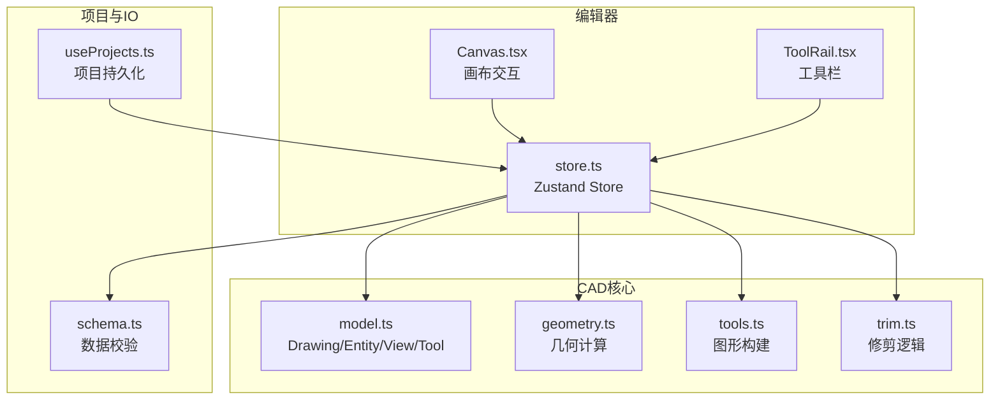
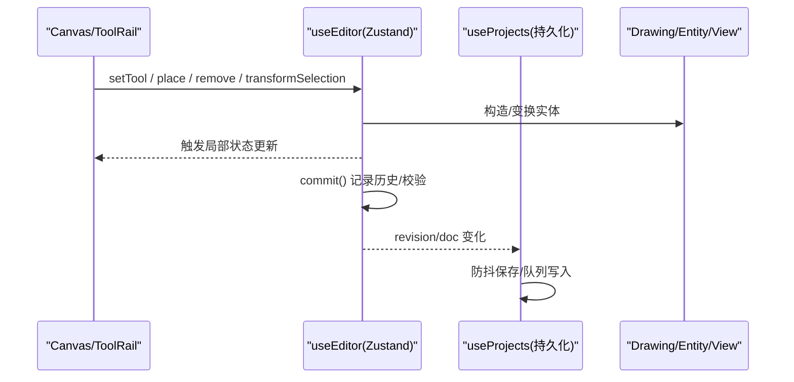
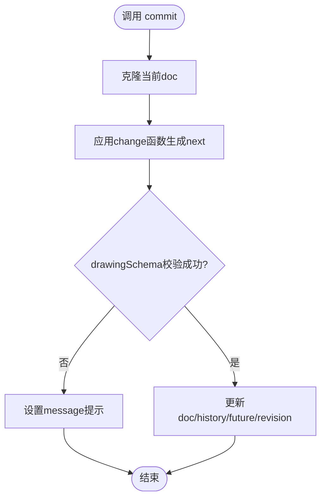
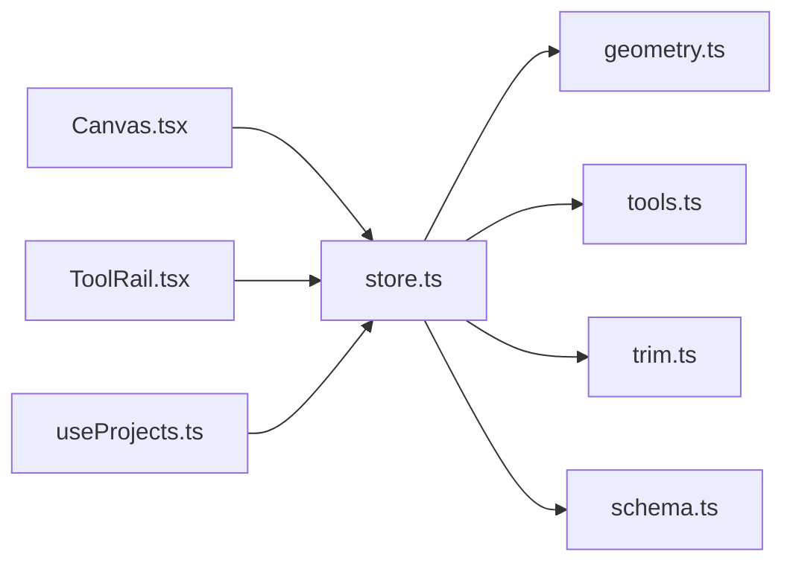

# 状态管理API

<cite>
**本文引用的文件**   
- [src/features/editor/store.ts](file://src/features/editor/store.ts)
- [src/cad/model.ts](file://src/cad/model.ts)
- [src/features/editor/Canvas.tsx](file://src/features/editor/Canvas.tsx)
- [src/features/editor/ToolRail.tsx](file://src/features/editor/ToolRail.tsx)
- [src/features/projects/useProjects.ts](file://src/features/projects/useProjects.ts)
- [src/io/schema.ts](file://src/io/schema.ts)
</cite>

## 目录
1. [简介](#简介)
2. [项目结构](#项目结构)
3. [核心组件](#核心组件)
4. [架构总览](#架构总览)
5. [详细组件分析](#详细组件分析)
6. [依赖关系分析](#依赖关系分析)
7. [性能与优化](#性能与优化)
8. [错误处理与验证](#错误处理与验证)
9. [持久化、撤销重做与示例](#持久化撤销重做与示例)
10. [React集成与Hooks用法](#react集成与hooks用法)
11. [结论](#结论)

## 简介
本文件为基于 Zustand 的编辑器状态管理 API 文档。重点说明：
- Store 的整体架构与状态结构设计，包括 editorState、commands 等核心字段
- Action 方法的签名、参数与返回值
- 状态订阅机制与响应式更新原理
- 状态持久化、撤销重做的实现方式与使用建议
- 错误处理、状态校验与性能优化最佳实践
- 与 React 组件的集成方式和 Hooks 使用方法

## 项目结构
本项目采用“功能域 + 工具库”的组织方式：
- cad：几何、模型定义、工具函数
- features/editor：编辑器 UI 与 Zustand store
- features/projects：项目列表与持久化
- io：导入导出与数据校验
- components：通用 UI 组件

图表来源
- [src/features/editor/store.ts:1-47](file://src/features/editor/store.ts#L1-L47)
- [src/cad/model.ts:1-75](file://src/cad/model.ts#L1-L75)
- [src/features/editor/Canvas.tsx:1-22](file://src/features/editor/Canvas.tsx#L1-L22)
- [src/features/editor/ToolRail.tsx:1-19](file://src/features/editor/ToolRail.tsx#L1-L19)
- [src/features/projects/useProjects.ts:15-26](file://src/features/projects/useProjects.ts#L15-L26)
- [src/io/schema.ts:1-200](file://src/io/schema.ts#L1-L200)

章节来源
- [src/features/editor/store.ts:1-47](file://src/features/editor/store.ts#L1-L47)
- [src/cad/model.ts:1-75](file://src/cad/model.ts#L1-L75)

## 核心组件
- EditorStore（Zustand）：集中维护绘图文档、视图、工具、选择集、历史栈等状态，并提供编辑命令
- Drawing/Entity/View/Tool：CAD 领域模型，描述图纸、图层、实体、视图与工具类型
- Canvas：画布交互层，将鼠标/键盘事件转换为 Store 动作
- ToolRail：工具栏，通过 useEditor 订阅并切换工具
- useProjects：项目持久化层，监听 doc 与 revision 变化，自动保存/加载

章节来源
- [src/features/editor/store.ts:17-47](file://src/features/editor/store.ts#L17-L47)
- [src/cad/model.ts:1-75](file://src/cad/model.ts#L1-L75)
- [src/features/editor/Canvas.tsx:32-43](file://src/features/editor/Canvas.tsx#L32-L43)
- [src/features/editor/ToolRail.tsx:59-62](file://src/features/editor/ToolRail.tsx#L59-L62)
- [src/features/projects/useProjects.ts:15-26](file://src/features/projects/useProjects.ts#L15-L26)

## 架构总览
Zustand Store 作为单一可信源，提供读写接口；UI 组件通过 hooks 订阅局部状态；业务逻辑在 store 内以纯函数形式组合几何与工具库；持久化层在外部监听状态变更进行异步写入。

图表来源
- [src/features/editor/store.ts:79-101](file://src/features/editor/store.ts#L79-L101)
- [src/features/editor/Canvas.tsx:116-148](file://src/features/editor/Canvas.tsx#L116-L148)
- [src/features/projects/useProjects.ts:117-125](file://src/features/projects/useProjects.ts#L117-L125)

## 详细组件分析

### Store 状态结构与命令
- 状态字段
  - doc: 当前绘图对象，包含 layers/entities/view 等
  - history/future: 撤销/重做历史栈
  - revision: 版本号，用于触发持久化
  - selected: 选中实体ID数组
  - activeLayer: 当前活动图层
  - tool: 当前工具
  - points: 多段点输入缓冲
  - grid/objects/ortho/gridStep: 网格与吸附设置
  - cursor: 光标世界坐标
  - message/text/textSize/dimensionMode/rotation: 工具提示与文本/标注/旋转参数
- 命令方法
  - load(doc): 载入新图纸，重置历史与选择
  - commit(change): 不可变更新，校验后入栈历史
  - setView(view): 更新视图平移缩放
  - setTool(tool): 切换工具，清空临时点与消息
  - undo/redo: 撤销/重做，维护历史栈与活跃图层
  - remove(): 删除选中可编辑实体
  - place(point): 根据工具创建或累积点
  - finish(): 完成折线绘制
  - trim(id, point): 按点击位置裁剪目标实体
  - transformSelection(fn, copy?): 对选中集合执行变换或复制

图表来源
- [src/features/editor/store.ts:79-101](file://src/features/editor/store.ts#L79-L101)

章节来源
- [src/features/editor/store.ts:17-47](file://src/features/editor/store.ts#L17-L47)
- [src/features/editor/store.ts:67-111](file://src/features/editor/store.ts#L67-L111)
- [src/features/editor/store.ts:112-186](file://src/features/editor/store.ts#L112-L186)
- [src/features/editor/store.ts:187-315](file://src/features/editor/store.ts#L187-L315)

### CAD 领域模型
- Point/Layer/Entity/View/Drawing/Tool：统一描述二维绘图的核心概念
- uid/createDrawing/cloneDrawing：ID生成、默认图纸与副本创建

章节来源
- [src/cad/model.ts:1-75](file://src/cad/model.ts#L1-L75)
- [src/cad/model.ts:76-141](file://src/cad/model.ts#L76-L141)

### 画布交互与状态联动
- 滚轮缩放：读取 useEditor.getState().doc.view，计算新缩放与中心，调用 setView
- 键盘快捷键：Ctrl/Cmd+Z/Y 触发 undo/redo；Delete/Backspace 触发 remove；Enter 触发 finish；字母键切换工具
- 指针事件：拖拽移动、框选、工具绘制、修剪等，最终都通过 store 的方法更新状态

章节来源
- [src/features/editor/Canvas.tsx:62-93](file://src/features/editor/Canvas.tsx#L62-L93)
- [src/features/editor/Canvas.tsx:94-179](file://src/features/editor/Canvas.tsx#L94-L179)
- [src/features/editor/Canvas.tsx:196-328](file://src/features/editor/Canvas.tsx#L196-L328)

### 工具栏与工具切换
- 通过 useEditor(s => s.tool) 订阅当前工具
- 点击按钮调用 setTool(name) 切换工具

章节来源
- [src/features/editor/ToolRail.tsx:59-79](file://src/features/editor/ToolRail.tsx#L59-L79)

### 项目持久化与自动保存
- 监听 doc 与 revision 变化，防抖写入 IndexedDB 或内存缓存
- 初始化时从数据库恢复最近项目，失败则进入临时编辑模式
- 页面关闭/失焦前强制 flush

章节来源
- [src/features/projects/useProjects.ts:15-26](file://src/features/projects/useProjects.ts#L15-L26)
- [src/features/projects/useProjects.ts:74-116](file://src/features/projects/useProjects.ts#L74-L116)
- [src/features/projects/useProjects.ts:117-143](file://src/features/projects/useProjects.ts#L117-L143)

## 依赖关系分析
- Store 依赖 geometry/tools/trim 进行几何运算与实体构建
- Store 依赖 schema 进行数据校验
- Canvas/ToolRail 依赖 useEditor 订阅状态
- useProjects 依赖 useEditor 的状态变化进行持久化

图表来源
- [src/features/editor/store.ts:1-15](file://src/features/editor/store.ts#L1-L15)
- [src/features/editor/Canvas.tsx:1-22](file://src/features/editor/Canvas.tsx#L1-L22)
- [src/features/editor/ToolRail.tsx:1-19](file://src/features/editor/ToolRail.tsx#L1-L19)
- [src/features/projects/useProjects.ts:15-26](file://src/features/projects/useProjects.ts#L15-L26)

## 性能与优化
- 不可变更新：commit 使用 structuredClone 与 spread，避免共享引用导致的意外修改
- 历史栈限制：history.slice(-99) 保留最近99条历史，防止无限增长
- 选择性订阅：组件通过 useEditor(s => s.xxx) 仅订阅所需字段，减少重渲染
- 防抖持久化：useProjects 使用定时器与队列合并写入，降低频繁IO开销
- 几何计算外置：复杂几何运算放在 geometry/tools/trim，保持 store 简洁

章节来源
- [src/features/editor/store.ts:79-101](file://src/features/editor/store.ts#L79-L101)
- [src/features/projects/useProjects.ts:117-125](file://src/features/projects/useProjects.ts#L117-L125)

## 错误处理与验证
- 数据校验：commit 中通过 drawingSchema.safeParse 校验 next 结构，失败时设置 message 提示
- 图层保护：新建/删除/变换前检查图层可见性与锁定状态，必要时返回或提示
- 工具约束：如镜像需要两个不同点、折线至少两点等，不满足条件时给出 message
- 持久化异常：useProjects 捕获数据库异常，切换到临时编辑模式并提示用户导出备份

章节来源
- [src/features/editor/store.ts:79-101](file://src/features/editor/store.ts#L79-L101)
- [src/features/editor/store.ts:235-239](file://src/features/editor/store.ts#L235-L239)
- [src/features/editor/store.ts:212-215](file://src/features/editor/store.ts#L212-L215)
- [src/features/projects/useProjects.ts:62-72](file://src/features/projects/useProjects.ts#L62-L72)

## 持久化、撤销重做与示例

### 状态持久化
- 自动保存：useProjects 监听 doc 与 revision，防抖写入 IndexedDB 或内存
- 手动刷新：flush 立即写入一次
- 打开/新建/复制/删除/导入/备份：封装常用项目操作，内部会先 flush 再写库

章节来源
- [src/features/projects/useProjects.ts:39-73](file://src/features/projects/useProjects.ts#L39-L73)
- [src/features/projects/useProjects.ts:144-191](file://src/features/projects/useProjects.ts#L144-L191)

### 撤销重做
- 入口：undo/redo
- 触发方式：
  - 键盘：Ctrl/Cmd+Z 撤销，Shift+Ctrl/Cmd+Z 或 Ctrl/Cmd+Y 重做
  - 菜单/按钮：直接调用 store 方法
- 行为：
  - 撤销：将 history 末尾恢复到 doc，同时把当前 doc 推入 future
  - 重做：将 future[0] 恢复到 doc，同时把当前 doc 推入 history
  - 清理：撤销/重做后清空 selected 与 points，并根据历史中的图层调整 activeLayer

章节来源
- [src/features/editor/store.ts:112-148](file://src/features/editor/store.ts#L112-L148)
- [src/features/editor/Canvas.tsx:116-125](file://src/features/editor/Canvas.tsx#L116-L125)

### API 使用示例（步骤说明）
- 新建图纸并载入
  - 使用 createDrawing 创建默认图纸
  - 调用 useEditor.getState().load(doc) 载入
- 绘制直线
  - setTool('line')
  - place({x,y}) 两次
- 移动/复制/旋转/镜像
  - 先用 select 工具选中实体
  - move/copy：place 两次点确定位移向量
  - rotate：设置 rotation，place 指定旋转中心
  - mirror：place 两个点定义镜像轴
- 删除
  - 选中实体后调用 remove()
- 裁剪
  - 切换到 trim 工具，点击目标实体上的期望裁剪位置

章节来源
- [src/features/editor/store.ts:111-186](file://src/features/editor/store.ts#L111-L186)
- [src/features/editor/store.ts:187-286](file://src/features/editor/store.ts#L187-L286)
- [src/features/editor/store.ts:287-315](file://src/features/editor/store.ts#L287-L315)

## React集成与Hooks用法
- 订阅单个字段：const tool = useEditor(s => s.tool)
- 订阅多个字段：const { doc, selected } = useEditor(s => ({ doc: s.doc, selected: s.selected }))
- 直接调用方法：useEditor.getState().setTool('line')
- 在事件回调中更新状态：Canvas 中通过 useEditor.getState() 获取最新状态并调用 setView/undo/redo/remove 等方法
- 工具栏绑定：ToolRail 通过 setTool(name) 切换工具

章节来源
- [src/features/editor/ToolRail.tsx:59-79](file://src/features/editor/ToolRail.tsx#L59-L79)
- [src/features/editor/Canvas.tsx:62-93](file://src/features/editor/Canvas.tsx#L62-L93)
- [src/features/editor/Canvas.tsx:116-148](file://src/features/editor/Canvas.tsx#L116-L148)

## 结论
该 Zustand Store 以不可变更新为核心，结合几何工具与数据校验，提供了完整的二维绘图编辑能力。通过分层设计，UI 与业务解耦，持久化独立于编辑流程，便于扩展与维护。建议在后续迭代中继续遵循：
- 所有状态变更走 commit，保证历史一致性与可审计
- 组件按需订阅，避免全量重渲染
- 对外暴露稳定的命令接口，隐藏内部实现细节
- 持续完善错误提示与边界条件处理