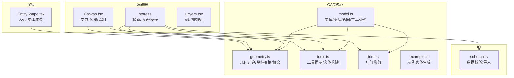
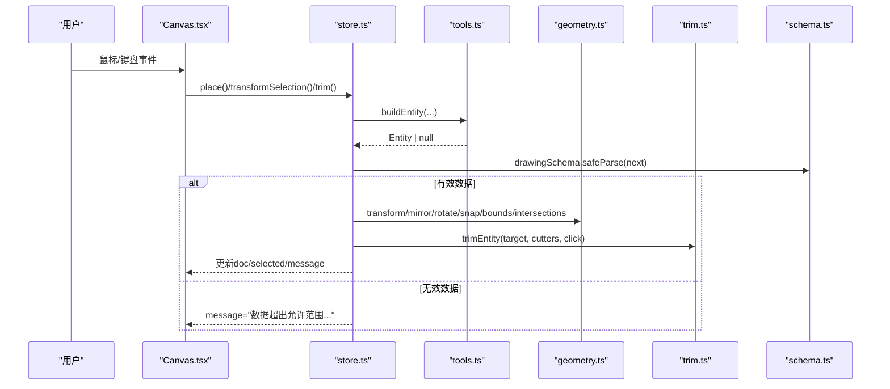
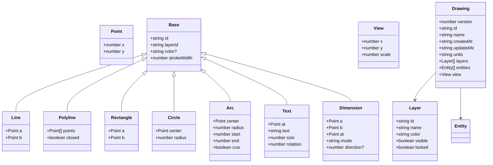
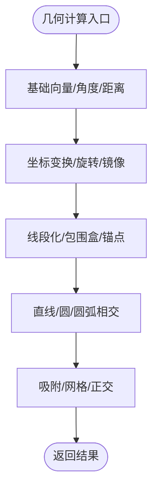
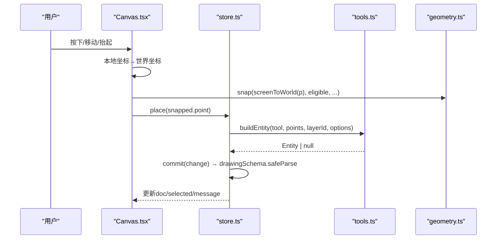
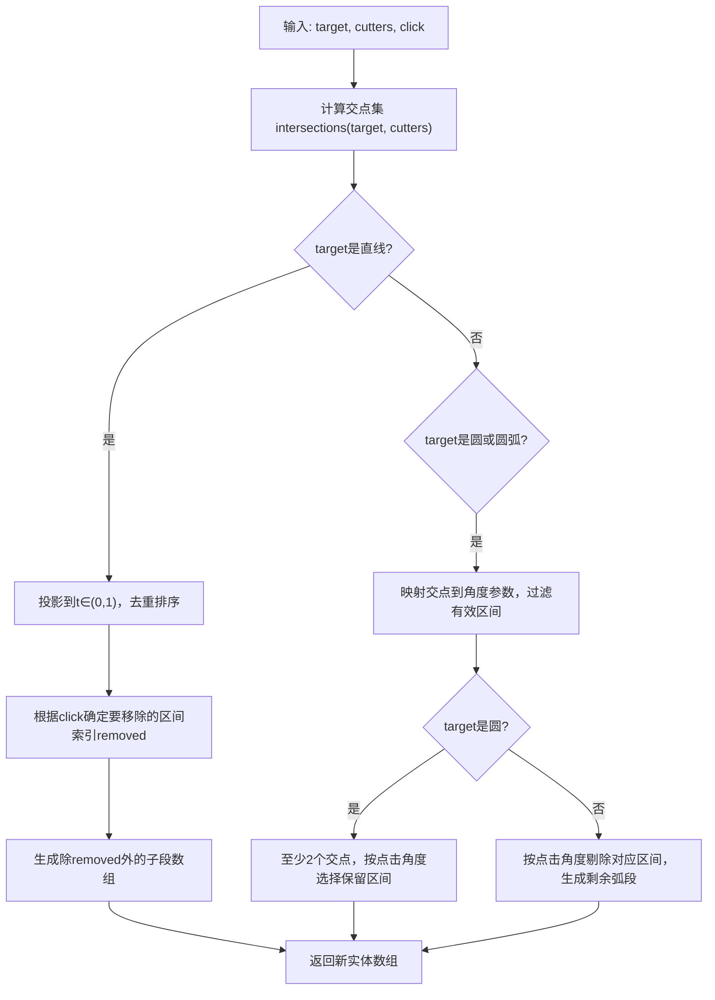
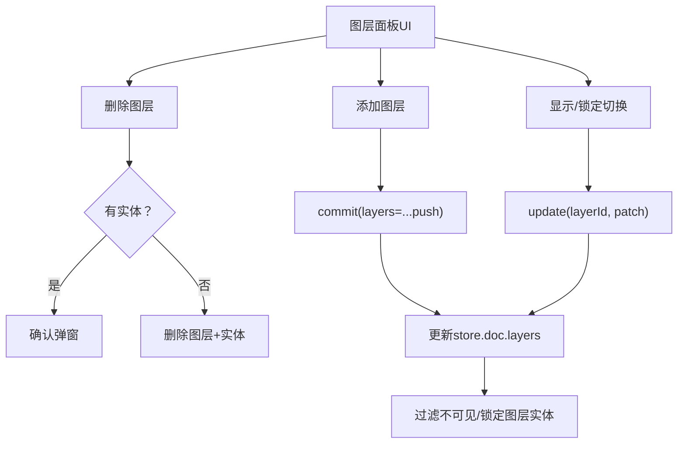
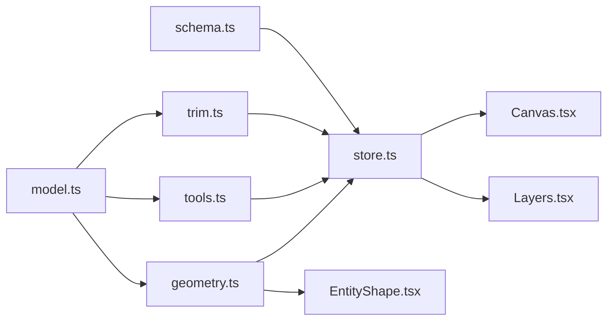

# CAD核心引擎

<cite>
**本文引用的文件**   
- [geometry.ts](file://src/cad/geometry.ts)
- [model.ts](file://src/cad/model.ts)
- [tools.ts](file://src/cad/tools.ts)
- [trim.ts](file://src/cad/trim.ts)
- [example.ts](file://src/cad/example.ts)
- [store.ts](file://src/features/editor/store.ts)
- [Canvas.tsx](file://src/features/editor/Canvas.tsx)
- [Layers.tsx](file://src/features/editor/Layers.tsx)
- [EntityShape.tsx](file://src/components/EntityShape.tsx)
- [schema.ts](file://src/io/schema.ts)
</cite>

## 目录
1. [引言](#引言)
2. [项目结构](#项目结构)
3. [核心组件](#核心组件)
4. [架构总览](#架构总览)
5. [详细组件分析](#详细组件分析)
6. [依赖关系分析](#依赖关系分析)
7. [性能与优化建议](#性能与优化建议)
8. [故障排查指南](#故障排查指南)
9. [结论](#结论)
10. [附录：API与使用模式](#附录api与使用模式)

## 引言
本技术文档围绕 web-cad 的 CAD 核心引擎展开，重点解释几何实体类型定义、图纸数据结构、图层系统设计；深入说明几何计算库的基础运算、坐标变换与几何关系计算；阐述绘图工具系统的实现逻辑与用户交互处理机制；详细说明几何修剪算法与布尔运算支持现状；提供与其他模块的集成方式与 API 接口；并给出性能优化建议与常见问题解决方案。文档面向具备基础前端与图形学知识的读者，同时尽量以循序渐进的方式帮助非专业读者理解系统设计与实现。

## 项目结构
CAD 核心引擎位于 src/cad 目录，包含几何计算、模型定义、工具构建与修剪算法等关键模块；编辑器状态与交互在 features/editor 中；渲染由 components 中的 SVG 组件完成；数据校验与导入导出在 io 层。

**图表来源**
- [model.ts:1-142](file://src/cad/model.ts#L1-L142)
- [geometry.ts:1-443](file://src/cad/geometry.ts#L1-L443)
- [tools.ts:1-126](file://src/cad/tools.ts#L1-L126)
- [trim.ts:1-129](file://src/cad/trim.ts#L1-L129)
- [example.ts:1-102](file://src/cad/example.ts#L1-L102)
- [store.ts:1-324](file://src/features/editor/store.ts#L1-L324)
- [Canvas.tsx:1-652](file://src/features/editor/Canvas.tsx#L1-L652)
- [Layers.tsx:1-163](file://src/features/editor/Layers.tsx#L1-L163)
- [EntityShape.tsx:1-96](file://src/components/EntityShape.tsx#L1-L96)
- [schema.ts:1-134](file://src/io/schema.ts#L1-L134)

**章节来源**
- [model.ts:1-142](file://src/cad/model.ts#L1-L142)
- [geometry.ts:1-443](file://src/cad/geometry.ts#L1-L443)
- [tools.ts:1-126](file://src/cad/tools.ts#L1-L126)
- [trim.ts:1-129](file://src/cad/trim.ts#L1-L129)
- [example.ts:1-102](file://src/cad/example.ts#L1-L102)
- [store.ts:1-324](file://src/features/editor/store.ts#L1-L324)
- [Canvas.tsx:1-652](file://src/features/editor/Canvas.tsx#L1-L652)
- [Layers.tsx:1-163](file://src/features/editor/Layers.tsx#L1-L163)
- [EntityShape.tsx:1-96](file://src/components/EntityShape.tsx#L1-L96)
- [schema.ts:1-134](file://src/io/schema.ts#L1-L134)

## 核心组件
- 几何计算库 geometry.ts：提供点向量运算、角度与极坐标、屏幕与世界坐标转换、圆弧参数化、锚点与包围盒、吸附与对齐、旋转与镜像、线段化、直线/圆/圆弧相交、通用相交检测等。
- 模型 model.ts：定义 Point、Layer、Entity（线、折线、矩形、圆、圆弧、文字、尺寸标注）、View、Drawing、Tool 等类型，并提供 uid、createDrawing、cloneDrawing 等工厂函数。
- 工具 tools.ts：维护工具名称映射与提示文案，根据工具与输入点序列构建对应 Entity。
- 修剪 trim.ts：基于交点与点击位置对直线、圆、圆弧进行区段裁剪。
- 编辑器 store.ts：基于 Zustand 的状态管理，封装加载、提交、撤销重做、选择、放置、变换、修剪等操作，协调 geometry、tools、trim 与 schema。
- 交互 Canvas.tsx：处理鼠标/键盘事件、视口缩放平移、框选、拖拽、预览、网格与标尺绘制。
- 图层 Layers.tsx：图层增删改查、可见性/锁定控制、当前图层切换。
- 渲染 EntityShape.tsx：将 Entity 转换为 SVG 元素。
- IO schema.ts：使用 Zod 校验 Drawing 结构，限制数值范围、数量上限与引用完整性，并提供导入解析。

**章节来源**
- [geometry.ts:1-443](file://src/cad/geometry.ts#L1-L443)
- [model.ts:1-142](file://src/cad/model.ts#L1-L142)
- [tools.ts:1-126](file://src/cad/tools.ts#L1-L126)
- [trim.ts:1-129](file://src/cad/trim.ts#L1-L129)
- [store.ts:1-324](file://src/features/editor/store.ts#L1-L324)
- [Canvas.tsx:1-652](file://src/features/editor/Canvas.tsx#L1-L652)
- [Layers.tsx:1-163](file://src/features/editor/Layers.tsx#L1-L163)
- [EntityShape.tsx:1-96](file://src/components/EntityShape.tsx#L1-L96)
- [schema.ts:1-134](file://src/io/schema.ts#L1-L134)

## 架构总览
CAD 核心引擎采用“数据模型 + 几何计算 + 工具构建 + 编辑器状态 + 交互渲染”的分层设计。模型与几何计算保持纯函数式，编辑器状态负责组合业务逻辑，交互层负责事件到状态的映射，渲染层仅负责可视化。

**图表来源**
- [Canvas.tsx:180-378](file://src/features/editor/Canvas.tsx#L180-L378)
- [store.ts:187-315](file://src/features/editor/store.ts#L187-L315)
- [tools.ts:49-125](file://src/cad/tools.ts#L49-L125)
- [geometry.ts:31-42](file://src/cad/geometry.ts#L31-L42)
- [geometry.ts:191-245](file://src/cad/geometry.ts#L191-L245)
- [geometry.ts:253-336](file://src/cad/geometry.ts#L253-L336)
- [geometry.ts:337-442](file://src/cad/geometry.ts#L337-L442)
- [trim.ts:21-128](file://src/cad/trim.ts#L21-L128)
- [schema.ts:66-104](file://src/io/schema.ts#L66-L104)

## 详细组件分析

### 几何实体类型与图纸数据结构
- 点 Point：二维坐标。
- 图层 Layer：id、name、color、visible、locked。
- 实体 Entity：统一 Base（id、layerId、color、strokeWidth）+ 具体类型字段：
  - line：两点 a、b。
  - polyline：points、closed。
  - rectangle：a、b。
  - circle：center、radius。
  - arc：center、radius、start、end、ccw。
  - text：at、text、size、rotation。
  - dimension：a、b、at、mode、direction。
- View：x、y、scale。
- Drawing：version、id、name、createdAt、updatedAt、units、layers、entities、view。
- Tool：select、line、polyline、rectangle、circle、arc、text、dimension、move、copy、rotate、mirror、trim。

**图表来源**
- [model.ts:1-61](file://src/cad/model.ts#L1-L61)

**章节来源**
- [model.ts:1-61](file://src/cad/model.ts#L1-L61)

### 几何计算库
- 基础运算：add、sub、mul、dot、cross、distance、angle、normalize、polar。
- 坐标变换：screenToWorld、worldToScreen、rotatePoint、mirrorPoint、transform。
- 几何关系：sweep、onArc、arcFromThree、anchors、bounds、segments、lineIntersection、lineCircle、intersections。
- 吸附与对齐：snap（对象吸附、网格吸附、正交约束）。

**图表来源**
- [geometry.ts:5-30](file://src/cad/geometry.ts#L5-L30)
- [geometry.ts:31-42](file://src/cad/geometry.ts#L31-L42)
- [geometry.ts:246-336](file://src/cad/geometry.ts#L246-L336)
- [geometry.ts:112-190](file://src/cad/geometry.ts#L112-L190)
- [geometry.ts:337-442](file://src/cad/geometry.ts#L337-L442)
- [geometry.ts:191-245](file://src/cad/geometry.ts#L191-L245)

**章节来源**
- [geometry.ts:1-443](file://src/cad/geometry.ts#L1-L443)

### 绘图工具系统与用户交互
- 工具提示与构建：tools.ts 提供 hint 与 buildEntity，根据工具与点击点序列生成实体。
- 交互流程：Canvas.tsx 监听指针事件，区分平移、框选、拖拽、绘制、修剪等手势；实时预览草稿实体；通过 store.place/finish/transformSelection/trim 更新状态。
- 键盘快捷键：Space 平移、Ctrl/Cmd+Z/Y 撤销重做、A 全选、Esc 取消、Delete/Backspace 删除、Enter 完成折线、L/P/R/C/A/T/D/M 快捷工具。

**图表来源**
- [Canvas.tsx:180-378](file://src/features/editor/Canvas.tsx#L180-L378)
- [store.ts:187-264](file://src/features/editor/store.ts#L187-L264)
- [tools.ts:20-125](file://src/cad/tools.ts#L20-L125)
- [geometry.ts:191-245](file://src/cad/geometry.ts#L191-L245)
- [schema.ts:66-104](file://src/io/schema.ts#L66-L104)

**章节来源**
- [Canvas.tsx:1-652](file://src/features/editor/Canvas.tsx#L1-L652)
- [store.ts:187-264](file://src/features/editor/store.ts#L187-L264)
- [tools.ts:1-126](file://src/cad/tools.ts#L1-L126)

### 几何修剪算法
- 目标：对直线、圆、圆弧按点击位置移除指定区段，其他部分保留。
- 步骤：
  1) 计算目标与所有可见边界实体的交点集合。
  2) 对直线：投影到参数 t ∈ (0,1)，去重后排序，确定点击所在区间，剔除该区间对应的子段。
  3) 对圆：将交点映射到角度参数，至少需要两个交点才能切出弧段；根据点击角度决定保留哪一段。
  4) 对圆弧：类似圆，但参数范围为 [start, end]（考虑方向），按点击位置剔除相应区间。
- 输出：返回被替换的新实体数组（每个子段为独立实体，带新 id）。

**图表来源**
- [trim.ts:16-128](file://src/cad/trim.ts#L16-L128)
- [geometry.ts:361-442](file://src/cad/geometry.ts#L361-L442)

**章节来源**
- [trim.ts:1-129](file://src/cad/trim.ts#L1-L129)
- [geometry.ts:361-442](file://src/cad/geometry.ts#L361-L442)

### 布尔运算支持现状
- 当前代码未实现通用的多边形布尔运算（并/交/差）。
- 现有能力包括：
  - 相交检测：intersections 可计算直线/圆/圆弧之间的交点。
  - 修剪：trimEntity 可对直线、圆、圆弧进行局部裁剪。
- 若需扩展布尔运算，可在 segments 基础上引入平面分割与区域构造算法，并在 store 中增加布尔操作工具。

[本节为概念性说明，不直接分析具体文件]

### 图层系统设计
- 图层属性：id、name、color、visible、locked。
- 行为：
  - 新建默认图层（轮廓、辅助线、标注）。
  - 新增/删除图层，限制最多 100 个图层。
  - 切换当前图层影响新绘实体归属。
  - 隐藏/锁定图层时，禁止编辑与选择，已选中实体自动清理。
  - 删除图层时可选择是否连带删除其上的实体。
- 与实体关联：实体通过 layerId 引用图层，渲染与交互均依据图层可见性与锁定状态过滤。

**图表来源**
- [Layers.tsx:19-76](file://src/features/editor/Layers.tsx#L19-L76)
- [model.ts:82-117](file://src/cad/model.ts#L82-L117)
- [schema.ts:74-86](file://src/io/schema.ts#L74-L86)

**章节来源**
- [Layers.tsx:1-163](file://src/features/editor/Layers.tsx#L1-L163)
- [model.ts:82-117](file://src/cad/model.ts#L82-L117)
- [schema.ts:74-86](file://src/io/schema.ts#L74-L86)

### 渲染与可视化
- EntityShape.tsx 将不同实体类型映射为 SVG 元素：
  - line → line
  - rectangle → rect
  - polyline → path（含闭合）
  - circle → circle
  - arc → path（大弧标志与方向）
  - text → text（带旋转与缩放）
  - dimension → 组合路径与文本（基于 dimensionGeometry）
- Canvas.tsx 负责：
  - 视口变换（translate/scale）
  - 网格与标尺绘制
  - 实体高亮与锚点显示
  - 预览草稿实体（半透明虚线）

**章节来源**
- [EntityShape.tsx:1-96](file://src/components/EntityShape.tsx#L1-L96)
- [Canvas.tsx:390-581](file://src/features/editor/Canvas.tsx#L390-L581)
- [geometry.ts:81-111](file://src/cad/geometry.ts#L81-L111)

## 依赖关系分析
- model.ts 被 geometry.ts、tools.ts、trim.ts、store.ts、Layers.tsx、EntityShape.tsx、schema.ts 引用。
- geometry.ts 被 store.ts、Canvas.tsx、EntityShape.tsx、trim.ts 引用。
- tools.ts 被 store.ts、Canvas.tsx 引用。
- trim.ts 被 store.ts 引用。
- store.ts 被 Canvas.tsx、Layers.tsx 引用。
- schema.ts 被 store.ts、io/files.tsx（未在本文分析）引用。

**图表来源**
- [model.ts:1-142](file://src/cad/model.ts#L1-L142)
- [geometry.ts:1-443](file://src/cad/geometry.ts#L1-L443)
- [tools.ts:1-126](file://src/cad/tools.ts#L1-L126)
- [trim.ts:1-129](file://src/cad/trim.ts#L1-L129)
- [store.ts:1-324](file://src/features/editor/store.ts#L1-L324)
- [Canvas.tsx:1-652](file://src/features/editor/Canvas.tsx#L1-L652)
- [Layers.tsx:1-163](file://src/features/editor/Layers.tsx#L1-L163)
- [EntityShape.tsx:1-96](file://src/components/EntityShape.tsx#L1-L96)
- [schema.ts:1-134](file://src/io/schema.ts#L1-L134)

**章节来源**
- [model.ts:1-142](file://src/cad/model.ts#L1-L142)
- [geometry.ts:1-443](file://src/cad/geometry.ts#L1-L443)
- [tools.ts:1-126](file://src/cad/tools.ts#L1-L126)
- [trim.ts:1-129](file://src/cad/trim.ts#L1-L129)
- [store.ts:1-324](file://src/features/editor/store.ts#L1-L324)
- [Canvas.tsx:1-652](file://src/features/editor/Canvas.tsx#L1-L652)
- [Layers.tsx:1-163](file://src/features/editor/Layers.tsx#L1-L163)
- [EntityShape.tsx:1-96](file://src/components/EntityShape.tsx#L1-L96)
- [schema.ts:1-134](file://src/io/schema.ts#L1-L134)

## 性能与优化建议
- 几何计算复杂度：
  - intersections 对每对实体进行线段化与两两相交检测，时间复杂度近似 O(N^2)。建议在大规模场景中引入空间索引（如四叉树或网格）以减少候选对。
  - anchors/bounds 遍历实体计算包围盒，频繁调用时可缓存结果并按视口裁剪。
- 渲染优化：
  - 仅渲染可见图层实体；已实现按 visible 过滤。
  - 使用 path 批量绘制 polyline 与 dimension，减少 DOM 节点数。
  - 预览草稿实体使用低透明度与虚线，避免干扰主场景。
- 交互优化：
  - snap 在对象吸附时遍历所有锚点，可结合视口裁剪与空间索引加速。
  - 框选时使用 bounds 快速剔除不在框内的实体。
- 状态与历史：
  - history 保留最近 99 步，避免内存膨胀。
  - commit 前使用 drawingSchema.safeParse 校验，失败则提示错误信息，防止脏数据污染。
- 数值稳定性：
  - 使用 EPS 容差处理浮点误差，避免退化情况（如零长度线段、重合点）。

[本节为通用指导，不直接分析具体文件]

## 故障排查指南
- 无法创建实体：
  - 检查当前图层是否可见且未锁定。
  - 检查输入点是否满足工具要求（如直线需要两个不同点，圆弧需要三点）。
  - 查看 message 提示：“无法构建图形：请检查点的位置或文字内容”。
- 数据校验失败：
  - 当数值越界、实体数量超限、ID重复或引用不存在图层时，会触发 schema 校验失败，message 显示“数据超出允许范围，请检查数值或图形数量”。
- 修剪无效：
  - 确保目标为直线、圆或圆弧，且存在有效交点；否则 message 显示“没有有效交点，或目标不是直线、圆、圆弧”。
- 变换失败：
  - 移动/复制/旋转/镜像需要先选择未锁定的图形；否则 message 提示“请先选择未锁定的图形”。
  - 镜像轴需要两个不同点，否则会提示“镜像轴需要两个不同点”。

**章节来源**
- [store.ts:187-315](file://src/features/editor/store.ts#L187-L315)
- [schema.ts:66-104](file://src/io/schema.ts#L66-L104)

## 结论
web-cad 的 CAD 核心引擎以清晰的模型定义与纯函数式几何计算为基础，配合编辑器状态管理与丰富的交互能力，实现了从几何建模到可视化的完整闭环。当前版本聚焦于基础几何运算、坐标变换、相交检测与修剪功能，尚未实现通用布尔运算。未来可扩展空间索引、布尔运算与更多高级工具，以提升大规模场景的性能与表达能力。

[本节为总结性内容，不直接分析具体文件]

## 附录：API与使用模式

### 几何计算 API（geometry.ts）
- 基础运算：add、sub、mul、dot、cross、distance、angle、normalize、polar
- 坐标变换：screenToWorld、worldToScreen、rotatePoint、mirrorPoint、transform
- 几何关系：sweep、onArc、arcFromThree、anchors、bounds、segments、lineIntersection、lineCircle、intersections
- 吸附：snap

使用模式示例（路径引用）：
- 坐标转换：[geometry.ts:31-42](file://src/cad/geometry.ts#L31-L42)
- 旋转与镜像：[geometry.ts:246-336](file://src/cad/geometry.ts#L246-L336)
- 相交检测：[geometry.ts:361-442](file://src/cad/geometry.ts#L361-L442)
- 吸附与正交：[geometry.ts:191-245](file://src/cad/geometry.ts#L191-L245)

### 工具构建 API（tools.ts）
- 工具名映射：toolNames
- 提示文案：hint
- 实体构建：buildEntity(tool, points, layerId, options)

使用模式示例（路径引用）：
- 构建直线/圆/圆弧/折线/尺寸标注：[tools.ts:49-125](file://src/cad/tools.ts#L49-L125)

### 修剪 API（trim.ts）
- 修剪函数：trimEntity(target, cutters, click)

使用模式示例（路径引用）：
- 直线/圆/圆弧修剪流程：[trim.ts:21-128](file://src/cad/trim.ts#L21-L128)

### 编辑器状态 API（store.ts）
- 状态字段：doc、history、future、revision、selected、activeLayer、tool、points、grid、objects、ortho、gridStep、cursor、message、text、textSize、dimensionMode、rotation
- 操作方法：load、commit、setView、setTool、undo、redo、remove、place、finish、trim、transformSelection

使用模式示例（路径引用）：
- 放置实体与预览：[store.ts:187-264](file://src/features/editor/store.ts#L187-L264)
- 变换选择（移动/复制/旋转/镜像）：[store.ts:160-186](file://src/features/editor/store.ts#L160-L186)
- 修剪流程：[store.ts:287-315](file://src/features/editor/store.ts#L287-L315)

### 数据模型与校验（model.ts、schema.ts）
- 模型类型：Point、Layer、Entity、View、Drawing、Tool
- 工厂函数：uid、createDrawing、cloneDrawing
- 数据校验：drawingSchema、parseImport

使用模式示例（路径引用）：
- 模型定义：[model.ts:1-61](file://src/cad/model.ts#L1-L61)
- 工厂函数：[model.ts:76-141](file://src/cad/model.ts#L76-L141)
- 校验规则：[schema.ts:66-104](file://src/io/schema.ts#L66-L104)
- 导入解析：[schema.ts:105-134](file://src/io/schema.ts#L105-L134)

### 示例实体生成（example.ts）
- 示例函数：exampleEntities(doc)

使用模式示例（路径引用）：
- 生成示例实体集合：[example.ts:4-101](file://src/cad/example.ts#L4-L101)