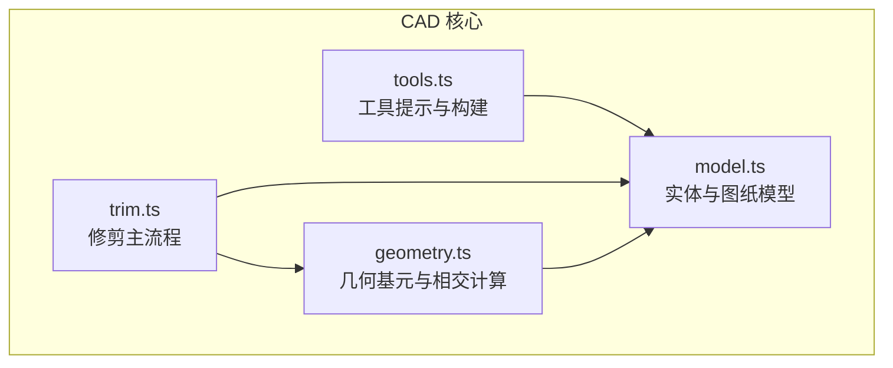
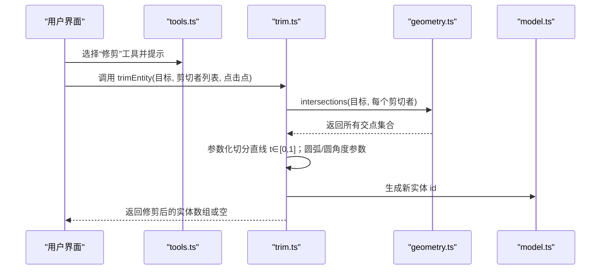
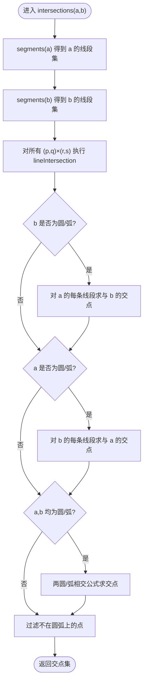
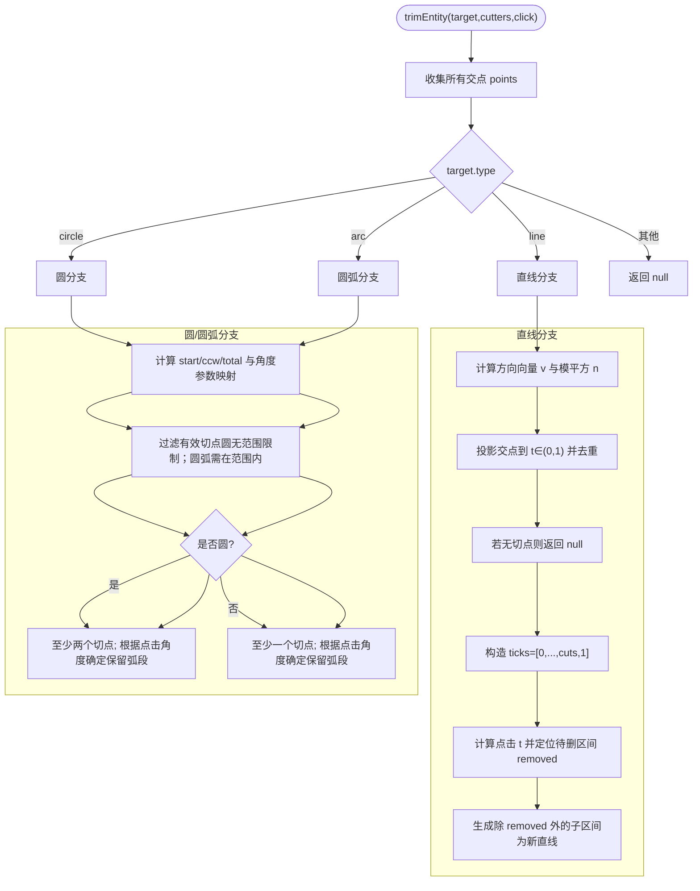
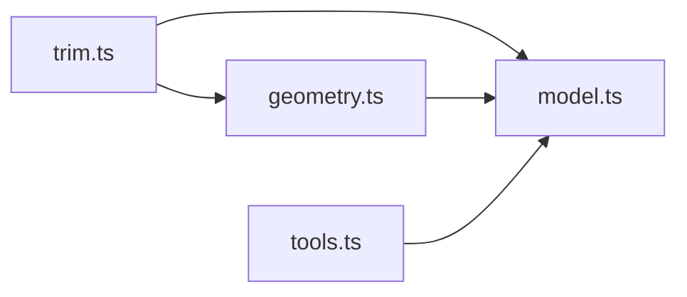

# 几何修剪算法

<cite>
**本文引用的文件**   
- [trim.ts](file://src/cad/trim.ts)
- [geometry.ts](file://src/cad/geometry.ts)
- [model.ts](file://src/cad/model.ts)
- [tools.ts](file://src/cad/tools.ts)
- [geometry.test.ts](file://src/cad/geometry.test.ts)
</cite>

## 目录
1. [引言](#引言)
2. [项目结构](#项目结构)
3. [核心组件](#核心组件)
4. [架构总览](#架构总览)
5. [详细组件分析](#详细组件分析)
6. [依赖关系分析](#依赖关系分析)
7. [性能与复杂度](#性能与复杂度)
8. [故障排查指南](#故障排查指南)
9. [结论](#结论)
10. [附录：API 与数据模型](#附录api-与数据模型)

## 引言
本技术文档聚焦 CAD 核心引擎中的几何修剪算法，系统阐述其数学基础、实现细节与工程实践。内容覆盖线段相交检测、圆/圆弧参数化裁剪、布尔运算思想在修剪中的应用、复杂图形（多段线、矩形、圆弧）的处理流程，以及结果拓扑一致性与性能优化策略。读者无需深入前端框架知识即可理解算法原理与代码组织。

## 项目结构
本项目采用按功能域划分的目录组织方式，几何与修剪逻辑集中在 src/cad 下：
- geometry.ts：二维几何基元与通用计算（向量、角度、极坐标、边界框、线段/圆相交等）
- trim.ts：修剪主流程（目标对象与剪切对象的交点计算、参数区间划分、区段保留/删除）
- model.ts：实体类型定义、视图与图纸数据结构
- tools.ts：工具提示与实体构建（包含“修剪”工具的交互提示）
- geometry.test.ts：几何与修剪的单元测试，覆盖关键场景

图表来源
- [model.ts:18-45](file://src/cad/model.ts#L18-L45)
- [geometry.ts:401-442](file://src/cad/geometry.ts#L401-L442)
- [trim.ts:21-128](file://src/cad/trim.ts#L21-L128)
- [tools.ts:5-19](file://src/cad/tools.ts#L5-L19)

章节来源
- [model.ts:18-45](file://src/cad/model.ts#L18-L45)
- [geometry.ts:401-442](file://src/cad/geometry.ts#L401-L442)
- [trim.ts:21-128](file://src/cad/trim.ts#L21-L128)
- [tools.ts:5-19](file://src/cad/tools.ts#L5-L19)

## 核心组件
- 几何基元与相交计算（geometry.ts）
  - 提供向量加减、点积、叉积、距离、角度、归一化角度、极坐标转换等基础函数
  - 提供线段-线段相交 lineIntersection、线段-圆相交 lineCircle、通用相交 intersections
  - 提供圆弧判定 onArc、弧扫角 sweep、边界 bounds、锚点 anchors、分段 segments 等
- 修剪主流程（trim.ts）
  - 统一入口 trimEntity(target, cutters, click)
  - 对直线、圆、圆弧三类目标分别处理；多段线/矩形通过 segments 分解为线段参与相交
  - 基于点击位置决定保留哪一侧，输出新的实体集合
- 实体模型（model.ts）
  - 定义 Entity 联合类型（line/polyline/rectangle/circle/arc/text/dimension）
  - 提供 Drawing、View、Layer 等绘图上下文结构
- 工具与交互（tools.ts）
  - 提供“修剪”工具的提示文案，明确“可见图形作为修剪边界”

章节来源
- [geometry.ts:1-442](file://src/cad/geometry.ts#L1-L442)
- [trim.ts:1-128](file://src/cad/trim.ts#L1-L128)
- [model.ts:18-45](file://src/cad/model.ts#L18-L45)
- [tools.ts:5-19](file://src/cad/tools.ts#L5-L19)

## 架构总览
修剪算法的整体调用链如下：

图表来源
- [tools.ts:20-24](file://src/cad/tools.ts#L20-L24)
- [trim.ts:21-128](file://src/cad/trim.ts#L21-L128)
- [geometry.ts:401-442](file://src/cad/geometry.ts#L401-L442)
- [model.ts:76-81](file://src/cad/model.ts#L76-L81)

## 详细组件分析

### 几何基元与相交计算（geometry.ts）
- 向量与角度
  - add/sub/mul/dot/cross：基本向量运算
  - angle/normalize：角度计算与角度归一化到 [0, 2π)
  - polar：极坐标转笛卡尔坐标
- 圆弧与圆
  - arcFromThree：三点确定圆弧（圆心、半径、起止角、方向）
  - onArc：判断给定角度是否在圆弧范围内
  - sweep：计算圆弧扫角（考虑顺时针/逆时针）
- 线段与圆/线段相交
  - lineIntersection：线段-线段相交，使用叉积判别共线与比例参数
  - lineCircle：线段-圆相交，求解二次方程判别式，过滤有效参数区间
  - intersections：组合上述方法，支持任意实体对相交，自动将多段线/矩形拆分为线段
- 边界与锚点
  - anchors/bounds：用于包围盒与拾取辅助
  - segments：将 polyline/rectangle 拆解为线段序列，供相交计算使用

图表来源
- [geometry.ts:337-359](file://src/cad/geometry.ts#L337-L359)
- [geometry.ts:361-400](file://src/cad/geometry.ts#L361-L400)
- [geometry.ts:401-442](file://src/cad/geometry.ts#L401-L442)

章节来源
- [geometry.ts:1-442](file://src/cad/geometry.ts#L1-L442)

### 修剪主流程（trim.ts）
- 输入与前置校验
  - 排除自身作为剪切者（e.id !== target.id）
  - 对直线目标进行退化检查（长度接近 0 直接返回 null）
- 交点收集与去重
  - 使用 unique 对参数值排序并去重（EPS 容差）
- 直线修剪
  - 将交点投影到直线的参数 t ∈ (0,1)，形成多个子区间
  - 根据点击点的 t 值定位要删除的区间，其余区间生成新直线实体
- 圆/圆弧修剪
  - 将交点映射到角度参数（考虑起始角与方向 ccw）
  - 圆需要至少两个交点才能产生有效修剪；圆弧需保证交点在弧范围内
  - 根据点击角度定位要删除的区间，生成新的圆弧实体（保持 ccw 与起止角）
- 不支持的目标类型
  - 非 line/circle/arc 的目标直接返回 null（如 text/dimension 不参与修剪）

图表来源
- [trim.ts:16-20](file://src/cad/trim.ts#L16-L20)
- [trim.ts:21-59](file://src/cad/trim.ts#L21-L59)
- [trim.ts:60-128](file://src/cad/trim.ts#L60-L128)

章节来源
- [trim.ts:16-128](file://src/cad/trim.ts#L16-L128)

### 复杂几何图形的修剪逻辑
- 多段线（polyline）与矩形（rectangle）
  - 通过 segments 将其分解为若干线段，再与目标对象进行相交计算
  - 修剪时仅对目标对象进行参数化切分；多段线/矩形作为“剪切者”不改变
- 文本对象（text）
  - 不参与修剪（trimEntity 对 text 返回 null），但可作为剪切边界参与与其他目标的相交计算（取决于具体调用方）
- 尺寸标注（dimension）
  - 同样不作为修剪目标；其几何信息可用于显示与测量

章节来源
- [geometry.ts:337-359](file://src/cad/geometry.ts#L337-L359)
- [trim.ts:60-61](file://src/cad/trim.ts#L60-L61)

### 布尔运算思想与拓扑一致性
- 布尔运算思想
  - 修剪本质上是“目标曲线 × 剪切者集合”的差集操作：以剪切者为边界，从目标曲线上移除指定区间
  - 通过参数化（直线 t、圆弧角度 θ）将连续曲线离散化为区间集合，再进行区间减法
- 拓扑一致性维护
  - 使用 EPS 容差避免浮点误差导致的重复切点
  - 对圆弧/圆严格校验交点是否在弧上（onArc + normalize 角度）
  - 生成新实体时分配新 id，避免与原实体混淆
  - 对圆弧方向（ccw）与起止角保持一致性约束

章节来源
- [trim.ts:16-20](file://src/cad/trim.ts#L16-L20)
- [geometry.ts:48-54](file://src/cad/geometry.ts#L48-L54)
- [model.ts:76-81](file://src/cad/model.ts#L76-L81)

## 依赖关系分析
- trim.ts 依赖 geometry.ts 的几何计算与相交函数，依赖 model.ts 的 uid 生成
- geometry.ts 依赖 model.ts 的 Entity 类型定义
- tools.ts 提供“修剪”工具的提示文案，不直接依赖 trim.ts

图表来源
- [trim.ts:1-14](file://src/cad/trim.ts#L1-L14)
- [geometry.ts:1-2](file://src/cad/geometry.ts#L1-L2)
- [tools.ts:1-3](file://src/cad/tools.ts#L1-L3)

章节来源
- [trim.ts:1-14](file://src/cad/trim.ts#L1-L14)
- [geometry.ts:1-2](file://src/cad/geometry.ts#L1-L2)
- [tools.ts:1-3](file://src/cad/tools.ts#L1-L3)

## 性能与复杂度
- 时间复杂度
  - 设目标对象被分解为 m 条线段，剪切者集合有 k 个对象，平均每个对象分解为 n 条线段
  - 线段-线段相交 O(m·k·n)；若涉及圆/弧，额外增加线段-圆与圆-圆相交计算
  - 参数化切分与排序去重 O(c log c)，c 为交点数量
- 空间复杂度
  - 主要消耗在交点集合与中间参数数组，O(c)
- 优化建议
  - 使用包围盒（bounds）快速剔除不相交的剪切者
  - 对频繁调用的 intersections 可缓存部分结果（如静态剪切者）
  - 合理设置 EPS 平衡精度与稳定性

章节来源
- [geometry.ts:401-442](file://src/cad/geometry.ts#L401-L442)
- [trim.ts:26-28](file://src/cad/trim.ts#L26-L28)

## 故障排查指南
- 常见问题
  - 直线长度为 0：trimEntity 直接返回 null，避免除以零
  - 相切或无交点：不会修改原对象，返回 null
  - 圆弧方向错误：确保 ccw 与起止角一致；使用 normalize 保证角度在 [0, 2π)
  - 点击位置歧义：点击点用于决定删除哪个区间；若点击位于切点附近，注意 EPS 容差影响
- 调试技巧
  - 打印交点集合与参数化切点，确认 unique 去重效果
  - 对圆弧分支，打印 start/end/ccw/sweep 与点击角度，验证区间定位
  - 使用单元测试用例逐步验证：直线双交点、圆半圆修剪、圆弧顺时针修剪、无交点/相切

章节来源
- [trim.ts:29-33](file://src/cad/trim.ts#L29-L33)
- [trim.ts:82-105](file://src/cad/trim.ts#L82-L105)
- [geometry.test.ts:241-297](file://src/cad/geometry.test.ts#L241-L297)

## 结论
该修剪算法以参数化为核心，将连续几何对象切分为区间并进行布尔差集式的区间删除，从而实现对直线、圆与圆弧的统一修剪。借助 geometry.ts 提供的稳健相交计算与角度归一化，算法在数值稳定性与拓扑一致性方面表现良好。结合测试用例与清晰的模块职责，便于扩展至更多几何类型与更复杂的布尔运算场景。

## 附录：API 与数据模型
- 修剪 API
  - trimEntity(target, cutters, click): 返回修剪后的实体数组或 null
- 几何 API（节选）
  - intersections(a, b): 返回实体 a 与 b 的所有交点
  - onArc(e, t): 判断角度 t 是否在圆弧 e 上
  - sweep(e): 计算圆弧 e 的扫角
- 数据模型（节选）
  - Entity：line/polyline/rectangle/circle/arc/text/dimension
  - Drawing：包含 layers/entities/view 等绘图上下文

章节来源
- [trim.ts:21-128](file://src/cad/trim.ts#L21-L128)
- [geometry.ts:401-442](file://src/cad/geometry.ts#L401-L442)
- [model.ts:18-45](file://src/cad/model.ts#L18-L45)