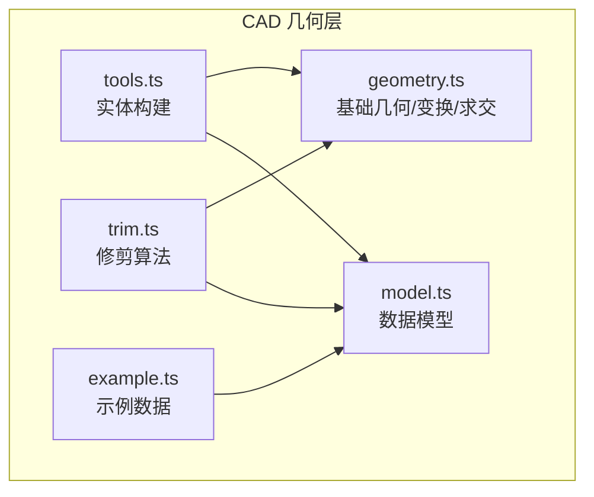
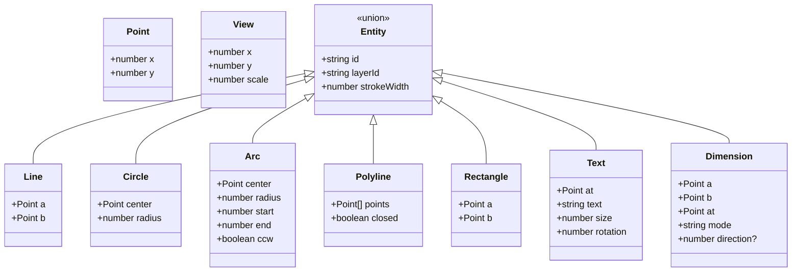
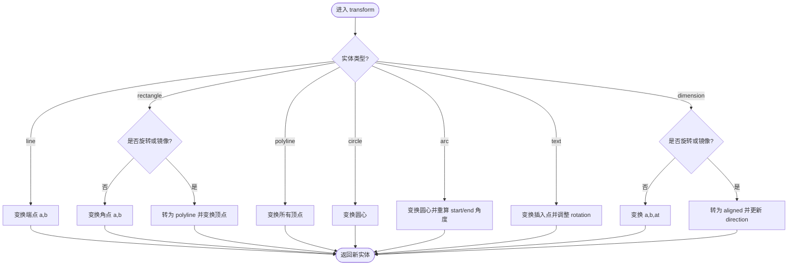
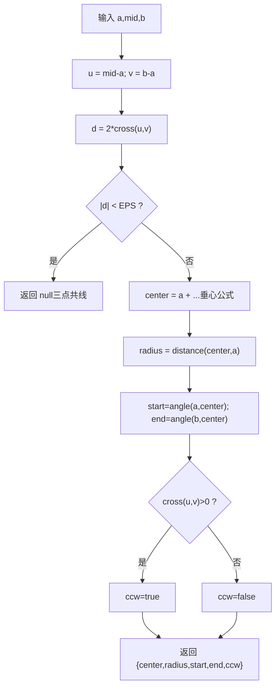
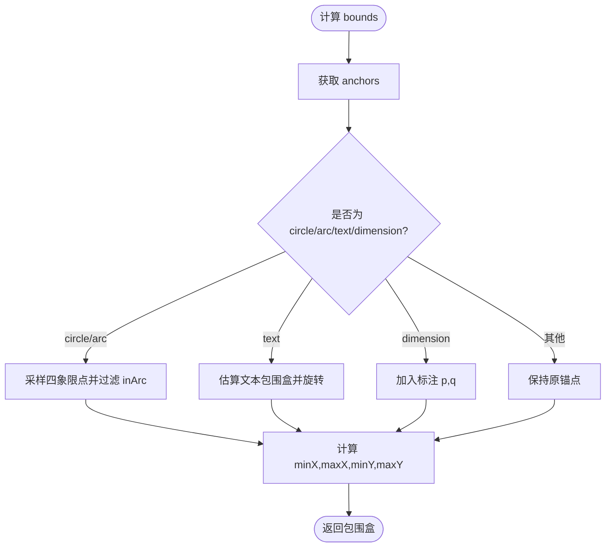
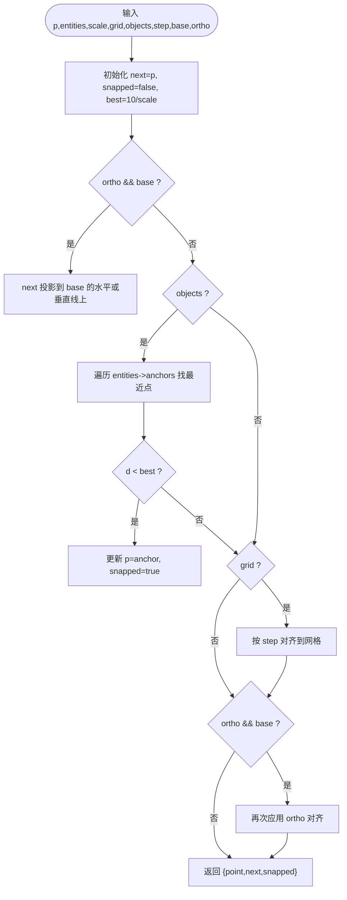
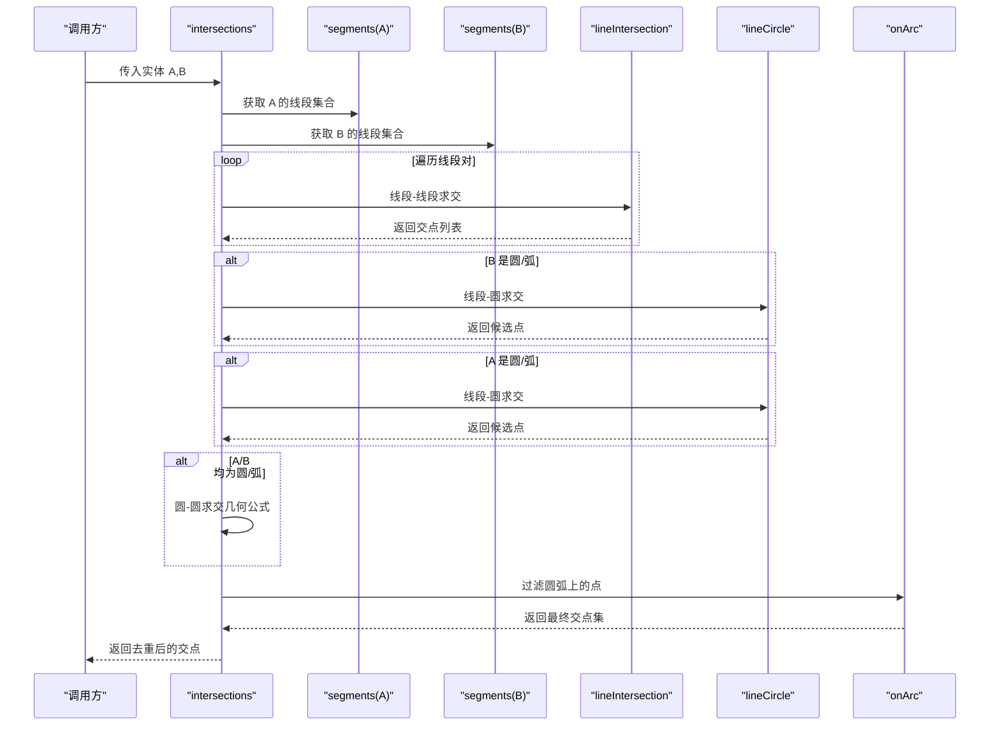
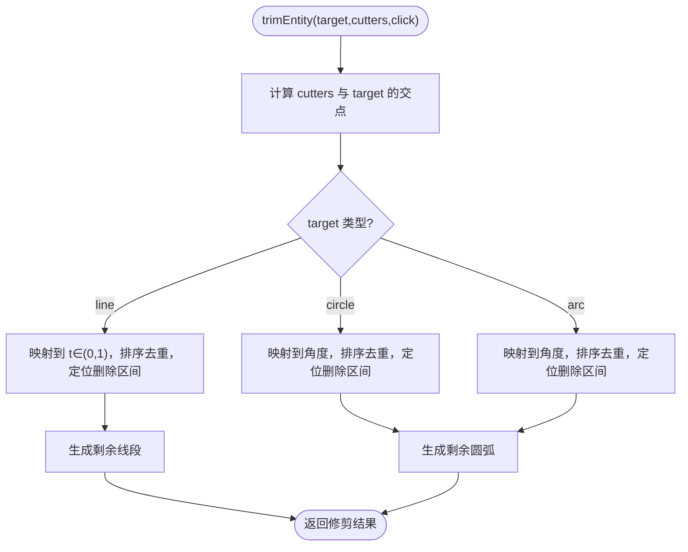
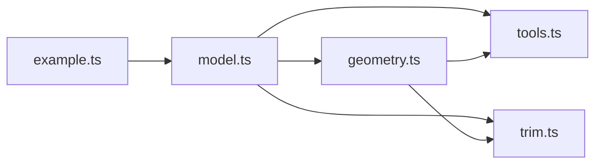

# 几何计算库

<cite>
**本文引用的文件**   
- [geometry.ts](file://src/cad/geometry.ts)
- [model.ts](file://src/cad/model.ts)
- [tools.ts](file://src/cad/tools.ts)
- [trim.ts](file://src/cad/trim.ts)
- [example.ts](file://src/cad/example.ts)
</cite>

## 目录
1. [简介](#简介)
2. [项目结构](#项目结构)
3. [核心组件](#核心组件)
4. [架构总览](#架构总览)
5. [详细组件分析](#详细组件分析)
6. [依赖关系分析](#依赖关系分析)
7. [性能与复杂度](#性能与复杂度)
8. [精度与边界处理](#精度与边界处理)
9. [集成方式与接口规范](#集成方式与接口规范)
10. [故障排查指南](#故障排查指南)
11. [结论](#结论)

## 简介
本技术文档面向 CAD 核心引擎中的几何计算库，系统性阐述点、线、圆、圆弧等基础几何实体的运算实现，坐标变换系统（平移、旋转、缩放）的数学原理与算法，以及距离、角度、交点求解等核心几何算法。同时给出浮点数精度处理策略、边界情况处理方案、性能优化建议与复杂度分析，并说明与其他模块的集成方式和 API 接口规范。

## 项目结构
CAD 几何相关代码集中在 src/cad 目录下：
- geometry.ts：几何基础运算、坐标变换、实体锚点与包围盒、线段/圆/圆弧求交等核心算法
- model.ts：几何与绘图的数据模型定义（Point、Entity、View、Drawing 等）
- tools.ts：工具构建器，根据用户输入构造 Entity
- trim.ts：基于几何求交的修剪算法
- example.ts：示例数据生成，用于演示和测试

**图表来源**
- [geometry.ts:1-443](file://src/cad/geometry.ts#L1-L443)
- [model.ts:1-142](file://src/cad/model.ts#L1-L142)
- [tools.ts:1-126](file://src/cad/tools.ts#L1-L126)
- [trim.ts:1-129](file://src/cad/trim.ts#L1-L129)
- [example.ts:1-102](file://src/cad/example.ts#L1-L102)

**章节来源**
- [geometry.ts:1-443](file://src/cad/geometry.ts#L1-L443)
- [model.ts:1-142](file://src/cad/model.ts#L1-L142)
- [tools.ts:1-126](file://src/cad/tools.ts#L1-L126)
- [trim.ts:1-129](file://src/cad/trim.ts#L1-L129)
- [example.ts:1-102](file://src/cad/example.ts#L1-L102)

## 核心组件
- 基础向量与标量运算：add、sub、mul、dot、cross、distance、angle、normalize、polar
- 视图坐标变换：screenToWorld、worldToScreen
- 圆弧参数化与判定：sweep、onArc、arcFromThree
- 实体锚点与包围盒：anchors、bounds
- 捕捉与对齐：snap
- 几何变换：rotatePoint、transform、mirrorPoint
- 线段/圆/圆弧求交：lineIntersection、lineCircle、intersections
- 修剪：trimEntity

**章节来源**
- [geometry.ts:1-443](file://src/cad/geometry.ts#L1-L443)
- [trim.ts:1-129](file://src/cad/trim.ts#L1-L129)

## 架构总览
几何计算库以 model.ts 定义的实体类型为中心，geometry.ts 提供通用几何能力，tools.ts 将用户交互转化为实体，trim.ts 在已有实体上执行布尔式裁剪。整体分层清晰，耦合度低，便于扩展新的几何操作或实体类型。

**图表来源**
- [model.ts:1-61](file://src/cad/model.ts#L1-L61)

## 详细组件分析

### 基础几何运算
- 向量运算：add、sub、mul、dot、cross
- 距离与角度：distance、angle
- 极坐标转换：polar
- 角度归一化：normalize（[0, 2π)）

这些函数为后续所有几何算法提供原子操作，时间复杂度 O(1)，空间复杂度 O(1)。

**章节来源**
- [geometry.ts:5-30](file://src/cad/geometry.ts#L5-L30)

### 坐标变换系统
- 屏幕坐标与世界坐标互转：screenToWorld、worldToScreen
  - 世界坐标到屏幕坐标：先平移至视口中心，再按 scale 缩放，Y 轴翻转以适应屏幕坐标系
  - 屏幕坐标到世界坐标：逆过程
- 点绕任意中心旋转：rotatePoint
- 实体级变换：transform
  - 支持对 line、rectangle、polyline、circle、arc、text、dimension 进行统一变换
  - 对 arc 的角度参数通过 angle(polar(...), center) 重新计算，保证变换后角度一致
  - 对 rectangle 在存在旋转或镜像时退化为 polyline，确保几何一致性
  - 对 dimension 在非水平/垂直方向时转换为 aligned 模式，并更新 direction

**图表来源**
- [geometry.ts:253-328](file://src/cad/geometry.ts#L253-L328)

**章节来源**
- [geometry.ts:31-42](file://src/cad/geometry.ts#L31-L42)
- [geometry.ts:246-328](file://src/cad/geometry.ts#L246-L328)

### 圆弧与圆的几何关系
- 圆弧跨度与方向：sweep、onArc
  - sweep 根据 ccw 决定起止角差的正负方向
  - onArc 判断给定角度是否在圆弧范围内，考虑 EPS 容差
- 三点定圆弧：arcFromThree
  - 通过叉积判断三点共线，若共线则返回空
  - 使用垂心公式计算圆心，半径由圆心到起点距离得到
  - 起始/终止角度通过 angle 计算，ccw 由叉积符号确定

**图表来源**
- [geometry.ts:55-72](file://src/cad/geometry.ts#L55-L72)

**章节来源**
- [geometry.ts:43-72](file://src/cad/geometry.ts#L43-L72)

### 实体锚点与包围盒
- anchors：为不同实体类型返回关键控制点（如端点、中点、象限点），用于捕捉、包围盒计算
- bounds：基于 anchors 计算最小外接矩形；对 circle/arc 额外采样四个象限点；对 text 估算文本框；对 dimension 加入标注端点

**图表来源**
- [geometry.ts:112-190](file://src/cad/geometry.ts#L112-L190)

**章节来源**
- [geometry.ts:112-190](file://src/cad/geometry.ts#L112-L190)

### 捕捉与对齐
- snap：结合对象捕捉与网格对齐，支持正交约束（ortho）
  - 优先匹配实体锚点，阈值 best 随缩放比例动态调整
  - 当启用 grid 时，按 step 对齐到网格
  - ortho 模式下强制 X/Y 对齐基准点 base

**图表来源**
- [geometry.ts:191-245](file://src/cad/geometry.ts#L191-L245)

**章节来源**
- [geometry.ts:191-245](file://src/cad/geometry.ts#L191-L245)

### 线段/圆/圆弧求交
- 线段相交：lineIntersection
  - 使用叉积判别平行/重合，利用参数 t,s 判断在线段范围内
  - 返回 0 或 1 个交点
- 线段与圆相交：lineCircle
  - 解二次方程判别式 disc，过滤有效参数区间 [-EPS, 1+EPS]
- 多实体求交：intersections
  - 将实体分解为线段集合 segments
  - 分别计算线段-线段、线段-圆/圆弧、圆-圆交点
  - 对圆弧结果用 onArc 过滤，确保交点在弧段内

**图表来源**
- [geometry.ts:337-442](file://src/cad/geometry.ts#L337-L442)

**章节来源**
- [geometry.ts:337-442](file://src/cad/geometry.ts#L337-L442)

### 修剪算法
- trimEntity：对目标实体（line/circle/arc）进行修剪
  - 计算 cutters 与 target 的所有交点
  - 对 line：将交点映射到参数 t ∈ (0,1)，排序去重，根据点击位置确定删除区段，生成剩余子线段
  - 对 circle/arc：将交点映射到角度参数，排序去重，根据点击位置确定删除区间，生成剩余弧段
  - 使用 unique 去重相邻切点，避免数值抖动导致多余分段

**图表来源**
- [trim.ts:21-128](file://src/cad/trim.ts#L21-L128)

**章节来源**
- [trim.ts:1-129](file://src/cad/trim.ts#L1-L129)

### 工具构建器
- buildEntity：根据工具类型与输入点序列构造实体
  - 直线、矩形、圆、折线、三点圆弧、尺寸标注、文字
  - 对圆弧使用 arcFromThree 计算几何参数
  - 对矩形要求非退化（x/y 差值大于 EPS）
  - 对直线要求两点不重合（距离 > EPS）

**章节来源**
- [tools.ts:49-125](file://src/cad/tools.ts#L49-L125)

### 示例数据
- exampleEntities：生成一组示例实体，包括多段线、同心圆、辅助线与标注、文字等，用于演示与测试

**章节来源**
- [example.ts:4-100](file://src/cad/example.ts#L4-L100)

## 依赖关系分析
- geometry.ts 依赖 model.ts 的类型定义（Point、Entity、View）
- tools.ts 依赖 geometry.ts 的 arcFromThree、distance、EPS 与 model.ts 的 uid
- trim.ts 依赖 geometry.ts 的基础几何与求交能力，以及 model.ts 的 uid
- example.ts 依赖 model.ts 的类型与 uid

**图表来源**
- [geometry.ts:1-2](file://src/cad/geometry.ts#L1-L2)
- [tools.ts:1-3](file://src/cad/tools.ts#L1-L3)
- [trim.ts:1-14](file://src/cad/trim.ts#L1-L14)
- [example.ts:1-2](file://src/cad/example.ts#L1-L2)
- [model.ts:1-61](file://src/cad/model.ts#L1-L61)

**章节来源**
- [geometry.ts:1-443](file://src/cad/geometry.ts#L1-L443)
- [tools.ts:1-126](file://src/cad/tools.ts#L1-L126)
- [trim.ts:1-129](file://src/cad/trim.ts#L1-L129)
- [example.ts:1-102](file://src/cad/example.ts#L1-L102)
- [model.ts:1-142](file://src/cad/model.ts#L1-L142)

## 性能与复杂度
- 基础向量与标量运算：O(1)
- 锚点与包围盒：
  - anchors：O(n)（n 为顶点数）
  - bounds：O(n)
- 线段-线段求交：O(1)
- 线段-圆求交：O(1)
- 圆-圆求交：O(1)
- intersections：
  - 设 A 有 m 条线段，B 有 k 条线段，则线段-线段部分 O(mk)
  - 线段-圆/圆弧部分 O(m+k)
  - 圆-圆部分 O(1)
  - 总体 O(mk + m + k)
- trimEntity：
  - 求交阶段 O(N·K)（N 为目标实体线段数，K 为裁剪实体总数）
  - 排序与去重 O(p log p)（p 为交点数量）
  - 总体 O(N·K + p log p)

优化建议：
- 对大量实体求交前，先用 bounds 做粗筛，减少不必要的精确求交
- 对频繁调用的基础运算可缓存中间结果（如单位向量、法向量）
- 对圆弧采样点数量固定为 4，避免过多三角函数开销

**章节来源**
- [geometry.ts:337-442](file://src/cad/geometry.ts#L337-L442)
- [trim.ts:21-128](file://src/cad/trim.ts#L21-L128)

## 精度与边界处理
- 全局容差：EPS = 1e-7，用于比较接近零、共线、重合、角度范围等
- 角度归一化：normalize 保证角度在 [0, 2π)
- 线段-线段求交：den 接近 0 视为平行，返回空；t,s 在 [-EPS, 1+EPS] 内视为在线段上
- 线段-圆求交：disc < -EPS 无解；disc ≥ 0 取 sqrt(max(0,disc)) 避免 NaN
- 圆弧判定：onArc 使用 EPS 放宽边界，避免浮点误差导致误判
- 三点定圆弧：d 接近 0 视为共线，返回空
- 修剪去重：unique 使用 EPS 过滤重复切点，避免微小抖动产生多余分段

最佳实践：
- 所有涉及“等于”的比较均使用 EPS 容差
- 对角度与弧度运算后及时 normalize
- 对数值开方前确保被开方数非负

**章节来源**
- [geometry.ts:3-4](file://src/cad/geometry.ts#L3-L4)
- [geometry.ts:21-24](file://src/cad/geometry.ts#L21-L24)
- [geometry.ts:55-72](file://src/cad/geometry.ts#L55-L72)
- [geometry.ts:361-400](file://src/cad/geometry.ts#L361-L400)
- [geometry.ts:401-442](file://src/cad/geometry.ts#L401-L442)
- [trim.ts:16-20](file://src/cad/trim.ts#L16-L20)

## 集成方式与接口规范
- 数据模型
  - Point：{x,y}
  - Entity：联合类型，包含 line、rectangle、polyline、circle、arc、text、dimension
  - View：{x,y,scale}
  - Drawing：包含 layers、entities、view 等元信息
- 几何 API
  - 基础运算：add、sub、mul、dot、cross、distance、angle、normalize、polar
  - 坐标变换：screenToWorld、worldToScreen、rotatePoint、transform、mirrorPoint
  - 圆弧参数：sweep、onArc、arcFromThree
  - 实体几何：anchors、bounds、segments
  - 求交：lineIntersection、lineCircle、intersections
  - 捕捉：snap
- 工具与修剪
  - tools.buildEntity：根据 Tool 与输入点构造 Entity
  - trim.trimEntity：对目标实体执行修剪，返回新实体数组或 null

使用示例路径（不含具体代码内容）：
- 构造示例实体：[example.ts:4-100](file://src/cad/example.ts#L4-L100)
- 构建直线/圆/圆弧等实体：[tools.ts:49-125](file://src/cad/tools.ts#L49-L125)
- 计算两个实体的交点：[geometry.ts:401-442](file://src/cad/geometry.ts#L401-L442)
- 对圆弧进行修剪：[trim.ts:21-128](file://src/cad/trim.ts#L21-L128)

**章节来源**
- [model.ts:1-61](file://src/cad/model.ts#L1-L61)
- [geometry.ts:1-443](file://src/cad/geometry.ts#L1-L443)
- [tools.ts:49-125](file://src/cad/tools.ts#L49-L125)
- [trim.ts:21-128](file://src/cad/trim.ts#L21-L128)
- [example.ts:4-100](file://src/cad/example.ts#L4-L100)

## 故障排查指南
常见问题与定位方法：
- 交点缺失或不稳定
  - 检查 EPS 容差设置是否合理
  - 确认输入点是否接近共线或重合（lineIntersection 的 den 接近 0）
  - 对圆弧交点，确认 onArc 判定是否因角度未 normalize 导致失败
- 圆弧参数异常
  - 检查 arcFromThree 的 d 是否接近 0（三点共线）
  - 校验 start/end 角度是否经过 angle 计算并符合预期
- 修剪结果异常
  - 检查 unique 去重逻辑是否过滤了重复切点
  - 确认点击位置对应的参数区间是否正确定位删除段
- 坐标变换错误
  - 确认 screenToWorld/worldToScreen 的 w,h 与 View.scale 正确传入
  - 对 rotatePoint 的旋转中心 c 是否正确设置

定位建议：
- 打印关键中间变量（如 den、disc、t、s、角度参数）
- 使用 bounds 与 anchors 验证实体几何是否正确
- 对频繁失败的用例，缩小 EPS 或扩大容差对比行为差异

**章节来源**
- [geometry.ts:361-400](file://src/cad/geometry.ts#L361-L400)
- [geometry.ts:401-442](file://src/cad/geometry.ts#L401-L442)
- [trim.ts:21-128](file://src/cad/trim.ts#L21-L128)

## 结论
该几何计算库以简洁的数学原语为基础，构建了完整的 CAD 几何能力，涵盖基础运算、坐标变换、实体几何、求交与修剪等核心功能。通过统一的 EPS 容差策略与严格的边界处理，保证了数值稳定性与鲁棒性。模块间职责清晰、依赖明确，易于扩展与维护。在实际工程中，建议结合 bounds 预筛选与缓存策略进一步提升大规模几何运算的性能表现。