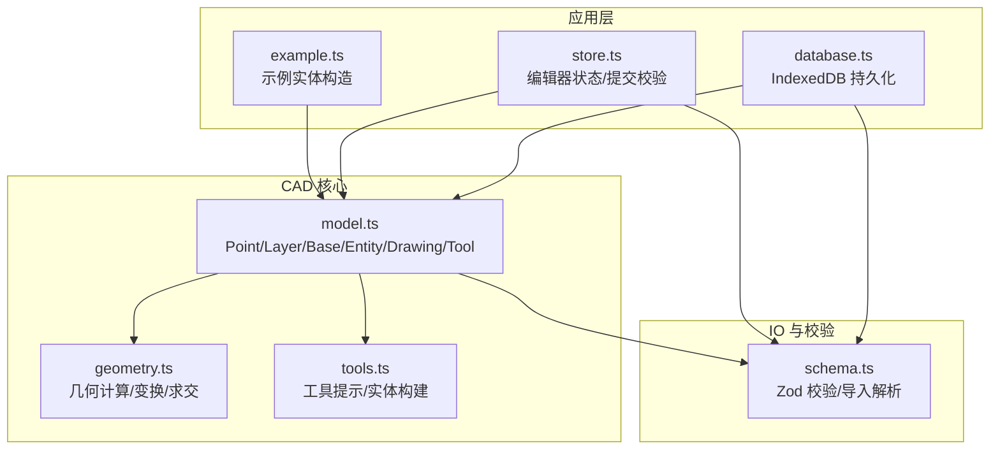
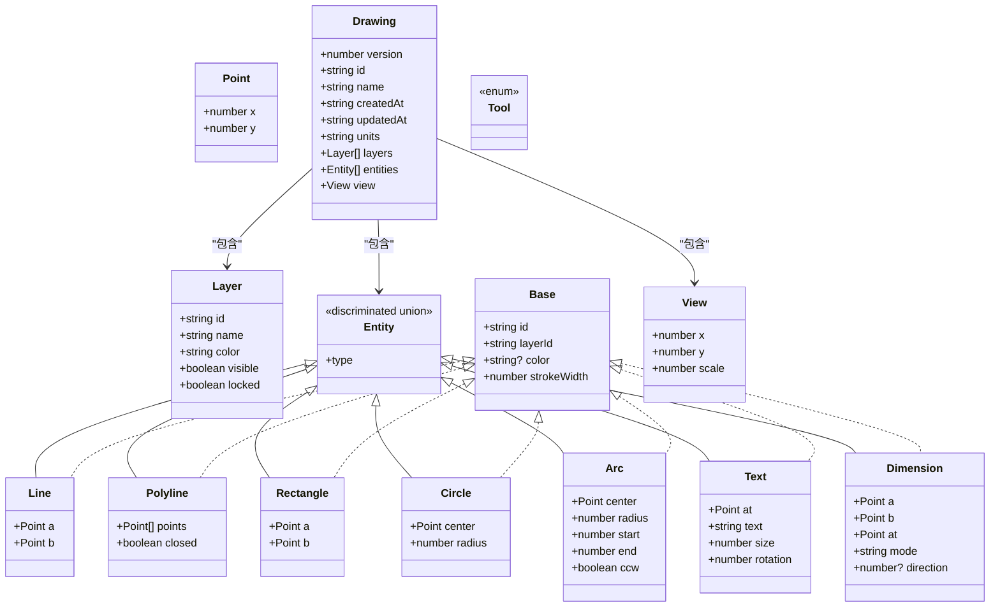
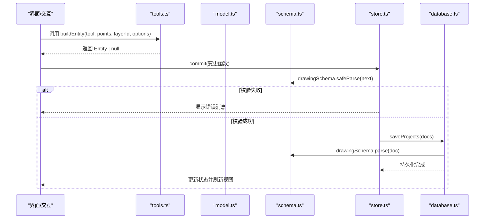
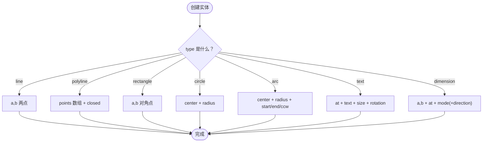
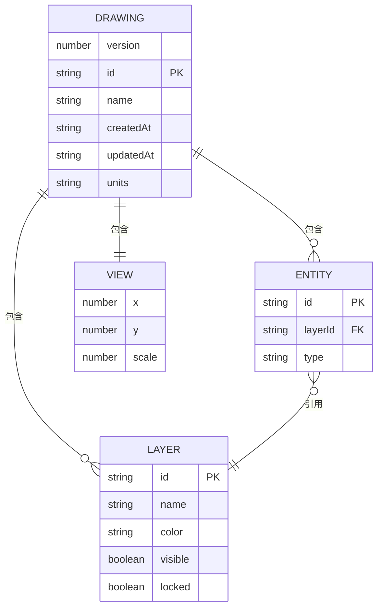
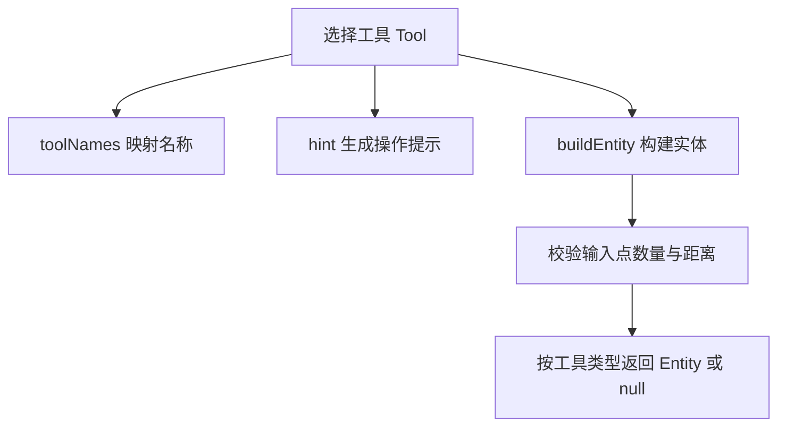
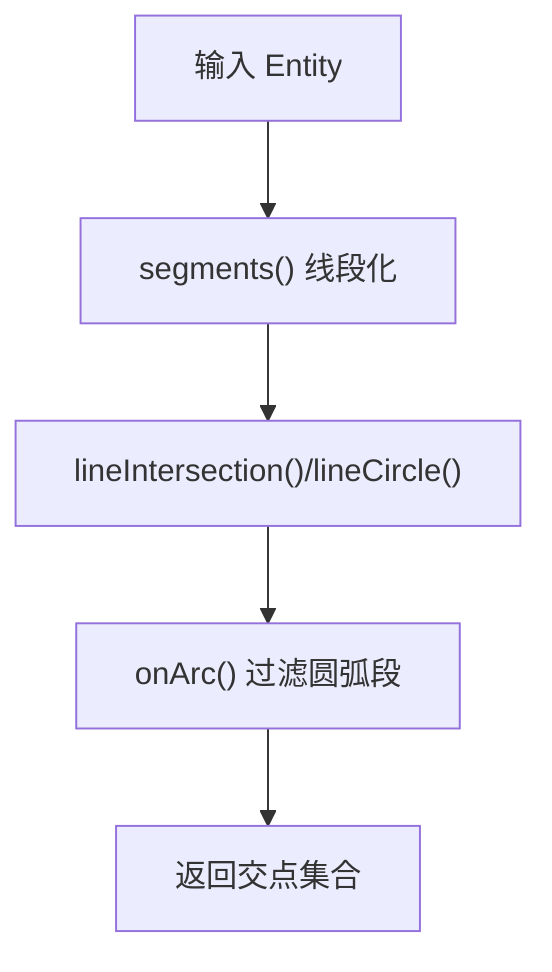
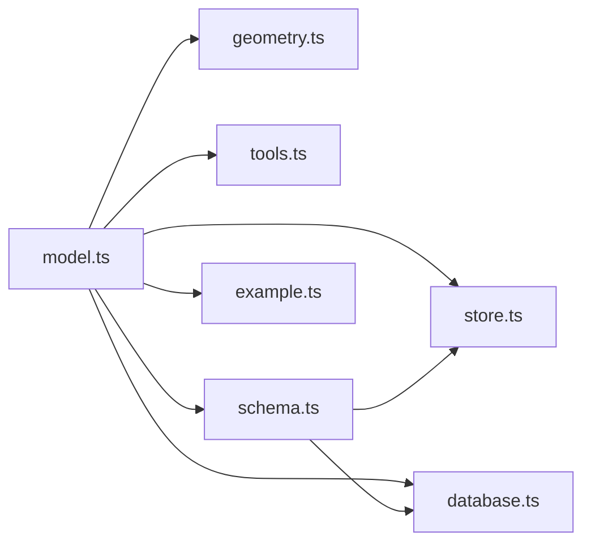
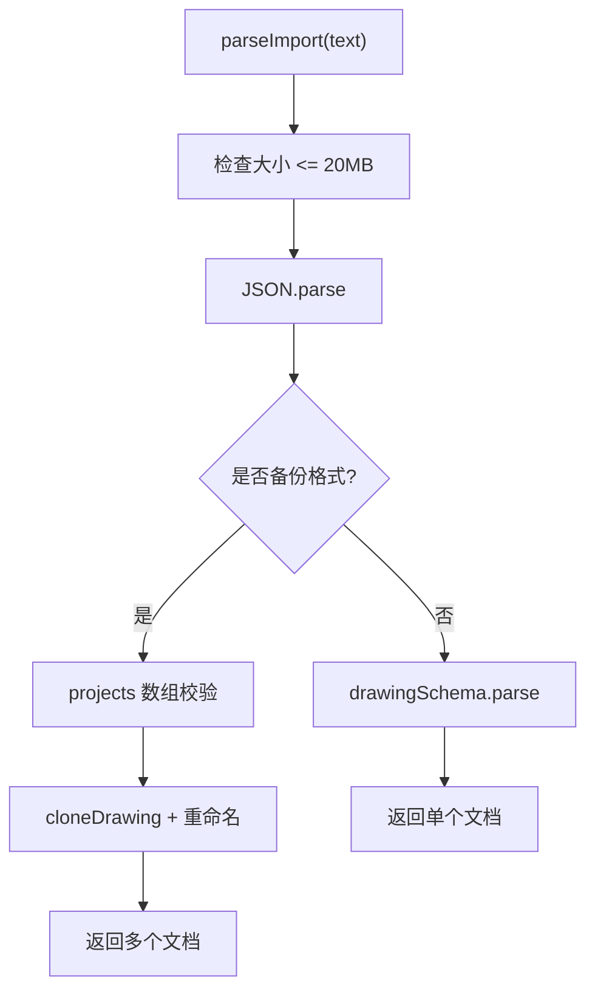

# 数据模型设计

<cite>
**本文引用的文件**   
- [model.ts](file://src/cad/model.ts)
- [geometry.ts](file://src/cad/geometry.ts)
- [tools.ts](file://src/cad/tools.ts)
- [schema.ts](file://src/io/schema.ts)
- [example.ts](file://src/cad/example.ts)
- [store.ts](file://src/features/editor/store.ts)
- [database.ts](file://src/storage/database.ts)
</cite>

## 目录
1. [引言](#引言)
2. [项目结构](#项目结构)
3. [核心数据模型](#核心数据模型)
4. [架构总览](#架构总览)
5. [详细组件分析](#详细组件分析)
6. [依赖关系分析](#依赖关系分析)
7. [性能与复杂度](#性能与复杂度)
8. [数据验证与约束](#数据验证与约束)
9. [序列化与反序列化最佳实践](#序列化与反序列化最佳实践)
10. [常见问题排查](#常见问题排查)
11. [结论](#结论)

## 引言
本文件面向 CAD 核心引擎的数据模型，系统性说明几何实体类型、图层组织、图纸结构与工具类型的定义与扩展机制。重点解释 discriminated union（判别联合）在 Entity 类型中的应用、Base 基础接口的扩展方式、Drawing 的版本管理与元数据、以及数据校验与持久化流程。文档同时提供可操作的示例路径，帮助读者快速创建和操作数据结构。

## 项目结构
CAD 数据模型主要位于以下模块：
- 核心模型定义：src/cad/model.ts
- 几何计算与变换：src/cad/geometry.ts
- 工具与实体构建：src/cad/tools.ts
- 运行时数据校验：src/io/schema.ts
- 示例构造：src/cad/example.ts
- 编辑器状态与提交校验：src/features/editor/store.ts
- 数据库持久化：src/storage/database.ts

图表来源
- [model.ts:1-61](file://src/cad/model.ts#L1-L61)
- [geometry.ts:1-443](file://src/cad/geometry.ts#L1-L443)
- [tools.ts:1-126](file://src/cad/tools.ts#L1-L126)
- [schema.ts:1-134](file://src/io/schema.ts#L1-L134)
- [example.ts:1-102](file://src/cad/example.ts#L1-L102)
- [store.ts:73-129](file://src/features/editor/store.ts#L73-L129)
- [database.ts:1-48](file://src/storage/database.ts#L1-L48)

章节来源
- [model.ts:1-61](file://src/cad/model.ts#L1-L61)
- [geometry.ts:1-443](file://src/cad/geometry.ts#L1-L443)
- [tools.ts:1-126](file://src/cad/tools.ts#L1-L126)
- [schema.ts:1-134](file://src/io/schema.ts#L1-L134)
- [example.ts:1-102](file://src/cad/example.ts#L1-L102)
- [store.ts:73-129](file://src/features/editor/store.ts#L73-L129)
- [database.ts:1-48](file://src/storage/database.ts#L1-L48)

## 核心数据模型
本节聚焦 Point、Layer、Base、Entity、View、Drawing、Tool 等核心接口的设计与职责。

- Point：二维坐标点，作为所有几何实体的基本单位。
- Layer：图层对象，包含 id、name、color、visible、locked，用于组织与过滤实体。
- Base：实体公共字段，包括 id、layerId、可选 color、strokeWidth。
- Entity：基于 discriminated union 的几何实体联合类型，通过 type 字段区分具体几何形状（line、polyline、rectangle、circle、arc、text、dimension），每种类型携带专属属性。
- View：视图配置，包含平移 x/y 与缩放 scale。
- Drawing：图纸根对象，包含 version、id、name、createdAt、updatedAt、units、layers、entities、view。
- Tool：工具枚举，涵盖选择、绘制、编辑与裁剪等工具类型。

图表来源
- [model.ts:1-61](file://src/cad/model.ts#L1-L61)

章节来源
- [model.ts:1-61](file://src/cad/model.ts#L1-L61)

## 架构总览
CAD 数据模型由“核心模型 + 几何计算 + 工具构建 + 校验 + 持久化”组成。核心模型定义数据结构；几何模块提供点运算、变换、求交等算法；工具模块根据用户输入构建实体；校验模块确保数据完整性；持久化模块将有效数据写入 IndexedDB。

图表来源
- [tools.ts:49-125](file://src/cad/tools.ts#L49-L125)
- [schema.ts:66-104](file://src/io/schema.ts#L66-L104)
- [store.ts:79-101](file://src/features/editor/store.ts#L79-L101)
- [database.ts:45-48](file://src/storage/database.ts#L45-L48)

## 详细组件分析

### Point 与 Layer
- Point 是二维坐标的最小单元，被 Entity 各类型广泛使用。
- Layer 管理图层的可见性与锁定状态，影响渲染与编辑行为。

章节来源
- [model.ts:1-11](file://src/cad/model.ts#L1-L11)

### Base 与 Entity 的判别联合模式
- Base 抽象了实体的公共字段（id、layerId、color、strokeWidth）。
- Entity 通过 type 字面量进行判别联合，编译器可在分支中精确推断属性，避免运行时类型检查开销。
- 新增实体类型时，需在 model.ts 中添加联合分支，并在 geometry.ts 与 tools.ts 中补充对应逻辑。

图表来源
- [model.ts:18-45](file://src/cad/model.ts#L18-L45)

章节来源
- [model.ts:12-45](file://src/cad/model.ts#L12-L45)

### Drawing 图纸结构
- version：当前数据格式版本，目前固定为 1，便于未来演进。
- id/name/createdAt/updatedAt：唯一标识与元数据。
- units：单位，当前固定为毫米。
- layers：图层集合，至少一个，最多 100 个。
- entities：实体集合，最多 20000 个。
- view：视图配置，scale 范围限制在 0.01~100。

图表来源
- [model.ts:46-61](file://src/cad/model.ts#L46-L61)
- [schema.ts:66-104](file://src/io/schema.ts#L66-L104)

章节来源
- [model.ts:46-61](file://src/cad/model.ts#L46-L61)
- [schema.ts:66-104](file://src/io/schema.ts#L66-L104)

### Tool 工具类型与扩展机制
- Tool 是字符串字面量联合类型，覆盖选择、绘制、编辑与裁剪等工具。
- tools.ts 提供 toolNames 映射与 hint 提示文案，buildEntity 根据工具与输入点序列构建实体。
- 扩展新工具时，需：
  - 在 model.ts 的 Tool 联合中添加新字面量。
  - 在 tools.ts 的 toolNames/hint/buildEntity 中实现对应逻辑。
  - 在 geometry.ts 中补充必要的几何处理（如需要）。

图表来源
- [tools.ts:5-48](file://src/cad/tools.ts#L5-L48)
- [tools.ts:49-125](file://src/cad/tools.ts#L49-L125)

章节来源
- [model.ts:62-75](file://src/cad/model.ts#L62-L75)
- [tools.ts:1-126](file://src/cad/tools.ts#L1-L126)

### 几何计算与变换
- geometry.ts 提供点加减乘、角度、极坐标、屏幕与世界坐标转换、弧扫角、锚点提取、边界框、吸附、旋转、镜像、线段化、求交等能力。
- transform 对 Entity 进行统一变换，支持旋转与镜像，必要时将矩形转换为折线以保持拓扑一致性。
- intersections 综合线段与圆的求交逻辑，并对圆弧段进行有效性过滤。

图表来源
- [geometry.ts:337-442](file://src/cad/geometry.ts#L337-L442)

章节来源
- [geometry.ts:1-443](file://src/cad/geometry.ts#L1-L443)

### 示例与构造
- example.ts 展示了如何基于 Drawing.layers 获取默认图层，并使用 uid 生成 id，构造多种 Entity。
- 该示例可作为创建复杂装配图的参考模板。

章节来源
- [example.ts:1-102](file://src/cad/example.ts#L1-L102)

## 依赖关系分析
- model.ts 是核心类型定义中心，被 geometry.ts、tools.ts、schema.ts、example.ts、store.ts、database.ts 引用。
- schema.ts 依赖 model.ts 中的 cloneDrawing 以在导入时生成新 ID。
- store.ts 在提交变更时对 next 状态执行 drawingSchema.safeParse，失败则拒绝更新。
- database.ts 使用 drawingSchema.parse 对持久化数据进行强校验。

图表来源
- [model.ts:1-142](file://src/cad/model.ts#L1-L142)
- [geometry.ts:1-443](file://src/cad/geometry.ts#L1-L443)
- [tools.ts:1-126](file://src/cad/tools.ts#L1-L126)
- [schema.ts:1-134](file://src/io/schema.ts#L1-L134)
- [example.ts:1-102](file://src/cad/example.ts#L1-L102)
- [store.ts:73-129](file://src/features/editor/store.ts#L73-L129)
- [database.ts:1-48](file://src/storage/database.ts#L1-L48)

章节来源
- [model.ts:1-142](file://src/cad/model.ts#L1-L142)
- [schema.ts:1-134](file://src/io/schema.ts#L1-L134)
- [store.ts:73-129](file://src/features/editor/store.ts#L73-L129)
- [database.ts:1-48](file://src/storage/database.ts#L1-L48)

## 性能与复杂度
- 实体集合规模上限：entities 最多 20000 个，layers 最多 100 个。
- 数值范围：有限数（finite）且限制在 ±1e9，防止溢出与异常大值。
- 几何求交：对两个实体的线段集合进行双重循环，时间复杂度 O(n*m)，其中 n、m 分别为两实体的线段数。对于圆/圆弧，额外增加常数级计算。
- 变换与边界计算：anchors/bounds/transform 均基于线性遍历，复杂度与实体顶点数成正比。
- 建议：
  - 对大量实体的求交与碰撞检测采用空间索引（如四叉树）优化。
  - 对频繁更新的实体，尽量复用中间结果（如缓存 anchors/bounds）。
  - 控制 polyline 的点数上限（schema 已限制 10000），避免过长折线导致性能退化。

[本节为通用性能讨论，不直接分析具体文件]

## 数据验证与约束
- 数值约束：所有坐标与尺寸使用 finite 数字，范围 ±1e9；半径、size、strokeWidth 为正数；scale 在 0.01~100。
- 长度约束：id 最长 200，name 最长 200，text 最长 10000，layers 最多 100，entities 最多 20000，polyline.points 最多 10000。
- 颜色约束：必须为 6 位十六进制色值。
- 结构约束：
  - version 固定为 1。
  - units 固定为 'mm'。
  - layers 至少 1 个。
  - entities 中每个 layerId 必须在 layers 中存在。
  - layers 与 entities 的 id 必须唯一。
- 导入保护：
  - 文件大小超过 20 MB 直接拒绝。
  - 备份格式 projects 列表内项目 id 必须唯一。
  - 非 JSON 或非法 JSON 抛出错误。

图表来源
- [schema.ts:105-134](file://src/io/schema.ts#L105-L134)

章节来源
- [schema.ts:1-134](file://src/io/schema.ts#L1-L134)

## 序列化与反序列化最佳实践
- 导出：
  - 使用 JSON.stringify 输出 Drawing。
  - 如需 SVG 导出，确保转义文本内容并排除隐藏图层。
- 导入：
  - 优先使用 parseImport 进行安全解析，自动处理备份格式与 ID 重映射。
  - 导入后名称追加“· 导入”，副本名称追加“· 副本”。
- 存储：
  - 使用 drawingSchema.parse 对持久化数据进行强校验。
  - 使用 structuredClone 深拷贝以避免共享可变状态。
- 版本管理：
  - 保持 version 字段稳定，仅在破坏性变更时升级。
  - 迁移逻辑应在导入阶段完成，保证运行期数据结构一致。

章节来源
- [schema.ts:105-134](file://src/io/schema.ts#L105-L134)
- [model.ts:82-141](file://src/cad/model.ts#L82-L141)
- [database.ts:45-48](file://src/storage/database.ts#L45-L48)

## 常见问题排查
- 实体未创建：
  - 检查 buildEntity 的输入点数量与距离阈值（EPS），若无效则返回 null。
  - 确认 layerId 存在且未被锁定。
- 数据提交失败：
  - 查看 store.commit 中的 safeParse 错误信息，常见原因包括数值越界、悬空图层引用、ID 重复。
- 导入失败：
  - 检查文件格式是否为 JSON 或备份格式。
  - 检查 version 是否为 1，units 是否为 'mm'。
  - 检查 layers/entities 的 id 唯一性与 layerId 引用完整性。
- 几何计算异常：
  - 注意 EPS 浮点误差处理，避免除零与无效圆弧。
  - 对圆弧方向（ccw）与起止角（start/end）保持一致性。

章节来源
- [tools.ts:49-125](file://src/cad/tools.ts#L49-L125)
- [store.ts:79-101](file://src/features/editor/store.ts#L79-L101)
- [schema.ts:93-104](file://src/io/schema.ts#L93-L104)
- [geometry.ts:43-72](file://src/cad/geometry.ts#L43-L72)

## 结论
本数据模型以 TypeScript 的类型系统与 Zod 校验为核心，结合 discriminated union 与 Base 扩展机制，实现了可扩展、可验证、可持久化的 CAD 几何数据结构。通过清晰的层次划分（模型/几何/工具/校验/持久化），系统在保证类型安全的同时提供了丰富的几何处理能力与稳健的数据治理策略。遵循本文档的扩展与使用规范，可安全地添加新的实体类型与工具，并确保数据在导入、编辑与存储过程中的完整性与一致性。