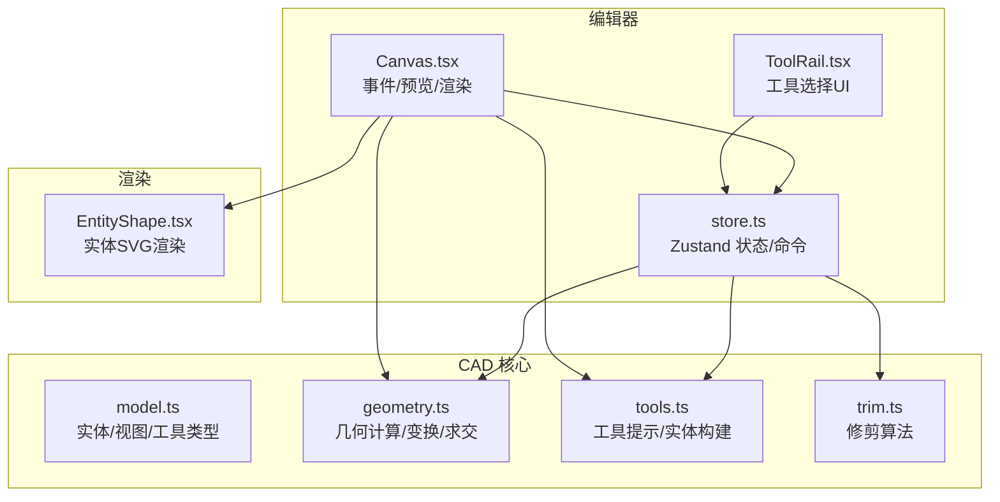
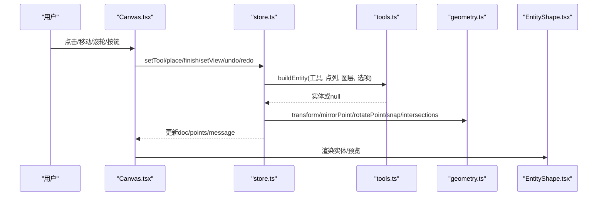
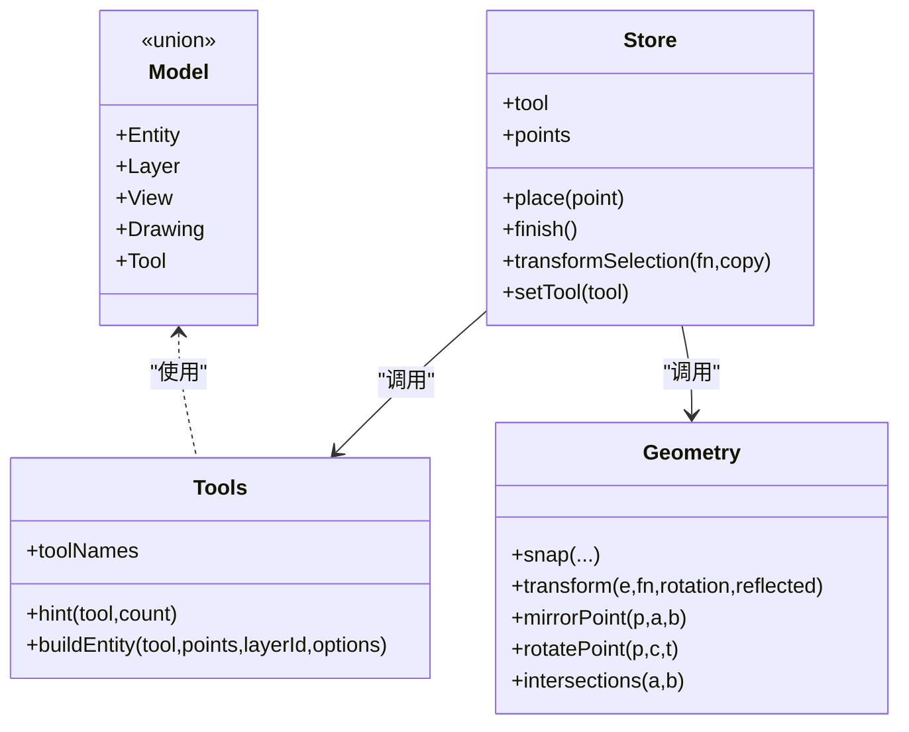
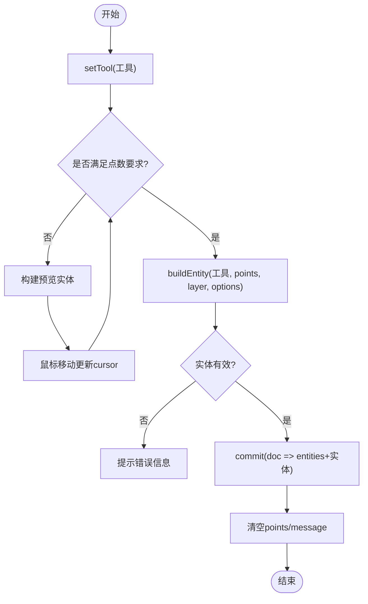
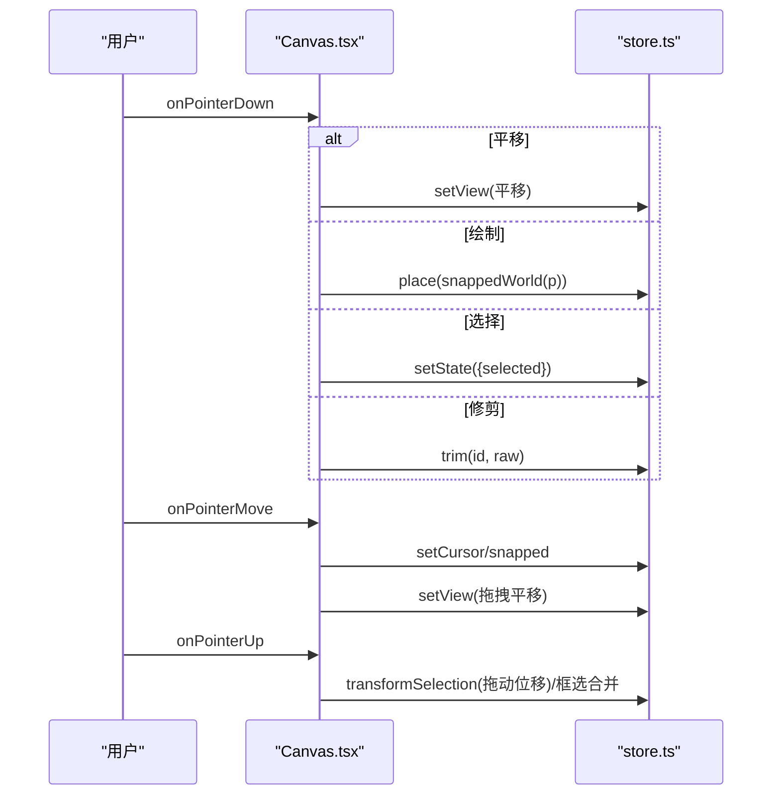
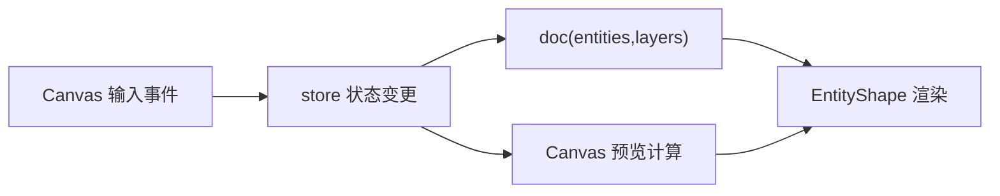
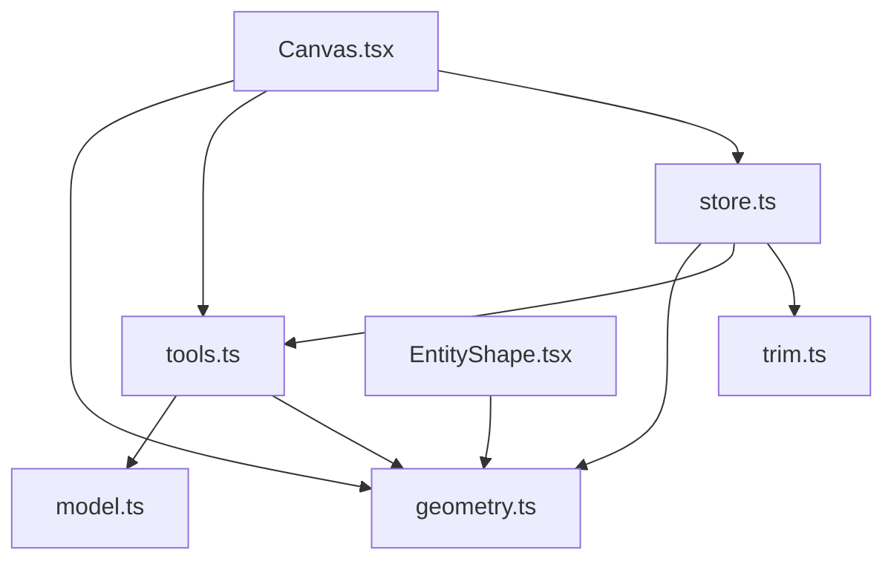

# 绘图工具系统

<cite>
**本文引用的文件**   
- [tools.ts](file://src/cad/tools.ts)
- [model.ts](file://src/cad/model.ts)
- [geometry.ts](file://src/cad/geometry.ts)
- [trim.ts](file://src/cad/trim.ts)
- [store.ts](file://src/features/editor/store.ts)
- [Canvas.tsx](file://src/features/editor/Canvas.tsx)
- [ToolRail.tsx](file://src/features/editor/ToolRail.tsx)
- [EntityShape.tsx](file://src/components/EntityShape.tsx)
</cite>

## 目录
1. [引言](#引言)
2. [项目结构](#项目结构)
3. [核心组件](#核心组件)
4. [架构总览](#架构总览)
5. [详细组件分析](#详细组件分析)
6. [依赖关系分析](#依赖关系分析)
7. [性能与体验优化](#性能与体验优化)
8. [故障排查指南](#故障排查指南)
9. [结论](#结论)
10. [附录：扩展与自定义工具开发指南](#附录扩展与自定义工具开发指南)

## 引言
本文件面向 CAD 核心引擎的“绘图工具系统”，系统性阐述工具类型定义、工具基类设计模式（以工厂函数与状态机为核心的轻量实现）、各绘图工具的绘制算法与交互流程，以及工具状态管理、用户输入处理、预览机制、编辑器状态同步和数据流。同时提供工具扩展开发指南与性能优化建议，帮助读者快速理解并在此基础上扩展新的绘图工具。

## 项目结构
本项目采用分层组织方式：
- cad 层：几何计算、实体模型、工具构建与修剪逻辑
- features/editor 层：编辑器状态、画布交互、工具栏 UI
- components 层：通用图形渲染组件
- io/storage：持久化与存储（与本主题关联较少）

图表来源
- [model.ts:18-75](file://src/cad/model.ts#L18-L75)
- [geometry.ts:31-42](file://src/cad/geometry.ts#L31-L42)
- [tools.ts:5-48](file://src/cad/tools.ts#L5-L48)
- [store.ts:17-47](file://src/features/editor/store.ts#L17-L47)
- [Canvas.tsx:32-43](file://src/features/editor/Canvas.tsx#L32-L43)
- [ToolRail.tsx:21-58](file://src/features/editor/ToolRail.tsx#L21-L58)
- [EntityShape.tsx:4-12](file://src/components/EntityShape.tsx#L4-L12)

章节来源
- [model.ts:1-142](file://src/cad/model.ts#L1-L142)
- [geometry.ts:1-443](file://src/cad/geometry.ts#L1-L443)
- [tools.ts:1-126](file://src/cad/tools.ts#L1-L126)
- [trim.ts:1-129](file://src/cad/trim.ts#L1-L129)
- [store.ts:1-324](file://src/features/editor/store.ts#L1-L324)
- [Canvas.tsx:1-652](file://src/features/editor/Canvas.tsx#L1-L652)
- [ToolRail.tsx:1-96](file://src/features/editor/ToolRail.tsx#L1-L96)
- [EntityShape.tsx:1-96](file://src/components/EntityShape.tsx#L1-L96)

## 核心组件
- 工具类型与实体模型：统一描述所有可绘制的几何对象、视图、图层与工具枚举。
- 几何库：提供点运算、坐标变换、捕捉、求交、旋转镜像等基础能力。
- 工具构建器：根据当前工具与已采集的点序列生成具体实体，并提供工具提示。
- 编辑器状态：集中管理文档、选中项、工具、临时点、视图、撤销重做等。
- 画布交互：处理鼠标/键盘/滚轮事件，驱动预览与最终提交。
- 工具栏 UI：展示分组工具按钮，绑定快捷键与激活态。
- 实体渲染：将不同实体类型映射为 SVG 元素。

章节来源
- [model.ts:18-75](file://src/cad/model.ts#L18-L75)
- [geometry.ts:1-443](file://src/cad/geometry.ts#L1-L443)
- [tools.ts:5-126](file://src/cad/tools.ts#L5-L126)
- [store.ts:17-47](file://src/features/editor/store.ts#L17-L47)
- [Canvas.tsx:32-43](file://src/features/editor/Canvas.tsx#L32-L43)
- [ToolRail.tsx:21-58](file://src/features/editor/ToolRail.tsx#L21-L58)
- [EntityShape.tsx:4-96](file://src/components/EntityShape.tsx#L4-L96)

## 架构总览
绘图工具系统采用“状态驱动 + 工厂构建”的模式：
- 工具类型是字符串联合类型，不引入复杂继承体系，降低耦合。
- 工具行为通过 store 中的 place/finish/transformSelection 等方法编排。
- 实体构建由 buildEntity 工厂完成，按工具分支构造对应实体。
- 画布负责事件到状态的映射，实时预览基于当前工具与光标位置动态构建草稿实体。

图表来源
- [Canvas.tsx:196-263](file://src/features/editor/Canvas.tsx#L196-L263)
- [store.ts:187-286](file://src/features/editor/store.ts#L187-L286)
- [tools.ts:49-126](file://src/cad/tools.ts#L49-L126)
- [geometry.ts:246-336](file://src/cad/geometry.ts#L246-L336)
- [EntityShape.tsx:4-96](file://src/components/EntityShape.tsx#L4-L96)

## 详细组件分析

### 工具类型定义与工具基类设计模式
- 工具类型：使用字符串联合类型 Tool，包含 select/line/polyline/rectangle/circle/arc/text/dimension/move/copy/rotate/mirror/trim。
- 工具命名与提示：toolNames 与 hint 函数提供工具显示名与分步提示，增强用户体验。
- 工具基类模式：未采用传统 OOP 继承，而是以“工具枚举 + 工厂函数 + 状态机”的组合实现：
  - 工厂函数 buildEntity 根据 tool 与 points 构建实体；
  - store 中 place/finish 作为状态机节点，维护 points 计数与工具特定逻辑；
  - Canvas 在 move 时基于 cursor 与 points 计算预览实体。

图表来源
- [model.ts:18-75](file://src/cad/model.ts#L18-L75)
- [tools.ts:5-126](file://src/cad/tools.ts#L5-L126)
- [store.ts:17-47](file://src/features/editor/store.ts#L17-L47)
- [geometry.ts:191-336](file://src/cad/geometry.ts#L191-L336)

章节来源
- [model.ts:62-75](file://src/cad/model.ts#L62-L75)
- [tools.ts:5-48](file://src/cad/tools.ts#L5-L48)
- [tools.ts:49-126](file://src/cad/tools.ts#L49-L126)
- [store.ts:187-286](file://src/features/editor/store.ts#L187-L286)

### 绘图工具实现逻辑与算法

#### 直线 line
- 输入：起点 a、终点 b
- 校验：两点距离需大于 EPS
- 输出：type=line 的实体

章节来源
- [tools.ts:79-82](file://src/cad/tools.ts#L79-L82)

#### 多段线 polyline
- 输入：多点序列 points
- 交互：支持逐步添加点，Enter 完成
- 输出：type=polyline，默认 closed=false

章节来源
- [tools.ts:96-103](file://src/cad/tools.ts#L96-L103)
- [store.ts:265-286](file://src/features/editor/store.ts#L265-L286)

#### 矩形 rectangle
- 输入：对角两点 a、b
- 校验：x/y 差值均大于 EPS
- 输出：type=rectangle

章节来源
- [tools.ts:83-87](file://src/cad/tools.ts#L83-L87)

#### 圆 circle
- 输入：圆心 center、圆周点 b
- 半径：distance(center, b)
- 输出：type=circle

章节来源
- [tools.ts:88-95](file://src/cad/tools.ts#L88-L95)

#### 圆弧 arc（三点圆弧）
- 输入：起点 a、中间点 mid、终点 b
- 算法：通过三点求外接圆圆心与半径，确定起止角与方向 ccw
- 输出：type=arc

章节来源
- [tools.ts:104-113](file://src/cad/tools.ts#L104-L113)
- [geometry.ts:55-72](file://src/cad/geometry.ts#L55-L72)

#### 文字 text
- 输入：插入点 at、文本内容、字号、旋转角度
- 输出：type=text

章节来源
- [tools.ts:67-78](file://src/cad/tools.ts#L67-L78)

#### 尺寸标注 dimension
- 输入：测量点 a、b，标注位置 at，模式 mode（水平/垂直/斜向）
- 输出：type=dimension

章节来源
- [tools.ts:114-123](file://src/cad/tools.ts#L114-L123)

#### 修改工具：移动/复制/旋转/镜像
- 移动/复制：基准点与目标点决定位移向量；copy 会生成新实体
- 旋转：以光标为旋转中心，属性面板控制角度
- 镜像：两点定义镜像轴，对选中实体进行反射变换
- 预览：move/copy/mirror/rotate 在移动过程中实时预览变换结果

章节来源
- [store.ts:192-233](file://src/features/editor/store.ts#L192-L233)
- [Canvas.tsx:355-389](file://src/features/editor/Canvas.tsx#L355-L389)
- [geometry.ts:246-336](file://src/cad/geometry.ts#L246-L336)

#### 修剪 trim
- 输入：目标实体 id、裁剪边界集合（可见实体）、点击位置 point
- 算法：计算目标与边界的交点，依据点击位置决定保留区段
- 支持：直线、圆、圆弧

章节来源
- [store.ts:287-315](file://src/features/editor/store.ts#L287-L315)
- [trim.ts:21-129](file://src/cad/trim.ts#L21-L129)

### 工具状态管理机制
- 工具激活：setTool 重置 points 与 message，切换工具后进入相应交互阶段。
- 参数设置：text、textSize、dimensionMode、rotation 等参数保存在 store，供 buildEntity 使用。
- 实时预览：Canvas 在 move 时根据当前工具与光标位置，调用 buildEntity 生成预览实体，并在 SVG 中以虚线样式渲染。
- 完成提交：place 收集足够点数后构建实体并提交到 doc；polyline 可通过 Enter 触发 finish 完成。

图表来源
- [store.ts:187-286](file://src/features/editor/store.ts#L187-L286)
- [tools.ts:49-126](file://src/cad/tools.ts#L49-L126)
- [Canvas.tsx:355-389](file://src/features/editor/Canvas.tsx#L355-L389)

章节来源
- [store.ts:111-111](file://src/features/editor/store.ts#L111-L111)
- [store.ts:187-286](file://src/features/editor/store.ts#L187-L286)
- [Canvas.tsx:355-389](file://src/features/editor/Canvas.tsx#L355-L389)

### 用户输入处理流程
- 鼠标事件：
  - down：区分平移（空格/中键）、工具绘制（非 select）、选择（select）、修剪（trim）。
  - move：更新光标位置、捕捉结果、拖拽平移/框选/拖动实体。
  - up：完成框选、拖动位移、清理手势状态。
- 键盘快捷键：
  - Space：临时平移模式
  - Ctrl/Cmd+Z/Y：撤销/重做
  - Ctrl/Cmd+A：全选
  - Esc：取消工具/清空选择
  - Delete/Backspace：删除选中
  - Enter：完成多段线
  - 字母键：快捷切换工具（v/l/p/r/c/a/t/d/m）
- 触摸手势：
  - 使用 Pointer Events 统一处理鼠标与触摸，无需额外适配。

图表来源
- [Canvas.tsx:196-328](file://src/features/editor/Canvas.tsx#L196-L328)
- [Canvas.tsx:94-179](file://src/features/editor/Canvas.tsx#L94-L179)
- [store.ts:187-315](file://src/features/editor/store.ts#L187-L315)

章节来源
- [Canvas.tsx:94-179](file://src/features/editor/Canvas.tsx#L94-L179)
- [Canvas.tsx:196-328](file://src/features/editor/Canvas.tsx#L196-L328)

### 工具与编辑器状态同步机制和数据流
- 状态源：Zustand store 持有 doc、tool、points、selected、view 等。
- 数据流：
  - Canvas 监听用户输入，调用 store 方法更新状态。
  - store 通过 commit 创建新版本文档，维护 history/future 实现撤销重做。
  - 预览数据由 Canvas 基于当前 tool/points/cursor 动态计算，不写入 doc。
  - 实体渲染由 EntityShape 读取 doc.entities 与 layers 控制可见性/颜色/选中态。

图表来源
- [store.ts:79-101](file://src/features/editor/store.ts#L79-L101)
- [Canvas.tsx:355-389](file://src/features/editor/Canvas.tsx#L355-L389)
- [EntityShape.tsx:4-96](file://src/components/EntityShape.tsx#L4-L96)

章节来源
- [store.ts:79-101](file://src/features/editor/store.ts#L79-L101)
- [Canvas.tsx:355-389](file://src/features/editor/Canvas.tsx#L355-L389)
- [EntityShape.tsx:4-96](file://src/components/EntityShape.tsx#L4-L96)

## 依赖关系分析
- tools.ts 依赖 model.ts（类型）、geometry.ts（距离/EPS）、model.ts（uid）。
- store.ts 依赖 geometry.ts（几何变换）、tools.ts（buildEntity）、trim.ts（修剪）、io/schema（数据校验）。
- Canvas.tsx 依赖 geometry.ts（坐标转换/捕捉/求交）、tools.ts（hint/buildEntity）、store.ts（状态）。
- EntityShape.tsx 依赖 geometry.ts（维度几何/极坐标）。

图表来源
- [tools.ts:1-3](file://src/cad/tools.ts#L1-L3)
- [store.ts:1-15](file://src/features/editor/store.ts#L1-L15)
- [Canvas.tsx:5-21](file://src/features/editor/Canvas.tsx#L5-L21)
- [EntityShape.tsx:1-3](file://src/components/EntityShape.tsx#L1-L3)

章节来源
- [tools.ts:1-126](file://src/cad/tools.ts#L1-L126)
- [store.ts:1-324](file://src/features/editor/store.ts#L1-L324)
- [Canvas.tsx:1-652](file://src/features/editor/Canvas.tsx#L1-L652)
- [EntityShape.tsx:1-96](file://src/components/EntityShape.tsx#L1-L96)

## 性能与体验优化
- 渲染优化：
  - 预览实体使用低透明度与虚线样式，减少视觉干扰。
  - 仅对可见且未锁定的图层实体参与捕捉与求交，降低计算量。
  - 网格与标尺按需绘制，避免重复计算。
- 交互优化：
  - 使用 Pointer Events 统一鼠标/触摸，简化事件处理。
  - 捕捉优先对象锚点，其次网格，最后正交约束，提升精度与效率。
  - 框选与拖动仅在位移超过阈值时提交，减少频繁状态更新。
- 状态优化：
  - commit 前使用 schema 校验，防止非法数据污染历史栈。
  - history 限制长度，避免内存增长。
- 用户体验：
  - 工具提示与快捷键提示清晰，Esc 取消操作，Enter 完成多段线。
  - 空画布引导文案与示例图纸入口，降低上手门槛。

[本节为通用指导，不直接分析具体文件]

## 故障排查指南
- 无法构建实体：
  - 检查点数是否满足工具要求（如 line 需要两个不同点，arc 需要三个点）。
  - 检查图层是否可见且未锁定。
  - 查看 message 提示，确认数值范围或几何有效性。
- 修剪无效：
  - 确保目标为直线/圆/圆弧，且存在有效交点。
  - 检查裁剪边界是否为可见实体。
- 变换失败：
  - 移动/复制/旋转/镜像需要先选择未锁定图层的实体。
  - 镜像轴两点不能重合。
- 撤销/重做异常：
  - 检查 commit 的数据校验是否通过。
  - 确认 history/future 栈未越界。

章节来源
- [store.ts:79-101](file://src/features/editor/store.ts#L79-L101)
- [store.ts:187-315](file://src/features/editor/store.ts#L187-L315)
- [tools.ts:79-126](file://src/cad/tools.ts#L79-L126)

## 结论
该绘图工具系统以简洁的类型系统与工厂函数为核心，结合 Zustand 状态管理与 React 事件驱动，实现了稳定可扩展的 CAD 绘图体验。通过明确的工具状态机、实时预览与完善的几何计算库，系统在易用性与性能之间取得良好平衡。后续可在保持现有模式的基础上，扩展更多工具类型与高级交互。

[本节为总结性内容，不直接分析具体文件]

## 附录：扩展与自定义工具开发指南

### 新增工具步骤
1. 在 model.ts 的 Tool 联合类型中添加新工具名称。
2. 在 tools.ts 的 toolNames 与 hint 中添加显示名与分步提示。
3. 在 tools.ts 的 buildEntity 中实现新工具的实体构建逻辑。
4. 在 store.ts 的 place/finish 中补充新工具的点数统计与完成逻辑。
5. 在 Canvas.tsx 中为新工具增加预览逻辑（如需）。
6. 在 ToolRail.tsx 中注册新工具按钮与快捷键。
7. 在 EntityShape.tsx 中为新实体类型添加 SVG 渲染逻辑。

### 关键实现要点
- 工具提示：确保 hint 覆盖所有交互阶段，提升用户引导。
- 实体构建：严格校验输入点与参数，返回 null 表示无效，交由 store 提示。
- 预览机制：利用 buildEntity 传入 cursor 作为第三点或终点，实现实时预览。
- 状态同步：place/finish 应保证 points 与 message 的一致性，避免状态漂移。
- 渲染一致性：EntityShape 需完整覆盖所有实体类型，确保预览与最终实体一致。

### 示例路径参考
- 工具类型与命名：[model.ts:62-75](file://src/cad/model.ts#L62-L75)、[tools.ts:5-19](file://src/cad/tools.ts#L5-L19)
- 工具提示：[tools.ts:20-48](file://src/cad/tools.ts#L20-L48)
- 实体构建：[tools.ts:49-126](file://src/cad/tools.ts#L49-L126)
- 状态机：[store.ts:187-286](file://src/features/editor/store.ts#L187-L286)
- 预览逻辑：[Canvas.tsx:355-389](file://src/features/editor/Canvas.tsx#L355-L389)
- 工具栏注册：[ToolRail.tsx:21-58](file://src/features/editor/ToolRail.tsx#L21-L58)
- 实体渲染：[EntityShape.tsx:4-96](file://src/components/EntityShape.tsx#L4-L96)

[本节为概念性指导，不直接分析具体文件]