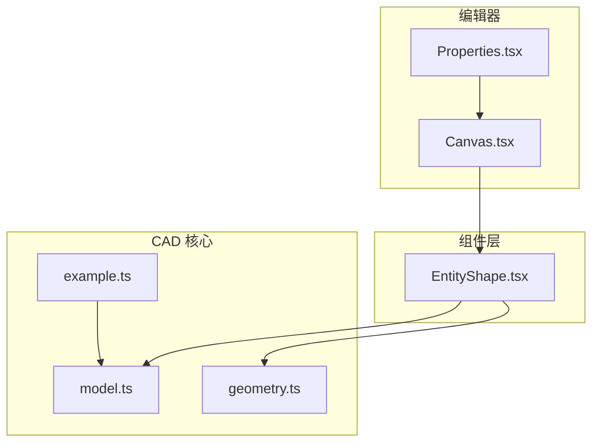
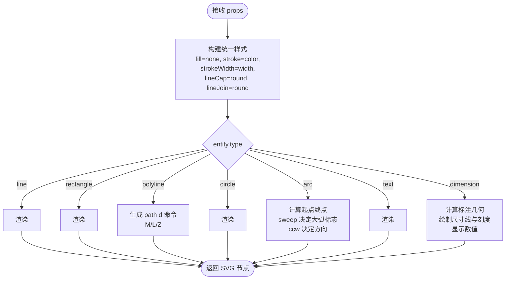
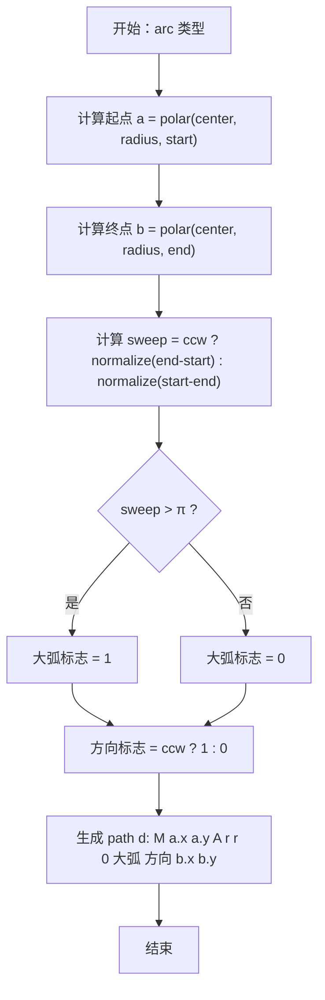
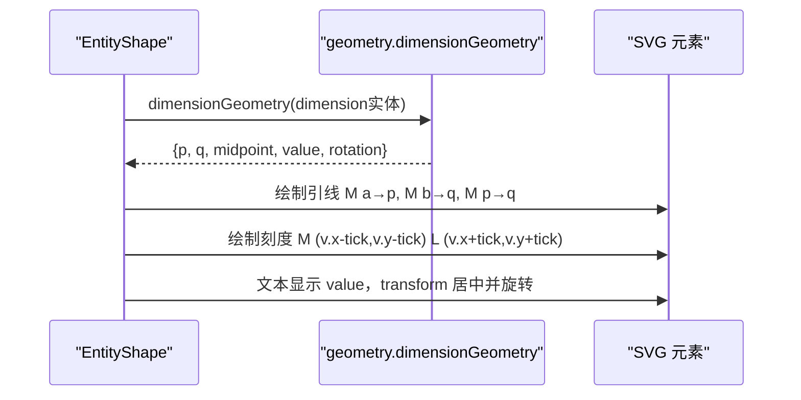
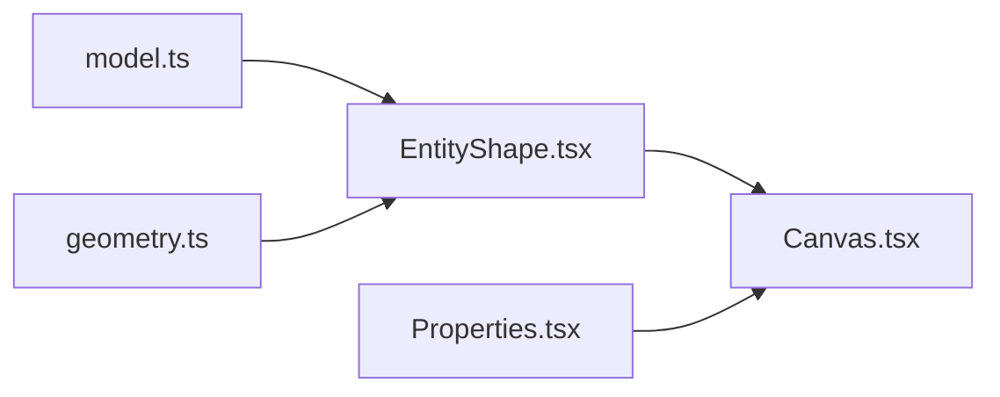

# EntityShape几何图形组件

<cite>
**本文引用的文件**   
- [EntityShape.tsx](file://src/components/EntityShape.tsx)
- [model.ts](file://src/cad/model.ts)
- [geometry.ts](file://src/cad/geometry.ts)
- [Canvas.tsx](file://src/features/editor/Canvas.tsx)
- [Properties.tsx](file://src/features/editor/Properties.tsx)
- [example.ts](file://src/cad/example.ts)
</cite>

## 目录
1. [简介](#简介)
2. [项目结构](#项目结构)
3. [核心组件](#核心组件)
4. [架构总览](#架构总览)
5. [详细组件分析](#详细组件分析)
6. [依赖关系分析](#依赖关系分析)
7. [性能与优化建议](#性能与优化建议)
8. [故障排查指南](#故障排查指南)
9. [结论](#结论)
10. [附录：使用示例与自定义样式](#附录使用示例与自定义样式)

## 简介
EntityShape 是一个用于将 CAD 实体数据动态渲染为 SVG 图形的 React 组件。它根据实体的类型（直线、矩形、多段线、圆、圆弧、文本、标注）选择对应的 SVG 元素，并应用统一的描边样式系统。该组件不关心坐标变换与视图缩放，只负责“从数据到图形”的映射；坐标系统与缩放由上层 Canvas 处理。

## 项目结构
本组件位于 components 层，依赖 cad 层的模型与几何工具：
- model.ts：定义 Entity 联合类型、Point、Layer、Drawing 等数据结构
- geometry.ts：提供极坐标转换、角度归一化、弧扫角计算、标注几何计算等工具
- EntityShape.tsx：根据 Entity 类型渲染对应 SVG 元素
- Canvas.tsx：在编辑器中实例化 EntityShape，传入颜色与线宽
- Properties.tsx：编辑器的属性面板，控制实体颜色与线宽
- example.ts：示例数据，展示不同实体类型的构造方式

图表来源
- [Canvas.tsx:469-513](file://src/features/editor/Canvas.tsx#L469-L513)
- [EntityShape.tsx:1-96](file://src/components/EntityShape.tsx#L1-L96)
- [model.ts:1-61](file://src/cad/model.ts#L1-L61)
- [geometry.ts:1-111](file://src/cad/geometry.ts#L1-L111)
- [example.ts:1-63](file://src/cad/example.ts#L1-L63)

章节来源
- [EntityShape.tsx:1-96](file://src/components/EntityShape.tsx#L1-L96)
- [model.ts:1-61](file://src/cad/model.ts#L1-L61)
- [geometry.ts:1-111](file://src/cad/geometry.ts#L1-L111)
- [Canvas.tsx:469-513](file://src/features/editor/Canvas.tsx#L469-L513)
- [Properties.tsx:104-123](file://src/features/editor/Properties.tsx#L104-L123)
- [example.ts:1-63](file://src/cad/example.ts#L1-L63)

## 核心组件
EntityShape 接收三个参数：
- entity：一个 Entity 对象，表示待渲染的 CAD 实体
- color：描边颜色字符串
- width：可选的线宽，默认取 entity.strokeWidth

内部样式系统：
- fill：固定为 none（不填充）
- stroke：color
- strokeWidth：width
- strokeLinecap：round（端点圆头）
- strokeLinejoin：round（连接处圆角）

这些样式通过展开属性传递给每个 SVG 元素，确保所有几何类型具有一致的视觉风格。

章节来源
- [EntityShape.tsx:4-19](file://src/components/EntityShape.tsx#L4-L19)

## 架构总览
EntityShape 作为纯渲染组件，遵循“数据驱动视图”的模式：
- 输入：Entity 数据 + 样式参数
- 处理：按 type 分支选择 SVG 元素，必要时调用 geometry 工具计算路径或角度
- 输出：SVG 节点树

图表来源
- [EntityShape.tsx:20-95](file://src/components/EntityShape.tsx#L20-L95)
- [geometry.ts:43-111](file://src/cad/geometry.ts#L43-L111)

## 详细组件分析

### Props 接口与样式系统
- entity：必须提供，类型为 Entity 联合类型，包含 id、layerId、color、strokeWidth 以及各几何类型的特有字段
- color：必填的颜色字符串，用于描边和文本填充
- width：可选数字，若未提供则回退到 entity.strokeWidth

样式对象统一设置：
- 填充：none
- 描边：color
- 线宽：width
- 端点：round
- 连接：round

这保证了所有几何类型在视觉上保持一致的描边风格。

章节来源
- [EntityShape.tsx:4-19](file://src/components/EntityShape.tsx#L4-L19)
- [model.ts:12-45](file://src/cad/model.ts#L12-L45)

### 几何类型渲染逻辑

#### 直线（line）
- 直接渲染 <line>，使用 e.a 与 e.b 两点坐标

章节来源
- [EntityShape.tsx:20-21](file://src/components/EntityShape.tsx#L20-L21)

#### 矩形（rectangle）
- 使用 <rect>，以 a、b 两点的对角确定矩形区域
- x、y 取最小值，width、height 取绝对差值，保证任意顺序的对角点都能正确渲染

章节来源
- [EntityShape.tsx:22-31](file://src/components/EntityShape.tsx#L22-L31)

#### 多段线（polyline）
- 使用 <path>，按 points 数组依次生成 M/L 命令
- 如果 closed 为真，追加 Z 闭合路径
- 首点使用 M，后续点使用 L

章节来源
- [EntityShape.tsx:33-39](file://src/components/EntityShape.tsx#L33-L39)

#### 圆（circle）
- 使用 <circle>，cx、cy 为圆心，r 为半径

章节来源
- [EntityShape.tsx:41-42](file://src/components/EntityShape.tsx#L41-L42)

#### 圆弧（arc）
- 使用 <path> 的 A 命令绘制圆弧
- 通过 polar 计算起点与终点坐标
- sweep(e) 计算扫角是否大于 π，决定大弧标志
- ccw 决定圆弧方向（逆时针为 1）

图表来源
- [EntityShape.tsx:43-55](file://src/components/EntityShape.tsx#L43-L55)
- [geometry.ts:25-47](file://src/cad/geometry.ts#L25-L47)

章节来源
- [EntityShape.tsx:43-55](file://src/components/EntityShape.tsx#L43-L55)
- [geometry.ts:25-47](file://src/cad/geometry.ts#L25-L47)

#### 文本（text）
- 使用 <text>，位置为 e.at，旋转为 e.rotation，字号为 e.size
- 通过 transform 进行平移、旋转与 Y 轴翻转（scale(1 -1)），适配 SVG 坐标系

章节来源
- [EntityShape.tsx:57-67](file://src/components/EntityShape.tsx#L57-L67)

#### 标注（dimension）
- 使用 geometry.dimensionGeometry 计算 p、q、midpoint、value、rotation
- 绘制两条引线（a→p、b→q）与尺寸线（p→q）
- 在 p、q 处绘制短刻度线
- 在 midpoint 处显示数值，字体大小固定，颜色继承 color

图表来源
- [EntityShape.tsx:69-93](file://src/components/EntityShape.tsx#L69-L93)
- [geometry.ts:81-111](file://src/cad/geometry.ts#L81-L111)

章节来源
- [EntityShape.tsx:69-93](file://src/components/EntityShape.tsx#L69-L93)
- [geometry.ts:81-111](file://src/cad/geometry.ts#L81-L111)

### 复杂几何算法说明

#### 圆弧扫角与方向
- sweep 函数根据 ccw 与 start/end 角度计算扫角范围
- 当扫角大于 π 时，SVG 的 large-arc-flag 设为 1，否则为 0
- ccw 决定 direction-flag（逆时针为 1）

章节来源
- [geometry.ts:43-47](file://src/cad/geometry.ts#L43-L47)
- [EntityShape.tsx:43-55](file://src/components/EntityShape.tsx#L43-L55)

#### 多段线路径生成
- 使用 M 命令移动到第一个点，随后用 L 命令连接到后续点
- 如果 closed 为真，追加 Z 闭合路径

章节来源
- [EntityShape.tsx:33-39](file://src/components/EntityShape.tsx#L33-L39)

#### 标注几何计算
- 水平模式：p、q 的 y 坐标等于 at.y
- 垂直模式：p、q 的 x 坐标等于 at.x
- 对齐模式：根据 direction 或向量投影计算 p、q
- 返回值包括 p、q、中点、长度与旋转角度

章节来源
- [geometry.ts:81-111](file://src/cad/geometry.ts#L81-L111)

## 依赖关系分析
- EntityShape 依赖 model.ts 中的 Entity 类型，确保类型安全
- EntityShape 依赖 geometry.ts 的工具函数 polar、sweep、dimensionGeometry
- Canvas.tsx 在视图中实例化 EntityShape，传入颜色与线宽
- Properties.tsx 提供用户界面来修改 color 与 strokeWidth

图表来源
- [EntityShape.tsx:1-2](file://src/components/EntityShape.tsx#L1-L2)
- [Canvas.tsx:469-513](file://src/features/editor/Canvas.tsx#L469-L513)
- [Properties.tsx:104-123](file://src/features/editor/Properties.tsx#L104-L123)

章节来源
- [EntityShape.tsx:1-2](file://src/components/EntityShape.tsx#L1-L2)
- [Canvas.tsx:469-513](file://src/features/editor/Canvas.tsx#L469-L513)
- [Properties.tsx:104-123](file://src/features/editor/Properties.tsx#L104-L123)

## 性能与优化建议
- 避免重复计算：对于静态实体，可在父组件缓存生成的 path d 字符串，减少每次渲染时的字符串拼接
- 批量更新：对大量实体渲染，考虑使用 key 稳定且分组渲染，减少重排
- 合理使用 scale：在 Canvas 中根据缩放比例调整 width，避免过细或过粗的线宽影响渲染性能
- 文本渲染优化：文本数量较多时，可限制字号与字体族，避免频繁创建复杂文本节点
- 标注渲染优化：仅在选中或预览时渲染标注组，降低常规视图的复杂度

[本节为通用指导，不涉及具体文件分析]

## 故障排查指南
- 圆弧方向错误：检查 ccw 与 start/end 的角度顺序，确认 sweep 计算是否符合预期
- 多段线未闭合：检查 polyline.closed 是否为真，确保路径末尾追加 Z
- 标注数值异常：检查 dimensionGeometry 的 mode 与 direction 设置，确认 p、q 的计算是否正确
- 文本旋转异常：确认 transform 的顺序与 scale(1 -1) 的使用，确保文字方向正确
- 线宽异常：确认 width 是否被正确传入，或在未传参时回退到 entity.strokeWidth

章节来源
- [EntityShape.tsx:43-55](file://src/components/EntityShape.tsx#L43-L55)
- [EntityShape.tsx:33-39](file://src/components/EntityShape.tsx#L33-L39)
- [EntityShape.tsx:69-93](file://src/components/EntityShape.tsx#L69-L93)
- [EntityShape.tsx:57-67](file://src/components/EntityShape.tsx#L57-L67)
- [EntityShape.tsx:4-12](file://src/components/EntityShape.tsx#L4-L12)

## 结论
EntityShape 组件以简洁的数据驱动方式，将多种 CAD 实体类型映射为对应的 SVG 元素，并通过统一的样式系统保持视觉一致性。其内部逻辑清晰，复杂几何如圆弧与标注借助 geometry 工具完成精确计算。在实际使用中，结合 Canvas 与 Properties 可实现完整的编辑与预览体验。

[本节为总结性内容，不涉及具体文件分析]

## 附录：使用示例与自定义样式

### 基本用法
- 在 Canvas 中为每个可见实体渲染 EntityShape，传入 entity、color 与 width
- 点击目标时，使用高亮色与较宽的 width 提升可交互性
- 预览模式下，使用浅色与较小线宽

章节来源
- [Canvas.tsx:469-513](file://src/features/editor/Canvas.tsx#L469-L513)

### 自定义样式
- 颜色：通过 Properties 面板修改 entity.color，或直接传入 color 参数
- 线宽：通过 Properties 面板修改 entity.strokeWidth，或在调用时传入 width
- 端点与连接：如需改变端点形状或连接样式，可在组件内扩展 style 对象

章节来源
- [Properties.tsx:104-123](file://src/features/editor/Properties.tsx#L104-L123)
- [EntityShape.tsx:13-19](file://src/components/EntityShape.tsx#L13-L19)

### 示例数据
- example.ts 展示了如何构造 polyline、circle、rectangle、dimension 等实体
- 可用于快速验证渲染效果与样式配置

章节来源
- [example.ts:1-63](file://src/cad/example.ts#L1-L63)