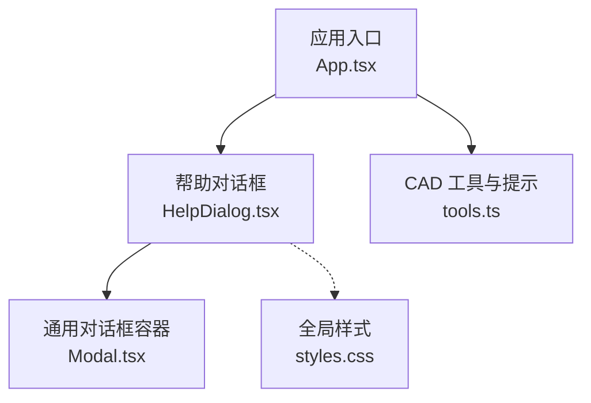
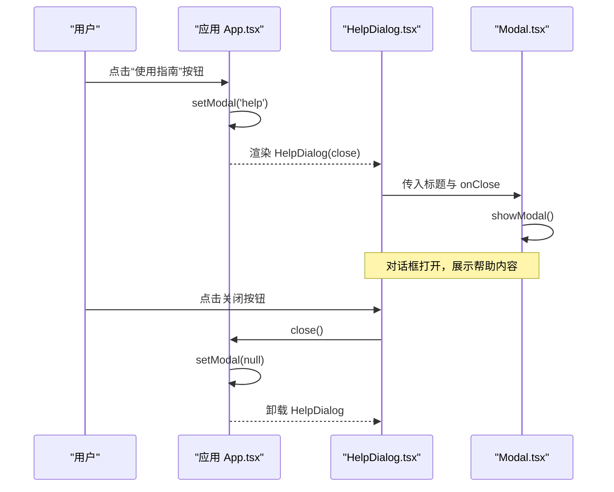
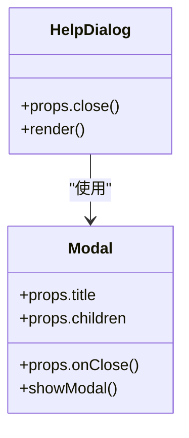
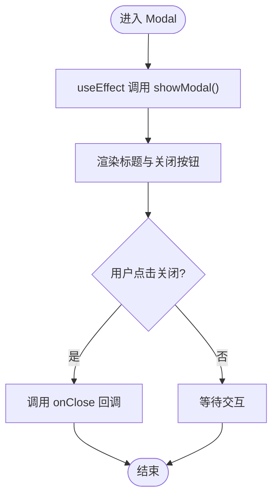
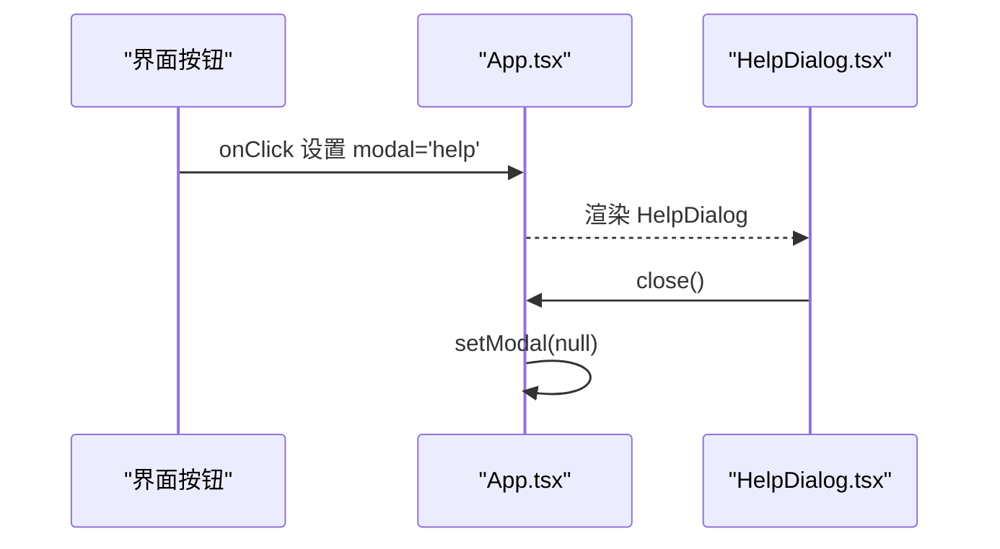
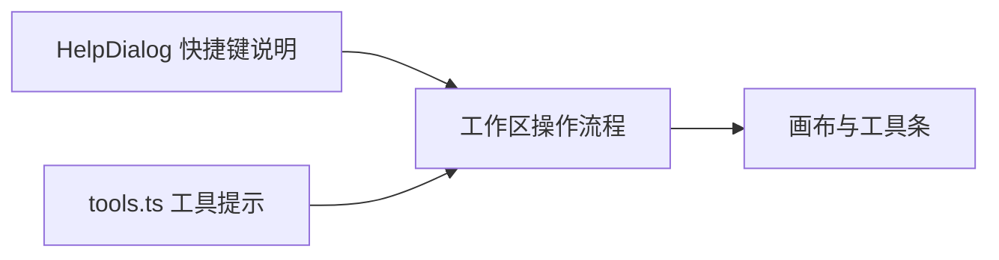
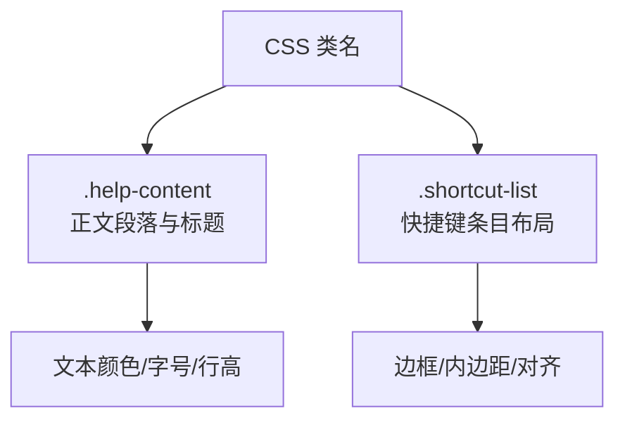
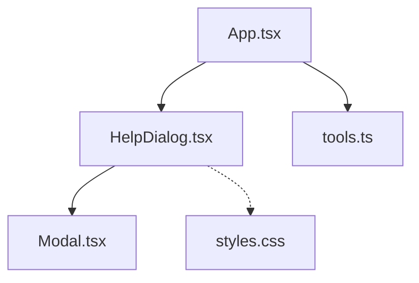
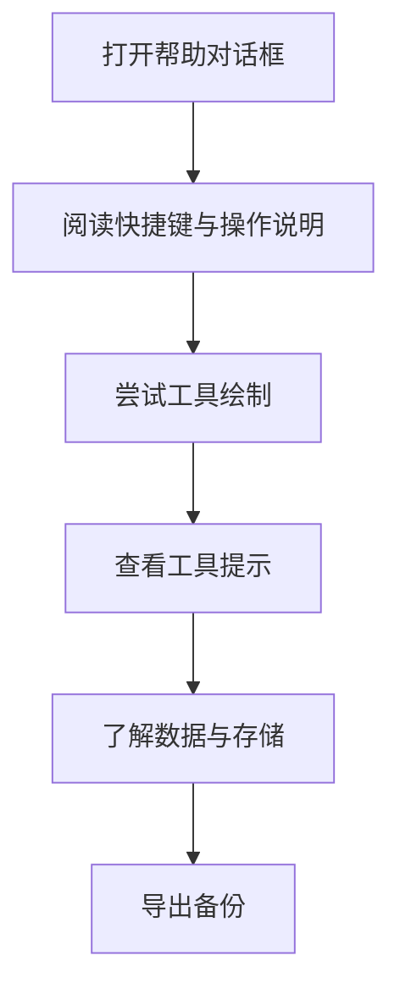

# HelpDialog帮助对话框组件

<cite>
**本文引用的文件**   
- [HelpDialog.tsx](file://src/components/HelpDialog.tsx)
- [Modal.tsx](file://src/components/Modal.tsx)
- [App.tsx](file://src/app/App.tsx)
- [tools.ts](file://src/cad/tools.ts)
- [styles.css](file://src/app/styles.css)
</cite>

## 目录
1. [简介](#简介)
2. [项目结构](#项目结构)
3. [核心组件](#核心组件)
4. [架构总览](#架构总览)
5. [详细组件分析](#详细组件分析)
6. [依赖关系分析](#依赖关系分析)
7. [性能与可维护性](#性能与可维护性)
8. [故障排查](#故障排查)
9. [结论](#结论)
10. [附录：扩展与本地化指南](#附录扩展与本地化指南)

## 简介
HelpDialog 是 Forma CAD 的“使用指南”对话框，用于向用户展示工作区快捷键、精确编辑说明以及数据与存储注意事项。它通过应用顶层状态控制显示与关闭，并复用通用 Modal 对话框容器进行渲染。该组件当前以静态内容为主，适合快速上手；后续可扩展为动态加载的多语言帮助文档。

## 项目结构
HelpDialog 位于组件层，被应用入口 App 按需挂载；样式由全局样式表提供；工具提示与操作说明在 CAD 工具模块中另有实现，二者共同构成完整的帮助体系。

**图表来源**
- [App.tsx:34-325](file://src/app/App.tsx#L34-L325)
- [HelpDialog.tsx:14-49](file://src/components/HelpDialog.tsx#L14-L49)
- [Modal.tsx:5-29](file://src/components/Modal.tsx#L5-L29)
- [tools.ts:5-48](file://src/cad/tools.ts#L5-L48)
- [styles.css:935-961](file://src/app/styles.css#L935-L961)

**章节来源**
- [App.tsx:34-325](file://src/app/App.tsx#L34-L325)
- [HelpDialog.tsx:14-49](file://src/components/HelpDialog.tsx#L14-L49)
- [Modal.tsx:5-29](file://src/components/Modal.tsx#L5-L29)
- [tools.ts:5-48](file://src/cad/tools.ts#L5-L48)
- [styles.css:935-961](file://src/app/styles.css#L935-L961)

## 核心组件
- HelpDialog：负责帮助内容的结构与文案组织，包括简介、快捷键列表、精确编辑说明和数据存储注意事项。
- Modal：封装原生 dialog 元素，提供标题栏、关闭按钮和遮罩行为。
- App：管理模态框状态 modal，根据用户交互触发 HelpDialog 的显示与关闭。
- tools：提供 CAD 工具的中文名称与绘制提示，与 HelpDialog 的快捷键说明互补。
- styles：定义 help-content、shortcut-list 等样式类，统一帮助对话框的视觉风格。

**章节来源**
- [HelpDialog.tsx:14-49](file://src/components/HelpDialog.tsx#L14-L49)
- [Modal.tsx:5-29](file://src/components/Modal.tsx#L5-L29)
- [App.tsx:34-325](file://src/app/App.tsx#L34-L325)
- [tools.ts:5-48](file://src/cad/tools.ts#L5-L48)
- [styles.css:935-961](file://src/app/styles.css#L935-L961)

## 架构总览
HelpDialog 作为受控子组件，由 App 通过状态变量 modal 控制是否渲染。点击顶部“使用指南”按钮或侧边隐私卡片中的链接时，将 modal 设为 'help'，从而渲染 HelpDialog；调用 close 回调后清空 modal，隐藏对话框。

**图表来源**
- [App.tsx:102-109](file://src/app/App.tsx#L102-L109)
- [App.tsx:317-325](file://src/app/App.tsx#L317-L325)
- [HelpDialog.tsx:14-49](file://src/components/HelpDialog.tsx#L14-L49)
- [Modal.tsx:14-29](file://src/components/Modal.tsx#L14-L29)

## 详细组件分析

### HelpDialog 组件
- 职责
  - 呈现帮助信息：产品简介、快捷键列表、精确编辑说明、数据存储与备份建议。
  - 复用 Modal 容器，接收 close 回调以关闭对话框。
- 内容组织
  - 简介段落：说明 Forma 的定位与基本用法。
  - 快捷键列表：以二维数组形式声明键位与说明，渲染为表格化的快捷方式条目。
  - 精确编辑：说明移动、复制、旋转、镜像、修剪、标注等操作要点。
  - 数据与存储：说明 IndexedDB 本地持久化、导出 JSON/SVG、离线运行与迁移注意事项。
- 动态性与扩展点
  - 当前快捷键与文案为静态常量，便于快速迭代。
  - 可将 shortcuts 与文案抽取为配置对象或外部资源，支持运行时更新与多语言切换。
- 可访问性
  - 借助 Modal 的 dialog 语义与 aria-label 关闭按钮，保证键盘与屏幕阅读器可用。

**图表来源**
- [HelpDialog.tsx:14-49](file://src/components/HelpDialog.tsx#L14-L49)
- [Modal.tsx:5-29](file://src/components/Modal.tsx#L5-L29)

**章节来源**
- [HelpDialog.tsx:14-49](file://src/components/HelpDialog.tsx#L14-L49)

### Modal 容器
- 职责
  - 封装原生 dialog，提供标题栏、关闭按钮与自动 show/hide 行为。
- 关键点
  - 使用 useEffect 调用 showModal 确保对话框弹出。
  - 通过 onClose 回调处理关闭逻辑，避免内存泄漏。

**图表来源**
- [Modal.tsx:14-29](file://src/components/Modal.tsx#L14-L29)

**章节来源**
- [Modal.tsx:5-29](file://src/components/Modal.tsx#L5-L29)

### 应用集成与触发条件
- 触发入口
  - 顶部工具栏“使用指南”按钮：设置 modal 为 'help'。
  - 右侧面板隐私卡片“了解本地存储”按钮：同样设置 modal 为 'help'。
- 关闭机制
  - HelpDialog 的 close 回调会清空 modal，使对话框卸载。

**图表来源**
- [App.tsx:102-109](file://src/app/App.tsx#L102-L109)
- [App.tsx:286-289](file://src/app/App.tsx#L286-L289)
- [App.tsx:317-325](file://src/app/App.tsx#L317-L325)
- [HelpDialog.tsx:14-49](file://src/components/HelpDialog.tsx#L14-L49)

**章节来源**
- [App.tsx:102-109](file://src/app/App.tsx#L102-L109)
- [App.tsx:286-289](file://src/app/App.tsx#L286-L289)
- [App.tsx:317-325](file://src/app/App.tsx#L317-L325)

### CAD 工具说明与快捷键联动
- HelpDialog 提供全局快捷键与工作区操作说明。
- tools.ts 提供每个工具的中文名称与绘制提示（如选择、折线、圆弧、尺寸标注等），与 HelpDialog 的快捷键形成互补：前者面向具体工具的操作引导，后者面向整体工作流与系统级快捷键。

**图表来源**
- [HelpDialog.tsx:3-13](file://src/components/HelpDialog.tsx#L3-L13)
- [tools.ts:5-48](file://src/cad/tools.ts#L5-L48)

**章节来源**
- [HelpDialog.tsx:3-13](file://src/components/HelpDialog.tsx#L3-L13)
- [tools.ts:5-48](file://src/cad/tools.ts#L5-L48)

### 样式与主题
- HelpDialog 使用 help-content 与 shortcut-list 两个关键样式类，分别控制正文排版与快捷键列表布局。
- 样式集中在 styles.css，便于统一调整字体、间距、边框与颜色。

**图表来源**
- [styles.css:935-961](file://src/app/styles.css#L935-L961)
- [HelpDialog.tsx:17-30](file://src/components/HelpDialog.tsx#L17-L30)

**章节来源**
- [styles.css:935-961](file://src/app/styles.css#L935-L961)
- [HelpDialog.tsx:17-30](file://src/components/HelpDialog.tsx#L17-L30)

## 依赖关系分析
- 组件依赖
  - HelpDialog 依赖 Modal 提供对话框外壳。
  - App 依赖 HelpDialog 并通过状态控制其显隐。
- 样式依赖
  - HelpDialog 依赖 styles.css 中的 help-content 与 shortcut-list。
- 功能互补
  - tools.ts 提供工具名称与绘制提示，与 HelpDialog 的全局快捷键说明协同工作。

**图表来源**
- [App.tsx:34-325](file://src/app/App.tsx#L34-L325)
- [HelpDialog.tsx:14-49](file://src/components/HelpDialog.tsx#L14-L49)
- [Modal.tsx:5-29](file://src/components/Modal.tsx#L5-L29)
- [tools.ts:5-48](file://src/cad/tools.ts#L5-L48)
- [styles.css:935-961](file://src/app/styles.css#L935-L961)

**章节来源**
- [App.tsx:34-325](file://src/app/App.tsx#L34-L325)
- [HelpDialog.tsx:14-49](file://src/components/HelpDialog.tsx#L14-L49)
- [Modal.tsx:5-29](file://src/components/Modal.tsx#L5-L29)
- [tools.ts:5-48](file://src/cad/tools.ts#L5-L48)
- [styles.css:935-961](file://src/app/styles.css#L935-L961)

## 性能与可维护性
- 渲染开销
  - HelpDialog 内容轻量，无复杂计算，渲染成本极低。
- 可维护性
  - 快捷键与文案集中声明，便于统一修改。
  - 建议将快捷键与文案抽离为配置对象或外部资源，便于测试与国际化。
- 可访问性
  - 使用 dialog 语义与 aria-label，提升键盘导航与屏幕阅读器体验。

[本节为通用指导，不直接分析具体文件]

## 故障排查
- 对话框无法打开
  - 检查 App 中 modal 状态是否为 'help'，确认按钮 onClick 是否正确设置。
- 对话框无法关闭
  - 确认 HelpDialog 的 close 回调是否被正确调用，且 App 中 setModal(null) 执行。
- 样式异常
  - 检查 styles.css 中 .help-content 与 .shortcut-list 是否被覆盖或未引入。
- 快捷键说明与实际不符
  - 核对 HelpDialog 的 shortcuts 常量与工具提示 tools.ts 的 hint 函数是否同步更新。

**章节来源**
- [App.tsx:102-109](file://src/app/App.tsx#L102-L109)
- [App.tsx:317-325](file://src/app/App.tsx#L317-L325)
- [HelpDialog.tsx:14-49](file://src/components/HelpDialog.tsx#L14-L49)
- [styles.css:935-961](file://src/app/styles.css#L935-L961)
- [tools.ts:20-48](file://src/cad/tools.ts#L20-L48)

## 结论
HelpDialog 以简洁的结构呈现 CAD 工作区的核心帮助信息，配合 Modal 与全局样式，提供了开箱即用的使用指南。它与 tools.ts 的工具提示形成互补，既覆盖全局快捷键，也解释具体工具的操作流程。当前内容为静态配置，易于维护；未来可通过配置化与本地化扩展，满足多语言与动态更新需求。

[本节为总结性内容，不直接分析具体文件]

## 附录：扩展与本地化指南

### 自定义帮助内容
- 新增章节
  - 在 HelpDialog 的内容区域添加新的标题与段落，保持语义化标签（如 h3、p）。
- 替换快捷键列表
  - 将 shortcuts 常量改为从外部配置读取，支持运行时更新与版本差异。
- 嵌入示例步骤
  - 可增加有序/无序列表，逐步演示常用任务（如创建直线、标注尺寸）。

**章节来源**
- [HelpDialog.tsx:14-49](file://src/components/HelpDialog.tsx#L14-L49)

### 样式定制选项
- 正文排版
  - 调整 .help-content p 的字号、行高与颜色，匹配品牌规范。
- 快捷键列表
  - 调整 .shortcut-list 的边框、圆角、内边距与 kbd 样式，增强可读性。
- 响应式适配
  - 在小屏设备上考虑增加滚动与更紧凑的布局。

**章节来源**
- [styles.css:935-961](file://src/app/styles.css#L935-L961)

### 多语言支持与本地化配置
- 设计建议
  - 将所有可见文案（标题、段落、快捷键说明）提取为 i18n 资源文件。
  - 为 HelpDialog 增加 locale 参数，按语言渲染对应内容。
- 实施路径
  - 新建翻译资源（如 zh-CN.json、en-US.json），在 App 层注入当前语言。
  - HelpDialog 读取资源并渲染，快捷键列表与工具提示保持一致的键值结构。
- 兼容性
  - 对平台差异（如 ⌘/Ctrl）保留双写，确保跨平台可读性。

[本节为概念性指导，不直接分析具体文件]

### 在 CAD 编辑器中的应用场景与使用流程
- 首次使用
  - 用户点击“使用指南”，阅读快捷键与基础操作，再开始绘制。
- 遇到问题
  - 用户在绘制过程中查看底部工具提示（tools.ts），并在需要时再次打开帮助对话框复习流程。
- 数据与存储
  - 用户通过隐私卡片链接了解本地存储策略，并根据提示定期导出备份。

**图表来源**
- [App.tsx:102-109](file://src/app/App.tsx#L102-L109)
- [App.tsx:286-289](file://src/app/App.tsx#L286-L289)
- [HelpDialog.tsx:14-49](file://src/components/HelpDialog.tsx#L14-L49)
- [tools.ts:20-48](file://src/cad/tools.ts#L20-L48)