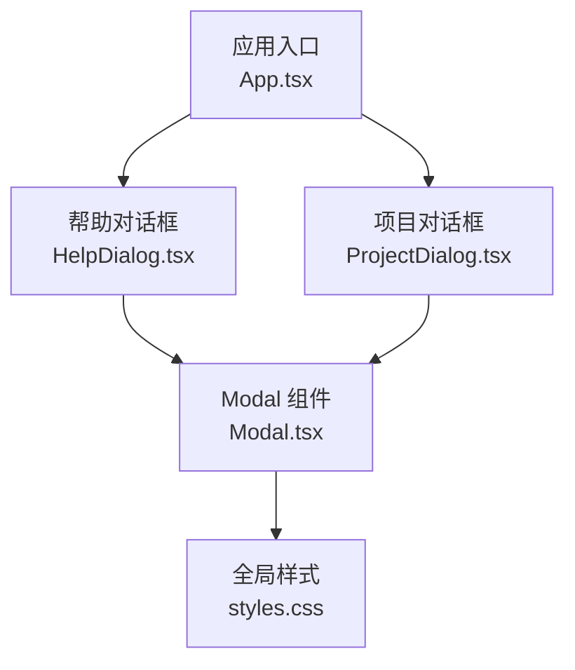
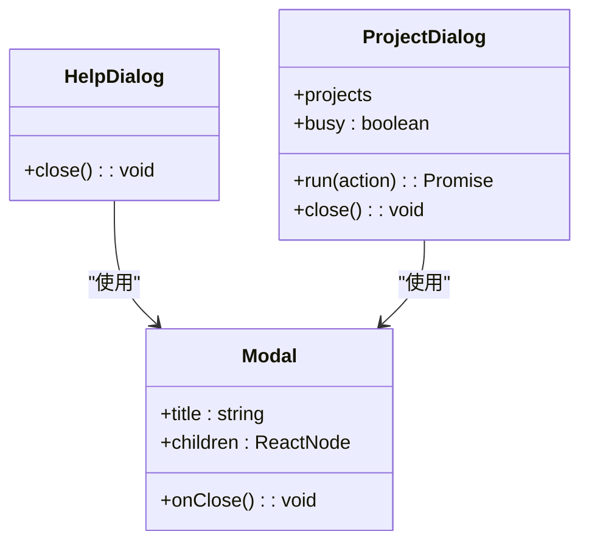
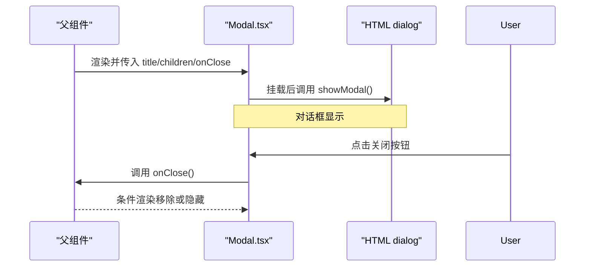
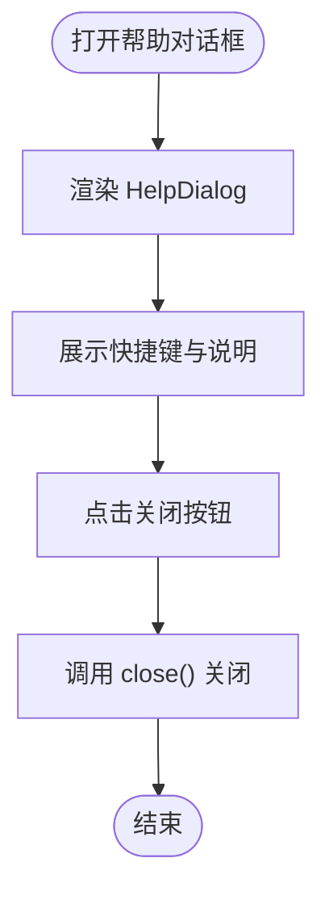
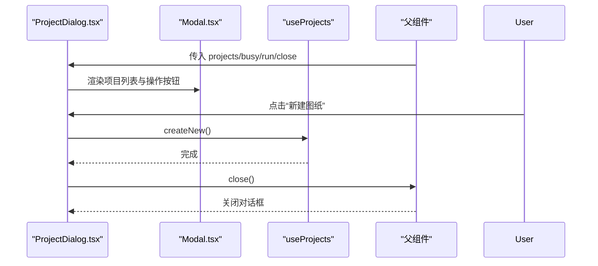
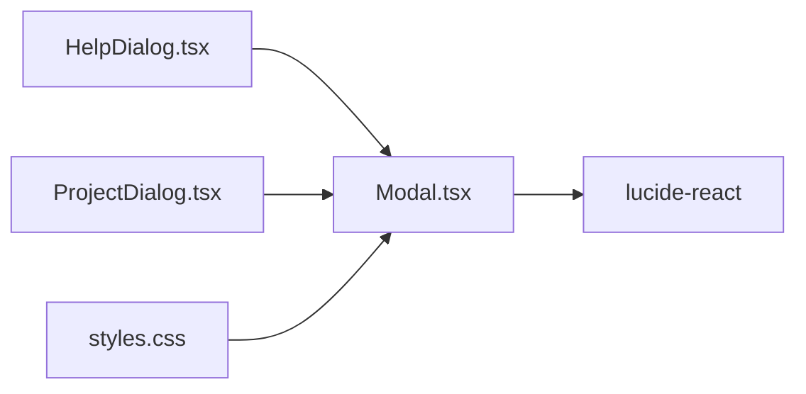
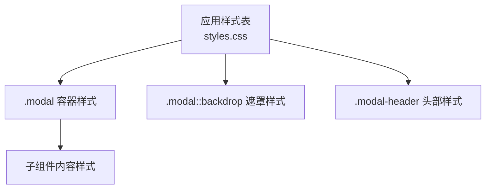

# Modal对话框组件

<cite>
**本文引用的文件**   
- [Modal.tsx](file://src/components/Modal.tsx)
- [HelpDialog.tsx](file://src/components/HelpDialog.tsx)
- [ProjectDialog.tsx](file://src/features/projects/ProjectDialog.tsx)
- [styles.css](file://src/app/styles.css)
</cite>

## 目录
1. [简介](#简介)
2. [项目结构](#项目结构)
3. [核心组件](#核心组件)
4. [架构总览](#架构总览)
5. [详细组件分析](#详细组件分析)
6. [依赖关系分析](#依赖关系分析)
7. [性能与可访问性](#性能与可访问性)
8. [样式定制与主题](#样式定制与主题)
9. [使用场景示例](#使用场景示例)
10. [故障排查指南](#故障排查指南)
11. [结论](#结论)

## 简介
本文件为 Modal 对话框组件的完整技术文档。内容涵盖：
- 基本用法、打开与关闭控制、内容展示方式
- Props 接口说明（标题、内容、关闭回调等）
- 交互行为（键盘事件、ESC 关闭、遮罩层点击关闭等）
- 样式定制与主题支持
- 多种使用场景（确认对话框、表单对话框、信息提示等）
- 可访问性与响应式设计考虑

## 项目结构
Modal 相关代码位于以下位置：
- 组件实现：src/components/Modal.tsx
- 使用方示例：
  - src/components/HelpDialog.tsx（帮助信息对话框）
  - src/features/projects/ProjectDialog.tsx（项目列表对话框）
- 样式定义：src/app/styles.css（包含 .modal、::backdrop、.modal-header 等）

图表来源
- [Modal.tsx:1-29](file://src/components/Modal.tsx#L1-L29)
- [HelpDialog.tsx:1-51](file://src/components/HelpDialog.tsx#L1-L51)
- [ProjectDialog.tsx:1-101](file://src/features/projects/ProjectDialog.tsx#L1-L101)
- [styles.css:848-934](file://src/app/styles.css#L848-L934)

章节来源
- [Modal.tsx:1-29](file://src/components/Modal.tsx#L1-L29)
- [HelpDialog.tsx:1-51](file://src/components/HelpDialog.tsx#L1-L51)
- [ProjectDialog.tsx:1-101](file://src/features/projects/ProjectDialog.tsx#L1-L101)
- [styles.css:848-934](file://src/app/styles.css#L848-L934)

## 核心组件
Modal 是一个基于原生 HTML dialog 的可复用对话框组件，负责：
- 渲染对话框容器与头部（标题 + 关闭按钮）
- 在挂载时自动显示对话框
- 将子节点作为内容区域渲染
- 通过 onClose 回调通知父组件关闭

Props 接口
- title: string — 对话框标题文本
- children: ReactNode — 对话框内容区域
- onClose: () => void — 关闭回调（由父组件提供）

关键实现要点
- 使用 useRef 获取 <dialog> 元素引用
- 使用 useEffect 在首次渲染后调用 showModal() 打开对话框
- 在 <dialog> 上绑定 onClose 事件以触发父组件关闭逻辑
- 头部提供带 aria-label 的关闭按钮，提升可访问性

章节来源
- [Modal.tsx:5-29](file://src/components/Modal.tsx#L5-L29)

## 架构总览
Modal 作为基础 UI 原语被业务对话框复用。HelpDialog 与 ProjectDialog 分别封装了不同的业务内容与交互，但都通过 Modal 统一呈现。

图表来源
- [Modal.tsx:5-29](file://src/components/Modal.tsx#L5-L29)
- [HelpDialog.tsx:14-49](file://src/components/HelpDialog.tsx#L14-L49)
- [ProjectDialog.tsx:12-99](file://src/features/projects/ProjectDialog.tsx#L12-L99)

## 详细组件分析

### Modal 组件
职责
- 管理对话框的生命周期（打开）
- 提供统一的头部结构与关闭入口
- 透传子节点作为内容区

打开与关闭流程
- 打开：组件挂载后调用 showModal()
- 关闭：用户点击关闭按钮或触发 onClose 事件时，调用父组件传入的 onClose 回调

图表来源
- [Modal.tsx:14-27](file://src/components/Modal.tsx#L14-L27)

章节来源
- [Modal.tsx:1-29](file://src/components/Modal.tsx#L1-L29)

### HelpDialog（帮助信息对话框）
用途
- 展示工作空间快捷键与使用说明
- 通过 Modal 承载富文本内容

交互
- 通过 close 回调关闭对话框

图表来源
- [HelpDialog.tsx:14-49](file://src/components/HelpDialog.tsx#L14-L49)

章节来源
- [HelpDialog.tsx:1-51](file://src/components/HelpDialog.tsx#L1-L51)

### ProjectDialog（项目列表对话框）
用途
- 展示当前浏览器中的项目列表
- 提供新建、复制、打开、删除等操作

交互
- 通过 run 包装异步操作，并在完成后调用 close 关闭
- 删除前使用 window.confirm 二次确认

图表来源
- [ProjectDialog.tsx:12-99](file://src/features/projects/ProjectDialog.tsx#L12-L99)
- [Modal.tsx:14-27](file://src/components/Modal.tsx#L14-L27)

章节来源
- [ProjectDialog.tsx:1-101](file://src/features/projects/ProjectDialog.tsx#L1-L101)

## 依赖关系分析
- Modal 依赖 React 基础能力（ref、effect）与 lucide-react 图标库
- HelpDialog 与 ProjectDialog 均依赖 Modal 进行统一呈现
- 样式集中在 styles.css，通过类名与伪元素 ::backdrop 控制外观

图表来源
- [Modal.tsx:1-3](file://src/components/Modal.tsx#L1-L3)
- [HelpDialog.tsx:1-1](file://src/components/HelpDialog.tsx#L1-L1)
- [ProjectDialog.tsx:3-3](file://src/features/projects/ProjectDialog.tsx#L3-L3)
- [styles.css:848-934](file://src/app/styles.css#L848-L934)

章节来源
- [Modal.tsx:1-3](file://src/components/Modal.tsx#L1-L3)
- [HelpDialog.tsx:1-1](file://src/components/HelpDialog.tsx#L1-L1)
- [ProjectDialog.tsx:3-3](file://src/features/projects/ProjectDialog.tsx#L3-L3)
- [styles.css:848-934](file://src/app/styles.css#L848-L934)

## 性能与可访问性
性能
- Modal 使用原生 <dialog>，避免自定义模态框的额外开销
- 仅在挂载时调用一次 showModal()，减少重复渲染

可访问性
- 关闭按钮带有 aria-label，便于屏幕阅读器识别
- 原生 <dialog> 自带焦点管理与 ESC 关闭语义

注意
- 当前 Modal 未显式处理键盘事件（如 ESC），主要依赖原生 <dialog> 的行为
- 若需更精细的键盘导航（如 Tab 聚焦顺序），可在上层组件中补充 focus trap 与键盘监听

章节来源
- [Modal.tsx:14-27](file://src/components/Modal.tsx#L14-L27)

## 样式定制与主题
默认样式要点
- 容器宽度：最大 600px，移动端自适应
- 背景色与文字颜色：深色主题配色
- 圆角与阴影：提升层级感
- 遮罩层：使用 ::backdrop 设置半透明模糊背景
- 头部布局：标题与关闭按钮两端对齐

可定制点
- 覆盖 .modal 类以调整尺寸、间距、边框、阴影
- 覆盖 .modal-header 与 h2 以调整标题排版
- 通过 ::backdrop 调整遮罩透明度与模糊程度
- 在子组件内使用自定义类名扩展内容区样式

图表来源
- [styles.css:848-934](file://src/app/styles.css#L848-L934)

章节来源
- [styles.css:848-934](file://src/app/styles.css#L848-L934)

## 使用场景示例
以下为常见使用模式（不直接展示代码，仅给出路径与要点）：

- 确认对话框
  - 参考：[ProjectDialog.tsx:75-89](file://src/features/projects/ProjectDialog.tsx#L75-L89)
  - 要点：在危险操作前使用 window.confirm 二次确认；成功后调用 close 关闭

- 表单对话框
  - 参考：[HelpDialog.tsx:14-49](file://src/components/HelpDialog.tsx#L14-L49)
  - 要点：在 Modal 的 children 中放置表单控件；通过外部状态控制提交与关闭

- 信息提示对话框
  - 参考：[HelpDialog.tsx:14-49](file://src/components/HelpDialog.tsx#L14-L49)
  - 要点：纯展示型内容，无需复杂交互；通过 close 回调关闭

- 列表选择对话框
  - 参考：[ProjectDialog.tsx:45-92](file://src/features/projects/ProjectDialog.tsx#L45-L92)
  - 要点：长列表滚动区域；选中项高亮；操作按钮禁用态与忙态

章节来源
- [ProjectDialog.tsx:75-89](file://src/features/projects/ProjectDialog.tsx#L75-L89)
- [HelpDialog.tsx:14-49](file://src/components/HelpDialog.tsx#L14-L49)
- [ProjectDialog.tsx:45-92](file://src/features/projects/ProjectDialog.tsx#L45-L92)

## 故障排查指南
常见问题与解决思路
- 对话框未显示
  - 检查是否在组件挂载后调用了 showModal()
  - 确认 Modal 是否被正确渲染且未被条件渲染隐藏
  - 参考：[Modal.tsx:14-17](file://src/components/Modal.tsx#L14-L17)

- 点击关闭无效
  - 确认 onClose 回调已正确传递给 Modal
  - 检查父组件是否在 onClose 中更新状态以移除对话框
  - 参考：[Modal.tsx:19-27](file://src/components/Modal.tsx#L19-L27)

- 遮罩层不可见或样式异常
  - 检查 ::backdrop 样式是否被覆盖或未引入
  - 参考：[styles.css:858-860](file://src/app/styles.css#L858-L860)

- 键盘交互不符合预期
  - 当前依赖原生 <dialog> 的 ESC 行为；如需自定义，请在上层组件添加键盘监听与焦点管理
  - 参考：[Modal.tsx:14-27](file://src/components/Modal.tsx#L14-L27)

章节来源
- [Modal.tsx:14-27](file://src/components/Modal.tsx#L14-L27)
- [styles.css:858-860](file://src/app/styles.css#L858-L860)

## 结论
Modal 组件以最小 API 提供了稳定可靠的对话框能力，配合 HelpDialog 与 ProjectDialog 展示了典型的使用模式。其优势在于：
- 基于原生 <dialog>，具备良好可访问性与性能
- 简洁的 Props 接口，易于集成与扩展
- 清晰的样式分层，便于主题化与定制

在实际项目中，建议：
- 在需要复杂交互的对话框中，于上层组件补充键盘导航与焦点管理
- 通过覆盖 CSS 类与 ::backdrop 实现主题切换
- 对危险操作增加二次确认，确保用户体验与安全