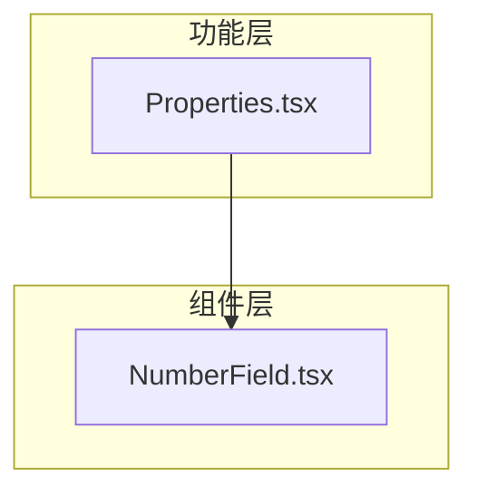
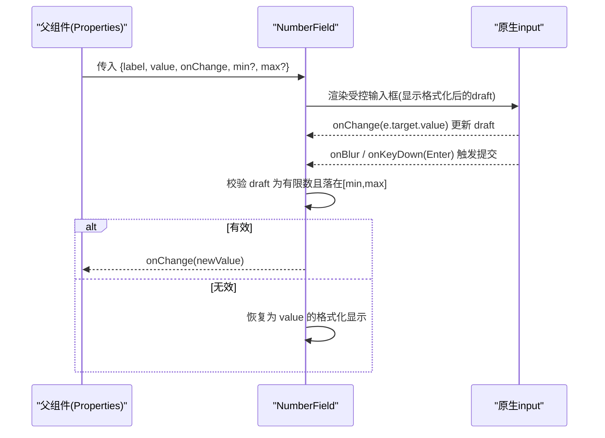
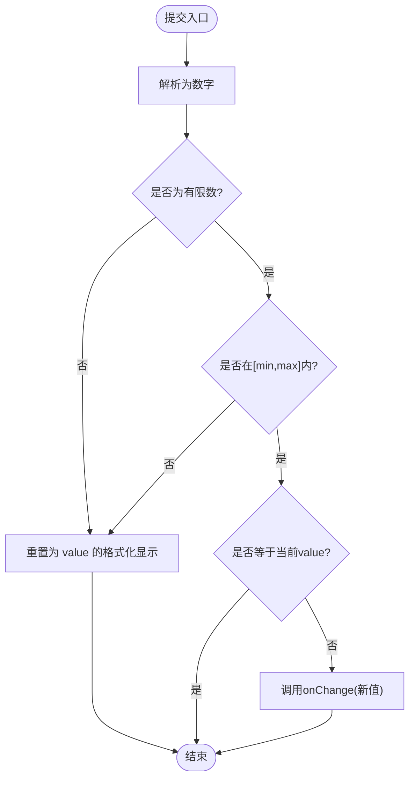
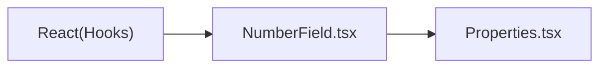

# NumberField数字输入组件

<cite>
**本文引用的文件**   
- [NumberField.tsx](file://src/components/NumberField.tsx)
- [Properties.tsx](file://src/features/editor/Properties.tsx)
</cite>

## 目录
1. [简介](#简介)
2. [项目结构](#项目结构)
3. [核心组件](#核心组件)
4. [架构总览](#架构总览)
5. [详细组件分析](#详细组件分析)
6. [依赖关系分析](#依赖关系分析)
7. [性能考虑](#性能考虑)
8. [故障排查指南](#故障排查指南)
9. [结论](#结论)
10. [附录：使用示例与最佳实践](#附录使用示例与最佳实践)

## 简介
NumberField 是一个轻量级的数字输入组件，用于在表单或属性面板中精确输入数值。它提供受控的值绑定、基础范围校验、格式化显示以及基础的键盘交互（回车确认）。该组件在编辑器属性面板中被广泛使用，支持角度、尺寸、线宽、文字高度等场景的数值编辑。

## 项目结构
NumberField 位于通用组件目录，被编辑器属性面板引用，形成“展示层组件 -> 业务面板”的使用链路。

图表来源
- [NumberField.tsx:1-48](file://src/components/NumberField.tsx#L1-L48)
- [Properties.tsx:1-10](file://src/features/editor/Properties.tsx#L1-L10)

章节来源
- [NumberField.tsx:1-48](file://src/components/NumberField.tsx#L1-L48)
- [Properties.tsx:1-10](file://src/features/editor/Properties.tsx#L1-L10)

## 核心组件
- 组件职责
  - 接收 label、value、onChange 作为受控输入
  - 根据 min/max 进行提交时范围校验
  - 将内部草稿值格式化为最多四位小数后显示
  - 通过 onBlur 和 Enter 键触发提交
- 关键行为
  - 当 value 变化时，同步更新内部草稿显示
  - 提交时仅当值为有限数且在[min, max]范围内才调用 onChange
  - 若无效则回退到当前 value 的格式化显示

章节来源
- [NumberField.tsx:3-27](file://src/components/NumberField.tsx#L3-L27)

## 架构总览
NumberField 以受控模式工作：父组件持有真实值 state，NumberField 负责展示与校验，最终通过回调将新值上报给父组件。

图表来源
- [NumberField.tsx:16-43](file://src/components/NumberField.tsx#L16-L43)
- [Properties.tsx:52-61](file://src/features/editor/Properties.tsx#L52-L61)

## 详细组件分析

### Props 接口与默认值
- 必填
  - label: string，输入框标签文本
  - value: number，受控值
  - onChange: (n: number) => void，值变更回调
- 可选
  - min?: number，最小值；默认 -1e9
  - max?: number，最大值；默认 1e9
- 说明
  - 未传 min/max 时使用极宽默认范围，适合通用数值输入
  - 建议在上层根据业务语义设置合理范围，如半径、线宽、字号等

章节来源
- [NumberField.tsx:3-15](file://src/components/NumberField.tsx#L3-L15)

### 值绑定与格式化
- 内部维护一个 draft 字符串状态，初始化和每次外部 value 变化时都会将其格式化为最多四位小数并转为字符串显示
- 这种设计保证输入框始终显示稳定精度的数值，避免浮点显示抖动

章节来源
- [NumberField.tsx:16-17](file://src/components/NumberField.tsx#L16-L17)

### 输入验证机制
- 提交时机
  - 失焦 onBlur
  - 按下 Enter 键
- 校验规则
  - 非空
  - 可解析为有限数
  - 在[min, max]闭区间内
- 结果处理
  - 有效：若与当前 value 不同，则调用 onChange
  - 无效：将显示回退为当前 value 的格式化值

图表来源
- [NumberField.tsx:18-27](file://src/components/NumberField.tsx#L18-L27)

章节来源
- [NumberField.tsx:18-27](file://src/components/NumberField.tsx#L18-L27)

### 键盘导航与焦点行为
- Enter 键：触发 blur，从而执行提交逻辑
- Tab 键：遵循浏览器默认行为，在相邻可聚焦元素间切换
- 上下箭头：由于 input 类型为 number 且 step="any"，浏览器可能允许步进调整；但本组件未显式监听方向键事件，因此不保证一致的步进行为
- 无障碍：为 input 设置了 aria-label=label，便于辅助技术读取

章节来源
- [NumberField.tsx:31-44](file://src/components/NumberField.tsx#L31-L44)

### 错误处理与用户反馈
- 当前实现没有显式的错误提示 UI
- 无效输入会在失焦或回车时自动回退到原值的格式化显示，起到“静默拒绝”的效果
- 建议在父组件层面增加友好的错误提示（例如字段旁文案），或在组件内部扩展错误状态与提示区域

章节来源
- [NumberField.tsx:18-27](file://src/components/NumberField.tsx#L18-L27)

## 依赖关系分析
- NumberField 仅依赖 React 的基础 Hooks（useState、useEffect）
- Properties 通过 import 引用 NumberField，并在多处使用其进行数值编辑

图表来源
- [NumberField.tsx:1-2](file://src/components/NumberField.tsx#L1-L2)
- [Properties.tsx:1-5](file://src/features/editor/Properties.tsx#L1-L5)

章节来源
- [NumberField.tsx:1-2](file://src/components/NumberField.tsx#L1-L2)
- [Properties.tsx:1-5](file://src/features/editor/Properties.tsx#L1-L5)

## 性能考虑
- 渲染开销低：组件仅包含一个 label 和一个 input，无复杂计算
- 状态更新频率可控：仅在输入变化时更新 draft，提交时才比较并调用 onChange
- 精度控制：统一以四位小数格式化显示，减少不必要的重绘差异

[本节为通用指导，不涉及具体代码片段]

## 故障排查指南
- 问题：输入非法字符后失去焦点，值未生效
  - 原因：未通过有限数与范围校验
  - 解决：检查 min/max 配置是否正确；确保输入为合法数字
- 问题：输入后按回车未提交
  - 原因：未触发 blur 或 onChange 未被正确传递
  - 解决：确认 onChange 已传入；检查外层是否有阻止冒泡的逻辑
- 问题：显示的小数位不符合预期
  - 原因：组件内部统一以四位小数格式化显示
  - 解决：如需自定义精度，可在上层对 value 做格式化后再传入

章节来源
- [NumberField.tsx:16-27](file://src/components/NumberField.tsx#L16-L27)

## 结论
NumberField 提供了简洁可靠的数字输入能力，具备受控值绑定、基础范围校验与稳定的格式化显示。对于更复杂的业务需求（如步长、精度、实时校验反馈、键盘步进），可在该组件基础上扩展 Props 与交互逻辑。

[本节为总结性内容，不涉及具体代码片段]

## 附录：使用示例与最佳实践

### 基本用法与值绑定
- 在父组件中维护 value 与 onChange，并将二者传给 NumberField
- 示例参考：坐标 X/Y 字段的绑定方式

章节来源
- [Properties.tsx:52-61](file://src/features/editor/Properties.tsx#L52-L61)

### 配置最小值与最大值
- 线宽：设置 min=0.01、max=100
- 半径：设置 min=0.001
- 文字高度：设置 min=0.01、max=10000

章节来源
- [Properties.tsx:116-122](file://src/features/editor/Properties.tsx#L116-L122)
- [Properties.tsx:129-134](file://src/features/editor/Properties.tsx#L129-L134)
- [Properties.tsx:176-182](file://src/features/editor/Properties.tsx#L176-L182)

### 角度输入（度转弧度）
- 显示层使用角度（°），存储层使用弧度
- 在 onChange 中进行单位转换

章节来源
- [Properties.tsx:138-147](file://src/features/editor/Properties.tsx#L138-L147)

### 尺寸输入（毫米）
- 直接使用 NumberField 输入长度类数值，结合合理的 min/max 限制

章节来源
- [Properties.tsx:116-122](file://src/features/editor/Properties.tsx#L116-L122)

### 百分比输入
- 当前仓库未直接提供百分比输入示例
- 建议：在父组件中将 value 乘以 100 显示，onChange 再除以 100 存储，同时设置合适的 min/max（如 0~100）

[本节为概念性示例，不涉及具体代码片段]

### 键盘交互建议
- 保持 Enter 提交行为
- 如需支持方向键步进，可在组件内监听 keydown 并根据 step 调整 draft 与 value
- 当前实现未内置方向键步进，需按需扩展

章节来源
- [NumberField.tsx:40-43](file://src/components/NumberField.tsx#L40-L43)