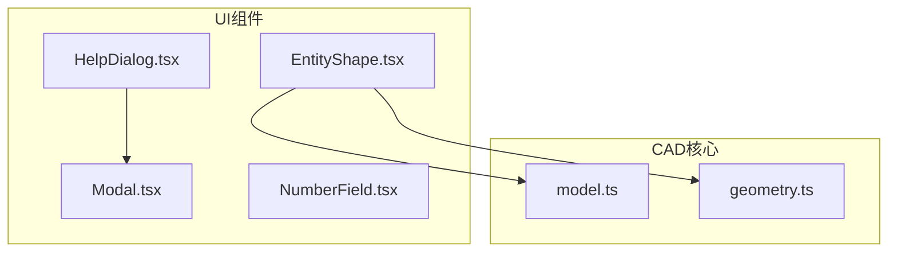
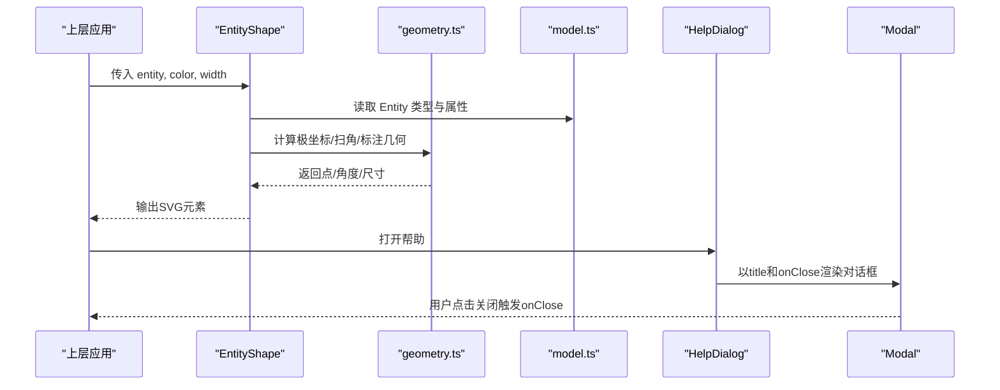
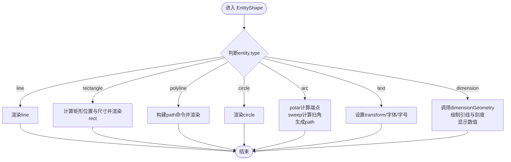
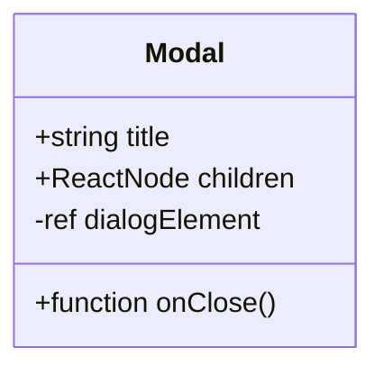
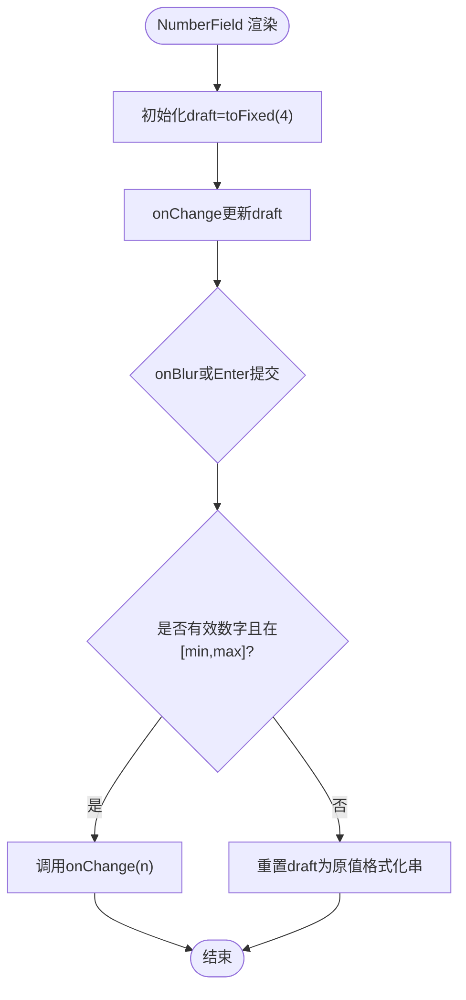
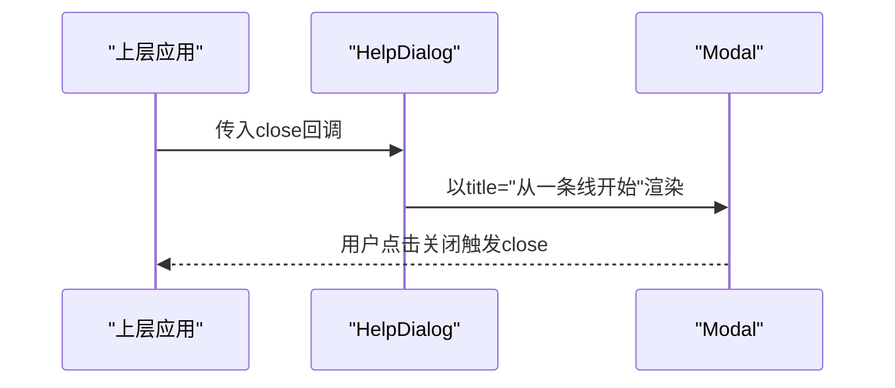
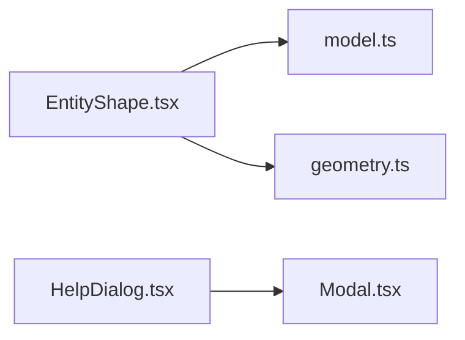

# UI组件库

<cite>
**本文引用的文件**   
- [EntityShape.tsx](file://src/components/EntityShape.tsx)
- [Modal.tsx](file://src/components/Modal.tsx)
- [NumberField.tsx](file://src/components/NumberField.tsx)
- [HelpDialog.tsx](file://src/components/HelpDialog.tsx)
- [model.ts](file://src/cad/model.ts)
- [geometry.ts](file://src/cad/geometry.ts)
</cite>

## 目录
1. [简介](#简介)
2. [项目结构](#项目结构)
3. [核心组件](#核心组件)
4. [架构总览](#架构总览)
5. [详细组件分析](#详细组件分析)
6. [依赖关系分析](#依赖关系分析)
7. [性能与可访问性](#性能与可访问性)
8. [故障排查指南](#故障排查指南)
9. [结论](#结论)
10. [附录：Props与事件参考](#附录props与事件参考)

## 简介
本文件为 web-cad 的 UI 组件库文档，聚焦以下四个组件：
- EntityShape：根据 CAD 实体数据渲染几何图形与标注。
- Modal：基于原生 dialog 的可复用对话框容器。
- NumberField：带范围校验、格式化与键盘交互的数字输入框。
- HelpDialog：帮助信息展示与快捷键说明的组合型对话框。

文档将详细说明各组件的渲染逻辑、样式定制、Props 接口、事件回调、可访问性与响应式支持，并给出组合模式与最佳实践建议。

## 项目结构
UI 组件位于 src/components 下，几何计算与数据模型位于 src/cad。EntityShape 依赖 model 与 geometry 模块完成从数据结构到 SVG 图形的转换；HelpDialog 组合 Modal 提供信息展示。

图表来源
- [EntityShape.tsx:1-96](file://src/components/EntityShape.tsx#L1-L96)
- [Modal.tsx:1-30](file://src/components/Modal.tsx#L1-L30)
- [NumberField.tsx:1-48](file://src/components/NumberField.tsx#L1-L48)
- [HelpDialog.tsx:1-51](file://src/components/HelpDialog.tsx#L1-L51)
- [model.ts:1-142](file://src/cad/model.ts#L1-L142)
- [geometry.ts:1-443](file://src/cad/geometry.ts#L1-L443)

章节来源
- [EntityShape.tsx:1-96](file://src/components/EntityShape.tsx#L1-L96)
- [Modal.tsx:1-30](file://src/components/Modal.tsx#L1-L30)
- [NumberField.tsx:1-48](file://src/components/NumberField.tsx#L1-L48)
- [HelpDialog.tsx:1-51](file://src/components/HelpDialog.tsx#L1-L51)
- [model.ts:1-142](file://src/cad/model.ts#L1-L142)
- [geometry.ts:1-443](file://src/cad/geometry.ts#L1-L443)

## 核心组件
本节概述四个组件的职责与使用要点：
- EntityShape：接收一个 Entity 对象，按类型渲染 line、rectangle、polyline、circle、arc、text、dimension 等图形，统一应用 stroke/fill 样式。
- Modal：封装原生 <dialog>，提供标题栏、关闭按钮与受控显示能力。
- NumberField：受控数字输入，支持最小/最大值约束、失焦或回车提交、输入值格式化。
- HelpDialog：组合 Modal，展示工作区介绍、快捷键列表与数据持久化说明。

章节来源
- [EntityShape.tsx:4-95](file://src/components/EntityShape.tsx#L4-L95)
- [Modal.tsx:5-29](file://src/components/Modal.tsx#L5-L29)
- [NumberField.tsx:3-47](file://src/components/NumberField.tsx#L3-L47)
- [HelpDialog.tsx:14-49](file://src/components/HelpDialog.tsx#L14-L49)

## 架构总览
下图展示了组件之间的调用与依赖关系，以及 EntityShape 与 CAD 核心模块的协作方式。

图表来源
- [EntityShape.tsx:1-96](file://src/components/EntityShape.tsx#L1-L96)
- [geometry.ts:25-53](file://src/cad/geometry.ts#L25-L53)
- [geometry.ts:81-110](file://src/cad/geometry.ts#L81-L110)
- [model.ts:18-45](file://src/cad/model.ts#L18-L45)
- [HelpDialog.tsx:14-49](file://src/components/HelpDialog.tsx#L14-L49)
- [Modal.tsx:5-29](file://src/components/Modal.tsx#L5-L29)

## 详细组件分析

### EntityShape 组件
职责
- 根据 Entity 的类型渲染对应的 SVG 元素。
- 统一处理描边、线帽、线连接样式。
- 对圆弧进行极坐标与扫角计算，生成正确的路径命令。
- 对标注维度计算投影点、中点、旋转角度并显示数值。

渲染分支与关键点
- line：直接渲染线段。
- rectangle：根据两点计算矩形左上角、宽高。
- polyline：根据 points 数组构建 path 命令，支持闭合。
- circle：根据中心与半径渲染圆。
- arc：通过 polar 与 sweep 计算起止点与 sweep-flag，生成弧线路径。
- text：设置字体、字号、旋转与翻转（Y轴翻转）保证可读。
- dimension：调用 dimensionGeometry 计算 p、q、midpoint、value、rotation，绘制引线、刻度与文本标签。

样式定制
- color：控制描边颜色（文字填充也使用该色）。
- width：线条宽度，默认取实体的 strokeWidth。
- 可通过外层 CSS 类名或 SVG 全局样式覆盖字体族、字号等。

可访问性
- 作为纯图形组件，不承载语义标签；如需无障碍描述，建议在父级添加 aria-label 或 role="img"。

响应式
- 图形尺寸由 SVG 坐标系决定，缩放与平移由上层 Canvas 管理；组件本身不处理视口变化。

错误处理
- 未识别的 type 不会渲染任何内容，避免崩溃。

图表来源
- [EntityShape.tsx:20-94](file://src/components/EntityShape.tsx#L20-L94)
- [geometry.ts:25-29](file://src/cad/geometry.ts#L25-L29)
- [geometry.ts:43-47](file://src/cad/geometry.ts#L43-L47)
- [geometry.ts:81-110](file://src/cad/geometry.ts#L81-L110)

章节来源
- [EntityShape.tsx:4-95](file://src/components/EntityShape.tsx#L4-L95)
- [model.ts:18-45](file://src/cad/model.ts#L18-L45)
- [geometry.ts:25-29](file://src/cad/geometry.ts#L25-L29)
- [geometry.ts:43-47](file://src/cad/geometry.ts#L43-L47)
- [geometry.ts:81-110](file://src/cad/geometry.ts#L81-L110)

### Modal 组件
职责
- 基于原生 <dialog> 实现模态对话框。
- 自动在挂载时调用 showModal。
- 提供标题栏与关闭按钮，关闭时触发 onClose。

用法要点
- 通过 title 设置标题。
- children 为对话框内容区域。
- onClose 用于受控关闭（如隐藏对话框状态）。

可访问性
- 关闭按钮包含 aria-label，便于屏幕阅读器理解。
- 使用原生 dialog，具备焦点管理与模态行为。

主题定制
- 通过 CSS 类名 modal、modal-header 进行样式扩展。

图表来源
- [Modal.tsx:5-29](file://src/components/Modal.tsx#L5-L29)

章节来源
- [Modal.tsx:5-29](file://src/components/Modal.tsx#L5-L29)

### NumberField 组件
职责
- 提供受控的数字输入，支持最小/最大值限制。
- 在失焦或回车时提交值，若无效则回滚到原值。
- 内部使用 draft 状态保持编辑体验流畅。

验证规则
- 仅当输入非空且为有限数字，且在[min,max]范围内时，才调用 onChange。
- 否则将 draft 重置为当前 value 的四位小数字符串。

格式化
- 初始化和同步 value 时，使用 toFixed(4) 并转 Number 再转 String，消除尾随零带来的显示差异。

交互
- 支持 Enter 键快速提交（触发 blur）。
- 使用 step="any" 允许任意步长。

可访问性
- 输入框带有 aria-label=label，提升可访问性。

图表来源
- [NumberField.tsx:16-44](file://src/components/NumberField.tsx#L16-L44)

章节来源
- [NumberField.tsx:3-47](file://src/components/NumberField.tsx#L3-L47)

### HelpDialog 组件
职责
- 组合 Modal 展示帮助信息，包括工作区介绍、快捷键列表、精确编辑说明与数据持久化提示。
- 通过 close 回调关闭对话框。

内容与交互
- 快捷键列表以键名与说明成对展示。
- 所有信息均为静态展示，无复杂交互。

主题定制
- 通过 help-content、shortcut-list 等类名进行样式扩展。

图表来源
- [HelpDialog.tsx:14-49](file://src/components/HelpDialog.tsx#L14-L49)
- [Modal.tsx:5-29](file://src/components/Modal.tsx#L5-L29)

章节来源
- [HelpDialog.tsx:14-49](file://src/components/HelpDialog.tsx#L14-L49)
- [Modal.tsx:5-29](file://src/components/Modal.tsx#L5-L29)

## 依赖关系分析
- EntityShape 依赖 model 中的 Entity 联合类型，确保类型安全地渲染不同几何体。
- EntityShape 依赖 geometry 中的 polar、sweep、dimensionGeometry 等函数完成几何计算。
- HelpDialog 依赖 Modal 提供对话框外壳。
- Modal 依赖 lucide-react 的 X 图标用于关闭按钮。

图表来源
- [EntityShape.tsx:1-3](file://src/components/EntityShape.tsx#L1-L3)
- [HelpDialog.tsx:1-1](file://src/components/HelpDialog.tsx#L1-L1)
- [Modal.tsx:1-3](file://src/components/Modal.tsx#L1-L3)

章节来源
- [EntityShape.tsx:1-3](file://src/components/EntityShape.tsx#L1-L3)
- [HelpDialog.tsx:1-1](file://src/components/HelpDialog.tsx#L1-L1)
- [Modal.tsx:1-3](file://src/components/Modal.tsx#L1-L3)

## 性能与可访问性
性能
- EntityShape 每次渲染会根据 entity 类型执行少量几何计算，复杂度与实体数量线性相关。
- 对于大量实体，建议在父层做条件渲染或虚拟化，减少不必要的重绘。
- NumberField 使用局部 draft 状态，避免频繁 state 更新导致的闪烁。

可访问性
- Modal 的关闭按钮提供 aria-label。
- NumberField 的 input 使用 aria-label=label。
- EntityShape 作为图形元素，建议在容器上补充语义描述以满足无障碍要求。

响应式
- 图形渲染基于 SVG 坐标系，缩放与平移由上层 Canvas 负责；组件自身不处理窗口大小变化。
- 对话框 Modal 使用原生 dialog，浏览器会处理遮罩与焦点管理。

主题定制
- 通过 CSS 类名 modal、modal-header、number-field、help-content、shortcut-list 等进行样式扩展。
- EntityShape 的字体族与字号可在 text/dimension 分支中通过 CSS 或内联样式调整。

[本节为通用指导，不直接分析具体文件]

## 故障排查指南
常见问题与建议
- EntityShape 未渲染：检查 entity.type 是否为支持的类型；确认传入的坐标与半径等参数合法。
- 圆弧方向异常：核对 ccw 与 start/end 的角度顺序；必要时用 sweep 函数辅助判断。
- 标注数值不正确：确认 mode 与 direction 配置；检查 dimensionGeometry 的计算结果。
- NumberField 无法提交：检查 min/max 边界与输入格式；确认 onBlur 或 Enter 被触发。
- Modal 无法关闭：确保 onClose 正确传递并在父层更新显示状态。
- HelpDialog 样式错乱：检查 help-content 与 shortcut-list 的 CSS 是否被覆盖。

章节来源
- [EntityShape.tsx:20-94](file://src/components/EntityShape.tsx#L20-L94)
- [geometry.ts:43-47](file://src/cad/geometry.ts#L43-L47)
- [geometry.ts:81-110](file://src/cad/geometry.ts#L81-L110)
- [NumberField.tsx:18-44](file://src/components/NumberField.tsx#L18-L44)
- [Modal.tsx:15-27](file://src/components/Modal.tsx#L15-L27)
- [HelpDialog.tsx:16-47](file://src/components/HelpDialog.tsx#L16-L47)

## 结论
这四个组件构成了 web-cad 的基础 UI 能力：EntityShape 将 CAD 数据高效映射为 SVG 图形；Modal 提供可靠的模态容器；NumberField 提供稳健的数字输入；HelpDialog 组合 Modal 展示帮助信息。通过清晰的 Props 接口、合理的验证与格式化策略、以及对可访问性的基础支持，它们可以在复杂 CAD 应用中稳定协作。推荐在父层统一管理状态与主题，并通过 CSS 类名扩展外观。

[本节为总结性内容，不直接分析具体文件]

## 附录：Props与事件参考

- EntityShape
  - Props
    - entity: Entity（来自 model.ts）
    - color: string（描边与文字填充色）
    - width?: number（线条宽度，默认取自 entity.strokeWidth）
  - 事件
    - 无直接事件回调
  - 示例
    - 传入 line、rectangle、polyline、circle、arc、text、dimension 类型的 entity，并指定 color 与可选 width。

- Modal
  - Props
    - title: string
    - children: ReactNode
    - onClose: () => void
  - 事件
    - onClose：用户点击关闭按钮或外部关闭时触发
  - 示例
    - 包裹帮助内容或表单，并在父层控制显示状态。

- NumberField
  - Props
    - label: string
    - value: number
    - onChange: (n: number) => void
    - min?: number（默认 -1e9）
    - max?: number（默认 1e9）
  - 事件
    - onChange：当输入值有效且发生变化时触发
  - 示例
    - 绑定 value 与 onChange，设置合适的 min/max 范围。

- HelpDialog
  - Props
    - close: () => void
  - 事件
    - close：关闭帮助对话框
  - 示例
    - 在工具栏或菜单中打开，传入 close 回调以隐藏对话框。

章节来源
- [EntityShape.tsx:4-12](file://src/components/EntityShape.tsx#L4-L12)
- [Modal.tsx:5-13](file://src/components/Modal.tsx#L5-L13)
- [NumberField.tsx:3-15](file://src/components/NumberField.tsx#L3-L15)
- [HelpDialog.tsx:14-15](file://src/components/HelpDialog.tsx#L14-L15)
- [model.ts:18-45](file://src/cad/model.ts#L18-L45)