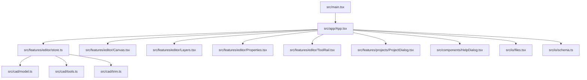
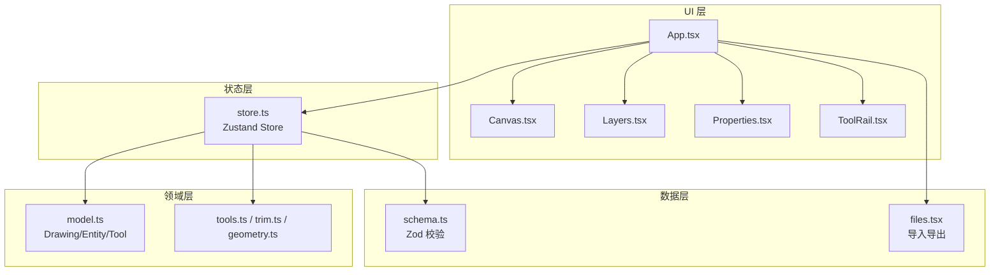
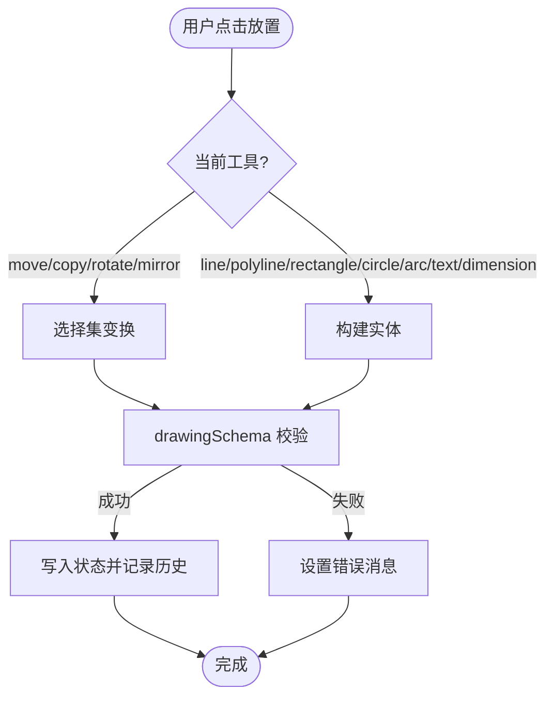
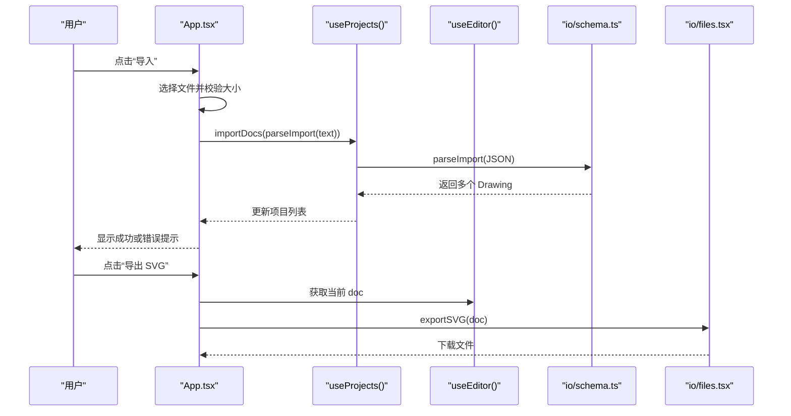
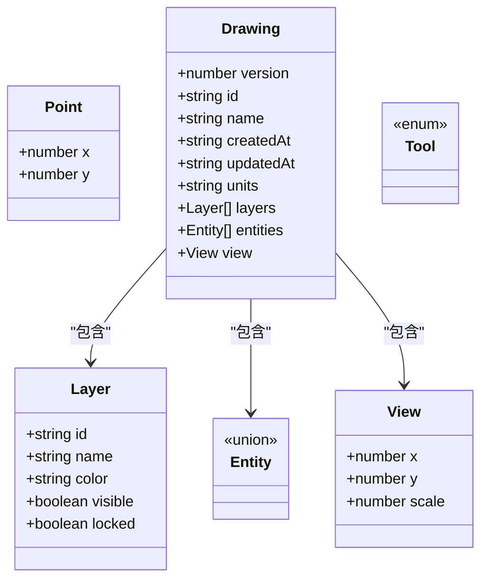
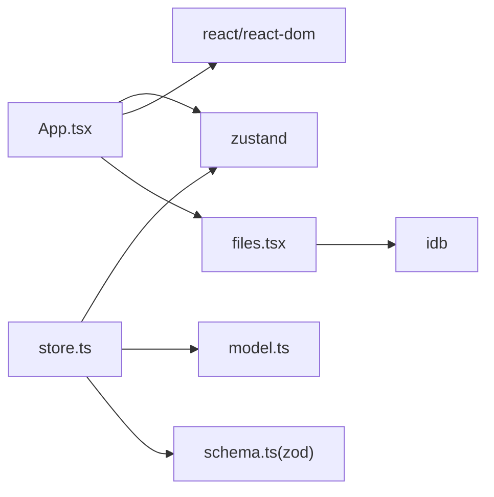

# 开发者指南

<cite>
**本文引用的文件**   
- [package.json](file://package.json)
- [tsconfig.json](file://tsconfig.json)
- [eslint.config.js](file://eslint.config.js)
- [vite.config.ts](file://vite.config.ts)
- [vitest.config.ts](file://vitest.config.ts)
- [playwright.config.ts](file://playwright.config.ts)
- [src/main.tsx](file://src/main.tsx)
- [src/app/App.tsx](file://src/app/App.tsx)
- [src/features/editor/store.ts](file://src/features/editor/store.ts)
- [src/cad/model.ts](file://src/cad/model.ts)
- [src/io/schema.ts](file://src/io/schema.ts)
</cite>

## 目录
1. [简介](#简介)
2. [项目结构](#项目结构)
3. [核心组件](#核心组件)
4. [架构总览](#架构总览)
5. [详细组件分析](#详细组件分析)
6. [依赖关系分析](#依赖关系分析)
7. [性能与优化](#性能与优化)
8. [调试与排错](#调试与排错)
9. [开发流程与代码审查](#开发流程与代码审查)
10. [常见问题与故障排除](#常见问题与故障排除)
11. [结论](#结论)

## 简介
本指南面向 web-cad 项目的开发者，覆盖从环境搭建、编码规范、调试技巧到重构与性能优化的全流程。项目基于 React + TypeScript + Vite，使用 Zustand 管理编辑器状态，Zod 进行数据校验，Playwright 进行端到端测试，Vitest 进行单元测试。

## 项目结构
仓库采用“功能域 + 领域模型”的混合组织方式：
- src/app: 应用外壳与全局样式入口
- src/components: 通用 UI 组件
- src/features: 按功能域划分（editor、projects）
- src/cad: CAD 领域模型、几何计算与工具函数
- src/io: 导入导出与数据模式校验
- src/storage: 本地持久化（IndexedDB）
- tests: E2E 测试与静态资源服务器
- 根配置: package.json、tsconfig.json、eslint.config.js、vite.config.ts、vitest.config.ts、playwright.config.ts

图表来源
- [src/main.tsx:1-6](file://src/main.tsx#L1-L6)
- [src/app/App.tsx:1-329](file://src/app/App.tsx#L1-L329)
- [src/features/editor/store.ts:1-324](file://src/features/editor/store.ts#L1-L324)
- [src/io/schema.ts:1-134](file://src/io/schema.ts#L1-L134)

章节来源
- [package.json:1-53](file://package.json#L1-L53)
- [src/main.tsx:1-6](file://src/main.tsx#L1-L6)

## 核心组件
- 应用入口与装配
  - 入口挂载 React 根节点并引入 App 与全局样式。
- 应用外壳
  - 提供顶部工具栏、文档操作区、编辑工具栏、画布、侧边面板、状态栏、项目对话框与帮助对话框等。
- 编辑器状态
  - 使用 Zustand store 维护当前图纸、历史栈、选中项、工具、视图、光标、消息等；提供 load、commit、undo/redo、place、finish、trim、transformSelection 等方法。
- 领域模型与校验
  - 定义 Drawing、Entity、Layer、View、Tool 等类型；使用 Zod 对导入/导出的 JSON 进行严格校验，确保 ID 唯一性、图层引用合法性与数值范围。

章节来源
- [src/main.tsx:1-6](file://src/main.tsx#L1-L6)
- [src/app/App.tsx:1-329](file://src/app/App.tsx#L1-L329)
- [src/features/editor/store.ts:1-324](file://src/features/editor/store.ts#L1-L324)
- [src/cad/model.ts:1-142](file://src/cad/model.ts#L1-L142)
- [src/io/schema.ts:1-134](file://src/io/schema.ts#L1-L134)

## 架构总览
系统以 React 为 UI 层，Zustand 作为全局状态中枢，CAD 领域逻辑集中在 src/cad，IO 与校验在 src/io，UI 组件按 features 与 components 分层组织。

图表来源
- [src/app/App.tsx:1-329](file://src/app/App.tsx#L1-L329)
- [src/features/editor/store.ts:1-324](file://src/features/editor/store.ts#L1-L324)
- [src/cad/model.ts:1-142](file://src/cad/model.ts#L1-L142)
- [src/io/schema.ts:1-134](file://src/io/schema.ts#L1-L134)

## 详细组件分析

### 编辑器状态与撤销重做
- 状态设计
  - 使用 history/future 双栈实现撤销/重做，限制历史长度避免内存膨胀。
  - 通过 revision 触发细粒度更新，结合 structuredClone 保证不可变更新。
- 变更校验
  - 每次 commit 前用 drawingSchema 校验，失败时设置 message 提示，不写入状态。
- 工具流
  - place/finish 根据当前 tool 构建 Entity，支持直线、折线、矩形、圆、圆弧、文本、标注等。
  - transformSelection 支持移动、复制、旋转、镜像等变换，内部调用几何库完成坐标变换。
- 裁剪逻辑
  - trim 基于可见实体集合计算交点，替换目标实体为裁剪后的结果。

图表来源
- [src/features/editor/store.ts:187-315](file://src/features/editor/store.ts#L187-L315)
- [src/io/schema.ts:66-104](file://src/io/schema.ts#L66-L104)

章节来源
- [src/features/editor/store.ts:1-324](file://src/features/editor/store.ts#L1-L324)
- [src/io/schema.ts:1-134](file://src/io/schema.ts#L1-L134)

### 应用外壳与交互流程
- 顶层交互
  - 新建/导入/导出项目、示例图纸、切换侧边栏、打开帮助对话框。
  - 所有异步操作统一通过 run 包装，处理 busy 锁与错误提示。
- 导入流程
  - 读取文件 -> 解析 JSON -> Zod 校验 -> 克隆并重命名 -> 注入项目列表。
- 导出流程
  - 导出项目 JSON/SVG/全部备份，分别调用 io/files 对应方法。

图表来源
- [src/app/App.tsx:146-210](file://src/app/App.tsx#L146-L210)
- [src/app/App.tsx:294-310](file://src/app/App.tsx#L294-L310)
- [src/io/schema.ts:105-133](file://src/io/schema.ts#L105-L133)

章节来源
- [src/app/App.tsx:1-329](file://src/app/App.tsx#L1-L329)

### 领域模型与数据结构
- 类型体系
  - Point、Layer、Entity（联合类型）、View、Drawing、Tool。
- 工厂与克隆
  - createDrawing 创建默认图纸与图层；cloneDrawing 深拷贝并重新分配 ID。
- 标识生成
  - uid 优先使用 crypto.randomUUID，回退到时间戳+随机字符串。

图表来源
- [src/cad/model.ts:1-142](file://src/cad/model.ts#L1-L142)

章节来源
- [src/cad/model.ts:1-142](file://src/cad/model.ts#L1-L142)

## 依赖关系分析
- 运行时依赖
  - react/react-dom: UI 框架
  - zustand: 轻量级状态管理
  - zod: 运行时数据校验
  - lucide-react: 图标库
  - idb: IndexedDB 封装（用于本地存储）
- 开发依赖
  - vite: 构建与开发服务器
  - @vitejs/plugin-react: React 插件
  - typescript: 类型检查
  - eslint + antfu/eslint-config + eslint-plugin-react: 代码风格与规则
  - vitest: 单元测试
  - @playwright/test: 端到端测试
  - vite-plugin-singlefile: 单文件构建

图表来源
- [package.json:22-45](file://package.json#L22-L45)
- [src/app/App.tsx:1-329](file://src/app/App.tsx#L1-L329)
- [src/features/editor/store.ts:1-324](file://src/features/editor/store.ts#L1-L324)
- [src/io/schema.ts:1-134](file://src/io/schema.ts#L1-L134)

章节来源
- [package.json:1-53](file://package.json#L1-L53)

## 性能与优化
- 渲染与状态
  - 使用 Zustand 的 selector 订阅最小化重渲染；避免在 render 中创建新对象。
  - 将频繁更新的视图参数（如 view）与业务数据分离，减少不必要的组件树更新。
- 历史栈与内存
  - 限制 history 长度（已实现），避免长时间运行导致内存增长。
  - 大对象更新时使用结构化克隆，避免意外共享可变状态。
- 几何计算
  - 将昂贵的几何运算（裁剪、变换）放在非渲染路径，必要时进行节流/防抖。
- 构建产物
  - 标准构建输出至 dist/standard；单文件构建用于离线分发。
  - 按需拆分路由与懒加载可进一步减小首屏体积（后续扩展建议）。

[本节为通用指导，不直接分析具体文件]

## 调试与排错
- 浏览器调试
  - 使用 React DevTools 检查组件树与 props/state。
  - 使用 Performance 面板录制关键交互（绘制、撤销重做、导入导出），定位耗时热点。
- 网络与文件
  - 导入超过 20 MB 会抛出错误；确认文件大小与 MIME 类型。
  - 使用 Network 面板观察静态资源加载情况。
- 类型与规则
  - 运行类型检查与 ESLint 修复：npm run typecheck、npm run lint:fix。
- 测试
  - 单元测试：npm run test
  - 端到端测试：npm run test:e2e（自动启动 dev server 与静态资源服务）

章节来源
- [package.json:9-20](file://package.json#L9-L20)
- [playwright.config.ts:1-35](file://playwright.config.ts#L1-L35)

## 开发流程与代码审查
- 环境搭建
  - Node.js 版本要求：^22.22.2 || >=24.15.0
  - 安装依赖：npm install
  - 启动开发服务器：npm run dev
  - 预览构建产物：npm run preview 或 npm run preview:single
- 编码规范
  - TypeScript 严格模式开启，ESNext 模块，React JSX 现代语法。
  - ESLint 使用 antfu 配置，启用 React 与 TypeScript 规则，格式化 CSS/HTML。
- 提交规范
  - 建议使用 conventional commits（feat/fix/docs/style/refactor/perf/test/build/ci/chore/revert）。
  - 提交前执行：npm run lint:fix && npm run typecheck && npm run test。
- 新功能开发流程
  - 明确需求与边界，先在 src/cad 或 src/features 下新增领域逻辑或功能模块。
  - 编写单元测试（vitest）与必要的 E2E 用例（playwright）。
  - 在 App 中集成新能力，确保错误处理与用户反馈完善。
- 代码审查标准
  - 类型安全：无 any，尽量使用字面量联合类型与 discriminated union。
  - 不可变更新：避免原地修改 state，使用 clone/映射/过滤组合。
  - 可测试性：纯函数优先，副作用收敛在 store 或 service 层。
  - 可读性：命名清晰，职责单一，复杂逻辑拆分为小函数。

章节来源
- [package.json:6-20](file://package.json#L6-L20)
- [tsconfig.json:1-16](file://tsconfig.json#L1-L16)
- [eslint.config.js:1-17](file://eslint.config.js#L1-L17)

## 常见问题与故障排除
- 无法启动开发服务器
  - 检查 Node.js 版本是否符合 engines 要求。
  - 清理缓存后重试：删除 node_modules 与 lock 文件，重新安装依赖。
- 类型检查报错
  - 运行 npm run typecheck 查看具体位置，修正类型不匹配或未声明的类型。
- ESLint 报错
  - 运行 npm run lint:fix 自动修复部分问题；未修复的问题需手动调整。
- 导入失败
  - 确认文件格式为 JSON，且不超过 20 MB。
  - 若为备份文件，确保格式字段正确；否则会被当作单个项目解析。
- 状态异常或界面卡死
  - 检查是否触发了大量历史累积；确认 commit 中的 schema 校验是否通过。
  - 使用 Performance 面板定位主线程阻塞点。

章节来源
- [src/io/schema.ts:105-133](file://src/io/schema.ts#L105-L133)
- [src/features/editor/store.ts:79-101](file://src/features/editor/store.ts#L79-L101)

## 结论
web-cad 以清晰的领域建模与严格的运行时校验为基础，结合 React + Zustand 提供了可扩展的二维绘图体验。遵循本指南的环境与规范，配合调试与测试工具，可高效地迭代功能并保障质量。建议在后续迭代中继续强化类型约束、组件拆分与性能监控，以提升可维护性与用户体验。