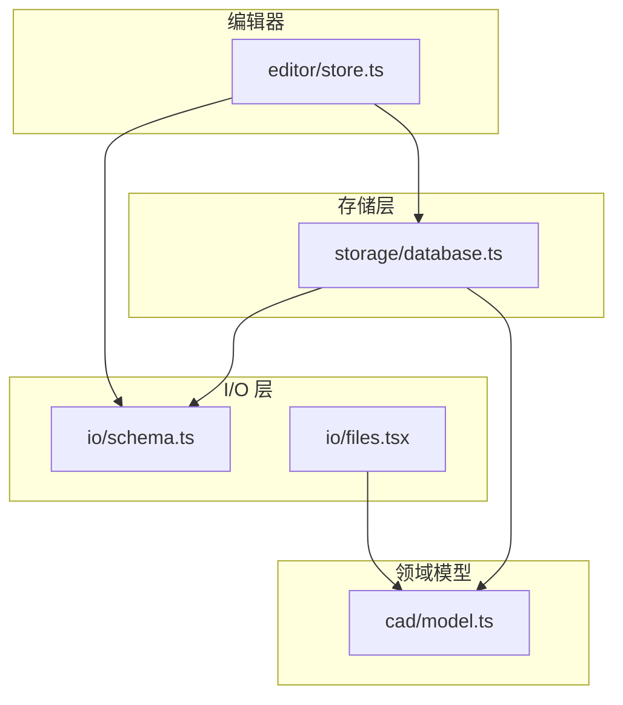
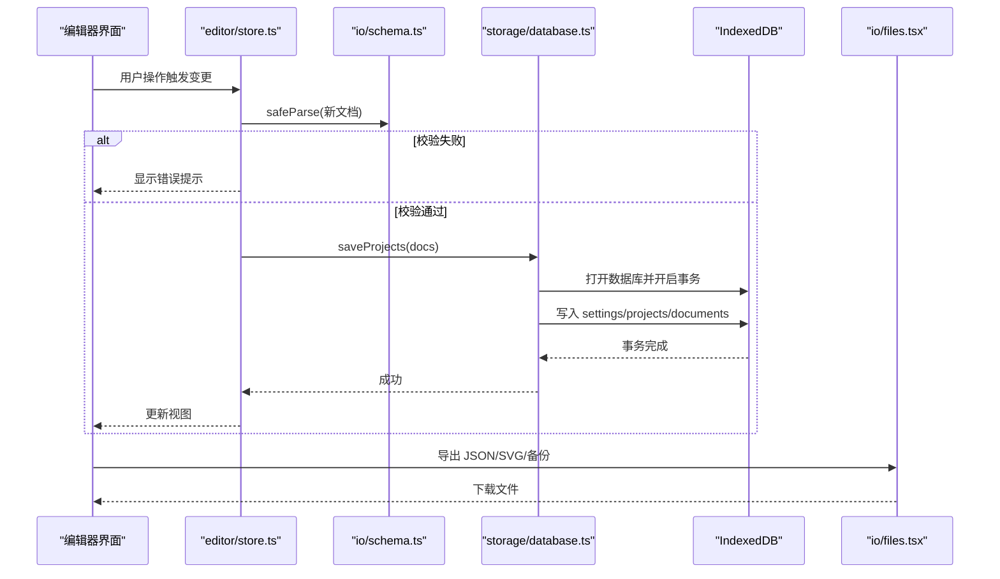
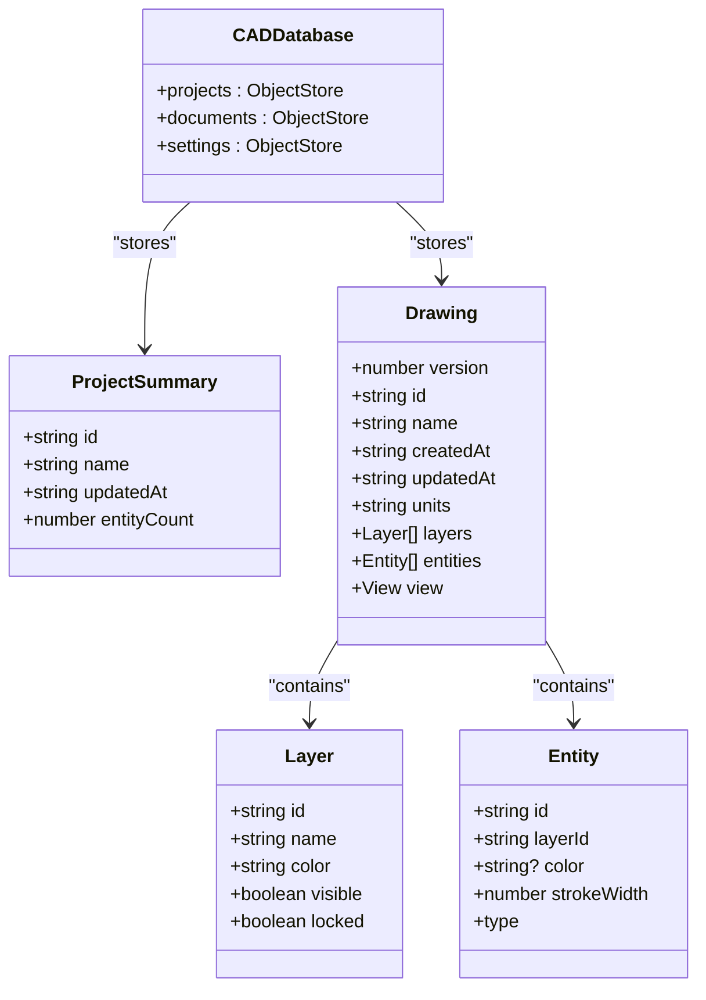
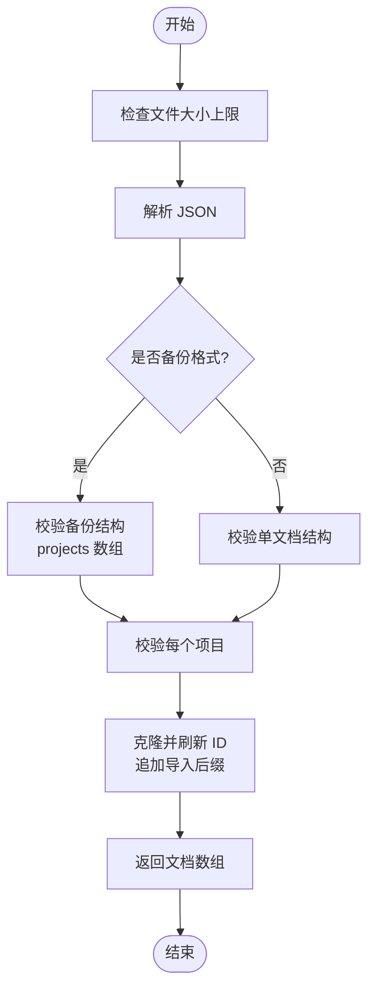
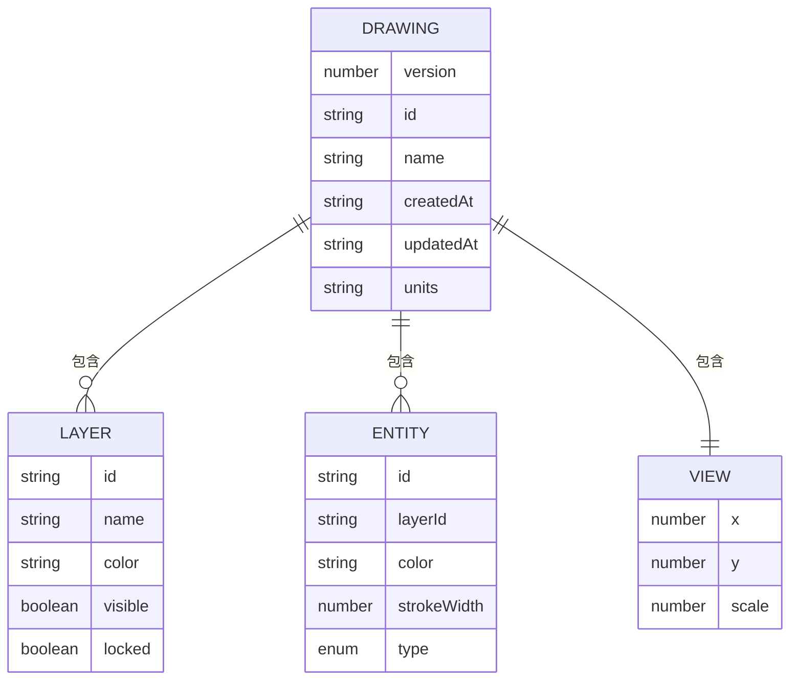
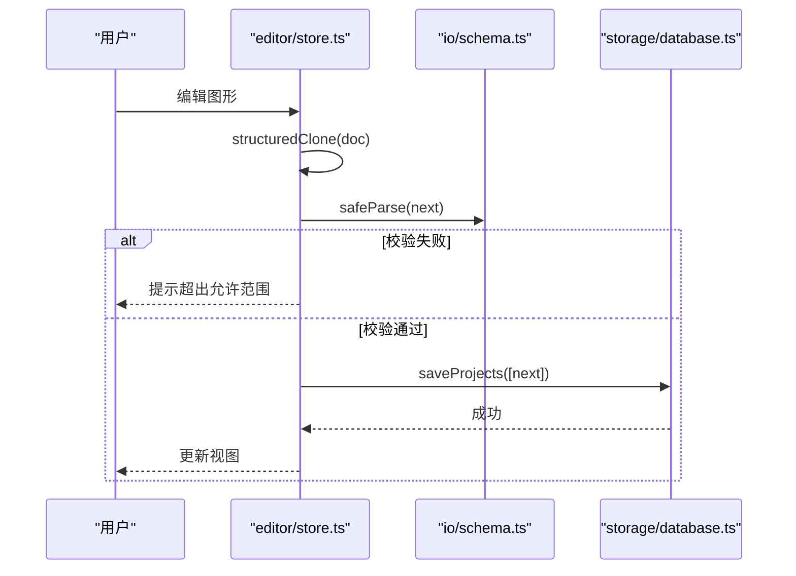
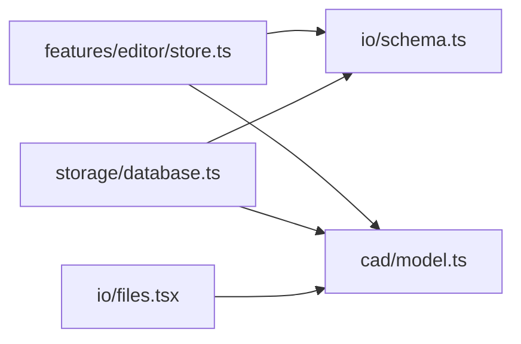

# 数据存储

<cite>
**本文引用的文件**   
- [database.ts](file://src/storage/database.ts)
- [files.tsx](file://src/io/files.tsx)
- [schema.ts](file://src/io/schema.ts)
- [model.ts](file://src/cad/model.ts)
- [store.ts](file://src/features/editor/store.ts)
- [database.test.ts](file://src/storage/database.test.ts)
- [files.test.tsx](file://src/io/files.test.tsx)
</cite>

## 目录
1. [引言](#引言)
2. [项目结构](#项目结构)
3. [核心组件](#核心组件)
4. [架构总览](#架构总览)
5. [详细组件分析](#详细组件分析)
6. [依赖关系分析](#依赖关系分析)
7. [性能与缓存](#性能与缓存)
8. [故障排查](#故障排查)
9. [结论](#结论)
10. [附录：API 与使用示例](#附录api-与使用示例)

## 引言
本文件面向 web-cad 的数据存储层，系统性说明 IndexedDB 数据库设计、文件 I/O 流程、Zod 数据验证模式、事务处理机制、持久化策略、备份恢复与版本兼容，以及与浏览器 API 的集成和错误处理。目标是帮助开发者快速理解并安全扩展该子系统。

## 项目结构
数据存储相关代码主要分布在以下模块：
- storage/database.ts：IndexedDB 连接、对象仓库定义、CRUD 与事务封装
- io/schema.ts：Zod 校验模式、导入解析与格式校验
- io/files.tsx：文件导出、备份导出、SVG 导出
- cad/model.ts：绘图模型类型与工厂方法
- features/editor/store.ts：编辑器状态与变更提交（含本地校验）
- 测试文件用于验证事务回滚、导入导出、ID 生成等关键行为

**图表来源**
- [store.ts:1-324](file://src/features/editor/store.ts#L1-L324)
- [schema.ts:1-134](file://src/io/schema.ts#L1-L134)
- [files.tsx:1-63](file://src/io/files.tsx#L1-L63)
- [database.ts:1-90](file://src/storage/database.ts#L1-L90)
- [model.ts:1-142](file://src/cad/model.ts#L1-L142)

**章节来源**
- [database.ts:1-90](file://src/storage/database.ts#L1-L90)
- [schema.ts:1-134](file://src/io/schema.ts#L1-L134)
- [files.tsx:1-63](file://src/io/files.tsx#L1-L63)
- [model.ts:1-142](file://src/cad/model.ts#L1-L142)
- [store.ts:1-324](file://src/features/editor/store.ts#L1-L324)

## 核心组件
- IndexedDB 数据库封装：提供连接管理、对象仓库创建/升级、最近项目记录、批量保存、列表查询、读取、删除等能力
- 文件 I/O：JSON 导出、备份导出、SVG 导出；支持文件名清理、Blob URL 生命周期管理
- Zod 数据验证：Drawing、Layer、Entity 等结构的强类型校验与业务约束
- 编辑器状态：基于 Zustand 的状态管理，变更时进行 schema 校验并更新更新时间戳

**章节来源**
- [database.ts:1-90](file://src/storage/database.ts#L1-L90)
- [files.tsx:1-63](file://src/io/files.tsx#L1-L63)
- [schema.ts:1-134](file://src/io/schema.ts#L1-L134)
- [store.ts:1-324](file://src/features/editor/store.ts#L1-L324)

## 架构总览
下图展示从编辑器到持久化的完整调用链，以及文件导入导出的路径。

**图表来源**
- [store.ts:79-101](file://src/features/editor/store.ts#L79-L101)
- [database.ts:45-63](file://src/storage/database.ts#L45-L63)
- [files.tsx:6-30](file://src/io/files.tsx#L6-L30)

## 详细组件分析

### IndexedDB 数据库设计与实现
- 数据库名与版本
  - 数据库名固定为 forma-cad
  - 当前版本号为 2，upgrade 回调负责对象仓库的创建
- 对象仓库
  - projects：项目摘要，keyPath 为 id，包含名称、更新时间、实体数量等
  - documents：完整 Drawing 文档，keyPath 为 id
  - settings：键值对设置，例如最近使用的 project id
- 连接管理
  - 单例 Promise 缓存连接，避免重复打开
  - blocking 回调关闭旧连接，terminated 回调重置连接缓存
- 索引优化
  - 当前未显式定义索引；按 id 查询为主
  - listProjects 在内存中对 updatedAt 排序，适合小数据集
- 事务处理
  - saveProjects 使用跨三个 store 的读写事务，先校验再写入，保证原子性
  - deleteProject 同时删除 projects 与 documents，确保一致性
- 最近项目
  - settings.recent 保存最近一次项目的 id，便于快速恢复

**图表来源**
- [database.ts:6-16](file://src/storage/database.ts#L6-L16)
- [model.ts:1-61](file://src/cad/model.ts#L1-L61)

**章节来源**
- [database.ts:12-41](file://src/storage/database.ts#L12-L41)
- [database.ts:45-89](file://src/storage/database.ts#L45-L89)

### 文件 I/O 系统
- 通用下载
  - 将内容以 Blob 形式创建 Object URL，触发 a 标签下载，并在延时后释放 URL
  - 文件名中的非法字符会被替换，避免平台兼容问题
- 导出功能
  - exportProject：导出单个 Drawing 为 JSON
  - exportBackup：导出多份 Drawing 为带 format/version/projects 的备份 JSON
  - exportSVG：渲染可见图层几何为 SVG 并下载
- 导入解析
  - parseImport：限制文件大小上限，尝试 JSON 解析，区分备份格式与单文档格式，执行 Zod 校验，复制并刷新 ID，追加“导入”后缀

**图表来源**
- [schema.ts:105-133](file://src/io/schema.ts#L105-L133)

**章节来源**
- [files.tsx:6-62](file://src/io/files.tsx#L6-L62)
- [schema.ts:105-133](file://src/io/schema.ts#L105-L133)

### Zod 数据验证模式
- 基础类型
  - finite：有限数值范围约束
  - point：二维点坐标
  - id：字符串长度约束
  - color：十六进制颜色正则
- 实体联合类型
  - 使用 discriminatedUnion 按 type 字段区分 line、rectangle、polyline、circle、arc、text、dimension
- 文档结构
  - drawingSchema：version、id、name、时间戳、units、layers、entities、view
  - superRefine：校验图层与实体 ID 唯一性、实体引用图层存在性
- 导入增强
  - 备份格式校验：format、version、projects 数组
  - 重复 ID 检测、超大文件拒绝、非有限数值拒绝

**图表来源**
- [schema.ts:4-92](file://src/io/schema.ts#L4-L92)
- [model.ts:1-61](file://src/cad/model.ts#L1-L61)

**章节来源**
- [schema.ts:1-134](file://src/io/schema.ts#L1-L134)

### 编辑器状态与持久化联动
- 编辑器状态使用 Zustand 管理 Drawing、历史栈、工具、选择集等
- commit 变更时：
  - 深拷贝当前文档
  - 使用 drawingSchema.safeParse 校验
  - 校验失败则提示用户
  - 校验成功则更新 updatedAt 并推入历史栈
- 与数据库交互：
  - 上层 UI 或业务逻辑调用 database.saveProjects 进行持久化
  - 保存前再次使用 drawingSchema.parse 做最终校验，确保入库数据合法

**图表来源**
- [store.ts:79-101](file://src/features/editor/store.ts#L79-L101)
- [database.ts:45-63](file://src/storage/database.ts#L45-L63)

**章节来源**
- [store.ts:79-101](file://src/features/editor/store.ts#L79-L101)
- [database.ts:45-63](file://src/storage/database.ts#L45-L63)

## 依赖关系分析
- 模块耦合
  - storage/database.ts 依赖 cad/model.ts 的类型与 io/schema.ts 的校验模式
  - io/files.tsx 依赖 cad/model.ts 的类型与 React DOM Server 的渲染能力
  - features/editor/store.ts 依赖 cad/model.ts、cad/geometry.ts、cad/tools.ts、cad/trim.ts、io/schema.ts
- 外部依赖
  - idb：IndexedDB 的 Promise 封装
  - zod：运行时数据校验
  - react-dom/server：服务端渲染 SVG 静态标记

**图表来源**
- [store.ts:1-15](file://src/features/editor/store.ts#L1-L15)
- [database.ts:1-5](file://src/storage/database.ts#L1-L5)
- [files.tsx:1-4](file://src/io/files.tsx#L1-L4)

**章节来源**
- [store.ts:1-15](file://src/features/editor/store.ts#L1-L15)
- [database.ts:1-5](file://src/storage/database.ts#L1-L5)
- [files.tsx:1-4](file://src/io/files.tsx#L1-L4)

## 性能与缓存
- 连接复用
  - 数据库连接以 Promise 缓存，避免频繁打开 IndexedDB
- 批量写入
  - saveProjects 使用单一事务并行写入多个 store，减少事务开销
- 内存排序
  - listProjects 在内存中按 updatedAt 排序，适用于小规模项目列表
- 导入限流
  - parseImport 限制文件大小上限，防止大文件阻塞主线程
- 建议
  - 若项目数增长，可为 projects 添加 updatedAt 索引以提升排序性能
  - 对 entities 的大对象可考虑分片存储或使用压缩序列化

[本节为通用性能建议，不直接分析具体文件]

## 故障排查
- 导入失败常见原因
  - 文件格式不是有效 JSON
  - 超过 20 MB 大小限制
  - 未知版本或不符合备份结构
  - 图层或实体 ID 重复
  - 实体引用了不存在的图层
  - 非有限数值（如 Infinity）
- 数据库异常
  - 连接被阻断或终止时会重置连接缓存，需重新获取连接
  - 事务中途 abort 会抛出异常，所有写入回滚
- 调试建议
  - 使用单元测试覆盖导入导出与事务回滚场景
  - 在浏览器控制台查看 IndexedDB 对象仓库内容与事务状态

**章节来源**
- [schema.ts:105-133](file://src/io/schema.ts#L105-L133)
- [database.ts:28-39](file://src/storage/database.ts#L28-L39)
- [database.test.ts:42-61](file://src/storage/database.test.ts#L42-L61)
- [files.test.tsx:37-77](file://src/io/files.test.tsx#L37-L77)

## 结论
web-cad 的数据存储层通过 IndexedDB 提供可靠的本地持久化，结合 Zod 进行严格的数据校验，配合文件 I/O 实现导入导出与备份恢复。编辑器状态在变更时即进行校验，确保入库数据的完整性与一致性。整体设计简洁清晰，具备良好的可扩展性与可维护性。

[本节为总结性内容，不直接分析具体文件]

## 附录：API 与使用示例

- 数据库连接与基本操作
  - 获取数据库连接：database()
  - 读取最近项目：recentProjectId()
  - 批量保存项目：saveProjects(docs)
  - 列出项目：listProjects()
  - 读取项目：readProject(id)
  - 列出全部项目：allProjects()
  - 删除项目：deleteProject(id)

- 文件 I/O
  - 导出单个项目：exportProject(doc)
  - 导出备份：exportBackup(docs)
  - 导出 SVG：exportSVG(doc)
  - 解析导入：parseImport(text)

- 事务语义
  - saveProjects 与 deleteProject 均使用跨 store 的事务，保证原子性
  - 测试覆盖了事务中止的回滚行为

- 版本与兼容性
  - Drawing.version 固定为 1，导入时拒绝未知版本
  - 备份格式包含 format 与 version 字段，便于未来演进

**章节来源**
- [database.ts:18-89](file://src/storage/database.ts#L18-L89)
- [files.tsx:18-62](file://src/io/files.tsx#L18-L62)
- [schema.ts:66-133](file://src/io/schema.ts#L66-L133)
- [database.test.ts:24-61](file://src/storage/database.test.ts#L24-L61)
- [files.test.tsx:12-83](file://src/io/files.test.tsx#L12-L83)