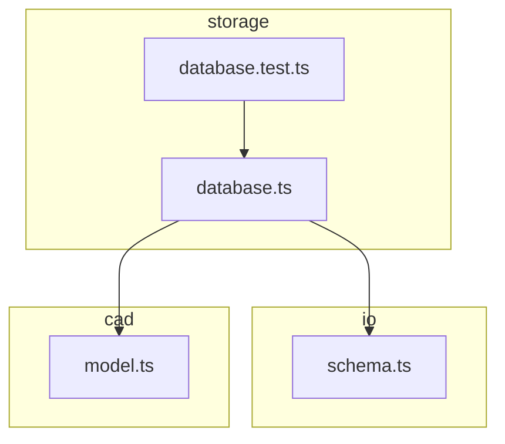
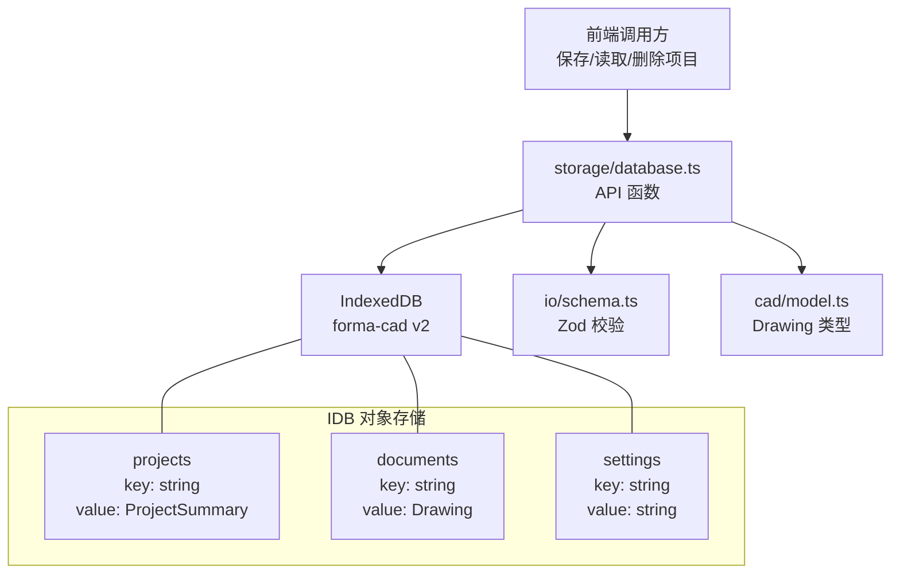
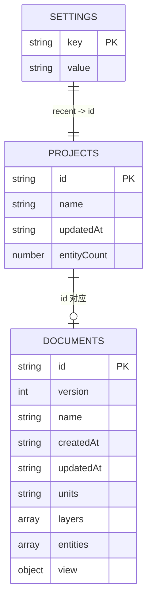
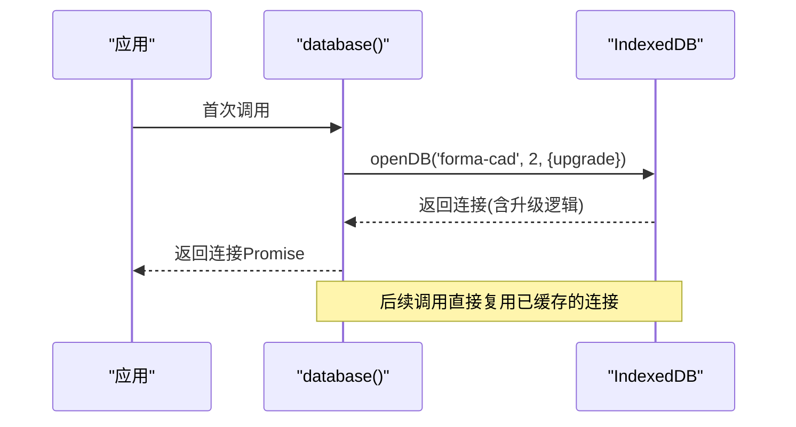
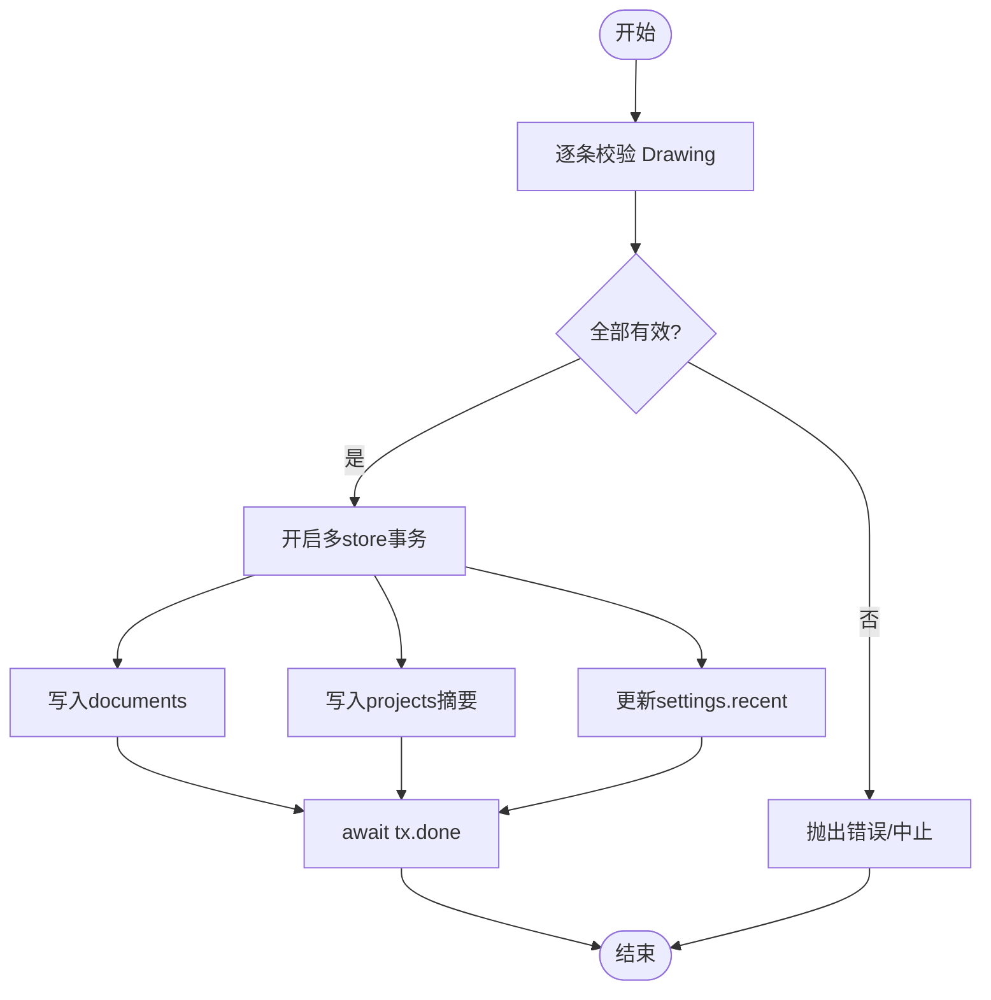
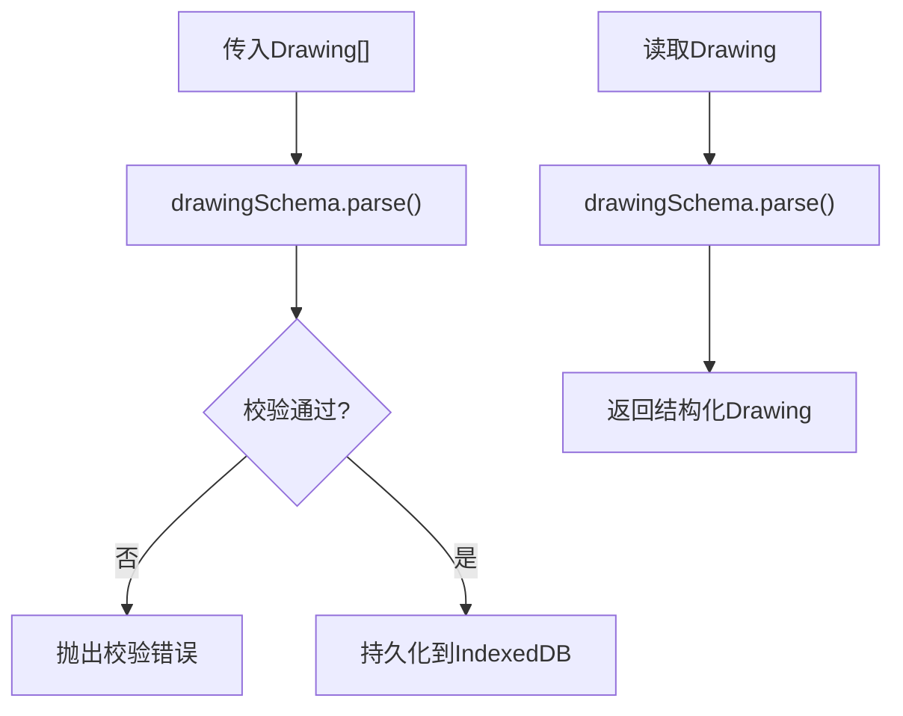
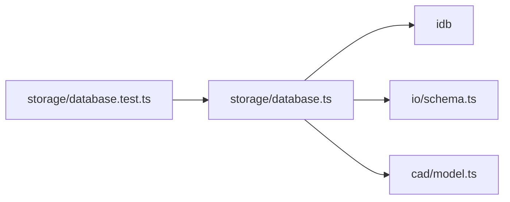

# 数据库设计

<cite>
**本文引用的文件**   
- [database.ts](file://src/storage/database.ts)
- [schema.ts](file://src/io/schema.ts)
- [model.ts](file://src/cad/model.ts)
- [database.test.ts](file://src/storage/database.test.ts)
</cite>

## 目录
1. [简介](#简介)
2. [项目结构](#项目结构)
3. [核心组件](#核心组件)
4. [架构总览](#架构总览)
5. [详细组件分析](#详细组件分析)
6. [依赖关系分析](#依赖关系分析)
7. [性能与优化建议](#性能与优化建议)
8. [故障排查指南](#故障排查指南)
9. [结论](#结论)

## 简介
本技术文档围绕 web-cad 的 IndexedDB 持久化层展开，重点说明 CADDatabase 接口的设计、三个对象存储（projects、documents、settings）的结构定义、ProjectSummary 字段语义与数据关系、数据库连接管理、版本升级机制、事务处理策略，以及完整的 API 使用示例。同时阐述数据验证与 Zod 模式的集成方式、错误处理与异常恢复机制，并给出数据库性能优化建议与最佳实践。

## 项目结构
IndexedDB 相关实现集中在 storage 模块中，并通过 io 层的 schema 进行数据校验，通过 cad 层的 model 提供领域模型类型。测试位于 storage 模块下，覆盖保存、读取、删除、批量导入和事务回滚等场景。

图表来源
- [database.ts:1-90](file://src/storage/database.ts#L1-L90)
- [schema.ts:1-134](file://src/io/schema.ts#L1-L134)
- [model.ts:1-142](file://src/cad/model.ts#L1-L142)
- [database.test.ts:1-63](file://src/storage/database.test.ts#L1-L63)

章节来源
- [database.ts:1-90](file://src/storage/database.ts#L1-L90)
- [database.test.ts:1-63](file://src/storage/database.test.ts#L1-L63)

## 核心组件
- CADDatabase：IndexedDB 的类型化 Schema，声明了 projects、documents、settings 三个对象存储及其键值类型。
- ProjectSummary：项目的摘要信息，用于列表展示与排序，包含 id、name、updatedAt、entityCount。
- Drawing：CAD 图纸的完整数据结构，由 zod 模式严格校验，作为 documents 存储的值类型。
- database()：单例化的数据库连接工厂，负责连接复用、升级、阻塞与终止回调。
- 业务 API：saveProjects、listProjects、readProject、allProjects、deleteProject、recentProjectId。

章节来源
- [database.ts:6-16](file://src/storage/database.ts#L6-L16)
- [database.ts:18-41](file://src/storage/database.ts#L18-L41)
- [database.ts:42-89](file://src/storage/database.ts#L42-L89)
- [model.ts:51-61](file://src/cad/model.ts#L51-L61)

## 架构总览
下图展示了 IndexedDB 在应用中的位置与各组件之间的交互关系。

图表来源
- [database.ts:12-16](file://src/storage/database.ts#L12-L16)
- [database.ts:18-41](file://src/storage/database.ts#L18-L41)
- [schema.ts:66-104](file://src/io/schema.ts#L66-L104)
- [model.ts:51-61](file://src/cad/model.ts#L51-L61)

## 详细组件分析

### CADDatabase 接口与对象存储设计
- projects：键为字符串（项目 id），值为 ProjectSummary，用于快速列出项目并按更新时间排序。
- documents：键为字符串（项目 id），值为 Drawing，存储完整图纸数据。
- settings：键为字符串（如 'recent'），值为字符串（最近打开的项目 id）。

图表来源
- [database.ts:6-16](file://src/storage/database.ts#L6-L16)
- [model.ts:51-61](file://src/cad/model.ts#L51-L61)

章节来源
- [database.ts:6-16](file://src/storage/database.ts#L6-L16)

### ProjectSummary 字段含义与数据关系
- id：项目唯一标识，与 documents 的主键一致。
- name：项目名称，便于列表展示。
- updatedAt：最后更新时间，用于列表按时间倒序排列。
- entityCount：实体数量，来源于 Drawing.entities.length，用于概览统计。

数据关系：
- ProjectSummary 是 Drawing 的轻量摘要，避免每次列表加载时读取完整 Drawing。
- settings.recent 指向某个 project.id，表示最近一次访问的项目。

章节来源
- [database.ts:6-11](file://src/storage/database.ts#L6-L11)
- [database.ts:54-59](file://src/storage/database.ts#L54-L59)

### 数据库连接管理与版本升级
- 连接管理：
  - 使用 Promise 缓存连接实例，避免重复创建连接。
  - blocking 回调中关闭旧连接，确保升级期间无并发写入。
  - terminated 回调清理缓存，防止断连后持有无效引用。
- 版本升级：
  - openDB 指定数据库名为 'forma-cad'，版本号为 2。
  - upgrade 阶段按需创建对象存储 projects、documents、settings，并使用 keyPath 或默认键。

图表来源
- [database.ts:18-41](file://src/storage/database.ts#L18-L41)

章节来源
- [database.ts:18-41](file://src/storage/database.ts#L18-L41)

### 事务处理策略
- 写操作统一通过 db.transaction([...stores], 'readwrite') 创建多 store 事务。
- saveProjects：
  - 先对输入数组逐个执行 drawingSchema.parse 完成校验，全部通过后进入事务。
  - 在同一个事务内并行写入 documents 与 projects，并更新 settings.recent。
  - 等待 tx.done 确保事务提交成功。
- deleteProject：
  - 在同一事务内并行删除 projects 与 documents，保证一致性。
- 失败与回滚：
  - 任一写入失败将导致整个事务回滚，不会留下部分数据。
  - 测试覆盖了 abort 与异常路径下的回滚行为。

图表来源
- [database.ts:45-63](file://src/storage/database.ts#L45-L63)
- [database.ts:81-89](file://src/storage/database.ts#L81-L89)

章节来源
- [database.ts:45-63](file://src/storage/database.ts#L45-L63)
- [database.ts:81-89](file://src/storage/database.ts#L81-L89)
- [database.test.ts:42-61](file://src/storage/database.test.ts#L42-L61)

### 数据验证与 Zod 模式集成
- 所有写入前均通过 drawingSchema.parse 进行强类型校验，包括：
  - 基础字段约束（version、id、name、时间戳、units）。
  - layers 与 entities 的数量与结构约束。
  - 自定义规则：图层与实体 id 唯一性、实体 layerId 必须存在于 layers。
- 读取路径 readProject 与 allProjects 同样使用 drawingSchema.parse 对从 IndexedDB 取出的数据进行二次校验，确保内存中的数据始终合法。

图表来源
- [schema.ts:66-104](file://src/io/schema.ts#L66-L104)
- [database.ts:45-47](file://src/storage/database.ts#L45-L47)
- [database.ts:70-74](file://src/storage/database.ts#L70-L74)
- [database.ts:76-79](file://src/storage/database.ts#L76-L79)

章节来源
- [schema.ts:66-104](file://src/io/schema.ts#L66-L104)
- [database.ts:45-47](file://src/storage/database.ts#L45-L47)
- [database.ts:70-74](file://src/storage/database.ts#L70-L74)
- [database.ts:76-79](file://src/storage/database.ts#L76-L79)

### API 使用示例与行为说明
以下示例以“如何使用”的方式描述，不直接展示代码内容。

- 保存项目（saveProjects）
  - 输入：Drawing[]
  - 行为：
    - 对所有 Drawing 执行 zod 校验；任意一条失败则整体失败，不写入任何数据。
    - 成功后在单个事务中写入 documents 与 projects，并设置 settings.recent 为第一个项目的 id。
    - 若重复保存同一 id，会覆盖已有记录，不会重复创建。
  - 参考用例：[database.test.ts:25-32](file://src/storage/database.test.ts#L25-L32)

- 列出项目（listProjects）
  - 行为：从 projects 获取所有摘要，并按 updatedAt 倒序排序。
  - 参考用例：[database.test.ts:29-31](file://src/storage/database.test.ts#L29-L31)

- 读取项目（readProject）
  - 输入：string id
  - 行为：从 documents 读取 Drawing，并进行 zod 校验；不存在返回 undefined。
  - 参考用例：[database.test.ts:29](file://src/storage/database.test.ts#L29)

- 获取全部项目（allProjects）
  - 行为：读取 documents 中的所有 Drawing，并逐一 zod 校验。
  - 参考用例：[database.test.ts:39](file://src/storage/database.test.ts#L39)

- 删除项目（deleteProject）
  - 输入：string id
  - 行为：在同一事务中删除 projects 与 documents 两条记录。
  - 参考用例：[database.test.ts:33-41](file://src/storage/database.test.ts#L33-L41)

- 最近项目（recentProjectId）
  - 行为：从 settings 读取 'recent' 对应的 id。
  - 参考用例：[database.test.ts:31](file://src/storage/database.test.ts#L31)

章节来源
- [database.ts:42-89](file://src/storage/database.ts#L42-L89)
- [database.test.ts:24-41](file://src/storage/database.test.ts#L24-L41)

## 依赖关系分析
- storage/database.ts 依赖：
  - idb：openDB、IDBPDatabase、DBSchema 类型。
  - io/schema.ts：drawingSchema 用于数据校验。
  - cad/model.ts：Drawing 类型定义。
- 测试依赖 fake-indexeddb 以在单元测试中模拟 IndexedDB。

图表来源
- [database.ts:1-4](file://src/storage/database.ts#L1-L4)
- [database.test.ts:1-12](file://src/storage/database.test.ts#L1-L12)

章节来源
- [database.ts:1-4](file://src/storage/database.ts#L1-L4)
- [database.test.ts:1-12](file://src/storage/database.test.ts#L1-L12)

## 性能与优化建议
- 连接复用
  - 通过缓存 connection Promise 避免重复建立连接，减少开销。
- 批量写入
  - 使用单一事务并行写入多个对象存储，降低事务启动次数与锁竞争。
- 索引与查询
  - 当前未使用复合索引；如需按名称、更新时间范围等条件查询，可考虑添加索引。
- 分页与懒加载
  - listProjects 全量拉取并按 updatedAt 排序，当项目数量增长时可考虑游标分页。
- 读写分离
  - 列表仅读取 ProjectSummary，避免加载完整 Drawing，显著降低 I/O 与序列化成本。
- 校验前置
  - 在事务外完成 zod 校验，失败即中止，避免无效数据进入事务。
- 大对象处理
  - Drawing 可能较大，建议结合压缩或分片存储策略，并在导入流程中限制文件大小（schema.ts 已有 20MB 上限）。

[本节为通用指导，不直接分析具体文件]

## 故障排查指南
- 常见错误来源
  - Zod 校验失败：字段缺失、类型不符、长度超限、自定义规则不满足（如图层/实体 id 重复、layerId 引用不存在）。
  - IndexedDB 升级冲突：blocking 回调会关闭旧连接，确保升级安全。
  - 事务失败：任一写入失败将触发回滚，需检查上游数据合法性与 IndexedDB 可用性。
- 定位步骤
  - 确认 drawingSchema.parse 是否通过，必要时打印校验错误详情。
  - 检查 IndexedDB 是否存在目标对象存储及版本号是否正确。
  - 查看事务 done 的拒绝原因，确认是否为写入失败或中断。
- 恢复策略
  - 捕获异常后重试（注意幂等性与去重）。
  - 对于 settings.recent 不一致，可通过重新计算最近更新时间或用户选择修复。

章节来源
- [schema.ts:66-104](file://src/io/schema.ts#L66-L104)
- [database.ts:18-41](file://src/storage/database.ts#L18-L41)
- [database.ts:45-63](file://src/storage/database.ts#L45-L63)
- [database.test.ts:42-61](file://src/storage/database.test.ts#L42-L61)

## 结论
该数据库设计通过类型化的 DBSchema 与严格的 Zod 校验保证了数据的完整性与一致性；通过单例连接与多 store 事务实现了高效可靠的读写；通过 ProjectSummary 与 Drawing 的解耦提升了列表性能。建议在数据规模增长时引入分页与索引，并结合压缩与分片策略进一步优化大图档的存储与传输。