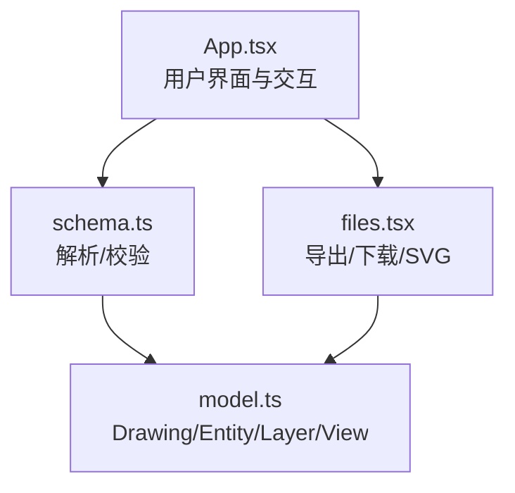
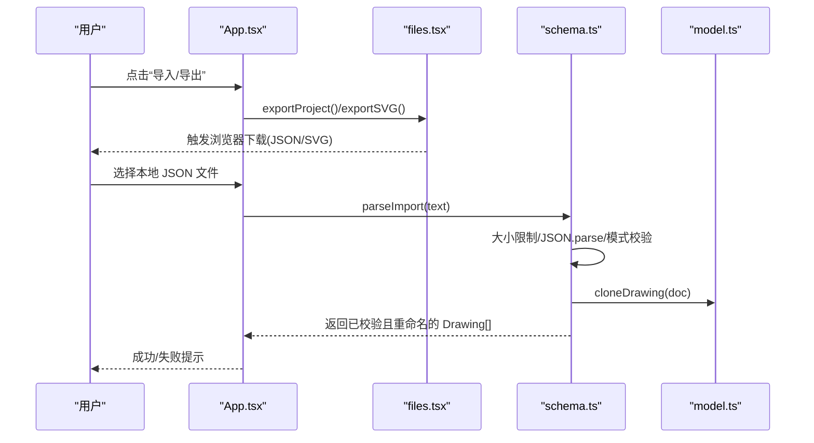
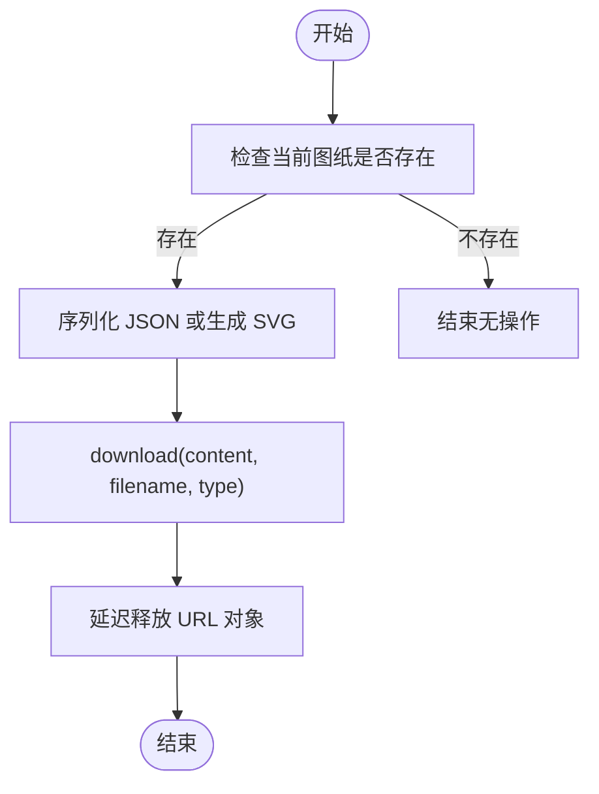
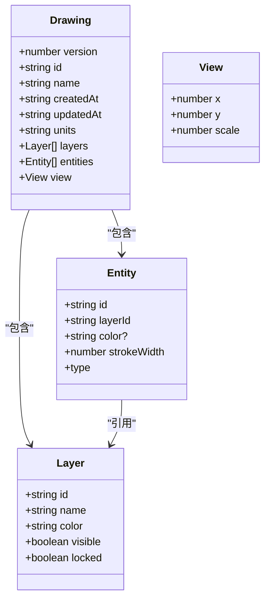
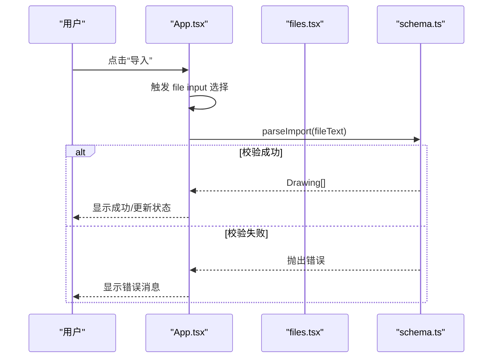
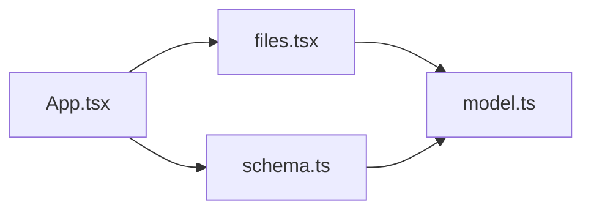

# 文件I/O系统

<cite>
**本文引用的文件**   
- [src/io/files.tsx](file://src/io/files.tsx)
- [src/io/schema.ts](file://src/io/schema.ts)
- [src/cad/model.ts](file://src/cad/model.ts)
- [src/app/App.tsx](file://src/app/App.tsx)
- [src/io/files.test.tsx](file://src/io/files.test.tsx)
</cite>

## 目录
1. [简介](#简介)
2. [项目结构](#项目结构)
3. [核心组件](#核心组件)
4. [架构总览](#架构总览)
5. [详细组件分析](#详细组件分析)
6. [依赖关系分析](#依赖关系分析)
7. [性能与容量限制](#性能与容量限制)
8. [错误处理与用户反馈](#错误处理与用户反馈)
9. [API 使用示例](#api-使用示例)
10. [兼容性说明](#兼容性说明)
11. [结论](#结论)

## 简介
本技术文档聚焦 web-cad 的文件输入输出系统，覆盖以下关键主题：
- 文件导入导出能力，尤其是 JSON 格式的读写流程。
- drawingSchema 数据验证模式的定义、字段约束与业务规则校验。
- 文件序列化与反序列化过程，以及数据类型转换机制。
- 文件操作 API 的完整用法，包括选择、读取、保存等。
- 文件格式兼容性、错误处理与用户反馈机制。
- 文件大小限制、性能优化与安全考虑。
- 与浏览器 File API 的集成方式及跨浏览器兼容策略。

该系统的核心目标是确保 CAD 图纸数据在浏览器环境中安全、稳定地导入导出，同时提供清晰的错误提示和健壮的数据校验。

## 项目结构
文件 I/O 相关代码主要位于 src/io 目录，并与应用入口、CAD 模型层紧密协作：
- src/io/files.tsx：负责下载/导出（JSON、SVG）、备份导出、SVG 内容生成。
- src/io/schema.ts：基于 Zod 的 drawingSchema 数据模式与 parseImport 解析器。
- src/cad/model.ts：Drawing、Entity、Layer、View 等核心类型与克隆工具。
- src/app/App.tsx：UI 层触发导入导出，捕获并展示错误信息。
- src/io/files.test.tsx：文件交换相关的单元测试，覆盖往返、备份、异常路径。

**图表来源**
- [src/app/App.tsx:34-195](file://src/app/App.tsx#L34-L195)
- [src/io/files.tsx:6-62](file://src/io/files.tsx#L6-L62)
- [src/io/schema.ts:66-133](file://src/io/schema.ts#L66-L133)
- [src/cad/model.ts:51-61](file://src/cad/model.ts#L51-L61)

**章节来源**
- [src/io/files.tsx:1-63](file://src/io/files.tsx#L1-L63)
- [src/io/schema.ts:1-134](file://src/io/schema.ts#L1-L134)
- [src/cad/model.ts:1-142](file://src/cad/model.ts#L1-L142)
- [src/app/App.tsx:34-195](file://src/app/App.tsx#L34-L195)

## 核心组件
- 导出与下载
  - download：将字符串内容以 Blob + URL.createObjectURL 的方式触发浏览器下载，自动清理对象 URL。
  - exportProject：将当前 Drawing 序列化为 JSON 并下载。
  - exportBackup：将多个 Drawing 打包为备份格式 JSON 并下载。
  - svgContent/exportSVG：根据可见图层与实体渲染 SVG 字符串并下载。
- 数据模式与解析
  - drawingSchema：基于 Zod 的严格模式，定义版本、ID、名称、时间戳、单位、图层、实体、视图等字段类型与范围约束，并通过 superRefine 实现跨字段业务规则校验。
  - parseImport：统一入口，支持单图 JSON 与多图备份 JSON；包含大小限制、JSON 语法校验、模式校验、ID 唯一性检查、名称截断与“导入”后缀追加。

**章节来源**
- [src/io/files.tsx:6-62](file://src/io/files.tsx#L6-L62)
- [src/io/schema.ts:66-133](file://src/io/schema.ts#L66-L133)

## 架构总览
下图展示了从用户操作到文件落盘或内存解析的关键调用链。

**图表来源**
- [src/app/App.tsx:34-195](file://src/app/App.tsx#L34-L195)
- [src/io/files.tsx:6-62](file://src/io/files.tsx#L6-L62)
- [src/io/schema.ts:105-133](file://src/io/schema.ts#L105-L133)
- [src/cad/model.ts:118-141](file://src/cad/model.ts#L118-L141)

## 详细组件分析

### 导出与下载模块（files.tsx）
- download(content, filename, type)
  - 通过 Blob 与 URL.createObjectURL 创建可下载链接，自动替换非法文件名字符，并在延迟后释放对象 URL。
- exportProject(doc)
  - 将 Drawing 对象序列化为 JSON 字符串，并以 doc.name.json 命名下载。
- exportBackup(docs)
  - 将多个 Drawing 封装为 { format: 'forma-cad-backup', version: 1, projects } 结构并下载。
- svgContent(doc) / exportSVG(doc)
  - 过滤可见图层对应的实体，计算包围盒，使用 React 服务端渲染生成 SVG 字符串，再触发下载。

**图表来源**
- [src/io/files.tsx:6-62](file://src/io/files.tsx#L6-L62)

**章节来源**
- [src/io/files.tsx:6-62](file://src/io/files.tsx#L6-L62)

### 数据模式与解析模块（schema.ts）
- drawingSchema
  - 基础字段：version、id、name、createdAt、updatedAt、units。
  - layers：数组，每个图层含 id、name、color、visible、locked，数量 1..100。
  - entities：数组，最大 20000，元素为联合类型（line、rectangle、polyline、circle、arc、text、dimension），各子类型有特定几何字段与约束。
  - view：x、y、scale（有限数，范围 0.01..100）。
  - superRefine 业务规则：
    - 图层 ID 与实体 ID 必须唯一。
    - 实体的 layerId 必须存在于图层集合中。
- parseImport(text)
  - 先进行字节长度检查，超过 20 MB 直接抛出错误。
  - 尝试 JSON.parse，失败则抛出“不是有效的 JSON 文件”。
  - 识别是否为备份格式（包含 format 字段），分别走 backup 或 drawingSchema 校验。
  - 校验备份内项目 ID 唯一性。
  - 对每个文档执行 cloneDrawing，并重命名为“原名称前190字符 + ‘ · 导入’”，保证符合 name 长度限制。

**图表来源**
- [src/cad/model.ts:51-61](file://src/cad/model.ts#L51-L61)
- [src/cad/model.ts:5-17](file://src/cad/model.ts#L5-L17)
- [src/cad/model.ts:18-45](file://src/cad/model.ts#L18-L45)
- [src/cad/model.ts:46-50](file://src/cad/model.ts#L46-L50)

**章节来源**
- [src/io/schema.ts:66-133](file://src/io/schema.ts#L66-L133)
- [src/cad/model.ts:51-61](file://src/cad/model.ts#L51-L61)

### 应用入口与交互（App.tsx）
- 提供“导入”按钮，触发原生 input[type=file] 选择文件。
- 提供“导出”下拉菜单，支持导出“项目 JSON”与“矢量 SVG”。
- 统一的 run 异步包装器：
  - 捕获 z.ZodError 并转换为友好提示：“导入数据不合法：...（请使用 Forma CAD 导出的版本 1 JSON）”。
  - 其他 Error 透传 message。
  - 设置 busy 状态，防止重复操作。

**图表来源**
- [src/app/App.tsx:34-195](file://src/app/App.tsx#L34-L195)
- [src/io/schema.ts:105-133](file://src/io/schema.ts#L105-L133)

**章节来源**
- [src/app/App.tsx:34-195](file://src/app/App.tsx#L34-L195)

## 依赖关系分析
- files.tsx 依赖 model.ts 的类型 Drawing，用于导出时的序列化与 SVG 渲染。
- schema.ts 依赖 model.ts 的 cloneDrawing，用于导入时复制并重新分配 ID。
- App.tsx 作为 UI 层，组合 files.tsx 与 schema.ts 的能力，并提供错误处理与用户反馈。

**图表来源**
- [src/app/App.tsx:34-195](file://src/app/App.tsx#L34-L195)
- [src/io/files.tsx:1-62](file://src/io/files.tsx#L1-L62)
- [src/io/schema.ts:1-133](file://src/io/schema.ts#L1-L133)
- [src/cad/model.ts:118-141](file://src/cad/model.ts#L118-L141)

**章节来源**
- [src/io/files.tsx:1-62](file://src/io/files.tsx#L1-L62)
- [src/io/schema.ts:1-133](file://src/io/schema.ts#L1-L133)
- [src/cad/model.ts:118-141](file://src/cad/model.ts#L118-L141)
- [src/app/App.tsx:34-195](file://src/app/App.tsx#L34-L195)

## 性能与容量限制
- 文件大小限制
  - parseImport 在解析前对文本进行字节长度检查，超过 20 MB 直接拒绝，避免大文件导致的内存与解析开销。
- 数据结构规模限制
  - layers 最多 100，entities 最多 20000，备份 projects 最多 500，防止超大文档导致渲染与校验性能问题。
- 数值范围限制
  - 所有坐标与尺寸使用有限数（finite），view.scale 限定在 0.01..100，避免 Infinity/NaN 引发计算异常。
- 序列化与渲染
  - 导出 JSON 使用结构化序列化；SVG 渲染仅包含可见图层实体，减少不必要的节点。

[本节为通用性能建议，未直接分析具体文件，故不附“章节来源”]

## 错误处理与用户反馈
- 解析阶段
  - 非 JSON：抛出“不是有效的 JSON 文件”。
  - 超出大小：抛出“文件超过 20 MB 上限”。
  - 模式校验失败：Zod 返回 issues，UI 层将其转为“导入数据不合法：...”提示。
  - 业务规则失败：如 ID 重复、图层引用不存在、备份内项目 ID 重复等，均会抛出明确错误。
- UI 层
  - run 包装器统一捕获错误并设置 busy 状态，避免并发操作。
  - 针对 ZodError 给出友好文案，引导用户使用 Forma CAD 导出的版本 1 JSON。

**章节来源**
- [src/io/schema.ts:105-133](file://src/io/schema.ts#L105-L133)
- [src/app/App.tsx:43-64](file://src/app/App.tsx#L43-L64)

## API 使用示例
以下为常用 API 的使用说明与调用路径（不包含具体代码内容）：

- 导出当前项目为 JSON
  - 调用：exportProject(doc)
  - 行为：将 Drawing 对象序列化为 JSON 并触发浏览器下载，文件名为 doc.name.json。
  - 参考路径：[src/io/files.tsx:18-20](file://src/io/files.tsx#L18-L20)

- 导出全部图纸备份
  - 调用：exportBackup(docs)
  - 行为：将多个 Drawing 封装为备份格式 JSON 并下载。
  - 参考路径：[src/io/files.tsx:21-30](file://src/io/files.tsx#L21-L30)

- 导出当前项目为 SVG
  - 调用：exportSVG(doc)
  - 行为：根据可见图层与实体生成 SVG 字符串并下载。
  - 参考路径：[src/io/files.tsx:60-62](file://src/io/files.tsx#L60-L62)

- 获取 SVG 内容字符串
  - 调用：svgContent(doc)
  - 行为：计算包围盒并渲染 SVG，返回字符串。
  - 参考路径：[src/io/files.tsx:31-59](file://src/io/files.tsx#L31-L59)

- 导入 JSON 或备份
  - 调用：parseImport(text)
  - 行为：校验大小、解析 JSON、按模式校验、克隆并命名，返回 Drawing[]。
  - 参考路径：[src/io/schema.ts:105-133](file://src/io/schema.ts#L105-L133)

- 在 UI 中触发导入
  - 步骤：
    1. 使用 input[type=file] 让用户选择本地 JSON 文件。
    2. 读取文件内容为字符串。
    3. 调用 parseImport(text)。
    4. 捕获错误并提示用户。
  - 参考路径：[src/app/App.tsx:146-152](file://src/app/App.tsx#L146-L152), [src/app/App.tsx:43-64](file://src/app/App.tsx#L43-L64)

- 在 UI 中触发导出
  - 步骤：
    1. 点击“导出”菜单中的“项目 JSON”或“矢量 SVG”。
    2. 调用 exportProject(doc) 或 exportSVG(doc)。
  - 参考路径：[src/app/App.tsx:172-195](file://src/app/App.tsx#L172-L195), [src/io/files.tsx:18-20](file://src/io/files.tsx#L18-L20), [src/io/files.tsx:60-62](file://src/io/files.tsx#L60-L62)

**章节来源**
- [src/io/files.tsx:18-62](file://src/io/files.tsx#L18-L62)
- [src/io/schema.ts:105-133](file://src/io/schema.ts#L105-L133)
- [src/app/App.tsx:146-195](file://src/app/App.tsx#L146-L195)

## 兼容性说明
- 浏览器 File API
  - 导入：通过原生 input[type=file] 选择文件，由上层 UI 读取为字符串后交给 parseImport。
  - 导出：使用 Blob + URL.createObjectURL 创建临时 URL，触发 a.download 下载，并在延迟后释放对象 URL。
- 跨浏览器差异
  - a.download 属性在不同浏览器中行为略有差异，但现代浏览器普遍支持。
  - URL.createObjectURL 与 revokeObjectURL 为标准 Web API，广泛可用。
- 数据格式兼容性
  - 支持单图 JSON（drawingSchema）与多图备份 JSON（format: 'forma-cad-backup'）。
  - 版本控制：drawingSchema.version 固定为 1，备份 version 也固定为 1，确保向后兼容。
- 安全考虑
  - SVG 导出使用 React 服务端渲染，自动转义危险字符，避免 XSS。
  - 文件名清洗：下载时替换非法字符，降低文件系统风险。
  - 输入限制：大小、数量、数值范围等多重限制，防止恶意或异常数据影响稳定性。

**章节来源**
- [src/io/files.tsx:6-17](file://src/io/files.tsx#L6-L17)
- [src/io/files.tsx:31-59](file://src/io/files.tsx#L31-L59)
- [src/io/schema.ts:105-133](file://src/io/schema.ts#L105-L133)

## 结论
web-cad 的文件 I/O 系统通过清晰的分层设计实现了稳健的导入导出能力：
- 使用 Zod 的 drawingSchema 提供强类型与业务规则校验，确保数据一致性。
- 通过 parseImport 统一处理单图与备份格式，内置大小限制与错误提示。
- 借助 files.tsx 的导出与下载函数，结合浏览器标准 API 完成 JSON 与 SVG 的输出。
- UI 层集中处理用户交互与错误反馈，提升用户体验与系统健壮性。

建议在后续迭代中：
- 继续扩展文件格式兼容性（如 DXF/DWG 的只读预览）。
- 增加进度反馈与取消机制，提升大文件体验。
- 完善测试覆盖，持续验证边界条件与异常路径。