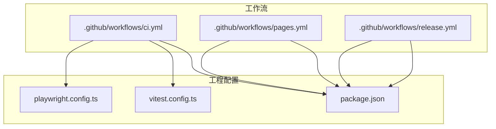
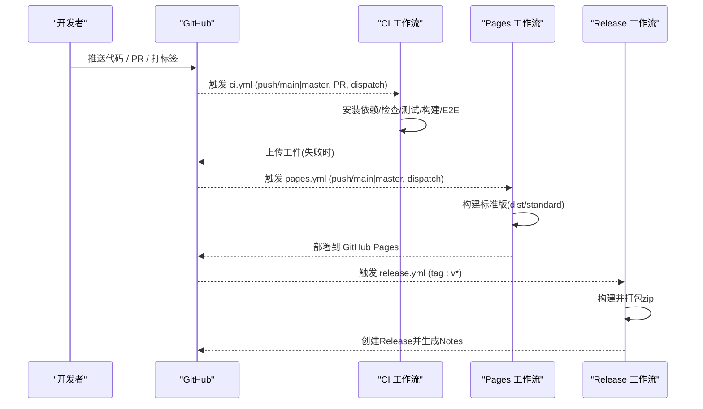
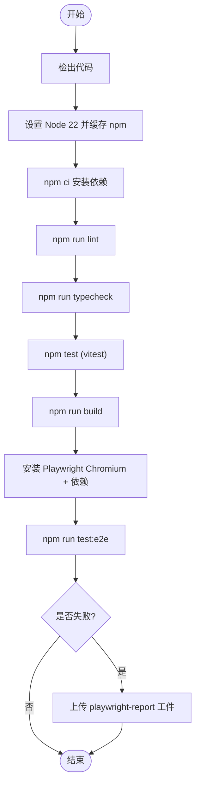
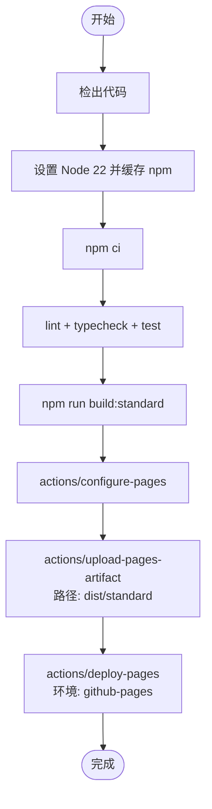
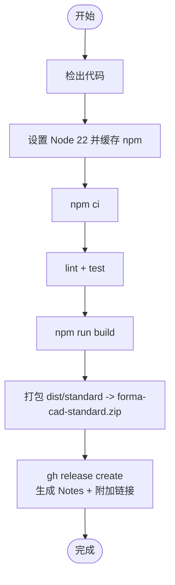
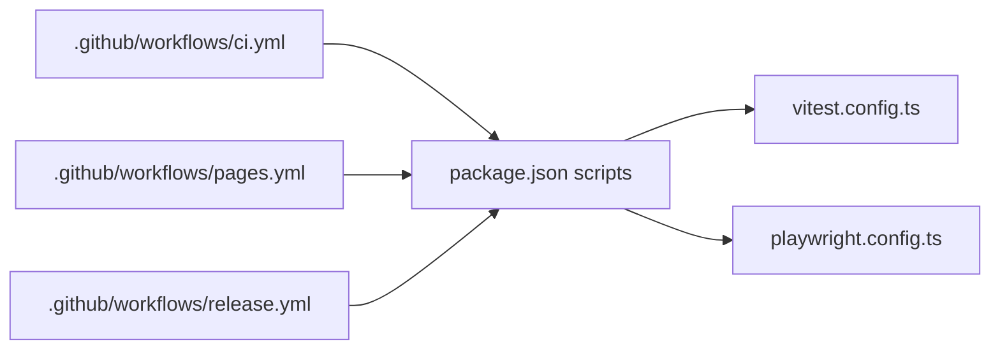

# CI/CD流水线

<cite>
**本文引用的文件**   
- [ci.yml](file://.github/workflows/ci.yml)
- [pages.yml](file://.github/workflows/pages.yml)
- [release.yml](file://.github/workflows/release.yml)
- [package.json](file://package.json)
- [vitest.config.ts](file://vitest.config.ts)
- [playwright.config.ts](file://playwright.config.ts)
</cite>

## 目录
1. [简介](#简介)
2. [项目结构](#项目结构)
3. [核心组件](#核心组件)
4. [架构总览](#架构总览)
5. [详细组件分析](#详细组件分析)
6. [依赖关系分析](#依赖关系分析)
7. [性能与稳定性考虑](#性能与稳定性考虑)
8. [故障排查指南](#故障排查指南)
9. [结论](#结论)
10. [附录：多环境部署模板与最佳实践](#附录多环境部署模板与最佳实践)

## 简介
本仓库采用 GitHub Actions 构建完整的 CI/CD 流水线，覆盖持续集成、GitHub Pages 页面部署与版本发布。CI 阶段执行静态检查、类型检查、单元测试与端到端测试；Pages 阶段在 main/master 分支推送后自动构建并部署到 GitHub Pages；Release 阶段在打 tag 时生成双构建产物并创建 GitHub Release，同时自动生成变更日志。

## 项目结构
与 CI/CD 相关的核心文件位于 .github/workflows 目录，脚本命令定义于 package.json，测试配置分别由 vitest 与 playwright 提供。

**图表来源**
- [ci.yml:1-31](file://.github/workflows/ci.yml#L1-L31)
- [pages.yml:1-45](file://.github/workflows/pages.yml#L1-L45)
- [release.yml:1-29](file://.github/workflows/release.yml#L1-L29)
- [package.json:9-20](file://package.json#L9-L20)
- [vitest.config.ts:1-13](file://vitest.config.ts#L1-L13)
- [playwright.config.ts:1-35](file://playwright.config.ts#L1-L35)

**章节来源**
- [ci.yml:1-31](file://.github/workflows/ci.yml#L1-L31)
- [pages.yml:1-45](file://.github/workflows/pages.yml#L1-L45)
- [release.yml:1-29](file://.github/workflows/release.yml#L1-L29)
- [package.json:9-20](file://package.json#L9-L20)
- [vitest.config.ts:1-13](file://vitest.config.ts#L1-L13)
- [playwright.config.ts:1-35](file://playwright.config.ts#L1-L35)

## 核心组件
- 持续集成（CI）
  - 触发条件：push 至 main/master、任意 pull_request、手动触发。
  - 步骤：检出代码、安装 Node 22 并缓存 npm、安装依赖、执行 lint、typecheck、单元测试、构建、安装 Playwright Chromium 并运行 E2E 测试。失败时上传 Playwright 报告作为工件。
- 页面部署（GitHub Pages）
  - 触发条件：push 至 main/master、手动触发。
  - 步骤：构建标准版产物，使用 actions/configure-pages 与 actions/upload-pages-artifact 上传 dist/standard，随后 actions/deploy-pages 部署到 GitHub Pages 环境。
- 版本发布（Release）
  - 触发条件：推送 v* 标签。
  - 步骤：校验、测试、构建，打包标准构建产物为 zip，通过 gh release create 创建 Release，自动生成变更日志并附加链接。

**章节来源**
- [ci.yml:1-31](file://.github/workflows/ci.yml#L1-L31)
- [pages.yml:1-45](file://.github/workflows/pages.yml#L1-L45)
- [release.yml:1-29](file://.github/workflows/release.yml#L1-L29)

## 架构总览
下图展示三个工作流的触发点、关键步骤与产物流转关系。

**图表来源**
- [ci.yml:1-31](file://.github/workflows/ci.yml#L1-L31)
- [pages.yml:1-45](file://.github/workflows/pages.yml#L1-L45)
- [release.yml:1-29](file://.github/workflows/release.yml#L1-L29)

## 详细组件分析

### 持续集成（CI）
- 环境与工具链
  - Node.js 22，npm 缓存启用。
  - 依赖安装使用 npm ci 保证可重复性。
- 质量门禁
  - 静态检查：eslint。
  - 类型检查：tsc --noEmit。
  - 单元测试：vitest run。
  - 构建：vite build（标准版与单文件版）。
- 端到端测试
  - 安装 Playwright Chromium 及系统依赖。
  - 启动本地开发服务器与静态资源服务，运行 playwright test。
  - 失败时上传 playwright-report 工件，保留 7 天。

**图表来源**
- [ci.yml:10-31](file://.github/workflows/ci.yml#L10-L31)
- [package.json:9-20](file://package.json#L9-L20)
- [playwright.config.ts:1-35](file://playwright.config.ts#L1-L35)

**章节来源**
- [ci.yml:1-31](file://.github/workflows/ci.yml#L1-L31)
- [package.json:9-20](file://package.json#L9-L20)
- [vitest.config.ts:1-13](file://vitest.config.ts#L1-L13)
- [playwright.config.ts:1-35](file://playwright.config.ts#L1-L35)

### 页面部署（GitHub Pages）
- 并发控制
  - 使用 concurrency 组 pages，取消进行中的任务，避免重复部署。
- 构建与部署
  - 构建标准版：npm run build:standard，输出到 dist/standard。
  - 使用 actions/configure-pages 与 actions/upload-pages-artifact 上传产物。
  - 使用 actions/deploy-pages 部署到 environment github-pages，并暴露 page_url。

**图表来源**
- [pages.yml:1-45](file://.github/workflows/pages.yml#L1-L45)
- [package.json:16-18](file://package.json#L16-L18)

**章节来源**
- [pages.yml:1-45](file://.github/workflows/pages.yml#L1-L45)
- [package.json:16-18](file://package.json#L16-L18)

### 版本发布（Release）
- 触发与权限
  - 仅对 v* 标签触发，具备 contents: write 权限以创建 Release。
- 构建与打包
  - 执行 lint、test、build，确保发布前质量。
  - 将 dist/standard 打包为 forma-cad-standard.zip。
- 创建 Release
  - 使用 gh release create 创建 Release，标题包含版本号，自动生成变更日志，并附加链接。

**图表来源**
- [release.yml:1-29](file://.github/workflows/release.yml#L1-L29)
- [package.json:9-18](file://package.json#L9-L18)

**章节来源**
- [release.yml:1-29](file://.github/workflows/release.yml#L1-L29)
- [package.json:9-18](file://package.json#L9-L18)

## 依赖关系分析
- 工作流与脚本
  - ci.yml 调用 package.json 的 lint、typecheck、test、build、test:e2e。
  - pages.yml 调用 build:standard。
  - release.yml 调用 lint、test、build，并使用 gh CLI 创建 Release。
- 测试框架
  - 单元测试：vitest，按 src/**/*.test.{ts,tsx} 匹配用例。
  - 端到端测试：playwright，启动两个 webServer（开发服务器与静态资源服务），失败重试策略受 CI 环境变量影响。

**图表来源**
- [ci.yml:1-31](file://.github/workflows/ci.yml#L1-L31)
- [pages.yml:1-45](file://.github/workflows/pages.yml#L1-L45)
- [release.yml:1-29](file://.github/workflows/release.yml#L1-L29)
- [package.json:9-20](file://package.json#L9-L20)
- [vitest.config.ts:1-13](file://vitest.config.ts#L1-L13)
- [playwright.config.ts:1-35](file://playwright.config.ts#L1-L35)

**章节来源**
- [ci.yml:1-31](file://.github/workflows/ci.yml#L1-L31)
- [pages.yml:1-45](file://.github/workflows/pages.yml#L1-L45)
- [release.yml:1-29](file://.github/workflows/release.yml#L1-L29)
- [package.json:9-20](file://package.json#L9-L20)
- [vitest.config.ts:1-13](file://vitest.config.ts#L1-L13)
- [playwright.config.ts:1-35](file://playwright.config.ts#L1-L35)

## 性能与稳定性考虑
- 依赖安装
  - 使用 npm ci 与 npm 缓存加速安装，提升可重复性与速度。
- 并发与并行
  - Pages 工作流启用 concurrency 组，避免重复部署竞争。
  - Playwright 关闭并行 workers，降低资源争用，提高稳定性。
- 浏览器与依赖
  - CI 中显式安装 Playwright Chromium 及其系统依赖，减少首次运行开销。
- 工件保留
  - Playwright 报告在失败时上传并保留 7 天，便于回溯问题。

[本节为通用指导，不直接分析具体文件]

## 故障排查指南
- 静态检查或类型检查失败
  - 定位：查看 CI 日志中 npm run lint 与 npm run typecheck 的输出。
  - 处理：根据 ESLint 与 TypeScript 错误修复代码。
- 单元测试失败
  - 定位：查看 npm test 输出与 Vitest 报告。
  - 处理：补充或修复用例，必要时调整 vitest.config.ts 的 include 规则。
- 端到端测试失败
  - 定位：查看 Playwright HTML 报告与 trace（失败时启用）。
  - 关键点：webServer 启动端口 5186 与静态资源服务 4174；viewport 与 baseURL 需一致。
  - 处理：确认服务可用、网络可达，必要时增加 retries 或调整超时。
- GitHub Pages 部署失败
  - 定位：检查 actions/deploy-pages 步骤与环境 github-pages 的配置。
  - 处理：确认 dist/standard 存在且非空，权限与 OIDC 令牌已正确授予。
- Release 创建失败
  - 定位：检查 gh release create 命令与 GH_TOKEN/GH_REPO/RELEASE_TAG 环境变量。
  - 处理：确认标签格式为 v*，仓库具有写权限，gh CLI 可用。

**章节来源**
- [ci.yml:10-31](file://.github/workflows/ci.yml#L10-L31)
- [playwright.config.ts:1-35](file://playwright.config.ts#L1-L35)
- [pages.yml:32-45](file://.github/workflows/pages.yml#L32-L45)
- [release.yml:20-28](file://.github/workflows/release.yml#L20-L28)

## 结论
该项目的 CI/CD 流水线以 GitHub Actions 为核心，实现了从代码质量门禁、自动化测试到页面部署与版本发布的完整闭环。通过明确的触发条件、严格的构建步骤与工件管理，保证了交付物的质量与一致性。建议在后续迭代中引入更细粒度的环境隔离与告警机制，进一步提升可观测性与稳定性。

[本节为总结性内容，不直接分析具体文件]

## 附录：多环境部署模板与最佳实践
- 环境划分建议
  - development：PR 分支自动构建预览站点，供评审验证。
  - staging：main/master 分支自动构建，用于预生产验证。
  - production：仅允许受保护分支与标签触发，结合签名与审批流程。
- 配置要点
  - 使用 GitHub Environments 区分不同环境的变量与权限。
  - 使用 OIDC Token 访问托管平台（如 GitHub Pages、对象存储）。
  - 使用 secrets 管理敏感信息（API Key、Token）。
- 最佳实践
  - 所有环境复用同一套构建脚本，仅替换环境变量与目标路径。
  - 在关键步骤添加通知与告警（Slack、邮件、企业微信等）。
  - 对关键指标（构建时长、失败率、部署成功率）建立监控看板。
  - 对 E2E 测试增加截图与视频录制，便于快速定位 UI 回归问题。

[本节为概念性指导，不直接分析具体文件]