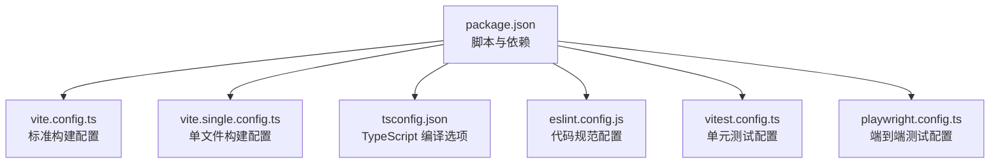
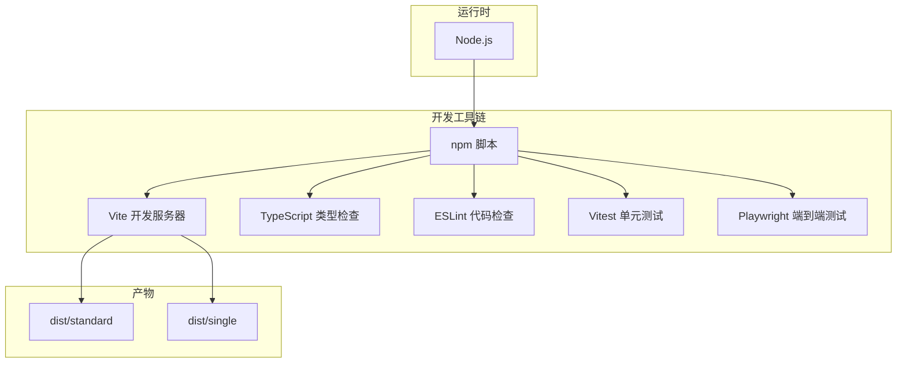
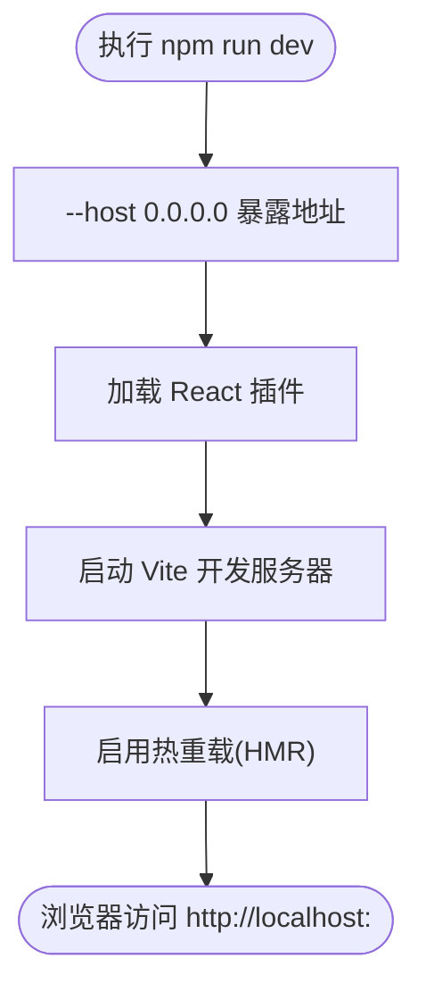
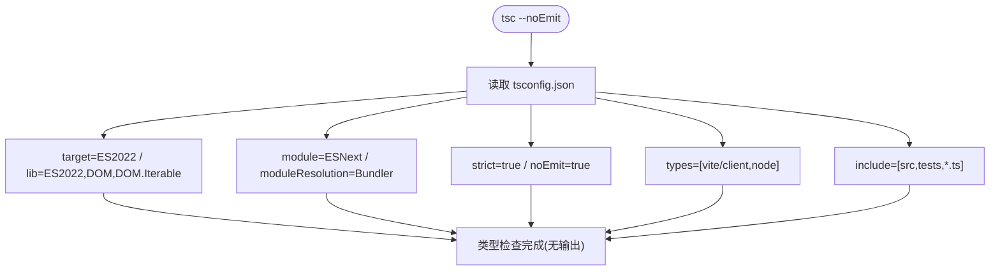
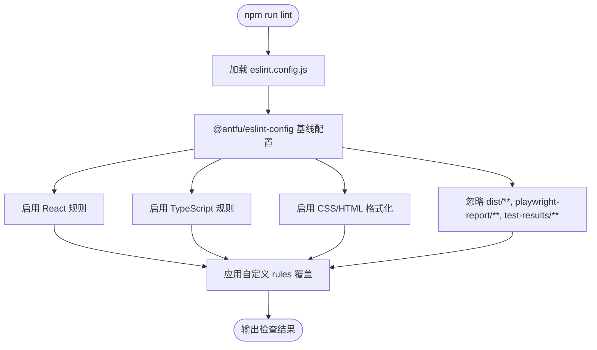
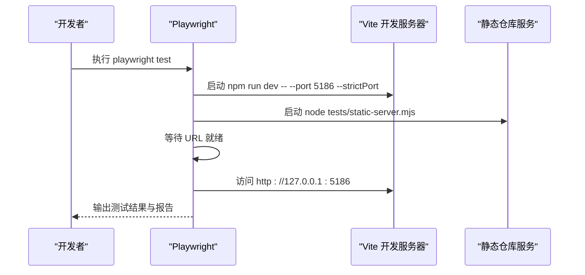
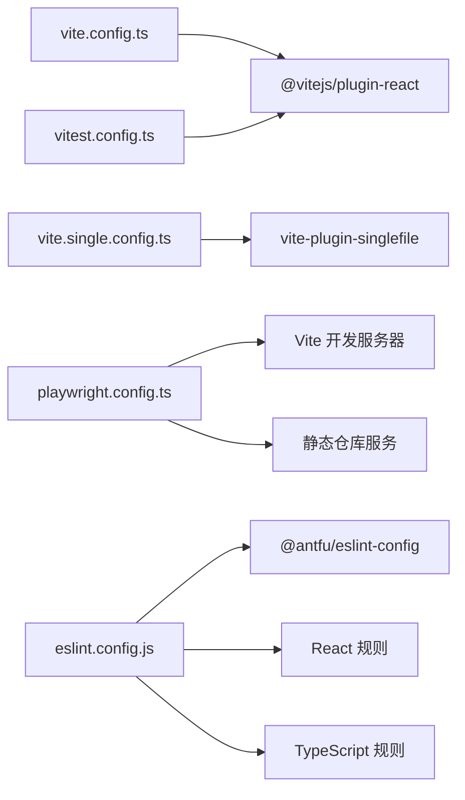

# 开发环境配置

<cite>
**本文引用的文件**   
- [package.json](file://package.json)
- [vite.config.ts](file://vite.config.ts)
- [vite.single.config.ts](file://vite.single.config.ts)
- [tsconfig.json](file://tsconfig.json)
- [eslint.config.js](file://eslint.config.js)
- [playwright.config.ts](file://playwright.config.ts)
- [vitest.config.ts](file://vitest.config.ts)
</cite>

## 目录
1. [简介](#简介)
2. [项目结构](#项目结构)
3. [核心组件](#核心组件)
4. [架构总览](#架构总览)
5. [详细组件分析](#详细组件分析)
6. [依赖分析](#依赖分析)
7. [性能考虑](#性能考虑)
8. [故障排查指南](#故障排查指南)
9. [结论](#结论)
10. [附录](#附录)

## 简介
本文件为 web-cad 项目的开发环境配置文档，覆盖以下主题：
- Vite 开发服务器与构建配置（插件、路径别名、输出目录）
- TypeScript 编译目标、模块系统与严格模式
- ESLint 代码规范检查规则与自定义扩展
- Node.js 环境要求与依赖管理
- 开发工具链集成（热重载、调试器、IDE 支持）
- 常见问题排查与解决方案

## 项目结构
本项目采用基于功能分层的目录组织方式，主要包含应用入口、CAD 核心逻辑、UI 组件、特性模块、I/O 与存储层，以及测试与 E2E 配置。关键配置文件包括 Vite、TypeScript、ESLint、Playwright 与 Vitest 的配置。

图表来源
- [package.json:1-53](file://package.json#L1-L53)
- [vite.config.ts:1-11](file://vite.config.ts#L1-L11)
- [vite.single.config.ts:1-13](file://vite.single.config.ts#L1-L13)
- [tsconfig.json:1-17](file://tsconfig.json#L1-L17)
- [eslint.config.js:1-17](file://eslint.config.js#L1-L17)
- [vitest.config.ts:1-13](file://vitest.config.ts#L1-L13)
- [playwright.config.ts:1-35](file://playwright.config.ts#L1-L35)

章节来源
- [package.json:1-53](file://package.json#L1-L53)

## 核心组件
- Vite 开发服务器与构建：通过 vite.config.ts 与 vite.single.config.ts 分别提供标准多文件与单文件构建能力；默认启用 React 插件。
- TypeScript：使用 ES2022 目标、ESNext 模块系统、Bundler 解析策略，开启严格模式并关闭类型检查输出。
- ESLint：基于 @antfu/eslint-config 的现代化配置，启用 React 与 TypeScript 规则集，并针对特定规则进行开关调整。
- 测试与 E2E：Vitest 用于单元测试，Playwright 用于端到端测试，二者均复用 Vite/React 插件以保持一致性。

章节来源
- [vite.config.ts:1-11](file://vite.config.ts#L1-L11)
- [vite.single.config.ts:1-13](file://vite.single.config.ts#L1-L13)
- [tsconfig.json:1-17](file://tsconfig.json#L1-L17)
- [eslint.config.js:1-17](file://eslint.config.js#L1-L17)
- [vitest.config.ts:1-13](file://vitest.config.ts#L1-L13)
- [playwright.config.ts:1-35](file://playwright.config.ts#L1-L35)

## 架构总览
下图展示了开发环境与构建流程中各工具的协作关系：Node.js 驱动 npm 脚本，Vite 负责开发与构建，TypeScript 提供类型检查，ESLint 负责代码质量，Vitest 与 Playwright 分别承担单元与端到端测试。

图表来源
- [package.json:9-20](file://package.json#L9-L20)
- [vite.config.ts:4-10](file://vite.config.ts#L4-L10)
- [vite.single.config.ts:5-12](file://vite.single.config.ts#L5-L12)
- [tsconfig.json:2-14](file://tsconfig.json#L2-L14)
- [eslint.config.js:3-16](file://eslint.config.js#L3-L16)
- [vitest.config.ts:4-11](file://vitest.config.ts#L4-L11)
- [playwright.config.ts:4-33](file://playwright.config.ts#L4-L33)

## 详细组件分析

### Vite 开发服务器与构建配置
- 插件配置
  - 标准构建与开发：启用 @vitejs/plugin-react，提供 React JSX/TSX 支持与快速刷新。
  - 单文件构建：在 vite.single.config.ts 中额外启用 vite-plugin-singlefile，将资源内联为单个 HTML 文件。
- 路径别名
  - 当前未显式定义路径别名；如需统一导入路径，可在 plugins 数组中添加路径别名插件并在 tsconfig 中同步映射。
- 开发服务器设置
  - 启动命令通过 npm 脚本传入 --host 0.0.0.0 以允许局域网访问；端口由 Vite 默认分配。
  - E2E 测试通过 playwright.config.ts 启动本地静态服务与 Vite 开发服务器，固定端口 5186 并启用严格端口模式。
- 构建输出
  - 标准构建输出到 dist/standard。
  - 单文件构建输出到 dist/single。

图表来源
- [package.json:10](file://package.json#L10)
- [vite.config.ts:1-8](file://vite.config.ts#L1-L8)
- [playwright.config.ts:22-27](file://playwright.config.ts#L22-L27)

章节来源
- [vite.config.ts:1-11](file://vite.config.ts#L1-L11)
- [vite.single.config.ts:1-13](file://vite.single.config.ts#L1-L13)
- [package.json:9-20](file://package.json#L9-L20)
- [playwright.config.ts:22-33](file://playwright.config.ts#L22-L33)

### TypeScript 编译配置
- 目标版本与库
  - target 设置为 ES2022，lib 包含 ES2022、DOM 与 DOM.Iterable，确保现代 API 与 Web API 可用。
- 模块系统
  - module 为 ESNext，moduleResolution 为 Bundler，适配 Vite 等现代打包器的解析行为。
- 严格模式
  - strict 开启，启用全部严格类型检查；noEmit 表示仅做类型检查不生成 JS。
- 其他选项
  - jsx 使用 react-jsx 以匹配 React 17+ 的新 JSX 转换。
  - types 引入 vite/client 与 node 类型声明。
  - allowImportingTsExtensions 允许直接导入 .ts/.tsx 后缀。
  - skipLibCheck 跳过第三方库的类型检查以提升速度。
  - include 覆盖 src、tests 与根级 *.ts 文件。

图表来源
- [tsconfig.json:2-15](file://tsconfig.json#L2-L15)
- [package.json:13](file://package.json#L13)

章节来源
- [tsconfig.json:1-17](file://tsconfig.json#L1-L17)
- [package.json:13](file://package.json#L13)

### ESLint 代码规范检查规则配置
- 基础配置
  - 使用 @antfu/eslint-config 作为基线，启用 react 与 typescript 规则集。
  - 启用 CSS 与 HTML 格式化检查。
  - 忽略 dist、playwright-report、test-results 等目录。
- 自定义规则
  - 关闭 react-dom/no-missing-button-type 与 no-alert 两条规则以满足业务需求。

图表来源
- [eslint.config.js:1-16](file://eslint.config.js#L1-L16)
- [package.json:11-12](file://package.json#L11-L12)

章节来源
- [eslint.config.js:1-17](file://eslint.config.js#L1-L17)
- [package.json:11-12](file://package.json#L11-L12)

### Node.js 环境要求与依赖包管理
- Node.js 版本
  - engines.node 指定 ^22.22.2 或 >=24.15.0，建议使用 LTS 或最新稳定版。
- 脚本命令
  - dev：启动 Vite 开发服务器并暴露到 0.0.0.0。
  - lint/lint:fix：运行 ESLint 并可选自动修复。
  - typecheck：执行 tsc --noEmit 进行类型检查。
  - test：运行 Vitest 单元测试。
  - build/build:standard/build:single：标准构建与单文件构建。
  - preview/preview:single：预览构建产物。
- 依赖分类
  - 运行时依赖：react、react-dom、zustand、idb、zod、lucide-react。
  - 开发依赖：vite、@vitejs/plugin-react、typescript、eslint、@antfu/eslint-config、vitest、@playwright/test、vite-plugin-singlefile 等。
- 依赖覆盖
  - overrides 对 katex、minimatch、tinypool 进行版本覆盖以确保兼容性。

章节来源
- [package.json:1-53](file://package.json#L1-L53)

### 测试与 E2E 工具链集成
- 单元测试（Vitest）
  - 复用 React 插件以保持与 Vite 一致的 JSX/TSX 处理。
  - 测试文件匹配 src/**/*.test.{ts,tsx}，运行环境为 node。
- 端到端测试（Playwright）
  - 测试目录 tests，禁用并行，工作进程数为 1。
  - 报告格式包含 list 与 html（不自动打开）。
  - 使用 baseURL 指向本地开发服务器，视口固定为 1440x960。
  - 失败时保留 trace。
  - webServer 同时启动 Vite 开发服务器（端口 5186，严格端口）与静态仓库服务（端口 4174）。

图表来源
- [playwright.config.ts:4-33](file://playwright.config.ts#L4-L33)
- [package.json:15](file://package.json#L15)

章节来源
- [vitest.config.ts:1-13](file://vitest.config.ts#L1-L13)
- [playwright.config.ts:1-35](file://playwright.config.ts#L1-L35)

## 依赖分析
下图展示关键工具之间的依赖关系：Vite 依赖 React 插件，Playwright 依赖 Vite 开发服务器与静态服务，ESLint 依赖 antfu 配置与 React/TS 规则集，Vitest 复用 React 插件。

图表来源
- [vite.config.ts:1-8](file://vite.config.ts#L1-L8)
- [vite.single.config.ts:1-10](file://vite.single.config.ts#L1-L10)
- [playwright.config.ts:22-32](file://playwright.config.ts#L22-L32)
- [eslint.config.js:1-16](file://eslint.config.js#L1-L16)
- [vitest.config.ts:1-7](file://vitest.config.ts#L1-L7)

章节来源
- [vite.config.ts:1-11](file://vite.config.ts#L1-L11)
- [vite.single.config.ts:1-13](file://vite.single.config.ts#L1-L13)
- [playwright.config.ts:1-35](file://playwright.config.ts#L1-L35)
- [eslint.config.js:1-17](file://eslint.config.js#L1-L17)
- [vitest.config.ts:1-13](file://vitest.config.ts#L1-L13)

## 性能考虑
- 类型检查
  - 使用 skipLibCheck 减少第三方库类型检查开销，提升 tsc 速度。
- 构建优化
  - 标准构建与单文件构建分离，便于按需选择产物形态。
- 测试并行
  - Playwright 默认关闭并行与工作进程数设为 1，避免并发导致的资源竞争；可根据机器性能调整 workers 与 fullyParallel。
- 开发体验
  - 使用 React 插件提供的快速刷新能力，缩短反馈循环。

[本节为通用指导，不涉及具体文件分析]

## 故障排查指南
- 无法访问开发服务器
  - 确认已使用 --host 0.0.0.0 启动；检查防火墙与端口占用。
  - 若端口冲突，可参考 Playwright 配置中的 --strictPort 用法，或在脚本中指定固定端口。
- 类型检查报错
  - 检查 tsconfig.json 的 include 是否覆盖需要检查的文件；确认 types 字段包含所需类型声明。
  - 若第三方库类型缺失，可临时添加对应 @types 包或调整 skipLibCheck。
- ESLint 规则冲突
  - 在 eslint.config.js 的 rules 中按需关闭或调整规则；确保 ignores 列表正确排除构建产物与测试报告。
- 测试无法连接本地服务
  - 检查 playwright.config.ts 中的 baseURL 与 webServer 配置；确保 Vite 与静态服务均已成功启动且端口一致。
- 单文件构建体积过大
  - 单文件构建会将资源内联，适合分发但不利于缓存；建议仅在必要时使用 vite.single.config.ts。

章节来源
- [package.json:9-20](file://package.json#L9-L20)
- [tsconfig.json:2-15](file://tsconfig.json#L2-L15)
- [eslint.config.js:3-16](file://eslint.config.js#L3-L16)
- [playwright.config.ts:16-33](file://playwright.config.ts#L16-L33)
- [vite.single.config.ts:5-12](file://vite.single.config.ts#L5-L12)

## 结论
本项目以 Vite 为核心构建与开发工具，结合 TypeScript、ESLint、Vitest 与 Playwright 形成完整的开发工具链。通过分离的标准与单文件构建配置，满足不同场景下的产物需求；严格的类型检查与现代化的 ESLint 规则保障代码质量；Playwright 的 webServer 集成简化了端到端测试的启动流程。遵循本文档的配置说明与排错建议，可快速搭建并稳定维护开发环境。

[本节为总结性内容，不涉及具体文件分析]

## 附录
- 常用命令速查
  - 开发：npm run dev
  - 类型检查：npm run typecheck
  - 代码检查：npm run lint / npm run lint:fix
  - 单元测试：npm run test
  - 端到端测试：npm run test:e2e
  - 构建：npm run build / npm run build:standard / npm run build:single
  - 预览：npm run preview / npm run preview:single

章节来源
- [package.json:9-20](file://package.json#L9-L20)