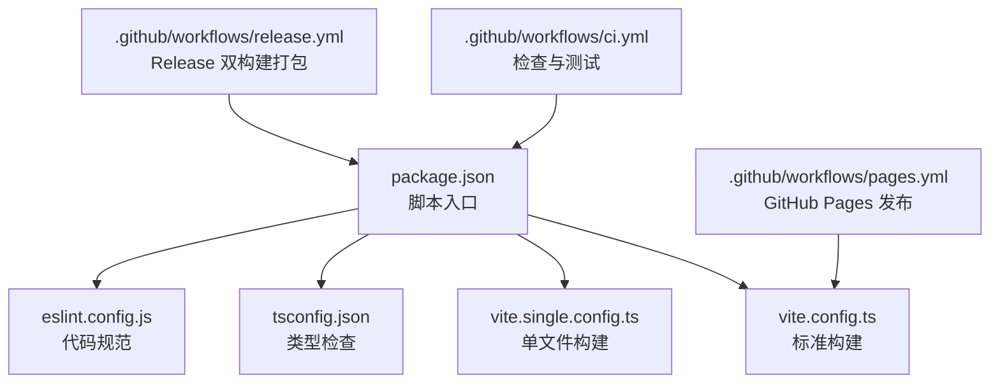
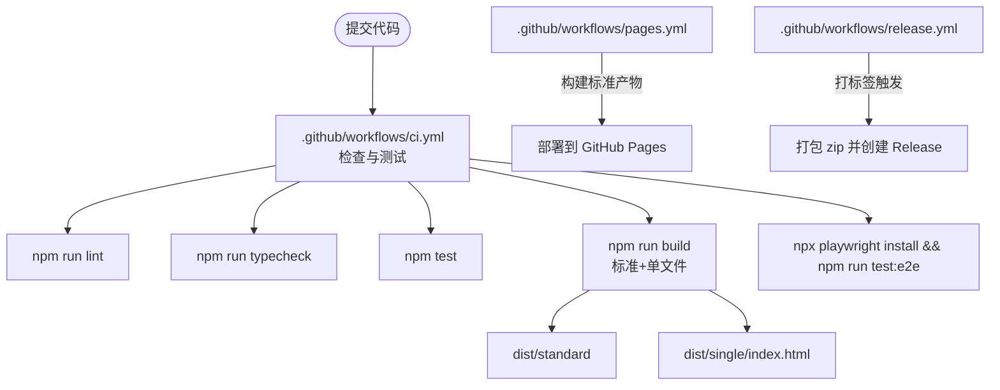
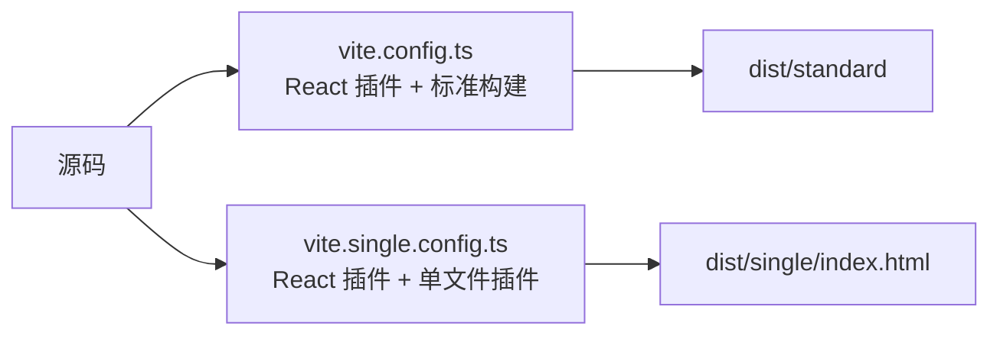
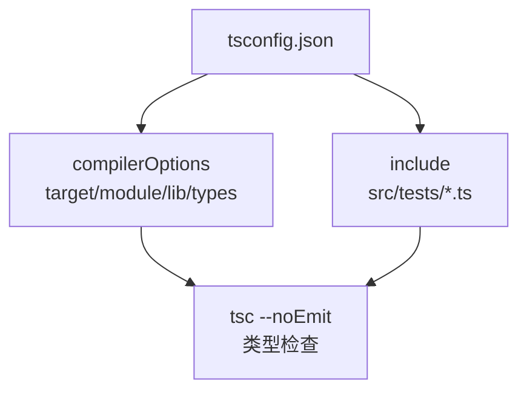
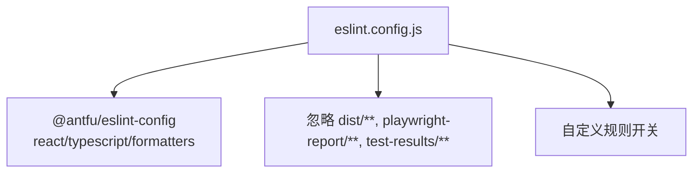
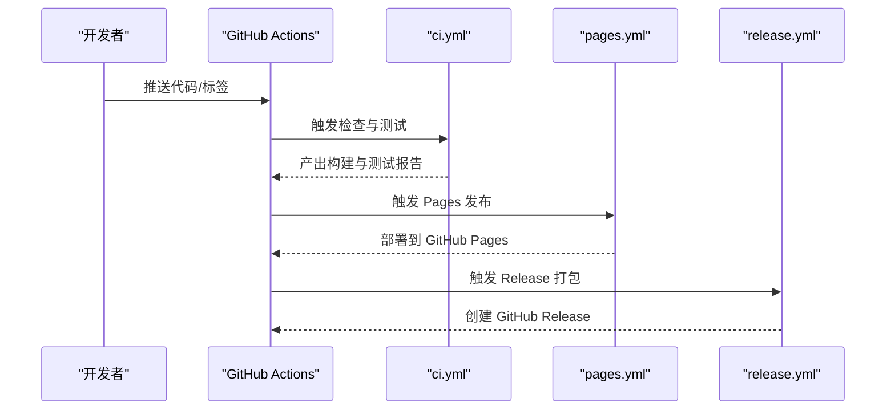
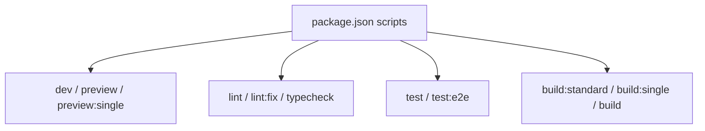
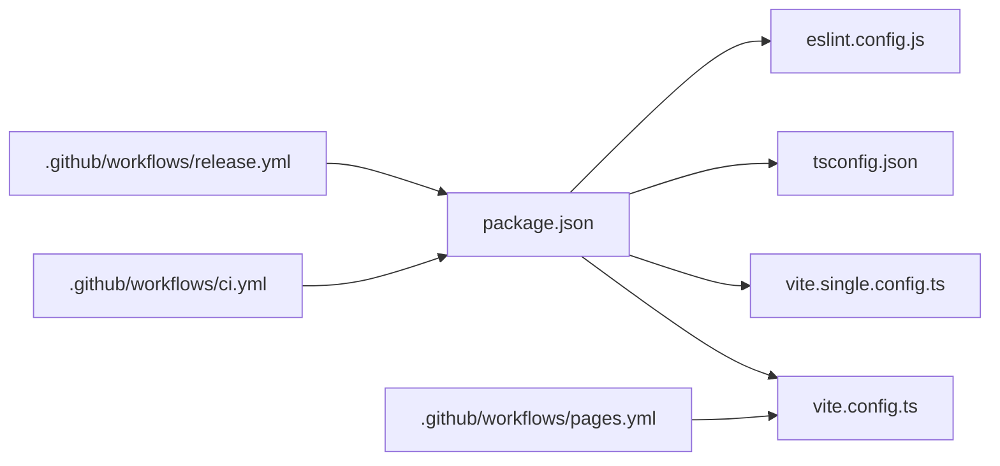

# 构建与部署

<cite>
**本文引用的文件**   
- [package.json](file://package.json)
- [vite.config.ts](file://vite.config.ts)
- [vite.single.config.ts](file://vite.single.config.ts)
- [tsconfig.json](file://tsconfig.json)
- [eslint.config.js](file://eslint.config.js)
- [.github/workflows/ci.yml](file://.github/workflows/ci.yml)
- [.github/workflows/pages.yml](file://.github/workflows/pages.yml)
- [.github/workflows/release.yml](file://.github/workflows/release.yml)
</cite>

## 目录
1. [简介](#简介)
2. [项目结构](#项目结构)
3. [核心组件](#核心组件)
4. [架构总览](#架构总览)
5. [详细组件分析](#详细组件分析)
6. [依赖关系分析](#依赖关系分析)
7. [性能考虑](#性能考虑)
8. [故障排查指南](#故障排查指南)
9. [结论](#结论)
10. [附录](#附录)

## 简介
本文件面向 web-cad 项目的构建与部署，覆盖以下主题：
- Vite 标准构建与单文件构建的差异与适用场景
- TypeScript 编译配置与 ESLint 代码规范检查
- CI/CD 流水线与自动化部署流程（GitHub Actions）
- 生产环境优化与性能调优建议
- 环境变量与部署脚本使用方法
- Docker 容器化与云平台部署指导
- 构建产物分析与性能监控实施方法

## 项目结构
仓库采用模块化组织方式，关键构建与质量相关配置集中在根目录：
- 构建工具：Vite（含 React 插件与单文件插件）
- 类型系统：TypeScript
- 代码规范：ESLint（基于 antfu 配置）
- 测试：Vitest（单元测试）、Playwright（端到端测试）
- 持续集成：GitHub Actions（检查、发布 Pages、打包 Release）

**图表来源**
- [package.json:9-20](file://package.json#L9-L20)
- [vite.config.ts:1-11](file://vite.config.ts#L1-L11)
- [vite.single.config.ts:1-13](file://vite.single.config.ts#L1-L13)
- [tsconfig.json:1-17](file://tsconfig.json#L1-L17)
- [eslint.config.js:1-17](file://eslint.config.js#L1-L17)
- [.github/workflows/ci.yml:1-31](file://.github/workflows/ci.yml#L1-L31)
- [.github/workflows/pages.yml:1-45](file://.github/workflows/pages.yml#L1-L45)
- [.github/workflows/release.yml:1-29](file://.github/workflows/release.yml#L1-L29)

**章节来源**
- [package.json:1-53](file://package.json#L1-L53)

## 核心组件
- Vite 构建配置
  - 标准构建：输出到 dist/standard，启用 React 插件，基础路径为相对路径。
  - 单文件构建：在标准构建基础上启用 vite-plugin-singlefile，将资源内联为单个 HTML，输出到 dist/single。
- TypeScript 编译配置
  - 目标 ES2022，模块解析使用 Bundler 模式，严格模式开启，不生成 JS 输出（noEmit），由 Vite 负责打包。
- ESLint 代码规范
  - 基于 @antfu/eslint-config，启用 React 与 TypeScript 规则，包含 CSS/HTML 格式化器，忽略构建产物目录。
- CI/CD 流水线
  - ci.yml：拉取代码、安装依赖、执行 lint、typecheck、单元测试、构建、安装 Playwright 并运行 E2E 测试，失败时上传报告。
  - pages.yml：构建标准产物并部署到 GitHub Pages。
  - release.yml：打标签后构建双产物，打包 zip 并发布 GitHub Release。

**章节来源**
- [vite.config.ts:1-11](file://vite.config.ts#L1-L11)
- [vite.single.config.ts:1-13](file://vite.single.config.ts#L1-L13)
- [tsconfig.json:1-17](file://tsconfig.json#L1-L17)
- [eslint.config.js:1-17](file://eslint.config.js#L1-L17)
- [.github/workflows/ci.yml:1-31](file://.github/workflows/ci.yml#L1-L31)
- [.github/workflows/pages.yml:1-45](file://.github/workflows/pages.yml#L1-L45)
- [.github/workflows/release.yml:1-29](file://.github/workflows/release.yml#L1-L29)

## 架构总览
下图展示了从代码提交到构建、测试、发布的整体流程，以及两种构建产物的用途。

**图表来源**
- [.github/workflows/ci.yml:1-31](file://.github/workflows/ci.yml#L1-L31)
- [.github/workflows/pages.yml:1-45](file://.github/workflows/pages.yml#L1-L45)
- [.github/workflows/release.yml:1-29](file://.github/workflows/release.yml#L1-L29)
- [package.json:9-20](file://package.json#L9-L20)

## 详细组件分析

### Vite 构建配置与差异
- 标准构建（vite.config.ts）
  - 启用 React 插件，基础路径为相对路径，输出目录为 dist/standard。
  - 适合常规 Web 应用部署，支持静态资源按需加载与缓存。
- 单文件构建（vite.single.config.ts）
  - 在标准构建基础上引入 vite-plugin-singlefile，将所有资源内联至单个 HTML 文件，输出目录为 dist/single。
  - 适合离线分发或简单托管场景，便于一次性交付。

**图表来源**
- [vite.config.ts:1-11](file://vite.config.ts#L1-L11)
- [vite.single.config.ts:1-13](file://vite.single.config.ts#L1-L13)

**章节来源**
- [vite.config.ts:1-11](file://vite.config.ts#L1-L11)
- [vite.single.config.ts:1-13](file://vite.single.config.ts#L1-L13)

### TypeScript 编译配置
- 目标与模块
  - target: ES2022，module: ESNext，moduleResolution: Bundler，适配现代浏览器与打包器。
- JSX 与库
  - jsx: react-jsx，lib 包含 ES2022、DOM、DOM.Iterable。
- 类型与环境
  - types 包含 vite/client 与 node，允许导入 .ts/.tsx 扩展名。
- 严格性与输出
  - strict: true，noEmit: true（仅类型检查，不产出 JS）。
- 包含范围
  - include 覆盖 src、tests 与根级 ts 文件。

**图表来源**
- [tsconfig.json:1-17](file://tsconfig.json#L1-L17)

**章节来源**
- [tsconfig.json:1-17](file://tsconfig.json#L1-L17)

### ESLint 代码规范检查
- 基础配置
  - 使用 @antfu/eslint-config，启用 React 与 TypeScript 规则集。
- 格式化器
  - 启用 CSS 与 HTML 格式化器，统一样式风格。
- 忽略目录
  - 忽略 dist、playwright-report、test-results 等目录。
- 自定义规则
  - 关闭 react-dom/no-missing-button-type 与 no-alert 规则以适配业务需求。

**图表来源**
- [eslint.config.js:1-17](file://eslint.config.js#L1-L17)

**章节来源**
- [eslint.config.js:1-17](file://eslint.config.js#L1-L17)

### CI/CD 流水线与自动化部署
- 检查与测试（ci.yml）
  - 触发条件：push 到 main/master 分支、PR、手动触发。
  - 步骤：检出代码、设置 Node 22、缓存 npm、安装依赖、执行 lint、typecheck、单元测试、构建、安装 Playwright 并运行 E2E 测试；失败时上传 playwright-report。
- 发布 GitHub Pages（pages.yml）
  - 触发条件：push 到 main/master 分支、手动触发。
  - 步骤：检出代码、设置 Node 22、安装依赖、执行 lint/typecheck/test、构建标准产物、配置 Pages、上传 artifact、部署到 GitHub Pages。
- 发布 Release（release.yml）
  - 触发条件：推送 v* 标签。
  - 步骤：检出代码、设置 Node 22、安装依赖、执行 lint/test、构建双产物、打包 standard 为 zip、调用 gh CLI 创建 Release 并附带 notes。

**图表来源**
- [.github/workflows/ci.yml:1-31](file://.github/workflows/ci.yml#L1-L31)
- [.github/workflows/pages.yml:1-45](file://.github/workflows/pages.yml#L1-L45)
- [.github/workflows/release.yml:1-29](file://.github/workflows/release.yml#L1-L29)

**章节来源**
- [.github/workflows/ci.yml:1-31](file://.github/workflows/ci.yml#L1-L31)
- [.github/workflows/pages.yml:1-45](file://.github/workflows/pages.yml#L1-L45)
- [.github/workflows/release.yml:1-29](file://.github/workflows/release.yml#L1-L29)

### 构建脚本与命令
- 开发
  - dev：启动 Vite 开发服务器并监听所有网卡。
  - preview：预览标准构建产物。
  - preview:single：预览单文件构建产物。
- 质量与测试
  - lint：执行 ESLint。
  - lint:fix：自动修复可修复问题。
  - typecheck：执行 TypeScript 类型检查。
  - test：运行 Vitest 单元测试。
  - test:e2e：运行 Playwright 端到端测试。
- 构建
  - build:standard：标准构建。
  - build:single：单文件构建。
  - build：先类型检查，再执行标准与单文件构建。

**图表来源**
- [package.json:9-20](file://package.json#L9-L20)

**章节来源**
- [package.json:9-20](file://package.json#L9-L20)

### 环境变量与部署脚本
- 环境变量
  - 当前工作流未显式定义环境变量，如需接入外部服务或 CDN，可在 workflow 中通过 env 注入，或在运行时通过 Vite 的 import.meta.env 读取。
- 部署脚本
  - GitHub Pages：通过 actions/configure-pages 与 actions/upload-pages-artifact 完成部署。
  - Release：通过 gh CLI 创建 Release 并上传 zip 与单文件 HTML。

**章节来源**
- [.github/workflows/pages.yml:28-44](file://.github/workflows/pages.yml#L28-L44)
- [.github/workflows/release.yml:20-28](file://.github/workflows/release.yml#L20-L28)

### Docker 容器化部署
- 推荐方案
  - 多阶段构建：第一阶段使用 Node 镜像安装依赖并构建标准产物；第二阶段使用 Nginx 或 Caddy 提供静态服务。
  - 单文件构建可直接作为静态资源托管，无需额外依赖。
- 示例思路
  - 构建阶段：npm ci、npm run build:standard。
  - 运行阶段：复制 dist/standard 到 Nginx 静态目录，暴露 80/443 端口。
- 注意
  - 若使用反向代理或 CDN，请确保 base 路径与代理路径一致。

[本节为通用指导，不涉及具体文件]

### 云平台部署指导
- GitHub Pages
  - 直接通过 pages.yml 自动部署标准构建产物。
- 对象存储（如 AWS S3、阿里云 OSS）
  - 上传 dist/standard 或 dist/single/index.html，并开启静态站点托管。
- 传统服务器
  - 使用 Nginx/Caddy 指向 dist/standard 目录，配置 gzip/brotli 压缩与缓存策略。

[本节为通用指导，不涉及具体文件]

### 构建产物分析与性能监控
- 构建产物分析
  - 可引入 @rollup/plugin-visualizer 或 vite-bundle-analyzer 生成体积分析报告，定位大依赖与重复打包。
- 性能监控
  - 前端指标：接入 Performance API 上报首屏时间、FCP/LCP/CLS 等。
  - 错误监控：接入 Sentry 或自研日志上报，捕获运行时异常。
- 缓存策略
  - 对静态资源启用长缓存与版本化文件名，提升二次访问性能。

[本节为通用指导，不涉及具体文件]

## 依赖关系分析
- 构建链
  - package.json 脚本驱动 Vite 构建，分别输出标准与单文件产物。
  - TypeScript 类型检查独立于构建过程，确保类型安全。
  - ESLint 保证代码风格与质量。
- 流水线耦合
  - ci.yml 串联 lint、typecheck、test、build、e2e。
  - pages.yml 依赖标准构建产物进行部署。
  - release.yml 依赖双构建产物进行打包与发布。

**图表来源**
- [package.json:9-20](file://package.json#L9-L20)
- [vite.config.ts:1-11](file://vite.config.ts#L1-L11)
- [vite.single.config.ts:1-13](file://vite.single.config.ts#L1-L13)
- [tsconfig.json:1-17](file://tsconfig.json#L1-L17)
- [eslint.config.js:1-17](file://eslint.config.js#L1-L17)
- [.github/workflows/ci.yml:1-31](file://.github/workflows/ci.yml#L1-L31)
- [.github/workflows/pages.yml:1-45](file://.github/workflows/pages.yml#L1-L45)
- [.github/workflows/release.yml:1-29](file://.github/workflows/release.yml#L1-L29)

**章节来源**
- [package.json:1-53](file://package.json#L1-L53)

## 性能考虑
- 构建优化
  - 标准构建利用浏览器缓存与分块加载，减少首次请求体积。
  - 单文件构建适合离线分发，但体积较大，需权衡使用场景。
- 运行时优化
  - 合理使用 React.lazy 与动态 import 实现路由级懒加载。
  - 避免在渲染路径中进行重型计算，必要时使用 Web Worker。
- 网络优化
  - 启用 HTTP/2 与 TLS 1.3，开启 gzip/brotli 压缩。
  - 合理设置 Cache-Control 与 ETag，提升缓存命中率。
- 监控与分析
  - 接入性能监控与错误上报，持续跟踪核心指标变化。

[本节为通用指导，不涉及具体文件]

## 故障排查指南
- 构建失败
  - 检查 Node 版本是否符合 engines 要求。
  - 确认依赖安装成功且无冲突（overrides 已声明部分依赖版本）。
- 类型检查失败
  - 根据 tsc 报错修正类型定义或关闭不必要的严格规则。
- ESLint 报错
  - 使用 npm run lint:fix 自动修复，或按规则说明调整代码。
- 测试失败
  - 查看 Vitest 与 Playwright 报告，定位断言失败或环境问题。
- 部署失败
  - GitHub Pages：确认 dist/standard 存在且权限正确。
  - Release：确认 GH_TOKEN 与 tag 格式正确。

**章节来源**
- [package.json:6-8](file://package.json#L6-L8)
- [package.json:47-51](file://package.json#L47-L51)
- [.github/workflows/ci.yml:12-31](file://.github/workflows/ci.yml#L12-L31)
- [.github/workflows/pages.yml:17-44](file://.github/workflows/pages.yml#L17-L44)
- [.github/workflows/release.yml:10-28](file://.github/workflows/release.yml#L10-L28)

## 结论
本项目通过 Vite 提供了标准与单文件两种构建模式，配合 TypeScript 与 ESLint 保障代码质量，并通过 GitHub Actions 实现了完整的检查、测试、发布与部署流程。建议在后续迭代中引入构建体积分析与前端性能监控，持续优化用户体验与可维护性。

[本节为总结性内容，不涉及具体文件]

## 附录
- 常用命令速查
  - 开发：npm run dev
  - 预览：npm run preview / npm run preview:single
  - 质量：npm run lint / npm run lint:fix / npm run typecheck
  - 测试：npm run test / npm run test:e2e
  - 构建：npm run build:standard / npm run build:single / npm run build

**章节来源**
- [package.json:9-20](file://package.json#L9-L20)