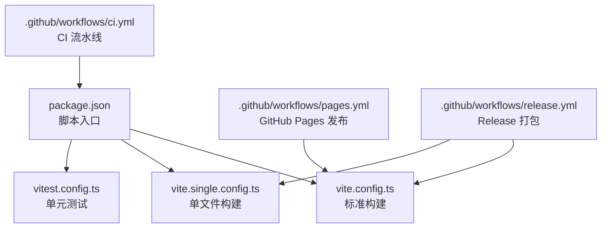
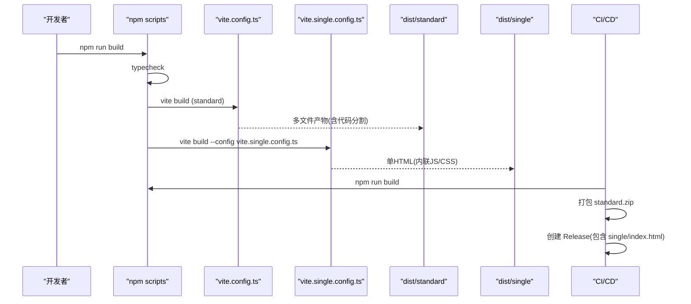
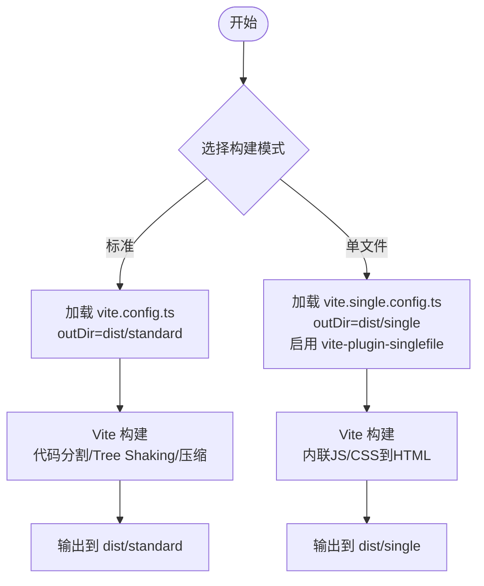
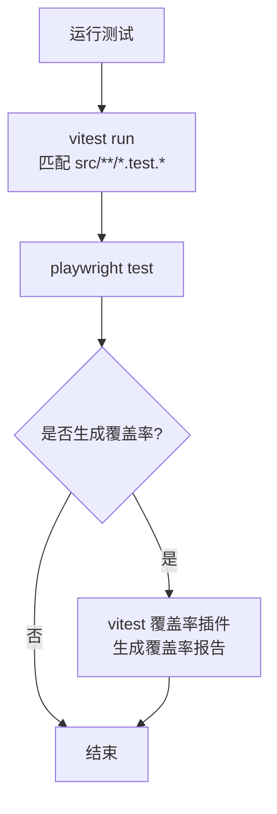
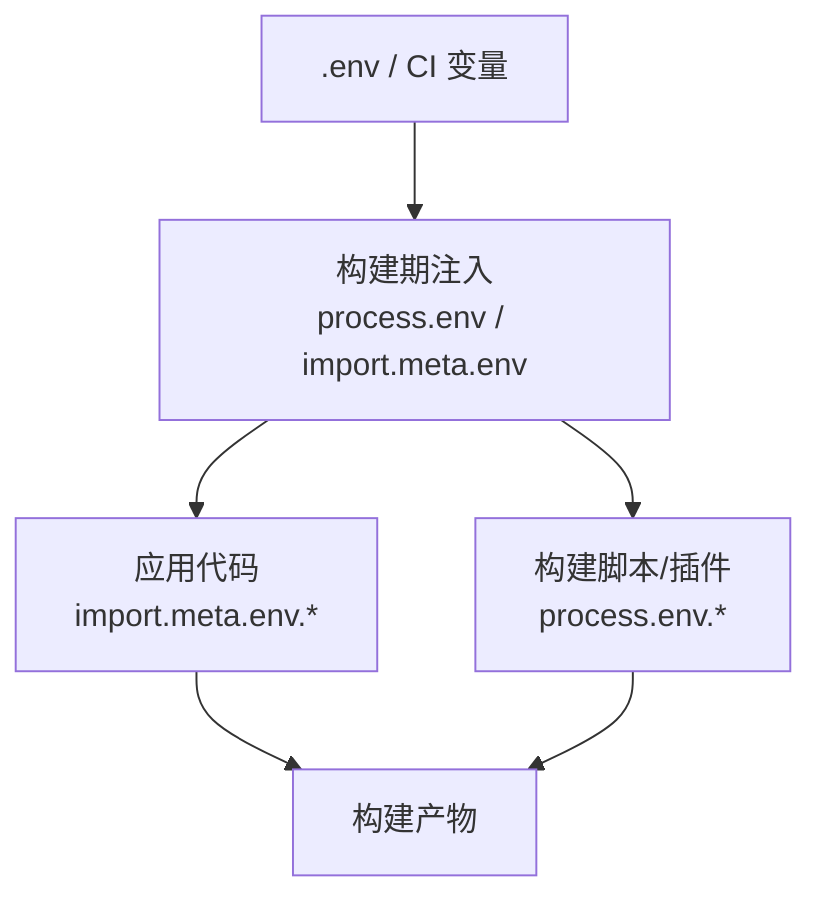
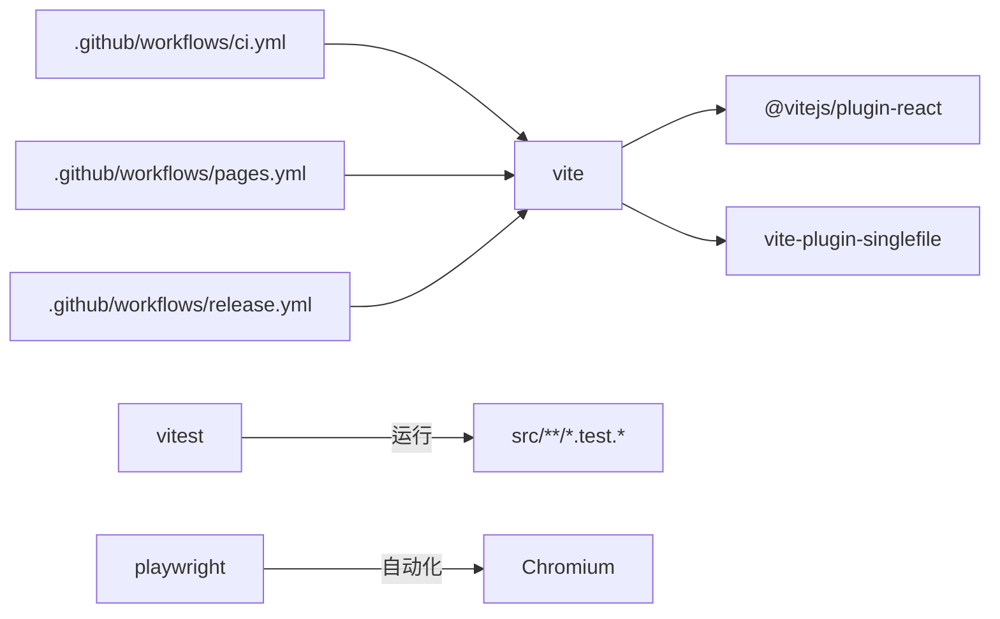

# 构建配置

<cite>
**本文引用的文件**   
- [package.json](file://package.json)
- [vite.config.ts](file://vite.config.ts)
- [vite.single.config.ts](file://vite.single.config.ts)
- [vitest.config.ts](file://vitest.config.ts)
- [playwright.config.ts](file://playwright.config.ts)
- [.github/workflows/ci.yml](file://.github/workflows/ci.yml)
- [.github/workflows/pages.yml](file://.github/workflows/pages.yml)
- [.github/workflows/release.yml](file://.github/workflows/release.yml)
</cite>

## 目录
1. [简介](#简介)
2. [项目结构](#项目结构)
3. [核心组件](#核心组件)
4. [架构总览](#架构总览)
5. [详细组件分析](#详细组件分析)
6. [依赖关系分析](#依赖关系分析)
7. [性能与优化](#性能与优化)
8. [故障排查](#故障排查)
9. [结论](#结论)
10. [附录](#附录)

## 简介
本文件面向 web-cad 项目的构建系统，系统性说明标准构建与单文件构建的差异、Vite 的优化能力、测试环境构建与覆盖率、环境变量在不同模式下的处理方式，以及构建性能优化与缓存策略。文档同时给出产物结构与体积优化建议，帮助你在本地开发与 CI/CD 中稳定高效地产出可部署资源。

## 项目结构
本项目使用 Vite 作为构建工具，提供两套构建配置：
- 标准构建：输出多文件（含代码分割）到 dist/standard
- 单文件构建：通过 vite-plugin-singlefile 将 JS/CSS 内联为单个 HTML 到 dist/single

图表来源
- [package.json:9-20](file://package.json#L9-L20)
- [vite.config.ts:4-10](file://vite.config.ts#L4-L10)
- [vite.single.config.ts:5-12](file://vite.single.config.ts#L5-L12)
- [vitest.config.ts:4-12](file://vitest.config.ts#L4-L12)
- [.github/workflows/ci.yml:10-24](file://.github/workflows/ci.yml#L10-L24)
- [.github/workflows/pages.yml:17-31](file://.github/workflows/pages.yml#L17-L31)
- [.github/workflows/release.yml:10-28](file://.github/workflows/release.yml#L10-L28)

章节来源
- [package.json:9-20](file://package.json#L9-L20)
- [vite.config.ts:4-10](file://vite.config.ts#L4-L10)
- [vite.single.config.ts:5-12](file://vite.single.config.ts#L5-L12)
- [vitest.config.ts:4-12](file://vitest.config.ts#L4-L12)
- [.github/workflows/ci.yml:10-24](file://.github/workflows/ci.yml#L10-L24)
- [.github/workflows/pages.yml:17-31](file://.github/workflows/pages.yml#L17-L31)
- [.github/workflows/release.yml:10-28](file://.github/workflows/release.yml#L10-L28)

## 核心组件
- 构建脚本与命令
  - build:standard：执行标准构建，输出至 dist/standard
  - build:single：执行单文件构建，输出至 dist/single
  - build：先类型检查，再并行执行两种构建
- 插件
  - @vitejs/plugin-react：启用 React 支持
  - vite-plugin-singlefile：将 JS/CSS 内联进单个 HTML
- 测试
  - vitest：运行 src/**/*.test.{ts,tsx}，环境为 node
  - playwright：端到端测试，受 CI 环境变量影响重试次数

章节来源
- [package.json:9-20](file://package.json#L9-L20)
- [vite.config.ts:4-10](file://vite.config.ts#L4-L10)
- [vite.single.config.ts:5-12](file://vite.single.config.ts#L5-L12)
- [vitest.config.ts:4-12](file://vitest.config.ts#L4-L12)

## 架构总览
下图展示了从脚本到构建产物的整体流程，包括 CI/CD 如何触发不同构建并产出发布物。

图表来源
- [package.json:9-20](file://package.json#L9-L20)
- [vite.config.ts:4-10](file://vite.config.ts#L4-L10)
- [vite.single.config.ts:5-12](file://vite.single.config.ts#L5-L12)
- [.github/workflows/release.yml:10-28](file://.github/workflows/release.yml#L10-L28)

## 详细组件分析

### 标准构建 vs 单文件构建对比
- 输出目录
  - 标准构建：dist/standard
  - 单文件构建：dist/single
- 资源处理
  - 标准构建：默认开启代码分割，生成多个 chunk 文件，利于浏览器缓存与增量更新
  - 单文件构建：通过 vite-plugin-singlefile 将 JS/CSS 内联到单个 HTML，便于离线分发与简单部署
- 基础路径
  - 两者均设置 base 为相对路径 './'，适合静态托管或 GitHub Pages
- 插件差异
  - 标准构建仅启用 React 插件
  - 单文件构建额外启用 vite-plugin-singlefile

图表来源
- [vite.config.ts:4-10](file://vite.config.ts#L4-L10)
- [vite.single.config.ts:5-12](file://vite.single.config.ts#L5-L12)

章节来源
- [vite.config.ts:4-10](file://vite.config.ts#L4-L10)
- [vite.single.config.ts:5-12](file://vite.single.config.ts#L5-L12)

### Vite 构建优化选项
- 代码分割
  - 标准构建默认启用动态导入与第三方库分包，提升首屏加载与缓存命中
  - 单文件构建会合并所有资源到一个 HTML，牺牲了分片缓存优势，换取便携性
- Tree Shaking
  - 基于 ES 模块静态分析移除未使用代码，减少包体
- 资源压缩
  - 生产构建默认对 JS/CSS 进行压缩；单文件构建会在内联前进行压缩
- 其他内置优化
  - CSS 预处理器、图片/字体等静态资源优化由 Vite 自动处理
  - 开发服务器与预览服务在 package.json 中提供 dev/preview 脚本

章节来源
- [package.json:9-20](file://package.json#L9-L20)
- [vite.config.ts:4-10](file://vite.config.ts#L4-L10)
- [vite.single.config.ts:5-12](file://vite.single.config.ts#L5-L12)

### 测试环境的构建配置与覆盖率
- 单元测试
  - 使用 vitest，配置文件为 vitest.config.ts
  - include 匹配 src/**/*.test.{ts,tsx}
  - environment 设置为 node，适用于非 DOM 逻辑测试
- 端到端测试
  - 使用 playwright，重试次数受 CI 环境变量控制
- 覆盖率报告
  - 当前仓库未显式配置覆盖率开关；如需生成覆盖率，可在 vitest.config.ts 中启用 coverage 相关选项并在脚本中追加参数

图表来源
- [vitest.config.ts:4-12](file://vitest.config.ts#L4-L12)
- [package.json:14-15](file://package.json#L14-L15)
- [playwright.config.ts:8-20](file://playwright.config.ts#L8-L20)

章节来源
- [vitest.config.ts:4-12](file://vitest.config.ts#L4-L12)
- [package.json:14-15](file://package.json#L14-L15)
- [playwright.config.ts:8-20](file://playwright.config.ts#L8-L20)

### 环境变量在不同构建模式下的处理
- 运行时读取
  - 应用代码可通过 import.meta.env 访问构建时注入的环境变量
- 构建期读取
  - 构建脚本与插件可通过 process.env 获取环境变量（例如 CI 分支判断、Playwright 渠道）
- CI/CD 中的变量
  - release 工作流中使用 GH_TOKEN、GH_REPO、RELEASE_TAG 等变量控制发布
  - pages 工作流通过 actions/configure-pages 与 actions/deploy-pages 完成部署
- 本地与环境隔离
  - 建议在 .env 文件中定义常量，并通过 Vite 的 define 机制在构建时注入

图表来源
- [playwright.config.ts:8-20](file://playwright.config.ts#L8-L20)
- [.github/workflows/release.yml:24-28](file://.github/workflows/release.yml#L24-L28)

章节来源
- [playwright.config.ts:8-20](file://playwright.config.ts#L8-L20)
- [.github/workflows/release.yml:24-28](file://.github/workflows/release.yml#L24-L28)

### 构建产物结构分析与体积优化技巧
- 标准构建产物（dist/standard）
  - index.html 与若干 JS/CSS 文件
  - 典型结构：
    - index.html
    - assets/*.js（含 vendor、chunk 等）
    - assets/*.css
- 单文件构建产物（dist/single）
  - 单个 index.html，内部内联 JS/CSS
- 体积优化建议
  - 优先使用标准构建以获得更好的缓存与分片
  - 避免在业务代码中引入大体积依赖；按需懒加载
  - 对图片等资源使用合适格式与尺寸
  - 谨慎使用单文件构建，仅在需要离线分发或极简部署时使用

章节来源
- [vite.config.ts:4-10](file://vite.config.ts#L4-L10)
- [vite.single.config.ts:5-12](file://vite.single.config.ts#L5-L12)

## 依赖关系分析
- 构建工具链
  - vite：核心构建器
  - @vitejs/plugin-react：React 支持
  - vite-plugin-singlefile：单文件构建
  - vitest：单元测试
  - playwright：端到端测试
- 工作流集成
  - CI：lint → typecheck → test → build → e2e
  - Pages：构建标准产物并发布到 GitHub Pages
  - Release：构建后打包 standard.zip，并将 single/index.html 作为 Release 附件

图表来源
- [package.json:30-45](file://package.json#L30-L45)
- [.github/workflows/ci.yml:10-24](file://.github/workflows/ci.yml#L10-L24)
- [.github/workflows/pages.yml:17-31](file://.github/workflows/pages.yml#L17-L31)
- [.github/workflows/release.yml:10-28](file://.github/workflows/release.yml#L10-L28)

章节来源
- [package.json:30-45](file://package.json#L30-L45)
- [.github/workflows/ci.yml:10-24](file://.github/workflows/ci.yml#L10-L24)
- [.github/workflows/pages.yml:17-31](file://.github/workflows/pages.yml#L17-L31)
- [.github/workflows/release.yml:10-28](file://.github/workflows/release.yml#L10-L28)

## 性能与优化
- 构建性能
  - 使用 npm ci 安装依赖以利用锁文件与缓存
  - 在 CI 中启用 npm 缓存（已配置 cache: npm）
  - 合理拆分任务：lint、typecheck、test、build、e2e 串行执行，避免并发竞争
- 缓存策略
  - 标准构建的多文件产物天然具备强缓存能力，建议开启服务端长缓存与版本化文件名（Vite 默认已实现）
  - 单文件构建由于内容变化会导致整文件失效，应结合 CDN 缓存策略与版本号查询参数
- 体积优化
  - 优先使用标准构建
  - 对大型第三方库进行按需引入或替换轻量替代
  - 图片/字体等资源进行压缩与格式优化
- 构建稳定性
  - 在 CI 中统一 Node 版本（已固定为 22），确保一致性
  - 使用 overrides 锁定关键依赖版本，避免上游破坏性更新

章节来源
- [package.json:6-8](file://package.json#L6-L8)
- [package.json:47-51](file://package.json#L47-L51)
- [.github/workflows/ci.yml:14-17](file://.github/workflows/ci.yml#L14-L17)
- [.github/workflows/pages.yml:19-22](file://.github/workflows/pages.yml#L19-L22)
- [.github/workflows/release.yml:12-16](file://.github/workflows/release.yml#L12-L16)

## 故障排查
- 构建失败
  - 检查 Node 版本是否符合 engines 要求
  - 清理 node_modules 后重新安装（npm ci）
  - 确认环境变量是否正确注入（如 CI、PLAYWRIGHT_CHANNEL）
- 测试失败
  - 查看 vitest 输出定位单元测试问题
  - 检查 playwright 日志与截图（CI 失败时上传 artifact）
- 部署异常
  - GitHub Pages：确认 actions/upload-pages-artifact 的路径为 dist/standard
  - Release：确认 zip 包路径与 Release 附件命名符合预期

章节来源
- [package.json:6-8](file://package.json#L6-L8)
- [playwright.config.ts:8-20](file://playwright.config.ts#L8-L20)
- [.github/workflows/ci.yml:23-30](file://.github/workflows/ci.yml#L23-L30)
- [.github/workflows/pages.yml:27-31](file://.github/workflows/pages.yml#L27-L31)
- [.github/workflows/release.yml:20-28](file://.github/workflows/release.yml#L20-L28)

## 结论
- 标准构建适合常规部署，具备更好的缓存与分片能力
- 单文件构建适合离线分发与极简部署场景
- 通过 Vite 的代码分割、Tree Shaking 与压缩，可获得良好的性能表现
- 在 CI/CD 中统一环境与缓存策略，能显著提升构建稳定性与速度
- 若需覆盖率报告，可在 vitest 中启用相应插件并在脚本中追加参数

## 附录
- 常用命令
  - 开发：npm run dev
  - 预览：npm run preview / npm run preview:single
  - 构建：npm run build:standard / npm run build:single / npm run build
  - 测试：npm run test / npm run test:e2e
- 工作流概览
  - CI：检查与测试
  - Pages：发布 GitHub Pages
  - Release：双构建产物打包与发布

章节来源
- [package.json:9-20](file://package.json#L9-L20)
- [.github/workflows/ci.yml:1-31](file://.github/workflows/ci.yml#L1-L31)
- [.github/workflows/pages.yml:1-45](file://.github/workflows/pages.yml#L1-L45)
- [.github/workflows/release.yml:1-28](file://.github/workflows/release.yml#L1-L28)