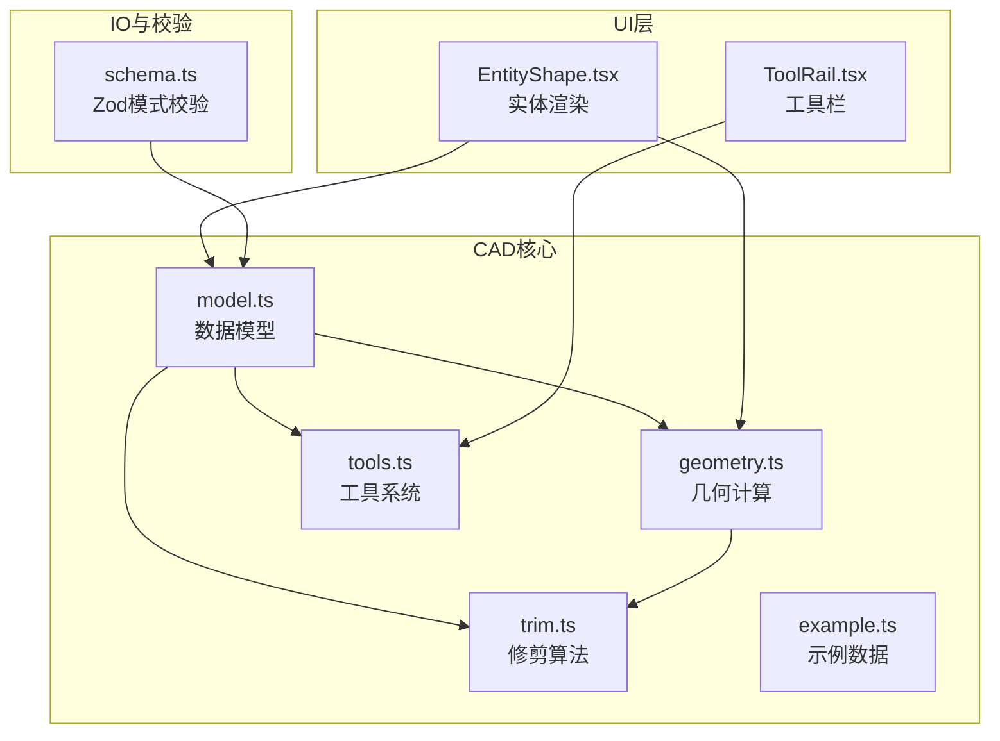
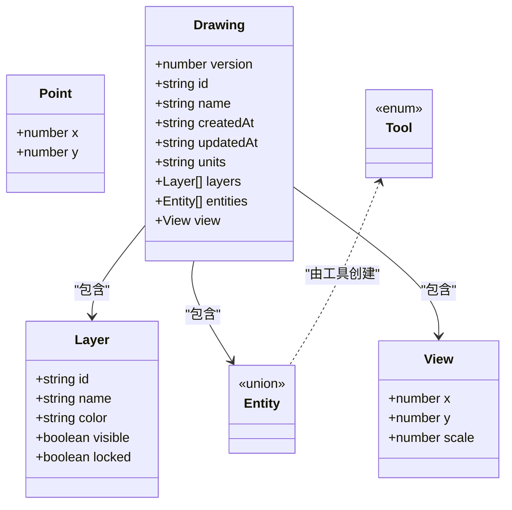
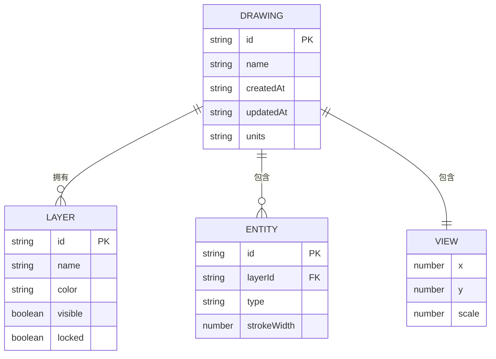
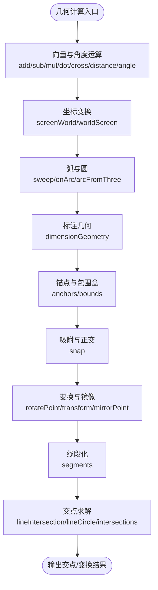
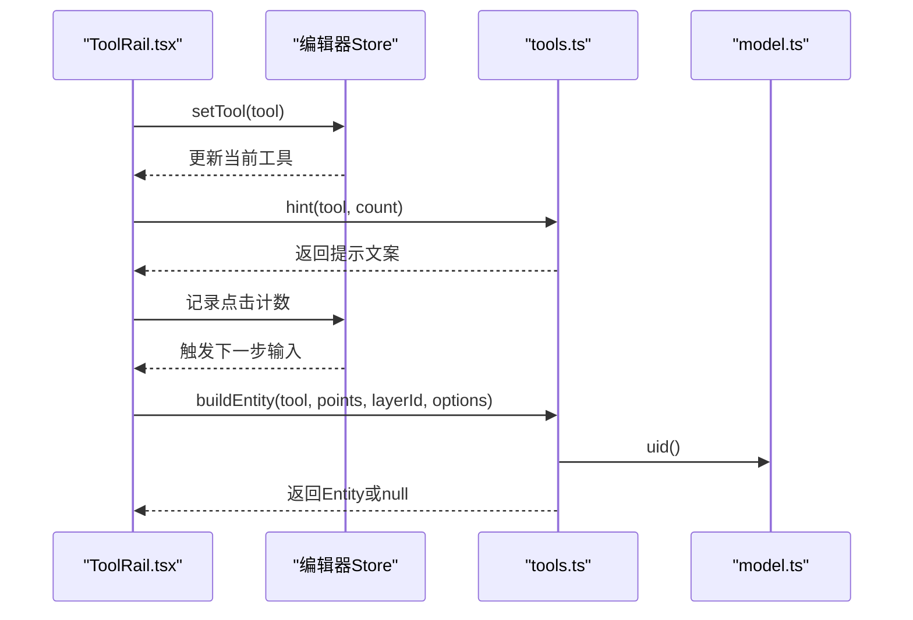
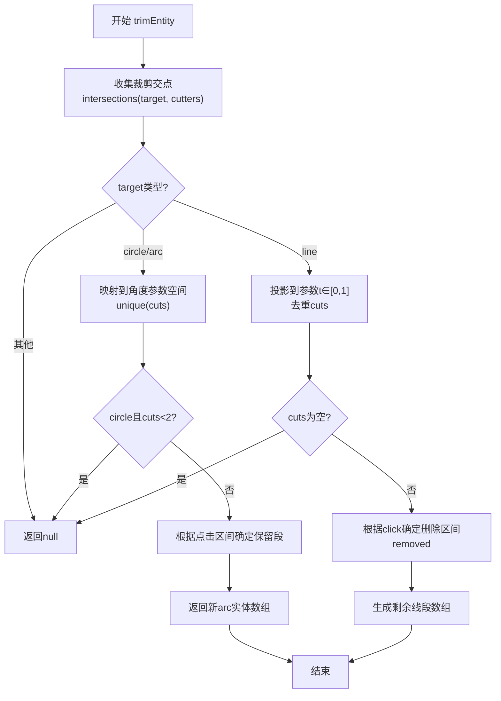
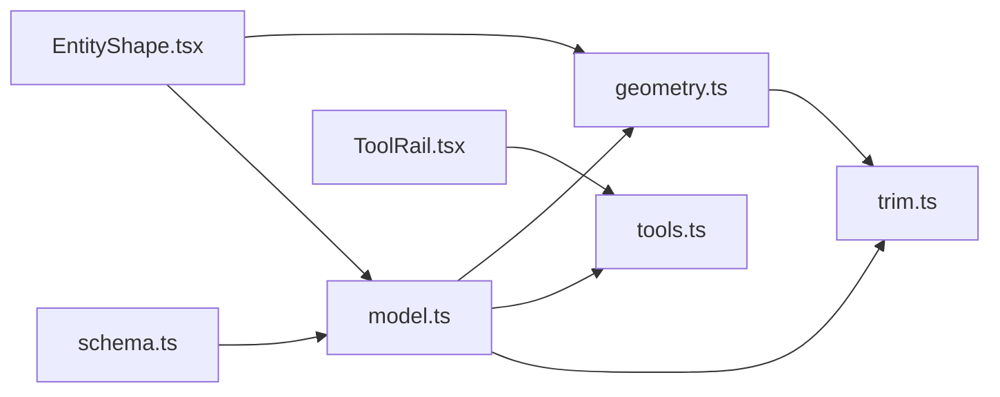

# CAD核心引擎架构

<cite>
**本文引用的文件**   
- [model.ts](file://src/cad/model.ts)
- [geometry.ts](file://src/cad/geometry.ts)
- [tools.ts](file://src/cad/tools.ts)
- [trim.ts](file://src/cad/trim.ts)
- [example.ts](file://src/cad/example.ts)
- [geometry.test.ts](file://src/cad/geometry.test.ts)
- [EntityShape.tsx](file://src/components/EntityShape.tsx)
- [ToolRail.tsx](file://src/features/editor/ToolRail.tsx)
- [schema.ts](file://src/io/schema.ts)
</cite>

## 目录
1. [引言](#引言)
2. [项目结构](#项目结构)
3. [核心组件](#核心组件)
4. [架构总览](#架构总览)
5. [详细组件分析](#详细组件分析)
6. [依赖关系分析](#依赖关系分析)
7. [性能与内存优化](#性能与内存优化)
8. [故障排查指南](#故障排查指南)
9. [结论](#结论)
10. [附录：扩展指南](#附录扩展指南)

## 引言
本文件面向web-cad的CAD核心引擎，系统性梳理几何实体模型、几何计算库、绘图工具系统与几何修剪算法的设计与实现。文档从领域驱动设计视角出发，解释数据模型的层次结构、模块间依赖关系，并给出扩展新几何类型与新工具类型的实践路径。同时总结性能优化策略与内存管理机制，帮助读者在保持代码可读性的前提下构建可扩展、可测试、高性能的二维CAD内核。

## 项目结构
CAD核心位于src/cad目录，围绕“数据模型 + 几何计算 + 工具系统 + 修剪算法”四个维度组织：
- 数据模型：定义Point、Layer、Entity联合类型、Drawing视图与工具枚举等核心数据结构。
- 几何计算：提供向量运算、坐标变换、交点求解、包围盒、吸附、变换（平移/旋转/镜像）等基础能力。
- 工具系统：将用户交互映射为实体构造逻辑，并提供工具提示与名称映射。
- 修剪算法：基于交点参数化对直线、圆、圆弧进行区段裁剪。

图表来源
- [model.ts:1-61](file://src/cad/model.ts#L1-L61)
- [geometry.ts:1-443](file://src/cad/geometry.ts#L1-L443)
- [tools.ts:1-126](file://src/cad/tools.ts#L1-L126)
- [trim.ts:1-129](file://src/cad/trim.ts#L1-L129)
- [EntityShape.tsx:1-59](file://src/components/EntityShape.tsx#L1-L59)
- [ToolRail.tsx:1-95](file://src/features/editor/ToolRail.tsx#L1-L95)
- [schema.ts:1-65](file://src/io/schema.ts#L1-L65)

章节来源
- [model.ts:1-61](file://src/cad/model.ts#L1-L61)
- [geometry.ts:1-443](file://src/cad/geometry.ts#L1-L443)
- [tools.ts:1-126](file://src/cad/tools.ts#L1-L126)
- [trim.ts:1-129](file://src/cad/trim.ts#L1-L129)
- [example.ts:1-102](file://src/cad/example.ts#L1-L102)
- [EntityShape.tsx:1-59](file://src/components/EntityShape.tsx#L1-L59)
- [ToolRail.tsx:1-95](file://src/features/editor/ToolRail.tsx#L1-L95)
- [schema.ts:1-65](file://src/io/schema.ts#L1-L65)

## 核心组件
- 数据模型
  - Point、Layer、View、Drawing构成图纸级上下文；Entity为联合类型，表达多种几何实体的统一抽象；Tool为工具枚举。
  - Base作为所有实体的公共字段（id、layerId、color、strokeWidth），体现领域对象的基础属性。
- 几何计算
  - 提供向量加减、点积叉积、距离、角度、极坐标转换、屏幕与世界坐标互转、弧扫角、点在弧上判断、三点定弧、矩形四角、标注几何、锚点集合、包围盒、吸附、旋转、变换、镜像、线段化、交点求解等。
- 工具系统
  - toolNames映射工具名到中文显示；hint根据工具与点击计数生成操作提示；buildEntity将用户输入点序列转换为具体Entity。
- 修剪算法
  - trimEntity以目标实体与一组裁剪实体为输入，计算交点并按点击位置决定保留哪一段，返回新的实体数组或null。

章节来源
- [model.ts:1-76](file://src/cad/model.ts#L1-L76)
- [geometry.ts:1-443](file://src/cad/geometry.ts#L1-L443)
- [tools.ts:1-126](file://src/cad/tools.ts#L1-L126)
- [trim.ts:1-129](file://src/cad/trim.ts#L1-L129)

## 架构总览
CAD核心采用“数据模型为中心”的领域驱动设计：
- 领域层：model.ts定义实体、图层、图纸、工具等概念；geometry.ts提供纯函数式几何运算；trim.ts封装修剪这一业务行为；tools.ts负责将交互转化为领域对象。
- 表现层：EntityShape.tsx将Entity渲染为SVG；ToolRail.tsx展示工具组与快捷键。
- 持久化与校验：schema.ts使用Zod对Drawing/Entity进行结构化校验，确保IO安全。

图表来源
- [model.ts:1-76](file://src/cad/model.ts#L1-L76)

章节来源
- [model.ts:1-76](file://src/cad/model.ts#L1-L76)

## 详细组件分析

### 几何实体模型设计
- 基类思想
  - 通过Base接口聚合id、layerId、color、strokeWidth等通用属性，所有Entity共享这些基础信息，便于统一样式与图层管理。
- 联合类型Entity
  - line：两点定义直线段。
  - polyline：多点折线，支持closed闭合。
  - rectangle：对角两点定义的矩形。
  - circle：圆心+半径。
  - arc：圆心+半径+起止角+方向（顺时针/逆时针）。
  - text：插入点、文本内容、字号、旋转角度。
  - dimension：测量端点a/b、标注位置at、模式horizontal/vertical/aligned，可选direction。
- 视图与图纸
  - View描述视口偏移与缩放；Drawing是顶层容器，包含layers、entities、view等。
- 工具枚举Tool
  - select、line、polyline、rectangle、circle、arc、text、dimension、move、copy、rotate、mirror、trim。

图表来源
- [model.ts:1-61](file://src/cad/model.ts#L1-L61)

章节来源
- [model.ts:1-61](file://src/cad/model.ts#L1-L61)

### 几何计算库数学运算模块
- 向量与角度
  - add/sub/mul/dot/cross/distance/angle/polar/normalize/TAU/EPS等基础运算，保证数值稳定性与角度归一化。
- 坐标变换
  - screenToWorld/worldToScreen完成屏幕像素与CAD世界坐标的双向转换，支撑缩放与平移。
- 弧与圆
  - sweep/onArc用于弧的方向与范围判定；arcFromThree通过三点求圆心和半径，处理共线退化情况。
- 标注几何
  - dimensionGeometry根据mode计算标注线段p/q、中点、长度与旋转角度。
- 锚点与包围盒
  - anchors为不同实体提供可吸附的关键点集；bounds计算包围盒，考虑圆弧特殊边界与文字旋转。
- 吸附与正交约束
  - snap支持网格吸附、对象吸附、正交约束（ortho）、基准点（base）对齐，容差按屏幕像素度量。
- 变换与镜像
  - rotatePoint实现绕中心旋转；transform对各类实体进行平移/旋转/镜像，必要时将rectangle转为polyline以保持语义正确性。
- 线段化与交点
  - segments将实体分解为线段集合；lineIntersection计算两线段交点；lineCircle计算线段与圆的交点；intersections组合多种情况，包括圆-圆相交。

图表来源
- [geometry.ts:1-443](file://src/cad/geometry.ts#L1-L443)

章节来源
- [geometry.ts:1-443](file://src/cad/geometry.ts#L1-L443)

### 绘图工具系统架构设计
- 工具命名与分组
  - toolNames提供工具中文名映射；ToolRail.tsx将工具分组（选择、绘制、注释、修改）并绑定图标与快捷键。
- 交互提示
  - hint根据tool与count动态生成提示文案，引导用户完成多步输入（如三点圆弧、尺寸标注）。
- 实体构建
  - buildEntity将points与options映射为具体Entity，处理各工具的输入有效性（如距离小于EPS视为无效）。
- 工具状态
  - ToolRail.tsx与store协作切换当前工具，影响后续鼠标事件的处理流程。

图表来源
- [ToolRail.tsx:1-95](file://src/features/editor/ToolRail.tsx#L1-L95)
- [tools.ts:1-126](file://src/cad/tools.ts#L1-L126)
- [model.ts:76-81](file://src/cad/model.ts#L76-L81)

章节来源
- [tools.ts:1-126](file://src/cad/tools.ts#L1-L126)
- [ToolRail.tsx:1-95](file://src/features/editor/ToolRail.tsx#L1-L95)

### 几何修剪算法的实现原理
- 输入与裁剪源
  - trimEntity(target, cutters, click)：target为目标实体，cutters为可见裁剪实体集合，click为点击位置。
- 交点计算
  - 使用intersections(target, cutter)获取所有交点，排除自身后参与参数化。
- 直线修剪
  - 将交点投影到直线的参数t∈[0,1]区间，去重后得到切割点序列；根据click所在区间决定删除哪一段，返回剩余片段的新直线实体数组。
- 圆与圆弧修剪
  - 将交点映射到角度参数空间，区分圆（全周）与弧（start/end/ccw）；对圆需至少两个交点才能分割；根据点击落在哪个区间决定保留哪一段，返回新的arc实体。
- 数值稳定
  - 使用EPS容差过滤退化情况（相切、重合），避免误删或无变化。

图表来源
- [trim.ts:1-129](file://src/cad/trim.ts#L1-L129)
- [geometry.ts:361-442](file://src/cad/geometry.ts#L361-L442)

章节来源
- [trim.ts:1-129](file://src/cad/trim.ts#L1-L129)
- [geometry.ts:361-442](file://src/cad/geometry.ts#L361-L442)

### 领域驱动设计在CAD业务逻辑中的应用
- 领域对象
  - Entity、Layer、Drawing、View等均为领域概念的直接映射，强调不变性与一致性（如Base聚合公共属性）。
- 领域服务
  - geometry.ts中的纯函数充当领域服务，不持有状态，仅对领域对象进行计算与转换。
- 应用流程
  - tools.ts将用户意图（工具+点序列）转换为领域对象；trim.ts封装修剪这一业务规则；EntityShape.tsx负责展示。
- 边界与契约
  - schema.ts通过Zod定义输入契约，确保外部IO的数据符合领域模型，降低非法数据进入核心逻辑的风险。

章节来源
- [model.ts:1-76](file://src/cad/model.ts#L1-L76)
- [geometry.ts:1-443](file://src/cad/geometry.ts#L1-L443)
- [tools.ts:1-126](file://src/cad/tools.ts#L1-L126)
- [trim.ts:1-129](file://src/cad/trim.ts#L1-L129)
- [schema.ts:1-65](file://src/io/schema.ts#L1-L65)

## 依赖关系分析
- model.ts被geometry.ts、tools.ts、trim.ts、example.ts引用，作为类型与工厂函数的基础。
- geometry.ts被tools.ts、trim.ts、EntityShape.tsx引用，提供几何计算能力。
- tools.ts被ToolRail.tsx引用，提供工具名称与构建逻辑。
- trim.ts依赖geometry.ts的交点与角度工具。
- EntityShape.tsx依赖geometry.ts与model.ts进行渲染。
- schema.ts依赖model.ts进行Zod校验。

图表来源
- [model.ts:1-76](file://src/cad/model.ts#L1-L76)
- [geometry.ts:1-443](file://src/cad/geometry.ts#L1-L443)
- [tools.ts:1-126](file://src/cad/tools.ts#L1-L126)
- [trim.ts:1-129](file://src/cad/trim.ts#L1-L129)
- [EntityShape.tsx:1-59](file://src/components/EntityShape.tsx#L1-L59)
- [ToolRail.tsx:1-95](file://src/features/editor/ToolRail.tsx#L1-L95)
- [schema.ts:1-65](file://src/io/schema.ts#L1-L65)

章节来源
- [model.ts:1-76](file://src/cad/model.ts#L1-L76)
- [geometry.ts:1-443](file://src/cad/geometry.ts#L1-L443)
- [tools.ts:1-126](file://src/cad/tools.ts#L1-L126)
- [trim.ts:1-129](file://src/cad/trim.ts#L1-L129)
- [EntityShape.tsx:1-59](file://src/components/EntityShape.tsx#L1-L59)
- [ToolRail.tsx:1-95](file://src/features/editor/ToolRail.tsx#L1-L95)
- [schema.ts:1-65](file://src/io/schema.ts#L1-L65)

## 性能与内存优化
- 数值稳定性
  - 使用EPS容差避免浮点误差导致的误判（如交点、相切、零长度向量）。
- 计算复杂度
  - intersections对每对实体进行线段化与两两比较，时间复杂度O(N^2)，适合中小规模图形；可通过分层与包围盒预筛选进一步优化。
- 变换优化
  - transform对rectangle在无旋转无反射时直接平移，避免不必要的polyline转换；旋转/镜像时才降级为polyline以保证几何正确性。
- 吸附优化
  - snap优先对象吸附，再网格吸附；正交约束下跳过非共线对象，减少无效计算。
- 内存管理
  - 使用immutable风格更新（展开运算符）生成新实体，避免副作用；uid生成使用crypto.randomUUID或回退方案，保证唯一性。
- 渲染优化
  - EntityShape.tsx针对不同类型使用原生SVG元素（line、rect、path、circle、text），减少路径计算开销。

章节来源
- [geometry.ts:1-443](file://src/cad/geometry.ts#L1-L443)
- [trim.ts:1-129](file://src/cad/trim.ts#L1-L129)
- [EntityShape.tsx:1-59](file://src/components/EntityShape.tsx#L1-L59)
- [model.ts:76-81](file://src/cad/model.ts#L76-L81)

## 故障排查指南
- 交点异常
  - 检查EPS容差设置与线段退化情况（aa<EPS或disc<-EPS），确认lineIntersection与lineCircle分支是否返回空集。
- 圆弧方向错误
  - 核对ccw与sweep计算，确保onArc判断与角度归一化一致。
- 修剪无效果
  - 确认cutters不包含target自身；检查cuts去重与区间判定逻辑；验证click参数是否在有效区间内。
- 吸附失效
  - 检查snap的ortho与base参数；确认对象吸附与网格吸附优先级；验证step与scale对吸附容差的影响。
- 变换后类型不符
  - 确认transform中对rectangle的特殊处理；旋转/镜像时应转为polyline并保持closed。

章节来源
- [geometry.ts:361-442](file://src/cad/geometry.ts#L361-L442)
- [trim.ts:1-129](file://src/cad/trim.ts#L1-L129)
- [geometry.test.ts:1-298](file://src/cad/geometry.test.ts#L1-L298)

## 结论
web-cad的CAD核心引擎以领域模型为中心，通过纯函数式几何计算与明确的工具系统，实现了可扩展、可测试的二维绘图内核。修剪算法基于参数化与交点检测，兼顾直线与圆弧场景。结合Zod校验与不可变更新策略，系统在IO与内存层面具备良好健壮性。未来可在大规模图形的空间索引与增量计算方面继续优化。

## 附录：扩展指南

### 扩展新的几何类型
步骤概览：
1. 在model.ts中扩展Entity联合类型，新增type字面量与对应字段。
2. 在geometry.ts中补充该类型的anchors、bounds、segments、transform等必要方法。
3. 在tools.ts的buildEntity中添加构造逻辑，处理输入有效性。
4. 在EntityShape.tsx中添加渲染分支，将该类型映射到SVG元素。
5. 在schema.ts中为该类型添加Zod校验规则，确保IO安全。
6. 在geometry.test.ts中补充单元测试，覆盖关键几何行为。

参考路径
- [model.ts:18-45](file://src/cad/model.ts#L18-L45)
- [geometry.ts:112-190](file://src/cad/geometry.ts#L112-L190)
- [geometry.ts:253-328](file://src/cad/geometry.ts#L253-L328)
- [tools.ts:49-125](file://src/cad/tools.ts#L49-L125)
- [EntityShape.tsx:20-59](file://src/components/EntityShape.tsx#L20-L59)
- [schema.ts:14-65](file://src/io/schema.ts#L14-L65)
- [geometry.test.ts:1-298](file://src/cad/geometry.test.ts#L1-L298)

### 扩展新的工具类型
步骤概览：
1. 在model.ts的Tool枚举中添加新工具名。
2. 在tools.ts的toolNames中添加中文映射，在hint中增加交互提示。
3. 在buildEntity中实现新工具的实体构造逻辑。
4. 在ToolRail.tsx中为新工具添加分组、图标与快捷键。
5. 在EntityShape.tsx中确保新工具生成的实体可正确渲染。
6. 在geometry.test.ts或相关测试中验证工具行为。

参考路径
- [model.ts:62-76](file://src/cad/model.ts#L62-L76)
- [tools.ts:5-48](file://src/cad/tools.ts#L5-L48)
- [tools.ts:49-125](file://src/cad/tools.ts#L49-L125)
- [ToolRail.tsx:21-58](file://src/features/editor/ToolRail.tsx#L21-L58)
- [EntityShape.tsx:20-59](file://src/components/EntityShape.tsx#L20-L59)

### 示例数据与用法
- example.ts展示了如何使用doc.layers与uid创建示例实体集合，涵盖polyline、circle、rectangle、dimension、text等类型，可作为扩展时的参考模板。

参考路径
- [example.ts:1-102](file://src/cad/example.ts#L1-L102)