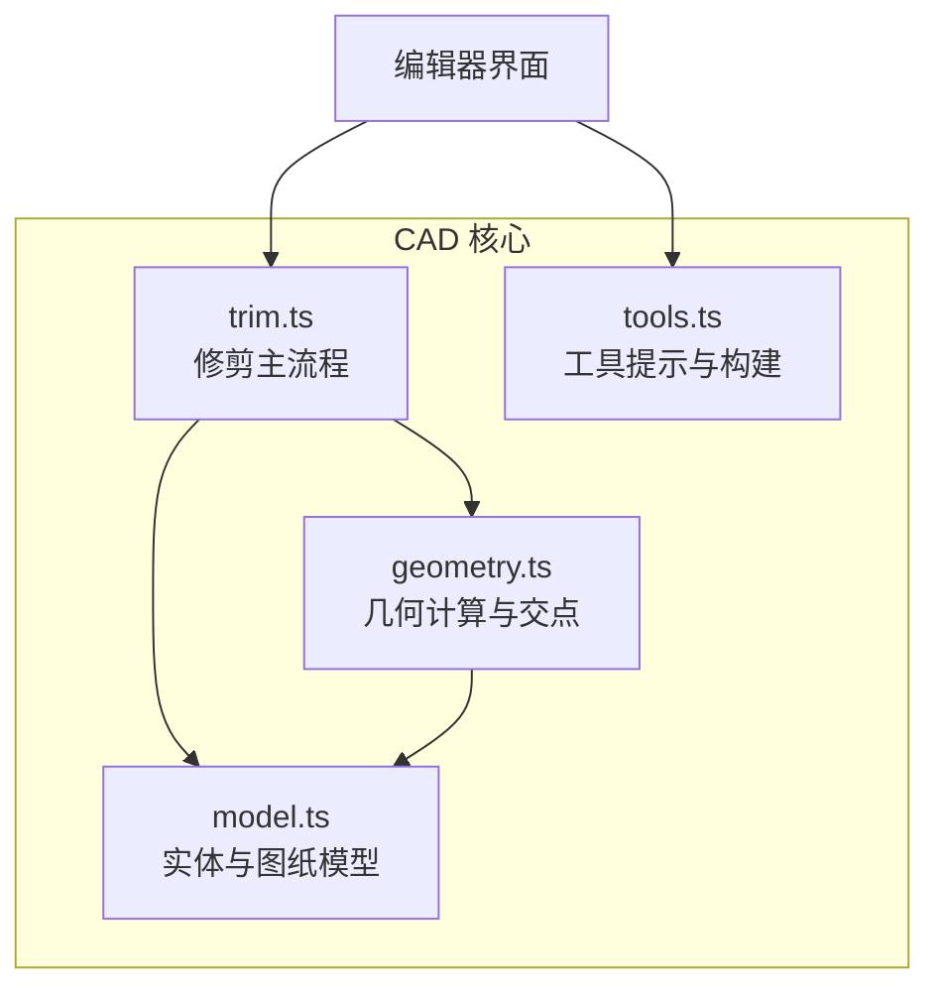
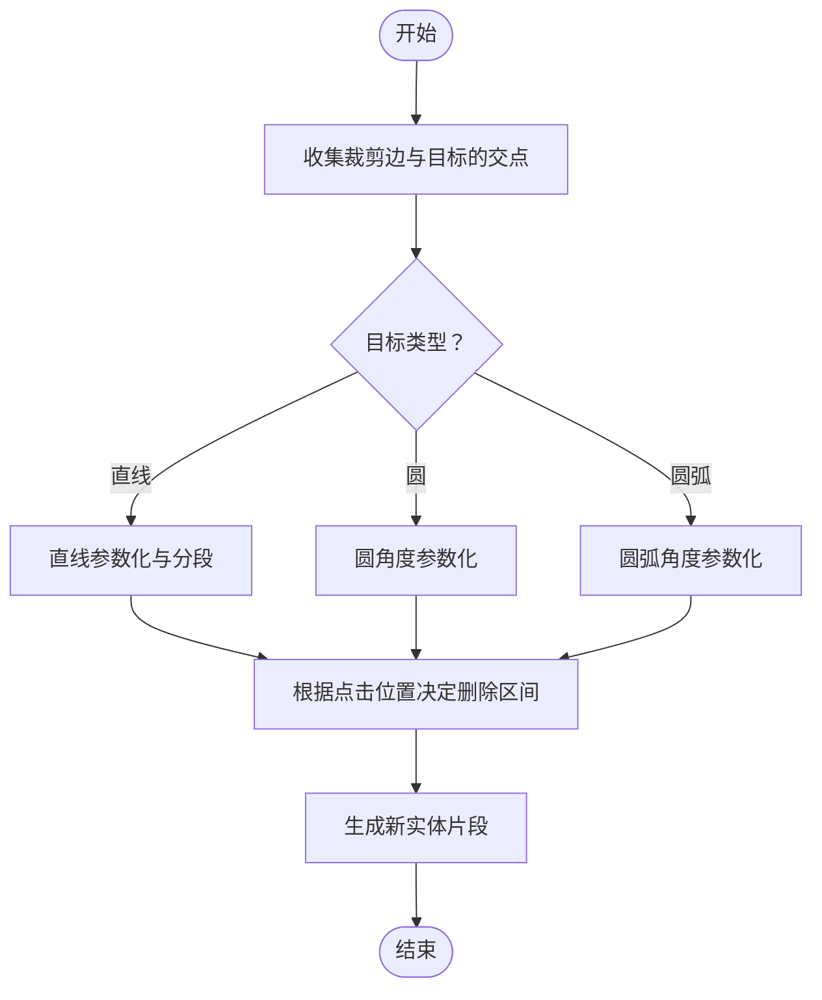
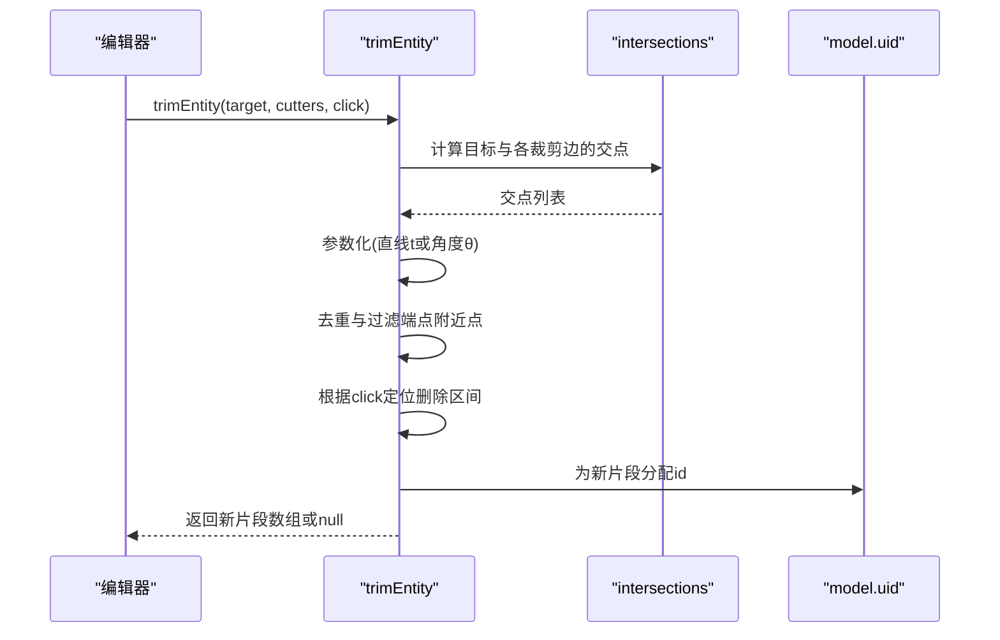
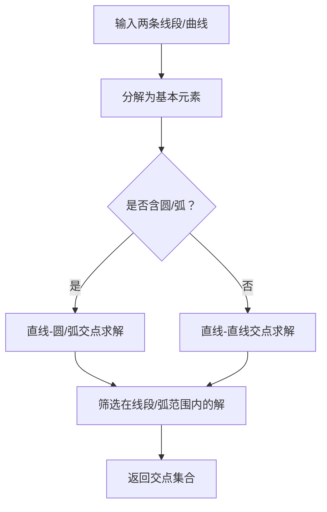
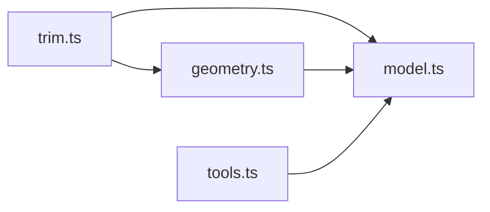

# 几何修剪算法

<cite>
**本文引用的文件**   
- [trim.ts](file://src/cad/trim.ts)
- [geometry.ts](file://src/cad/geometry.ts)
- [model.ts](file://src/cad/model.ts)
- [tools.ts](file://src/cad/tools.ts)
- [geometry.test.ts](file://src/cad/geometry.test.ts)
</cite>

## 目录
1. [简介](#简介)
2. [项目结构](#项目结构)
3. [核心组件](#核心组件)
4. [架构总览](#架构总览)
5. [详细组件分析](#详细组件分析)
6. [依赖关系分析](#依赖关系分析)
7. [性能与精度](#性能与精度)
8. [故障排查指南](#故障排查指南)
9. [结论](#结论)
10. [附录：布尔运算扩展建议](#附录布尔运算扩展建议)

## 简介
本文面向 web-cad 的几何修剪子系统，系统性说明其核心原理与实现方式。重点覆盖：
- 线段、圆弧、圆的修剪逻辑
- 多段线（折线）作为修剪边界时的处理策略
- 布尔运算（并集、交集、差集）在当前代码中的现状与扩展思路
- 边界条件、精度控制与性能优化
- 关键流程图与测试用例路径，帮助理解复杂场景的处理方式

## 项目结构
修剪相关代码集中在 cad 子目录中，核心文件如下：
- trim.ts：修剪主流程与按目标类型分支的实现
- geometry.ts：基础几何计算、交点求解、弧参数化等工具函数
- model.ts：实体类型定义、视图与图纸数据结构
- tools.ts：工具提示与实体构建（与修剪交互提示相关）
- geometry.test.ts：几何与修剪的单元测试，覆盖典型场景

图表来源
- [trim.ts:1-129](file://src/cad/trim.ts#L1-L129)
- [geometry.ts:1-443](file://src/cad/geometry.ts#L1-L443)
- [model.ts:1-142](file://src/cad/model.ts#L1-L142)
- [tools.ts:1-126](file://src/cad/tools.ts#L1-L126)

章节来源
- [trim.ts:1-129](file://src/cad/trim.ts#L1-L129)
- [geometry.ts:1-443](file://src/cad/geometry.ts#L1-L443)
- [model.ts:1-142](file://src/cad/model.ts#L1-L142)
- [tools.ts:1-126](file://src/cad/tools.ts#L1-L126)

## 核心组件
- 修剪入口：trimEntity(target, cutters, click)
  - target：被修剪的目标实体（支持 line、circle、arc）
  - cutters：裁剪边界集合（可见图形作为修剪边界）
  - click：用户点击位置，用于决定保留哪一段
- 几何工具：intersections、sweep、onArc、normalize、angle、EPS 等
- 数据模型：Entity 联合类型，包含 line、polyline、rectangle、circle、arc、text、dimension 等

章节来源
- [trim.ts:21-128](file://src/cad/trim.ts#L21-L128)
- [geometry.ts:43-54](file://src/cad/geometry.ts#L43-L54)
- [geometry.ts:401-442](file://src/cad/geometry.ts#L401-L442)
- [model.ts:18-45](file://src/cad/model.ts#L18-L45)

## 架构总览
修剪的整体流程如下：
1. 收集所有裁剪边与目标的交点
2. 根据目标类型（直线、圆、圆弧）将交点映射到一维参数空间
3. 去重与过滤（剔除端点附近的退化情况）
4. 依据用户点击位置确定要删除的区间
5. 生成新的实体片段（可能返回多个片段或空结果）

图表来源
- [trim.ts:21-128](file://src/cad/trim.ts#L21-L128)
- [geometry.ts:401-442](file://src/cad/geometry.ts#L401-L442)

## 详细组件分析

### 修剪主流程：trimEntity
- 输入：
  - target：被修剪的目标实体
  - cutters：裁剪边界实体数组
  - click：用户点击坐标
- 输出：
  - 修剪后的实体数组，或 null（无修改）

关键步骤：
- 使用 intersections 计算目标与每个裁剪边的交点集合
- 对直线：
  - 将交点投影到直线的参数 t ∈ (0,1)
  - 去重后得到 cuts
  - 若 cuts 为空则返回 null
  - 根据 click 在直线上的投影位置，找到应删除的区间索引
  - 生成除删除区间外的若干子线段
- 对圆与圆弧：
  - 将交点转换为角度参数（考虑 ccw 方向）
  - 圆需要至少两个交点才能形成有效分割；否则返回 null
  - 圆弧需确保交点在弧范围内
  - 同样依据 click 的角度位置决定删除区间，并生成新的 arc 片段

图表来源
- [trim.ts:21-128](file://src/cad/trim.ts#L21-L128)
- [geometry.ts:401-442](file://src/cad/geometry.ts#L401-L442)
- [model.ts:76-81](file://src/cad/model.ts#L76-L81)

章节来源
- [trim.ts:21-128](file://src/cad/trim.ts#L21-L128)

### 几何工具与交点求解
- 直线-直线交点：基于叉积判断平行与求交
- 直线-圆/圆弧交点：二次方程判别式，筛选在线段范围内的解
- 圆-圆交点：利用距离与半径关系求解两交点
- 圆弧有效性检查：通过 onArc 判断交点是否在弧范围内
- 弧参数化：sweep 计算扫角，normalize 统一角度范围

图表来源
- [geometry.ts:361-442](file://src/cad/geometry.ts#L361-L442)

章节来源
- [geometry.ts:361-442](file://src/cad/geometry.ts#L361-L442)

### 多段线（折线）修剪
- 当前 trimEntity 仅直接支持 line、circle、arc 三种目标类型
- 对于 polyline 或 rectangle，trimEntity 会返回 null（不直接修剪）
- 但 polyline 可作为裁剪边界（cutters），因为 intersections 会将 polyline 拆分为线段进行交点计算
- 因此，多段线“修剪”的实际含义是：用多段线作为边界来修剪其他目标（如直线、圆、圆弧）

章节来源
- [trim.ts:60-61](file://src/cad/trim.ts#L60-L61)
- [geometry.ts:337-360](file://src/cad/geometry.ts#L337-L360)

### 布尔运算（并集、交集、差集）
- 当前仓库未提供通用的二维布尔运算实现
- 现有能力可用于布尔运算的基础构件：
  - 交点求解（intersections）
  - 弧参数化与范围判断（sweep、onArc、normalize）
  - 线段拆分与重建（trimEntity 的子片段生成思路）
- 扩展建议：
  - 交集：以交点为节点，沿轮廓顺序选择位于另一形状内部的边段
  - 并集：合并外部轮廓，去除内部重叠区域
  - 差集：从主体轮廓中移除被裁剪边覆盖的区域
- 注意：布尔运算涉及拓扑排序、环检测、内外判定等复杂问题，需引入更完整的平面几何库或自研算法

章节来源
- [geometry.ts:401-442](file://src/cad/geometry.ts#L401-L442)
- [trim.ts:21-128](file://src/cad/trim.ts#L21-L128)

## 依赖关系分析
- trim.ts 依赖 geometry.ts 的几何计算与 EPS 精度常量
- trim.ts 依赖 model.ts 的 Entity 类型与 uid 生成
- geometry.ts 依赖 model.ts 的 Point、Entity、View 类型
- tools.ts 提供工具提示与实体构建，辅助编辑器交互（包括修剪工具的提示文案）

图表来源
- [trim.ts:1-14](file://src/cad/trim.ts#L1-L14)
- [geometry.ts:1-4](file://src/cad/geometry.ts#L1-L4)
- [model.ts:1-45](file://src/cad/model.ts#L1-L45)
- [tools.ts:1-3](file://src/cad/tools.ts#L1-L3)

章节来源
- [trim.ts:1-14](file://src/cad/trim.ts#L1-L14)
- [geometry.ts:1-4](file://src/cad/geometry.ts#L1-L4)
- [model.ts:1-45](file://src/cad/model.ts#L1-L45)
- [tools.ts:1-3](file://src/cad/tools.ts#L1-L3)

## 性能与精度
- 精度控制
  - 全局 EPS = 1e-7，用于浮点比较与退化判断（如零长度向量、平行线、相切）
  - normalize 保证角度在 [0, 2π) 范围内，避免跨零角度处理的歧义
  - unique 去重时采用 EPS 容差，防止重复交点导致错误分段
- 性能优化
  - 先快速排除无效目标（如长度为 0 的直线）
  - 仅在必要时进行圆/弧相关计算
  - 交点计算按基本线段遍历，复杂度与边数线性相关
- 边界条件
  - 直线：当 n < EPS 时视为退化，直接返回 null
  - 圆：需要至少两个交点才能分割，否则返回 null
  - 圆弧：交点必须在弧范围内，且考虑 ccw 方向
  - 相切：由于 EPS 容差，相切通常被视为一个交点，不会触发分割

章节来源
- [geometry.ts:3-4](file://src/cad/geometry.ts#L3-L4)
- [geometry.ts:21-24](file://src/cad/geometry.ts#L21-L24)
- [trim.ts:16-20](file://src/cad/trim.ts#L16-L20)
- [trim.ts:29-38](file://src/cad/trim.ts#L29-L38)
- [trim.ts:82-84](file://src/cad/trim.ts#L82-L84)

## 故障排查指南
常见问题与定位方法：
- 修剪无效果
  - 检查是否存在有效交点（intersections 返回空）
  - 确认目标类型是否为 line/circle/arc
  - 检查 click 位置是否落在期望的区间内
- 圆弧修剪方向异常
  - 检查 ccw 标志与 start/end 角度是否正确
  - 使用 sweep 与 onArc 验证弧范围
- 圆未被分割
  - 确认交点数是否小于 2
  - 检查是否出现相切（仅一个交点）
- 多段线作为目标未被修剪
  - 当前不支持直接修剪 polyline/rectangle 为目标的情况，可改用其他目标类型或将多段线作为裁剪边界

参考测试用例路径：
- 直线修剪：[geometry.test.ts:242-253](file://src/cad/geometry.test.ts#L242-L253)
- 圆区段修剪跨越零角度：[geometry.test.ts:254-267](file://src/cad/geometry.test.ts#L254-L267)
- 圆弧顺时针修剪：[geometry.test.ts:268-287](file://src/cad/geometry.test.ts#L268-L287)
- 无交点与相切不修改：[geometry.test.ts:288-296](file://src/cad/geometry.test.ts#L288-L296)

章节来源
- [geometry.test.ts:241-297](file://src/cad/geometry.test.ts#L241-L297)

## 结论
web-cad 的几何修剪模块以简洁高效的几何工具为基础，实现了针对直线、圆与圆弧的精确修剪。通过参数化与角度归一化，正确处理了跨零角度与顺时针/逆时针方向。多段线作为裁剪边界的能力由交点求解提供支撑，而多段线作为目标类型的直接修剪尚未实现。布尔运算目前未内置，但可利用现有几何工具逐步扩展。整体设计注重精度与性能平衡，适合在 CAD 编辑场景中稳定运行。

## 附录：布尔运算扩展建议
- 交集
  - 以交点为节点，沿轮廓顺序判断边段是否位于另一形状内部
  - 使用 onArc 与线段包含性判断维护拓扑一致性
- 并集
  - 合并外部轮廓，去除内部重叠区域
  - 需要环检测与内外判定（如射线法）
- 差集
  - 从主体轮廓中移除被裁剪边覆盖的区域
  - 结合 trimEntity 的分段思想，生成新的轮廓片段

这些扩展需要额外的拓扑与平面几何算法支持，建议在现有 geometry.ts 与 trim.ts 的基础上逐步完善。