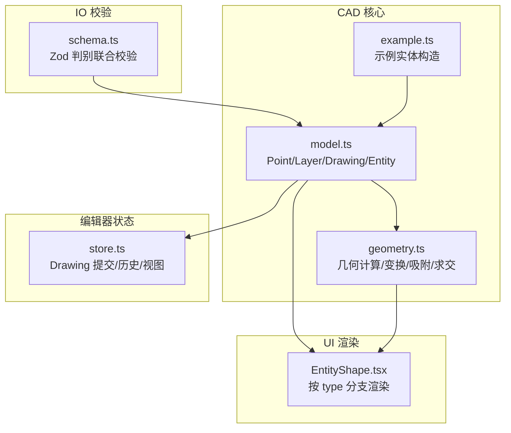
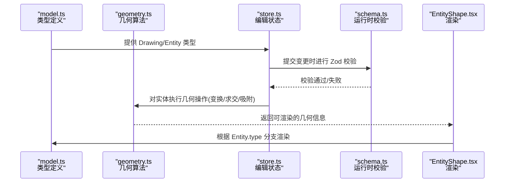
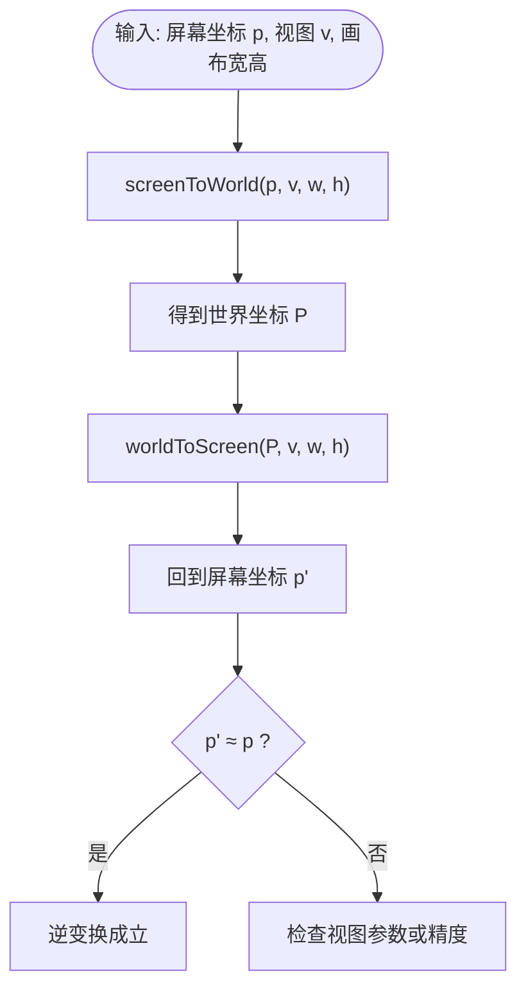
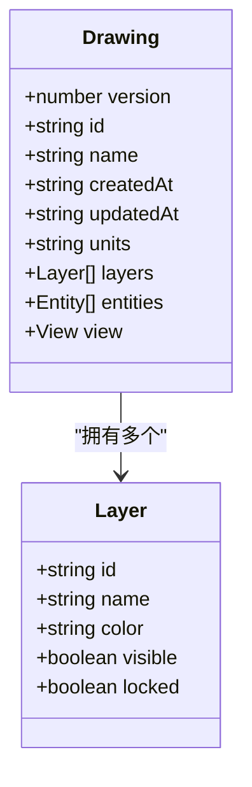
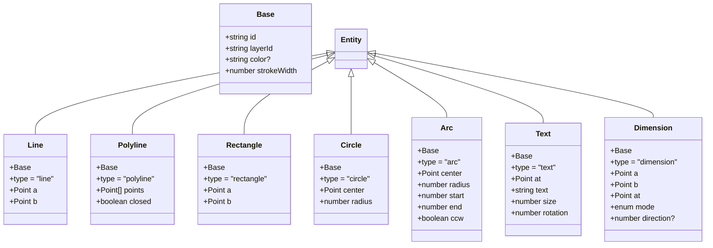
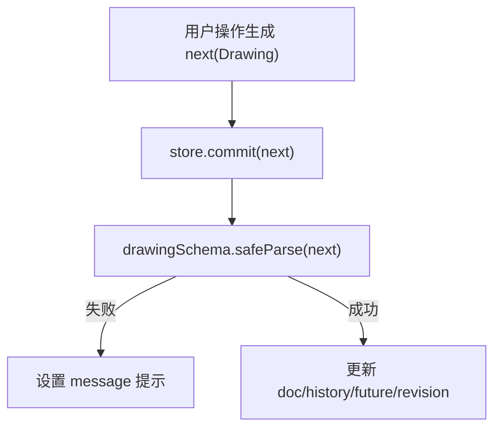
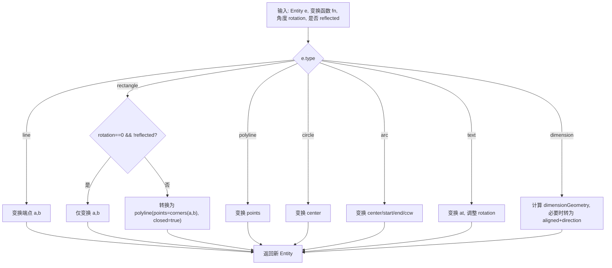
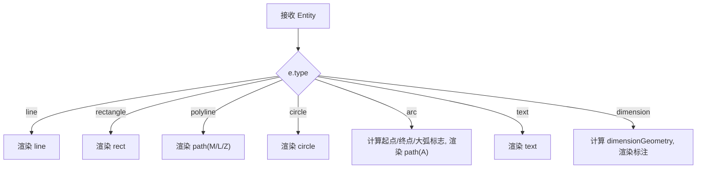
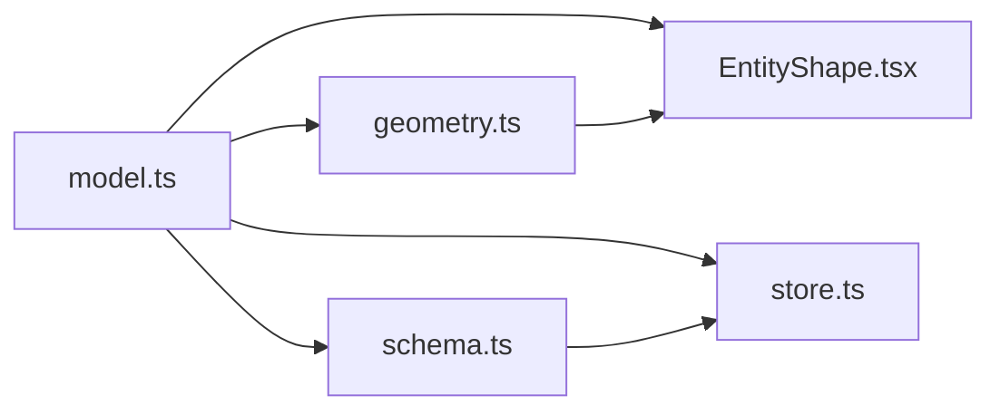

# 几何模型设计

<cite>
**本文引用的文件**   
- [model.ts](file://src/cad/model.ts)
- [geometry.ts](file://src/cad/geometry.ts)
- [example.ts](file://src/cad/example.ts)
- [EntityShape.tsx](file://src/components/EntityShape.tsx)
- [store.ts](file://src/features/editor/store.ts)
- [schema.ts](file://src/io/schema.ts)
- [geometry.test.ts](file://src/cad/geometry.test.ts)
</cite>

## 目录
1. [引言](#引言)
2. [项目结构](#项目结构)
3. [核心组件](#核心组件)
4. [架构总览](#架构总览)
5. [详细组件分析](#详细组件分析)
6. [依赖关系分析](#依赖关系分析)
7. [性能与扩展性](#性能与扩展性)
8. [故障排查指南](#故障排查指南)
9. [结论](#结论)
10. [附录：类型安全与扩展实践](#附录类型安全与扩展实践)

## 引言
本文件面向 web-cad 的几何模型设计，系统性说明以下主题：
- Entity 联合类型的设计模式与 discriminated union（区分联合）的类型安全机制
- Base 基接口在实体中的复用方式
- Point 坐标系统与屏幕/世界坐标转换
- Layer 图层管理与 Drawing 图纸主对象结构
- 几何计算、变换、吸附、求交等核心算法
- 如何创建和操作各类几何实体，以及如何扩展新的几何类型

## 项目结构
web-cad 的几何相关代码主要分布在 cad 层与 io 校验层，并在 UI 渲染层被消费。

**图表来源**
- [model.ts:1-61](file://src/cad/model.ts#L1-L61)
- [geometry.ts:1-443](file://src/cad/geometry.ts#L1-L443)
- [example.ts:1-102](file://src/cad/example.ts#L1-L102)
- [schema.ts:1-65](file://src/io/schema.ts#L1-L65)
- [EntityShape.tsx:1-59](file://src/components/EntityShape.tsx#L1-L59)
- [store.ts:73-129](file://src/features/editor/store.ts#L73-L129)

**章节来源**
- [model.ts:1-61](file://src/cad/model.ts#L1-L61)
- [geometry.ts:1-443](file://src/cad/geometry.ts#L1-L443)
- [example.ts:1-102](file://src/cad/example.ts#L1-L102)
- [schema.ts:1-65](file://src/io/schema.ts#L1-L65)
- [EntityShape.tsx:1-59](file://src/components/EntityShape.tsx#L1-L59)
- [store.ts:73-129](file://src/features/editor/store.ts#L73-L129)

## 核心组件
本节聚焦几何模型的核心数据结构与职责边界：
- Point：二维坐标点
- Layer：图层元数据
- Base：实体的公共字段基接口
- Entity：基于 discriminated union 的几何实体联合类型
- Drawing：图纸主对象，包含 layers、entities、view 等
- View：视图参数（平移与缩放）

这些类型共同构成类型安全的几何系统基础。

**章节来源**
- [model.ts:1-61](file://src/cad/model.ts#L1-L61)

## 架构总览
下图展示从“数据结构定义”到“几何计算”再到“UI 渲染”的整体流程。

**图表来源**
- [model.ts:1-61](file://src/cad/model.ts#L1-L61)
- [geometry.ts:1-443](file://src/cad/geometry.ts#L1-L443)
- [store.ts:73-129](file://src/features/editor/store.ts#L73-L129)
- [schema.ts:1-65](file://src/io/schema.ts#L1-L65)
- [EntityShape.tsx:1-59](file://src/components/EntityShape.tsx#L1-L59)

## 详细组件分析

### Point 坐标系统与坐标变换
- Point 是二维坐标的基本单元，所有几何实体均基于 Point 构建。
- geometry.ts 提供 add/sub/mul/dot/cross/distance/angle/polar 等向量运算工具。
- screenToWorld/worldToScreen 实现屏幕坐标与世界坐标的双向转换，配合 View 的 x/y/scale 完成视口变换。

**图表来源**
- [geometry.ts:31-42](file://src/cad/geometry.ts#L31-L42)

**章节来源**
- [model.ts:1-4](file://src/cad/model.ts#L1-L4)
- [geometry.ts:5-42](file://src/cad/geometry.ts#L5-L42)

### Layer 图层管理系统
- Layer 包含 id/name/color/visible/locked 等属性，用于组织与过滤实体。
- Drawing 默认创建三个图层：轮廓、辅助线、标注，并赋予不同颜色。
- cloneDrawing 会重新映射 layerId，确保副本独立。

**图表来源**
- [model.ts:5-11](file://src/cad/model.ts#L5-L11)
- [model.ts:51-61](file://src/cad/model.ts#L51-L61)
- [model.ts:82-117](file://src/cad/model.ts#L82-L117)
- [model.ts:118-141](file://src/cad/model.ts#L118-L141)

**章节来源**
- [model.ts:5-11](file://src/cad/model.ts#L5-L11)
- [model.ts:82-117](file://src/cad/model.ts#L82-L117)
- [model.ts:118-141](file://src/cad/model.ts#L118-L141)

### Base 基接口与 Entity 联合类型
- Base 抽象出实体的通用字段：id、layerId、color、strokeWidth。
- Entity 使用 discriminated union，以 type 字段作为区分标签，每个分支携带专属属性。
- 该设计保证在 switch/if 分支中 TypeScript 能精确推断实体属性，避免非法访问。

**图表来源**
- [model.ts:12-45](file://src/cad/model.ts#L12-L45)

**章节来源**
- [model.ts:12-45](file://src/cad/model.ts#L12-L45)

### Drawing 图纸主对象
- Drawing 聚合 layers/entities/view，并提供 createDrawing/cloneDrawing 工厂方法。
- store.ts 在 commit 时对 next 文档进行 schema 校验，失败则提示错误；成功则更新 history/future/revision。

**图表来源**
- [store.ts:79-100](file://src/features/editor/store.ts#L79-L100)
- [schema.ts:1-65](file://src/io/schema.ts#L1-L65)

**章节来源**
- [model.ts:51-61](file://src/cad/model.ts#L51-L61)
- [model.ts:82-117](file://src/cad/model.ts#L82-L117)
- [model.ts:118-141](file://src/cad/model.ts#L118-L141)
- [store.ts:79-100](file://src/features/editor/store.ts#L79-L100)

### 几何计算与变换
- geometry.ts 提供大量几何函数：
  - 弧相关：sweep/onArc/arcFromThree
  - 锚点与边界：anchors/bounds
  - 吸附：snap（支持网格、正交、对象吸附）
  - 变换：transform（移动/旋转/镜像），线段化 segments
  - 求交：intersections（直线/圆/圆弧）
- transform 会根据实体类型分别处理，矩形在旋转/反射时退化为闭合折线，尺寸标注在变换后可能转为 aligned 模式以保持测量语义。

**图表来源**
- [geometry.ts:253-327](file://src/cad/geometry.ts#L253-L327)

**章节来源**
- [geometry.ts:43-72](file://src/cad/geometry.ts#L43-L72)
- [geometry.ts:112-190](file://src/cad/geometry.ts#L112-L190)
- [geometry.ts:191-245](file://src/cad/geometry.ts#L191-L245)
- [geometry.ts:253-327](file://src/cad/geometry.ts#L253-L327)
- [geometry.ts:337-442](file://src/cad/geometry.ts#L337-L442)

### 渲染管线与类型分支
- EntityShape.tsx 根据 Entity.type 分支渲染对应 SVG 元素。
- 对于 arc，使用 polar/sweep 计算起点终点与 sweep 角，再绘制路径。
- 这种“按 type 分支”的模式与 discriminated union 紧密配合，保证编译期类型安全。

**图表来源**
- [EntityShape.tsx:20-59](file://src/components/EntityShape.tsx#L20-L59)
- [geometry.ts:43-54](file://src/cad/geometry.ts#L43-L54)

**章节来源**
- [EntityShape.tsx:1-59](file://src/components/EntityShape.tsx#L1-L59)

### 示例实体构造
- example.ts 展示了如何使用 Drawing.layers 为不同实体分配图层，并通过 uid 生成唯一 id。
- 示例包含多边形、圆、矩形、参考线、尺寸标注与文本，覆盖多种 Entity 类型。

**章节来源**
- [example.ts:1-102](file://src/cad/example.ts#L1-L102)

## 依赖关系分析
- model.ts 是类型与数据结构的单一事实来源，被 geometry.ts、EntityShape.tsx、store.ts、schema.ts 引用。
- geometry.ts 依赖 model.ts 的类型，但不反向依赖 UI 或存储层，保持纯函数特性。
- schema.ts 使用 zod.discriminatedUnion 对 Entity 进行运行时校验，与 model.ts 的类型定义保持一致。
- store.ts 在提交变更时调用 schema 校验，确保数据完整性。

**图表来源**
- [model.ts:1-61](file://src/cad/model.ts#L1-L61)
- [geometry.ts:1-443](file://src/cad/geometry.ts#L1-L443)
- [EntityShape.tsx:1-59](file://src/components/EntityShape.tsx#L1-L59)
- [store.ts:73-129](file://src/features/editor/store.ts#L73-L129)
- [schema.ts:1-65](file://src/io/schema.ts#L1-L65)

**章节来源**
- [model.ts:1-61](file://src/cad/model.ts#L1-L61)
- [geometry.ts:1-443](file://src/cad/geometry.ts#L1-L443)
- [EntityShape.tsx:1-59](file://src/components/EntityShape.tsx#L1-L59)
- [store.ts:73-129](file://src/features/editor/store.ts#L73-L129)
- [schema.ts:1-65](file://src/io/schema.ts#L1-L65)

## 性能与扩展性
- 复杂度概览
  - anchors/bounds：O(n) 遍历实体锚点或采样点，n 为顶点数或采样点数。
  - snap：O(E·A)，E 为实体数量，A 为每个实体的锚点数。
  - intersections：最坏 O(Sa·Sb)，Sa/Sb 为两实体的线段段数；圆/圆弧额外增加常数级计算。
- 优化建议
  - 对频繁查询的实体集合建立空间索引（如四叉树）以降低 snap/intersections 的扫描成本。
  - 将 bounds 结果缓存并按层分组，减少重复计算。
  - 对 arcs 的采样点数量可根据半径与精度阈值自适应调整。
- 扩展性
  - 新增几何类型需：
    1) 在 model.ts 的 Entity 联合类型中添加分支
    2) 在 geometry.ts 的 anchors/bounds/segments/transform 等函数中补充分支逻辑
    3) 在 schema.ts 的 discriminatedUnion 中添加 zod 校验规则
    4) 在 EntityShape.tsx 中添加渲染分支
  - 这样可在编译期与运行期同时保证类型安全与行为一致。

[本节为通用指导，不直接分析具体文件]

## 故障排查指南
- 常见错误与定位
  - 运行时数据超出允许范围：store.ts 在 commit 时若 zod 校验失败，会设置 message 提示。检查数值范围、实体数量、字符串长度等约束。
  - 类型不匹配：TypeScript 报错通常出现在未覆盖 Entity 的所有分支，或在未判定的分支中访问特定属性。确保对所有 type 分支进行处理。
  - 吸附异常：检查 ortho/grid/objects 开关与 base 点是否正确传入；确认 scale 与 step 参数合理。
  - 圆弧方向错误：检查 ccw 与 start/end 的顺序，以及 sweep 的计算是否符合预期。
- 调试建议
  - 使用 geometry.test.ts 中的用例作为基准，逐步验证各几何函数的正确性。
  - 在 EntityShape.tsx 中临时输出 e.type 与关键属性，确认渲染分支选择正确。
  - 在 store.ts 的 commit 前后打印 next 的结构，确认 layers/entities/view 的完整性。

**章节来源**
- [store.ts:79-100](file://src/features/editor/store.ts#L79-L100)
- [geometry.test.ts:1-298](file://src/cad/geometry.test.ts#L1-L298)

## 结论
web-cad 的几何模型以 discriminated union 为核心，结合 Base 基接口与 Point 坐标系统，构建了类型安全且可扩展的几何实体体系。Drawing 作为顶层容器统一管理图层与实体，geometry.ts 提供纯函数式的几何计算能力，EntityShape.tsx 负责按类型渲染，schema.ts 在运行时保障数据合法性。整体架构清晰、职责分明，便于后续扩展新的几何类型与功能。

[本节为总结性内容，不直接分析具体文件]

## 附录：类型安全与扩展实践

### 使用 discriminated union 的类型安全
- 所有几何实体共享 Base 公共字段，通过 type 字段区分具体类型。
- 在 switch/if 分支中，TypeScript 能自动收窄类型，从而安全访问专属属性。
- schema.ts 使用 zod.discriminatedUnion 与 model.ts 的类型一一对应，确保运行时数据与类型定义一致。

**章节来源**
- [model.ts:12-45](file://src/cad/model.ts#L12-L45)
- [schema.ts:14-65](file://src/io/schema.ts#L14-L65)

### 创建与操作几何实体的步骤
- 创建实体
  - 使用 model.ts 的 uid 生成 id，并从 Drawing.layers 中选择 layerId。
  - 根据实体类型填充必要属性（如 line 的 a/b，circle 的 center/radius）。
- 几何操作
  - 使用 geometry.ts 的 transform 进行移动/旋转/镜像。
  - 使用 anchors/bounds 获取控制点与包围盒。
  - 使用 snap 实现吸附，支持网格、正交与对象吸附。
  - 使用 intersections 计算两条实体的交点。
- 渲染
  - 在 EntityShape.tsx 中按 e.type 分支渲染对应 SVG 元素。

**章节来源**
- [example.ts:1-102](file://src/cad/example.ts#L1-L102)
- [geometry.ts:112-190](file://src/cad/geometry.ts#L112-L190)
- [geometry.ts:191-245](file://src/cad/geometry.ts#L191-L245)
- [geometry.ts:253-327](file://src/cad/geometry.ts#L253-L327)
- [geometry.ts:337-442](file://src/cad/geometry.ts#L337-L442)
- [EntityShape.tsx:20-59](file://src/components/EntityShape.tsx#L20-L59)