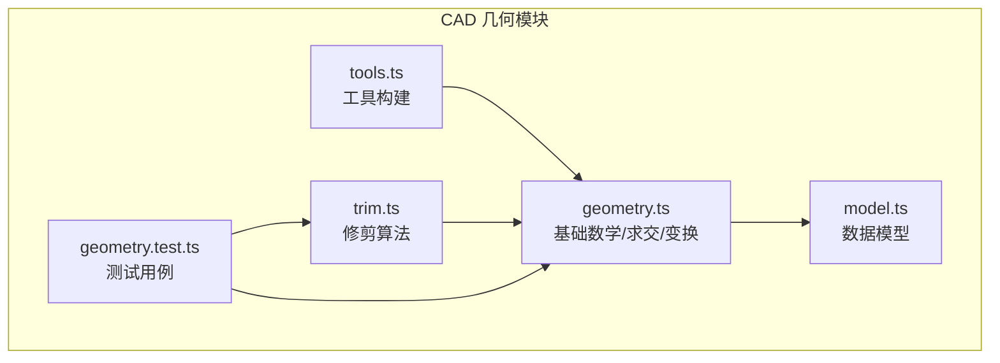
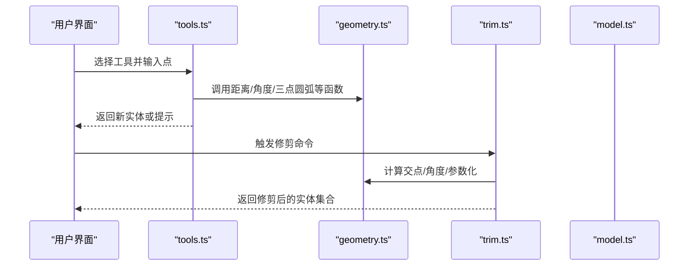
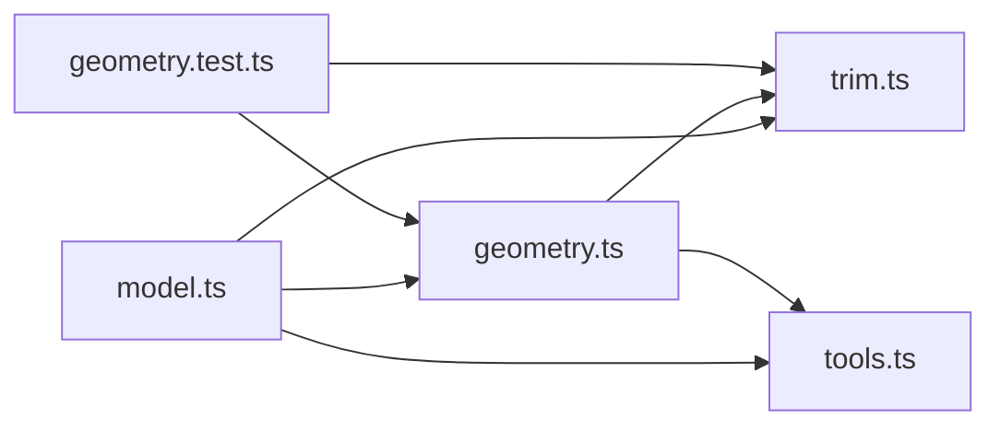

# 几何计算库

<cite>
**本文引用的文件**   
- [geometry.ts](file://src/cad/geometry.ts)
- [trim.ts](file://src/cad/trim.ts)
- [model.ts](file://src/cad/model.ts)
- [tools.ts](file://src/cad/tools.ts)
- [geometry.test.ts](file://src/cad/geometry.test.ts)
</cite>

## 目录
1. [简介](#简介)
2. [项目结构](#项目结构)
3. [核心组件](#核心组件)
4. [架构总览](#架构总览)
5. [详细组件分析](#详细组件分析)
6. [依赖关系分析](#依赖关系分析)
7. [性能与精度](#性能与精度)
8. [故障排查指南](#故障排查指南)
9. [结论](#结论)
10. [附录：常用公式与示例路径](#附录常用公式与示例路径)

## 简介
本文件为 web-cad 的几何计算库提供系统化文档，覆盖向量运算、坐标变换、距离与角度计算、点线关系判断、线与线交点、圆与圆相交检测、圆弧参数化与裁剪、吸附与对齐等能力。文档同时说明几何精度处理策略（EPS 容差）、浮点数比较方法，以及面向 CAD 场景的性能优化技巧，并给出可追溯的代码片段路径，帮助读者快速定位实现细节。

## 项目结构
几何相关代码集中在 src/cad 目录下：
- geometry.ts：基础数学函数、坐标变换、几何求交、实体边界与锚点、吸附与变换。
- trim.ts：基于交点的修剪算法，支持直线、圆与圆弧。
- model.ts：几何数据结构定义（Point、Entity、View、Drawing 等）。
- tools.ts：工具构建逻辑，使用几何库进行实体创建与校验。
- geometry.test.ts：几何功能测试用例，覆盖坐标逆变换、三点圆弧、交点、变换、尺寸数值等。

图表来源
- [geometry.ts:1-443](file://src/cad/geometry.ts#L1-L443)
- [trim.ts:1-129](file://src/cad/trim.ts#L1-L129)
- [model.ts:1-142](file://src/cad/model.ts#L1-L142)
- [tools.ts:1-126](file://src/cad/tools.ts#L1-L126)
- [geometry.test.ts:1-298](file://src/cad/geometry.test.ts#L1-L298)

章节来源
- [geometry.ts:1-443](file://src/cad/geometry.ts#L1-L443)
- [trim.ts:1-129](file://src/cad/trim.ts#L1-L129)
- [model.ts:1-142](file://src/cad/model.ts#L1-L142)
- [tools.ts:1-126](file://src/cad/tools.ts#L1-L126)
- [geometry.test.ts:1-298](file://src/cad/geometry.test.ts#L1-L298)

## 核心组件
- 基础数学与向量运算：加法、减法、数乘、点积、叉积、距离、角度、归一化角度、极坐标转换。
- 坐标系统：屏幕坐标与世界坐标互转、点旋转、镜像点。
- 几何构造：三点圆弧、矩形角点、标注几何信息。
- 实体操作：锚点提取、包围盒计算、线段分解、通用变换（平移/旋转/镜像）。
- 求交与判定：线段交点、线段与圆交点、圆与圆交点、点在弧上判定。
- 吸附与约束：对象吸附、网格对齐、正交约束。
- 修剪：按点击位置删除指定区段，支持直线、圆、圆弧。

章节来源
- [geometry.ts:1-443](file://src/cad/geometry.ts#L1-L443)
- [trim.ts:1-129](file://src/cad/trim.ts#L1-L129)

## 架构总览
几何库以“数据模型 + 纯函数”的方式组织，所有几何运算不依赖外部状态，便于测试与复用。上层工具层通过 geometry.ts 提供的函数完成实体构建与交互；修剪模块 trim.ts 在 geometry.ts 基础上实现更复杂的布尔式裁剪。

图表来源
- [tools.ts:1-126](file://src/cad/tools.ts#L1-L126)
- [geometry.ts:1-443](file://src/cad/geometry.ts#L1-L443)
- [trim.ts:1-129](file://src/cad/trim.ts#L1-L129)
- [model.ts:1-142](file://src/cad/model.ts#L1-L142)

## 详细组件分析

### 基础数学与向量运算
- 向量加减、数乘、点积、叉积：用于投影、方向判断、面积符号等。
- 距离与角度：hypot 计算欧氏距离；atan2 计算极角；normalize 将角度归一化到 [0, 2π)。
- 极坐标：polar 根据中心、半径和角度生成点。

复杂度与特性
- 时间复杂度 O(1)，空间复杂度 O(1)。
- 使用 EPS 容差避免浮点误差导致的误判。

章节来源
- [geometry.ts:3-30](file://src/cad/geometry.ts#L3-L30)

### 坐标系统与变换
- 屏幕坐标与世界坐标互转：screenToWorld 与 worldToScreen 支持缩放和平移，Y 轴翻转适配 Canvas。
- 点旋转：rotatePoint 围绕任意中心旋转。
- 镜像点：mirrorPoint 关于直线对称。

典型用法
- 视图变换：在渲染前将世界坐标转为屏幕坐标，在拾取时将屏幕坐标转回世界坐标。
- 几何编辑：对实体点进行统一旋转或镜像，保持几何一致性。

章节来源
- [geometry.ts:31-42](file://src/cad/geometry.ts#L31-L42)
- [geometry.ts:246-252](file://src/cad/geometry.ts#L246-L252)
- [geometry.ts:329-336](file://src/cad/geometry.ts#L329-L336)

### 几何构造与实体属性
- 三点圆弧：arcFromThree 由起点、中间点、终点确定圆心、半径、起止角与方向（顺时针/逆时针）。
- 矩形角点：corners 生成矩形的四个顶点。
- 标注几何：dimensionGeometry 计算水平/垂直/对齐标注的端点、中点、长度与旋转角度。

注意
- 三点共线时返回空结果，避免退化圆弧。
- 标注方向可由 direction 字段或自动推导。

章节来源
- [geometry.ts:55-72](file://src/cad/geometry.ts#L55-L72)
- [geometry.ts:73-80](file://src/cad/geometry.ts#L73-L80)
- [geometry.ts:81-111](file://src/cad/geometry.ts#L81-L111)

### 实体锚点、包围盒与线段分解
- 锚点 anchors：为不同实体类型生成关键采样点（端点、中点、象限点等），用于吸附与包围盒估算。
- 包围盒 bounds：根据锚点或圆弧象限点计算 minX/minY/maxX/maxY。
- 线段分解 segments：将多边形/折线/矩形拆分为线段数组，便于求交。

章节来源
- [geometry.ts:112-160](file://src/cad/geometry.ts#L112-L160)
- [geometry.ts:161-190](file://src/cad/geometry.ts#L161-L190)
- [geometry.ts:337-360](file://src/cad/geometry.ts#L337-L360)

### 通用变换与实体映射
- transform：对实体应用点级变换函数，并根据是否需要旋转/镜像调整类型与角度。
- 特殊处理：
  - 矩形旋转后转换为闭合折线。
  - 圆弧镜像会反转 ccw 方向。
  - 标注在旋转/镜像后可能转为对齐模式并更新 direction。

章节来源
- [geometry.ts:253-328](file://src/cad/geometry.ts#L253-L328)

### 吸附与约束
- snap：支持对象吸附、网格对齐、正交约束（ortho）与基准点（base）。
- 行为要点：
  - 对象吸附阈值随缩放 scale 动态调整。
  - 正交约束优先于网格与非共线对象吸附。
  - 吸附结果包含是否发生吸附的标志位。

章节来源
- [geometry.ts:191-245](file://src/cad/geometry.ts#L191-L245)

### 求交与几何判定
- 线段交点 lineIntersection：使用叉积判别平行与比例 t/s，考虑 EPS 容差。
- 线段与圆交点 lineCircle：求解二次方程判别式，过滤在线段范围内的解。
- 圆与圆交点：通过两圆圆心距离与半径关系计算交点。
- 点在弧上 onArc：基于起始角、终止角与扫描方向判断。
- 综合求交 intersections：组合线段-线段、线段-圆、圆-圆，并对圆弧做范围过滤。

章节来源
- [geometry.ts:361-442](file://src/cad/geometry.ts#L361-L442)

### 修剪算法
- trimEntity：根据目标实体类型分别处理：
  - 直线：计算交点参数 t，按点击位置决定删除区间，返回剩余子段。
  - 圆/圆弧：将交点映射到角度参数，按点击位置删除对应角度区间，返回剩余弧段。
- 去重与容差：unique 使用 EPS 去除重复切割点。

章节来源
- [trim.ts:1-129](file://src/cad/trim.ts#L1-L129)

### 工具构建与几何校验
- buildEntity：根据工具类型与输入点构建实体，使用 distance 与 EPS 校验无效输入（如两点重合）。
- 三点圆弧：调用 arcFromThree 生成圆弧实体。

章节来源
- [tools.ts:49-125](file://src/cad/tools.ts#L49-L125)

## 依赖关系分析
- geometry.ts 是核心，被 tools.ts 与 trim.ts 引用。
- model.ts 提供 Point、Entity、View 等类型定义，被 geometry.ts、trim.ts、tools.ts 共同引用。
- geometry.test.ts 验证 geometry.ts 与 trim.ts 的行为。

图表来源
- [model.ts:1-142](file://src/cad/model.ts#L1-L142)
- [geometry.ts:1-443](file://src/cad/geometry.ts#L1-L443)
- [trim.ts:1-129](file://src/cad/trim.ts#L1-L129)
- [tools.ts:1-126](file://src/cad/tools.ts#L1-L126)
- [geometry.test.ts:1-298](file://src/cad/geometry.test.ts#L1-L298)

## 性能与精度

### 几何精度与浮点比较策略
- 全局常量 EPS = 1e-7 用于多数几何比较（平行、共线、相等、范围判断）。
- normalize 角度归一化避免跨 2π 分支错误。
- unique 使用 EPS 去重，防止微小差异导致冗余切割。

建议
- 在扩展新算法时，尽量使用 EPS 容差而非严格等于。
- 对角度比较先归一化再比较，减少边界分支问题。

章节来源
- [geometry.ts:3-4](file://src/cad/geometry.ts#L3-L4)
- [geometry.ts:24](file://src/cad/geometry.ts#L24)
- [trim.ts:16-20](file://src/cad/trim.ts#L16-L20)

### 性能优化技巧
- 向量化思维：尽量用点积/叉积替代三角函数，减少昂贵计算。
- 早退策略：在求交前先判断平行/不相交条件，避免无谓计算。
- 批量处理：segments 将复杂实体拆解为线段，便于循环内统一处理。
- 缓存与复用：anchors/bounds 仅用于辅助计算，避免重复构造。

章节来源
- [geometry.ts:361-442](file://src/cad/geometry.ts#L361-L442)
- [geometry.ts:337-360](file://src/cad/geometry.ts#L337-L360)

## 故障排查指南
常见问题与定位思路
- 三点圆弧为空：检查三点是否近似共线（arcFromThree 返回 null）。
- 交点缺失：确认 EPS 容差设置是否合理；检查线段参数 t/s 是否在 [0,1] 范围内。
- 圆弧判定异常：确保角度已归一化，且 ccw 方向正确。
- 吸附失效：检查 scale 与 ortho/base 参数；确认对象锚点是否正确生成。
- 修剪未生效：确认点击位置对应的参数区间是否落在有效切割区间内。

参考测试用例
- 屏幕/世界坐标逆变换、三点圆弧方向与范围、对象吸附与正交约束、直线/圆/圆弧交点、变换与镜像、尺寸数值与旋转/镜像不变性、修剪行为等。

章节来源
- [geometry.test.ts:35-239](file://src/cad/geometry.test.ts#L35-L239)
- [geometry.test.ts:241-297](file://src/cad/geometry.test.ts#L241-L297)

## 结论
该几何计算库以简洁的纯函数接口提供 CAD 常用的数学与几何能力，涵盖从基础向量运算到高级求交与修剪的全链路需求。通过统一的 EPS 容差策略与清晰的实体抽象，既保证了数值稳定性，也便于扩展与维护。建议在新增几何功能时遵循现有模式：明确输入输出、使用 EPS 容差、提供单元测试覆盖边界情况。

## 附录：常用公式与示例路径

- 向量运算
  - 加法/减法/数乘/点积/叉积/距离/角度/归一化角度/极坐标
  - 示例路径：[geometry.ts:5-30](file://src/cad/geometry.ts#L5-L30)

- 坐标变换
  - 屏幕↔世界坐标、点旋转、镜像点
  - 示例路径：[geometry.ts:31-42](file://src/cad/geometry.ts#L31-L42), [geometry.ts:246-252](file://src/cad/geometry.ts#L246-L252), [geometry.ts:329-336](file://src/cad/geometry.ts#L329-L336)

- 几何构造
  - 三点圆弧、矩形角点、标注几何
  - 示例路径：[geometry.ts:55-111](file://src/cad/geometry.ts#L55-L111)

- 实体操作
  - 锚点、包围盒、线段分解、通用变换
  - 示例路径：[geometry.ts:112-190](file://src/cad/geometry.ts#L112-L190), [geometry.ts:253-328](file://src/cad/geometry.ts#L253-L328), [geometry.ts:337-360](file://src/cad/geometry.ts#L337-L360)

- 求交与判定
  - 线段交点、线段与圆、圆与圆、点在弧上
  - 示例路径：[geometry.ts:361-442](file://src/cad/geometry.ts#L361-L442)

- 吸附与约束
  - 对象吸附、网格对齐、正交约束
  - 示例路径：[geometry.ts:191-245](file://src/cad/geometry.ts#L191-L245)

- 修剪
  - 直线/圆/圆弧修剪
  - 示例路径：[trim.ts:21-128](file://src/cad/trim.ts#L21-L128)

- 工具构建
  - 实体构建与校验
  - 示例路径：[tools.ts:49-125](file://src/cad/tools.ts#L49-L125)