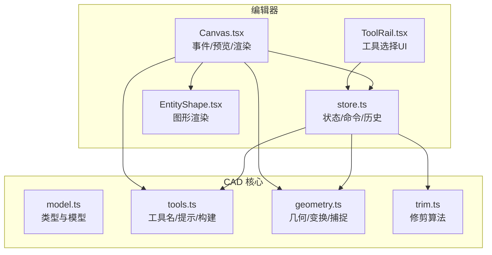
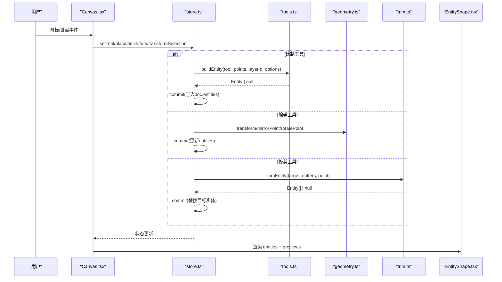
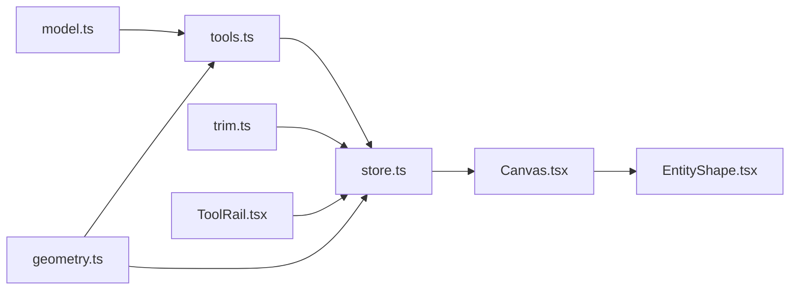

# 绘图工具系统

<cite>
**本文引用的文件**   
- [src/cad/model.ts](file://src/cad/model.ts)
- [src/cad/tools.ts](file://src/cad/tools.ts)
- [src/cad/geometry.ts](file://src/cad/geometry.ts)
- [src/cad/trim.ts](file://src/cad/trim.ts)
- [src/features/editor/store.ts](file://src/features/editor/store.ts)
- [src/features/editor/Canvas.tsx](file://src/features/editor/Canvas.tsx)
- [src/features/editor/ToolRail.tsx](file://src/features/editor/ToolRail.tsx)
- [src/components/EntityShape.tsx](file://src/components/EntityShape.tsx)
</cite>

## 目录
1. [简介](#简介)
2. [项目结构](#项目结构)
3. [核心组件](#核心组件)
4. [架构总览](#架构总览)
5. [详细组件分析](#详细组件分析)
6. [依赖关系分析](#依赖关系分析)
7. [性能与可扩展性](#性能与可扩展性)
8. [故障排查指南](#故障排查指南)
9. [结论](#结论)
10. [附录：扩展自定义工具](#附录扩展自定义工具)

## 简介
本文件系统性地梳理 web-cad 的绘图工具体系，覆盖以下方面：
- Tool 类型定义与工具分类（绘制、注释、编辑）
- 各工具的交互流程、状态管理与鼠标事件处理机制
- 几何计算、捕捉、预览与实体构建逻辑
- 修剪算法与变换操作（移动、复制、旋转、镜像）
- 如何扩展新工具以及注册与执行流程

该文档面向开发者与使用者，既提供代码级细节，也给出概念化说明，帮助快速理解并扩展系统。

## 项目结构
围绕绘图工具的核心代码分布在以下模块：
- 数据模型与工具枚举：model.ts
- 工具名称、提示与实体构建：tools.ts
- 几何计算与变换：geometry.ts
- 修剪算法：trim.ts
- 编辑器状态与命令：store.ts
- 画布交互与渲染：Canvas.tsx
- 工具栏 UI：ToolRail.tsx
- 图形渲染：EntityShape.tsx

图表来源
- [src/cad/model.ts:18-75](file://src/cad/model.ts#L18-L75)
- [src/cad/tools.ts:5-48](file://src/cad/tools.ts#L5-L48)
- [src/cad/geometry.ts:191-245](file://src/cad/geometry.ts#L191-L245)
- [src/cad/trim.ts:21-128](file://src/cad/trim.ts#L21-L128)
- [src/features/editor/store.ts:17-47](file://src/features/editor/store.ts#L17-L47)
- [src/features/editor/Canvas.tsx:180-328](file://src/features/editor/Canvas.tsx#L180-L328)
- [src/features/editor/ToolRail.tsx:21-58](file://src/features/editor/ToolRail.tsx#L21-L58)
- [src/components/EntityShape.tsx:1-96](file://src/components/EntityShape.tsx#L1-L96)

章节来源
- [src/cad/model.ts:18-75](file://src/cad/model.ts#L18-L75)
- [src/cad/tools.ts:5-48](file://src/cad/tools.ts#L5-L48)
- [src/features/editor/ToolRail.tsx:21-58](file://src/features/editor/ToolRail.tsx#L21-L58)

## 核心组件
- 数据模型与工具类型
  - Point、Layer、View、Drawing、Entity、Tool 等类型定义在 model.ts，Tool 是绘图画布所有工具的统一枚举。
- 工具元数据与构建器
  - tools.ts 提供 toolNames（工具中文名称）、hint（交互提示）和 buildEntity（根据当前工具与点序列生成 Entity）。
- 几何与变换
  - geometry.ts 提供点运算、坐标转换、捕捉 snap、实体变换 transform、镜像 mirrorPoint、线段/圆/圆弧求交 intersections 等。
- 修剪
  - trim.ts 实现 trimEntity，基于目标与裁剪边界的交点，按点击位置决定保留区段。
- 编辑器状态
  - store.ts 维护 doc、selected、tool、points、message 等状态，并提供 place、finish、trim、transformSelection、undo/redo 等命令。
- 画布交互
  - Canvas.tsx 监听指针事件、键盘快捷键，驱动预览与最终提交；同时负责视图缩放平移、网格与标尺绘制。
- 工具栏
  - ToolRail.tsx 将工具分组展示，绑定 setTool 到 UI 按钮。
- 渲染
  - EntityShape.tsx 将 Entity 渲染为 SVG 元素，支持直线、矩形、折线、圆、圆弧、文字、尺寸标注。

章节来源
- [src/cad/model.ts:18-75](file://src/cad/model.ts#L18-L75)
- [src/cad/tools.ts:5-125](file://src/cad/tools.ts#L5-L125)
- [src/cad/geometry.ts:191-443](file://src/cad/geometry.ts#L191-L443)
- [src/cad/trim.ts:21-128](file://src/cad/trim.ts#L21-L128)
- [src/features/editor/store.ts:17-324](file://src/features/editor/store.ts#L17-L324)
- [src/features/editor/Canvas.tsx:180-328](file://src/features/editor/Canvas.tsx#L180-L328)
- [src/features/editor/ToolRail.tsx:21-58](file://src/features/editor/ToolRail.tsx#L21-L58)
- [src/components/EntityShape.tsx:1-96](file://src/components/EntityShape.tsx#L1-L96)

## 架构总览
下图展示了从用户交互到状态变更再到渲染更新的完整链路。

图表来源
- [src/features/editor/Canvas.tsx:196-328](file://src/features/editor/Canvas.tsx#L196-L328)
- [src/features/editor/store.ts:187-315](file://src/features/editor/store.ts#L187-L315)
- [src/cad/tools.ts:49-125](file://src/cad/tools.ts#L49-L125)
- [src/cad/geometry.ts:253-336](file://src/cad/geometry.ts#L253-L336)
- [src/cad/trim.ts:21-128](file://src/cad/trim.ts#L21-L128)
- [src/components/EntityShape.tsx:1-96](file://src/components/EntityShape.tsx#L1-L96)

## 详细组件分析

### 工具类型与分类
- 绘制类：line、polyline、rectangle、circle、arc
- 注释类：text、dimension
- 编辑类：move、copy、rotate、mirror、trim
- 选择类：select

这些工具在 model.ts 中通过 Tool 联合类型统一声明，并在 tools.ts 中以 toolNames 提供中文显示名，在 ToolRail.tsx 中分组展示。

章节来源
- [src/cad/model.ts:62-75](file://src/cad/model.ts#L62-L75)
- [src/cad/tools.ts:5-19](file://src/cad/tools.ts#L5-L19)
- [src/features/editor/ToolRail.tsx:21-58](file://src/features/editor/ToolRail.tsx#L21-L58)

### 工具状态管理
- 当前工具：store.tool
- 临时点序列：store.points（用于多步绘制或变换参数）
- 选中集合：store.selected
- 消息提示：store.message（用于错误与引导）
- 视图与栅格：store.view、grid、objects、ortho、gridStep
- 文本与标注属性：store.text、store.textSize、store.dimensionMode、store.rotation

setTool 会清空 points 与 message，确保工具切换时状态干净。

章节来源
- [src/features/editor/store.ts:17-47](file://src/features/editor/store.ts#L17-L47)
- [src/features/editor/store.ts:111-111](file://src/features/editor/store.ts#L111-L111)

### 鼠标事件与交互流程
Canvas.tsx 集中处理：
- 滚轮缩放：以光标为中心调整 scale 与偏移
- 键盘快捷键：Space 平移、Ctrl/Cmd+Z/Y 撤销重做、A 全选、Esc 取消、Delete/Backspace 删除、Enter 完成折线、V/L/P/R/C/A/T/D/M 快捷选工具
- 指针事件：
  - 中键或按住 Space：平移画布
  - 非 select 工具：调用 store.place 放置点
  - select 工具：单选/多选/框选，支持 Shift 累加
  - trim 工具：直接触发 store.trim

预览逻辑：
- 使用 buildEntity 结合当前 cursor 生成预览实体
- move/copy/mirror/rotate 对已选实体进行实时预览变换

章节来源
- [src/features/editor/Canvas.tsx:62-93](file://src/features/editor/Canvas.tsx#L62-L93)
- [src/features/editor/Canvas.tsx:94-179](file://src/features/editor/Canvas.tsx#L94-L179)
- [src/features/editor/Canvas.tsx:196-328](file://src/features/editor/Canvas.tsx#L196-L328)
- [src/features/editor/Canvas.tsx:355-389](file://src/features/editor/Canvas.tsx#L355-L389)

### 绘制工具详解

#### select（选择）
- 行为：单击选择、Shift 多选、空白处拖拽框选
- 实现：Canvas.down 中识别 data-entity，更新 selected；box 手势计算包围盒筛选实体

章节来源
- [src/features/editor/Canvas.tsx:227-262](file://src/features/editor/Canvas.tsx#L227-L262)
- [src/features/editor/Canvas.tsx:298-327](file://src/features/editor/Canvas.tsx#L298-L327)

#### line（直线）
- 输入：起点 a、终点 b
- 构建：buildEntity('line', [a,b])
- 校验：两点距离需大于 EPS

章节来源
- [src/cad/tools.ts:79-82](file://src/cad/tools.ts#L79-L82)

#### polyline（折线）
- 输入：多点序列，Enter 完成
- 构建：buildEntity('polyline', points)，closed=false
- 完成：store.finish 检查点数并构建

章节来源
- [src/cad/tools.ts:96-103](file://src/cad/tools.ts#L96-L103)
- [src/features/editor/store.ts:265-286](file://src/features/editor/store.ts#L265-L286)

#### rectangle（矩形）
- 输入：对角点 a、b
- 构建：buildEntity('rectangle', [a,b])，要求 x/y 差值均大于 EPS

章节来源
- [src/cad/tools.ts:83-87](file://src/cad/tools.ts#L83-L87)

#### circle（圆）
- 输入：圆心 a、圆周点 b
- 构建：buildEntity('circle', [a,b])，半径=distance(a,b)

章节来源
- [src/cad/tools.ts:88-95](file://src/cad/tools.ts#L88-L95)

#### arc（三点圆弧）
- 输入：起点 a、经过点 mid、终点 b
- 构建：arcFromThree 计算圆心、半径、起止角与方向 ccw

章节来源
- [src/cad/tools.ts:104-113](file://src/cad/tools.ts#L104-L113)
- [src/cad/geometry.ts:55-72](file://src/cad/geometry.ts#L55-L72)

#### text（文字）
- 输入：插入点 at，配合 store.text、store.textSize
- 构建：buildEntity('text', [at])，忽略空文本

章节来源
- [src/cad/tools.ts:67-78](file://src/cad/tools.ts#L67-L78)

#### dimension（尺寸标注）
- 输入：测量点 a、b，标注位置 at，mode 可选 horizontal/vertical/aligned
- 构建：buildEntity('dimension', [a,b,at])

章节来源
- [src/cad/tools.ts:114-123](file://src/cad/tools.ts#L114-L123)

### 编辑工具详解

#### move（移动）
- 流程：先选实体 -> 点击基准点 -> 点击目标点 -> 应用位移
- 实现：store.place 收集两点后，transformSelection(e => transform(e, p => add(p, delta)))

章节来源
- [src/features/editor/store.ts:192-233](file://src/features/editor/store.ts#L192-L233)

#### copy（复制）
- 流程：同 move，但 transformSelection(..., copy=true) 生成新 ID 并追加实体

章节来源
- [src/features/editor/store.ts:160-186](file://src/features/editor/store.ts#L160-L186)
- [src/features/editor/store.ts:226-231](file://src/features/editor/store.ts#L226-L231)

#### rotate（旋转）
- 流程：先选实体 -> 点击旋转中心 -> 属性面板设置角度 -> 点击确认
- 实现：transformSelection(e => transform(e, p => rotatePoint(p, center, rad)))

章节来源
- [src/features/editor/store.ts:197-206](file://src/features/editor/store.ts#L197-L206)
- [src/cad/geometry.ts:246-252](file://src/cad/geometry.ts#L246-L252)

#### mirror（镜像）
- 流程：先选实体 -> 点击镜像轴起点 -> 点击第二点 -> 应用镜像
- 实现：transformSelection(e => transform(e, p => mirrorPoint(p, a, b), angle, reflected=true))

章节来源
- [src/features/editor/store.ts:212-225](file://src/features/editor/store.ts#L212-L225)
- [src/cad/geometry.ts:329-336](file://src/cad/geometry.ts#L329-L336)

#### trim（修剪）
- 流程：选择修剪工具 -> 点击目标实体待移除区段 -> 可见几何作为边界
- 实现：store.trim -> trimEntity(target, visibleEntities, click)

章节来源
- [src/features/editor/store.ts:287-315](file://src/features/editor/store.ts#L287-L315)
- [src/cad/trim.ts:21-128](file://src/cad/trim.ts#L21-L128)

### 几何与捕捉
- 坐标转换：screenToWorld/worldToScreen
- 捕捉：snap 支持对象锚点、网格对齐、正交模式、最近点吸附
- 变换：transform 支持 line/rectangle/polyline/circle/arc/text/dimension 的点集变换
- 求交：intersections 支持线段-线段、线段-圆/弧、圆-圆/弧

章节来源
- [src/cad/geometry.ts:31-42](file://src/cad/geometry.ts#L31-L42)
- [src/cad/geometry.ts:191-245](file://src/cad/geometry.ts#L191-L245)
- [src/cad/geometry.ts:253-336](file://src/cad/geometry.ts#L253-L336)
- [src/cad/geometry.ts:401-442](file://src/cad/geometry.ts#L401-L442)

### 渲染与预览
- 实体渲染：EntityShape.tsx 根据 type 输出对应 SVG 元素
- 预览：Canvas.tsx 使用 buildEntity 生成预览，并对 move/copy/mirror/rotate 进行实时变换预览
- 选择高亮与锚点：选中实体显示锚点方块，便于精确操作

章节来源
- [src/components/EntityShape.tsx:1-96](file://src/components/EntityShape.tsx#L1-L96)
- [src/features/editor/Canvas.tsx:355-389](file://src/features/editor/Canvas.tsx#L355-L389)
- [src/features/editor/Canvas.tsx:443-497](file://src/features/editor/Canvas.tsx#L443-L497)

## 依赖关系分析

图表来源
- [src/cad/model.ts:18-75](file://src/cad/model.ts#L18-L75)
- [src/cad/tools.ts:1-125](file://src/cad/tools.ts#L1-L125)
- [src/cad/geometry.ts:1-443](file://src/cad/geometry.ts#L1-L443)
- [src/cad/trim.ts:1-129](file://src/cad/trim.ts#L1-L129)
- [src/features/editor/store.ts:1-324](file://src/features/editor/store.ts#L1-L324)
- [src/features/editor/Canvas.tsx:1-652](file://src/features/editor/Canvas.tsx#L1-L652)
- [src/features/editor/ToolRail.tsx:1-96](file://src/features/editor/ToolRail.tsx#L1-L96)
- [src/components/EntityShape.tsx:1-96](file://src/components/EntityShape.tsx#L1-L96)

章节来源
- [src/cad/model.ts:18-75](file://src/cad/model.ts#L18-L75)
- [src/cad/tools.ts:1-125](file://src/cad/tools.ts#L1-L125)
- [src/cad/geometry.ts:1-443](file://src/cad/geometry.ts#L1-L443)
- [src/cad/trim.ts:1-129](file://src/cad/trim.ts#L1-L129)
- [src/features/editor/store.ts:1-324](file://src/features/editor/store.ts#L1-L324)
- [src/features/editor/Canvas.tsx:1-652](file://src/features/editor/Canvas.tsx#L1-L652)
- [src/features/editor/ToolRail.tsx:1-96](file://src/features/editor/ToolRail.tsx#L1-L96)
- [src/components/EntityShape.tsx:1-96](file://src/components/EntityShape.tsx#L1-L96)

## 性能与可扩展性
- 性能要点
  - 捕捉与求交：大量实体的 anchors 遍历与线段求交可能成为热点，建议在大规模图纸中考虑空间索引或视口裁剪优化。
  - 预览与渲染：预览实体仅用于交互反馈，避免频繁重建复杂路径；必要时可合并预览路径。
  - 历史栈：commit 限制 history 长度（最近 99 次），避免内存增长。
- 可扩展性
  - 新增工具建议遵循现有模式：在 Tool 类型中添加、在 tools.ts 补充 hint/buildEntity、在 Canvas.tsx 与 store.ts 中增加交互分支。
  - 工具组与快捷键：在 ToolRail.tsx 与 Canvas.tsx 的快捷键映射中同步添加。

[本节为通用指导，不直接分析具体文件]

## 故障排查指南
- 无法创建实体
  - 现象：提示“无法构建图形：请检查点的位置或文字内容”
  - 原因：buildEntity 返回 null（如两点重合、矩形退化、圆弧三点共线、文字为空）
  - 解决：检查点的间距是否大于 EPS，或修正文字内容
  - 参考：[src/cad/tools.ts:79-80](file://src/cad/tools.ts#L79-L80)、[src/cad/tools.ts:67-78](file://src/cad/tools.ts#L67-L78)
- 图层不可编辑
  - 现象：提示“当前图层隐藏或已锁定，请切换图层”
  - 原因：activeLayer.locked 或 !visible
  - 解决：切换到可见且未锁定的图层
  - 参考：[src/features/editor/store.ts:235-239](file://src/features/editor/store.ts#L235-L239)
- 修剪无效
  - 现象：提示“没有有效交点，或目标不是直线、圆、圆弧”
  - 原因：trimEntity 找不到有效切割点或目标类型不支持
  - 解决：确保存在可见边界实体并与目标相交
  - 参考：[src/features/editor/store.ts:303-305](file://src/features/editor/store.ts#L303-L305)、[src/cad/trim.ts:21-128](file://src/cad/trim.ts#L21-L128)
- 变换失败
  - 现象：提示“先用选择工具选中图形，再进行变换”
  - 原因：editableSelection 为空（无选中或未解锁可见层）
  - 解决：先选择实体并确保图层可见未锁定
  - 参考：[src/features/editor/store.ts:192-196](file://src/features/editor/store.ts#L192-L196)、[src/features/editor/store.ts:317-323](file://src/features/editor/store.ts#L317-L323)

章节来源
- [src/cad/tools.ts:79-80](file://src/cad/tools.ts#L79-L80)
- [src/cad/tools.ts:67-78](file://src/cad/tools.ts#L67-L78)
- [src/features/editor/store.ts:235-239](file://src/features/editor/store.ts#L235-L239)
- [src/features/editor/store.ts:303-305](file://src/features/editor/store.ts#L303-L305)
- [src/features/editor/store.ts:192-196](file://src/features/editor/store.ts#L192-L196)
- [src/features/editor/store.ts:317-323](file://src/features/editor/store.ts#L317-L323)
- [src/cad/trim.ts:21-128](file://src/cad/trim.ts#L21-L128)

## 结论
web-cad 的工具系统以简洁的类型系统与清晰的职责划分为核心：
- model.ts 定义统一的数据结构与工具枚举
- tools.ts 提供工具元数据与实体构建
- geometry.ts 提供几何与变换能力
- trim.ts 专注修剪算法
- store.ts 统一管理状态与命令
- Canvas.tsx 负责交互与预览
- ToolRail.tsx 与 EntityShape.tsx 分别承担 UI 与渲染

该设计使新增工具具备良好扩展点，同时保持交互一致性与代码可维护性。

[本节为总结，不直接分析具体文件]

## 附录：扩展自定义工具
以下步骤演示如何新增一个名为 “ellipse”（椭圆）的绘制工具：

1. 扩展 Tool 类型
   - 在 model.ts 的 Tool 联合类型中添加 'ellipse'
   - 参考：[src/cad/model.ts:62-75](file://src/cad/model.ts#L62-L75)

2. 添加工具名称与提示
   - 在 tools.ts 的 toolNames 中添加 'ellipse': '椭圆'
   - 在 hint 函数中为 'ellipse' 添加提示，例如“点击长轴端点，再点击短轴端点”
   - 参考：[src/cad/tools.ts:5-19](file://src/cad/tools.ts#L5-L19)、[src/cad/tools.ts:20-48](file://src/cad/tools.ts#L20-L48)

3. 实现实体构建
   - 在 buildEntity 中增加 'ellipse' 分支，接收两个点（长轴端点与短轴端点），计算半长轴、半短轴与旋转角，构造新的 Entity 变体
   - 若需要，先在 model.ts 中扩展 Entity 联合类型以容纳椭圆数据结构
   - 参考：[src/cad/tools.ts:49-125](file://src/cad/tools.ts#L49-L125)、[src/cad/model.ts:18-45](file://src/cad/model.ts#L18-L45)

4. 更新工具栏
   - 在 ToolRail.tsx 的 groups 中添加 ellipse 工具项，可选择图标与快捷键
   - 参考：[src/features/editor/ToolRail.tsx:21-58](file://src/features/editor/ToolRail.tsx#L21-L58)

5. 绑定快捷键
   - 在 Canvas.tsx 的键盘事件中为 'e' 映射到 'ellipse'
   - 参考：[src/features/editor/Canvas.tsx:149-165](file://src/features/editor/Canvas.tsx#L149-L165)

6. 渲染支持
   - 在 EntityShape.tsx 中为椭圆类型添加渲染逻辑（SVG path 或组合图形）
   - 参考：[src/components/EntityShape.tsx:1-96](file://src/components/EntityShape.tsx#L1-L96)

7. 交互与预览
   - 在 Canvas.tsx 的预览逻辑中，根据当前 points 与 cursor 构建椭圆预览
   - 在 store.ts 的 place/finish 中处理椭圆的两点输入与最终提交
   - 参考：[src/features/editor/Canvas.tsx:355-389](file://src/features/editor/Canvas.tsx#L355-L389)、[src/features/editor/store.ts:187-264](file://src/features/editor/store.ts#L187-L264)

8. 测试与验证
   - 验证新建椭圆的几何正确性、预览一致性、渲染效果与快捷键可用性
   - 如有需要，补充单元测试或端到端测试

通过以上步骤，即可在不破坏既有架构的前提下，平滑扩展新的工具类型。