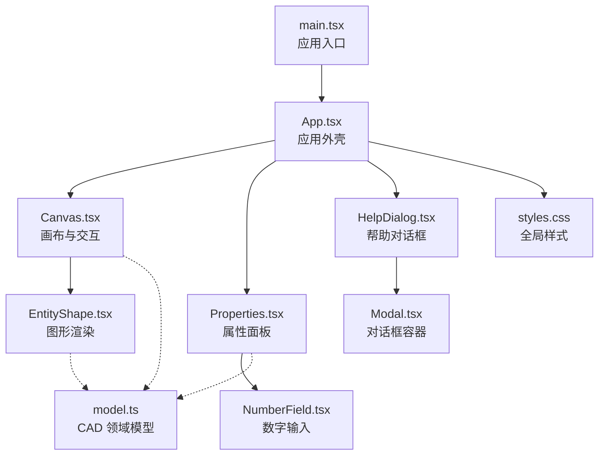
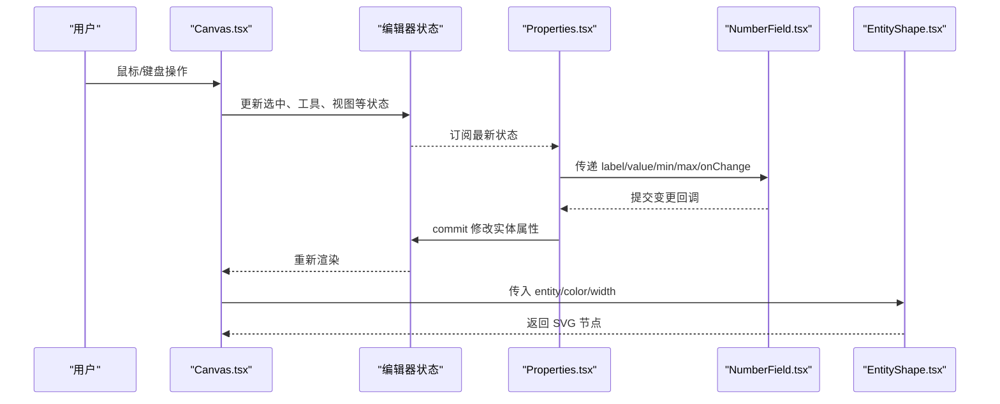
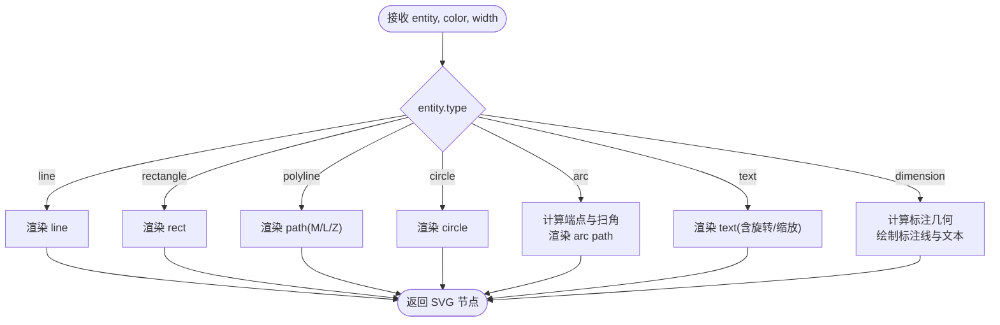
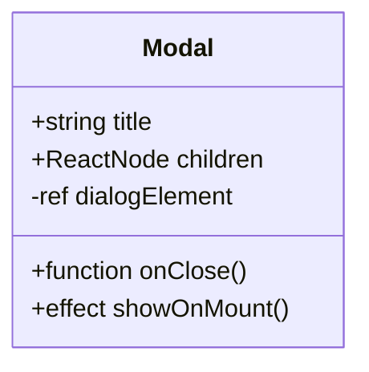
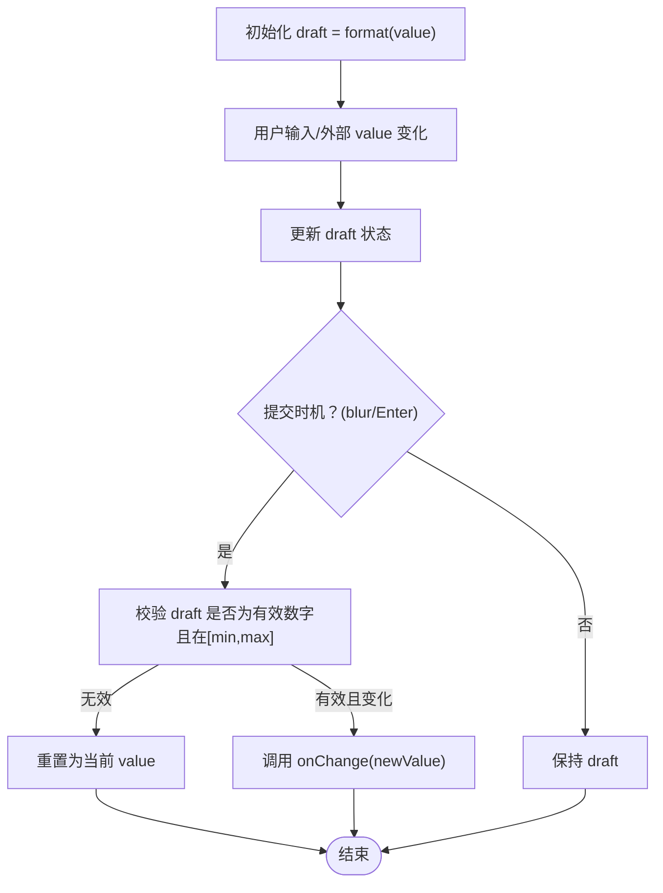
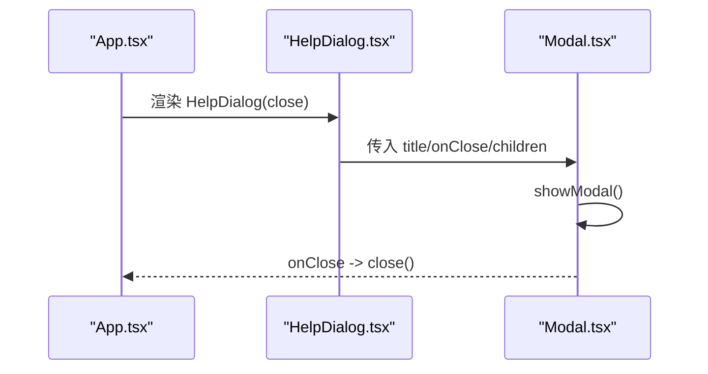
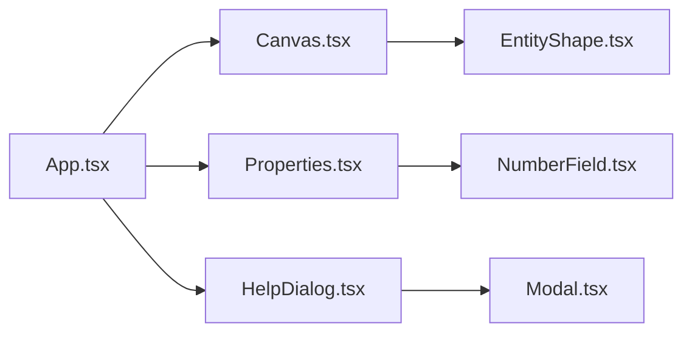
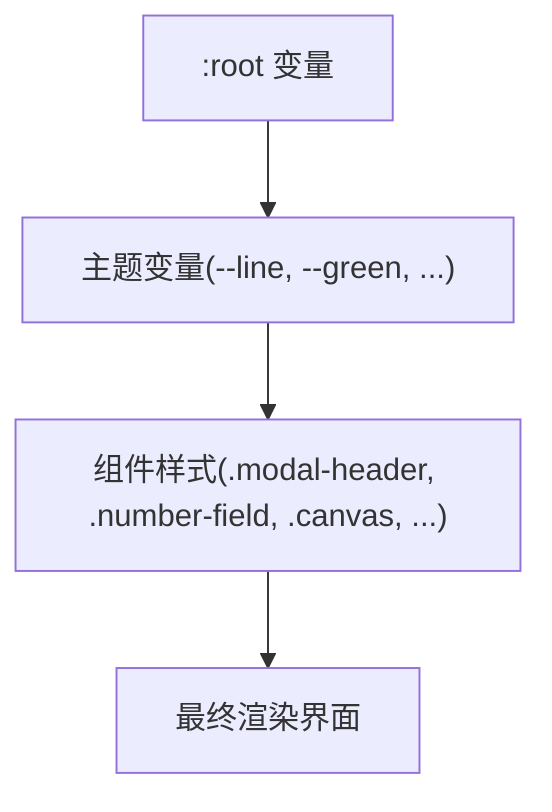
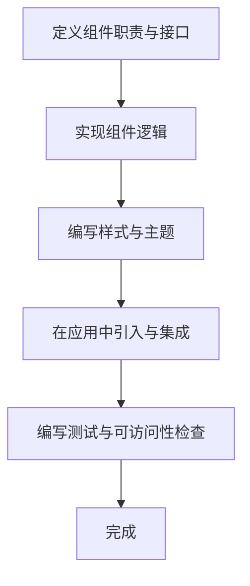

# UI组件架构

<cite>
**本文引用的文件**   
- [src/components/EntityShape.tsx](file://src/components/EntityShape.tsx)
- [src/components/Modal.tsx](file://src/components/Modal.tsx)
- [src/components/NumberField.tsx](file://src/components/NumberField.tsx)
- [src/components/HelpDialog.tsx](file://src/components/HelpDialog.tsx)
- [src/features/editor/Canvas.tsx](file://src/features/editor/Canvas.tsx)
- [src/features/editor/Properties.tsx](file://src/features/editor/Properties.tsx)
- [src/app/App.tsx](file://src/app/App.tsx)
- [src/main.tsx](file://src/main.tsx)
- [src/app/styles.css](file://src/app/styles.css)
- [src/cad/model.ts](file://src/cad/model.ts)
</cite>

## 目录
1. [引言](#引言)
2. [项目结构](#项目结构)
3. [核心组件](#核心组件)
4. [架构总览](#架构总览)
5. [详细组件分析](#详细组件分析)
6. [依赖关系分析](#依赖关系分析)
7. [性能与可维护性](#性能与可维护性)
8. [样式系统与主题](#样式系统与主题)
9. [响应式与跨浏览器兼容](#响应式与跨浏览器兼容)
10. [组件扩展指南](#组件扩展指南)
11. [故障排查](#故障排查)
12. [结论](#结论)

## 引言
本文面向 web-cad 的 UI 组件系统，聚焦可复用组件的设计模式、组件通信机制、样式组织与主题支持、响应式与兼容性策略，以及扩展新组件的实践指南。重点覆盖以下组件：
- EntityShape：图形渲染组件，负责将 CAD 实体数据映射为 SVG 元素。
- Modal：对话框容器，封装原生 dialog 行为与基础交互。
- NumberField：数字输入控件，提供受控值、校验与提交语义。
- HelpDialog：基于 Modal 的业务对话框，展示快捷键与使用说明。

同时说明这些组件如何与编辑器 Canvas、属性面板 Properties 以及应用入口 App 协作，形成从状态到视图再到用户操作的完整闭环。

## 项目结构
UI 相关代码主要分布在以下位置：
- src/components：通用 UI 组件（EntityShape、Modal、NumberField、HelpDialog）。
- src/features/editor：编辑器功能模块（Canvas、Properties、Layers、ToolRail、StatusBar、store）。
- src/app：应用外壳与全局样式（App.tsx、styles.css）。
- src/main.tsx：React 根挂载与全局样式引入。
- src/cad/model.ts：CAD 领域模型（Point、Layer、Entity、View、Drawing 等）。

**图表来源**
- [src/main.tsx:1-6](file://src/main.tsx#L1-L6)
- [src/app/App.tsx:1-329](file://src/app/App.tsx#L1-L329)
- [src/features/editor/Canvas.tsx:1-652](file://src/features/editor/Canvas.tsx#L1-L652)
- [src/features/editor/Properties.tsx:1-394](file://src/features/editor/Properties.tsx#L1-L394)
- [src/components/EntityShape.tsx:1-96](file://src/components/EntityShape.tsx#L1-L96)
- [src/components/Modal.tsx:1-30](file://src/components/Modal.tsx#L1-L30)
- [src/components/NumberField.tsx:1-48](file://src/components/NumberField.tsx#L1-L48)
- [src/components/HelpDialog.tsx:1-51](file://src/components/HelpDialog.tsx#L1-L51)
- [src/app/styles.css:1-800](file://src/app/styles.css#L1-L800)
- [src/cad/model.ts:1-142](file://src/cad/model.ts#L1-L142)

**章节来源**
- [src/main.tsx:1-6](file://src/main.tsx#L1-L6)
- [src/app/App.tsx:1-329](file://src/app/App.tsx#L1-L329)

## 核心组件
本节概述各 UI 组件的职责、接口约定与设计要点。

- EntityShape
  - 职责：根据 entity 类型渲染对应 SVG 元素（line、rectangle、polyline、circle、arc、text、dimension）。
  - 输入：entity、color、可选 width；默认线宽来自 entity.strokeWidth。
  - 输出：纯 SVG 节点，无副作用，适合在 Canvas 中批量渲染。
  - 设计要点：通过 type 分派渲染逻辑；尺寸与颜色由外部传入，保持“数据驱动视图”。

- Modal
  - 职责：封装原生 dialog 的生命周期与关闭回调，提供标题栏与关闭按钮。
  - 输入：title、children、onClose。
  - 行为：挂载后调用 showModal；点击关闭或 dialog 关闭事件触发 onClose。
  - 设计要点：使用 useRef + useEffect 控制原生 API；className 命名空间 modal-* 便于样式隔离。

- NumberField
  - 职责：受控数字输入，提供最小/最大值约束、草稿态与失焦提交。
  - 输入：label、value、onChange、min、max。
  - 行为：内部 draft 状态与外部 value 同步；Enter 或 onBlur 时校验并调用 onChange。
  - 设计要点：避免每次按键都触发父级更新；仅当数值变化时才回调；保留格式化精度。

- HelpDialog
  - 职责：业务内容型对话框，展示快捷键与使用说明。
  - 输入：close。
  - 组合：基于 Modal 构建，不关心底层实现细节。

**章节来源**
- [src/components/EntityShape.tsx:1-96](file://src/components/EntityShape.tsx#L1-L96)
- [src/components/Modal.tsx:1-30](file://src/components/Modal.tsx#L1-L30)
- [src/components/NumberField.tsx:1-48](file://src/components/NumberField.tsx#L1-L48)
- [src/components/HelpDialog.tsx:1-51](file://src/components/HelpDialog.tsx#L1-L51)

## 架构总览
UI 层采用“状态提升 + 受控组件”的模式：
- 应用状态集中在编辑器 store（useEditor），Canvas 与 Properties 作为消费者。
- 通用 UI 组件（Modal、NumberField）是纯展示与交互单元，通过 props 与回调与上层解耦。
- 图形渲染组件 EntityShape 只关注数据到 SVG 的映射，不参与业务逻辑。

**图表来源**
- [src/features/editor/Canvas.tsx:1-652](file://src/features/editor/Canvas.tsx#L1-L652)
- [src/features/editor/Properties.tsx:1-394](file://src/features/editor/Properties.tsx#L1-L394)
- [src/components/NumberField.tsx:1-48](file://src/components/NumberField.tsx#L1-L48)
- [src/components/EntityShape.tsx:1-96](file://src/components/EntityShape.tsx#L1-L96)

## 详细组件分析

### EntityShape 图形渲染组件
- 设计模式
  - 数据驱动渲染：根据 entity.type 分支渲染不同 SVG 元素。
  - 样式注入：统一设置 stroke、strokeWidth、strokeLinecap/join，确保视觉一致性。
  - 几何计算委托：圆弧端点与扫角方向委托 geometry 工具函数。
- 复杂度
  - 渲染路径 O(1) 分支判断；折线与标注涉及少量路径拼接，整体开销低。
- 可扩展性
  - 新增实体类型只需增加一个 if 分支，并在 model.ts 中扩展联合类型。
- 错误处理
  - 未匹配类型时回退到标注渲染分支，保证不会崩溃；建议后续增加显式兜底提示。

**图表来源**
- [src/components/EntityShape.tsx:1-96](file://src/components/EntityShape.tsx#L1-L96)

**章节来源**
- [src/components/EntityShape.tsx:1-96](file://src/components/EntityShape.tsx#L1-L96)
- [src/cad/model.ts:18-45](file://src/cad/model.ts#L18-L45)

### Modal 对话框组件
- 设计模式
  - 容器组件：仅负责 dialog 生命周期与基础布局，内容由 children 决定。
  - 事件透传：onClose 透传给原生 dialog 的 onClose 事件与关闭按钮。
- 可访问性
  - 提供 aria-label 用于关闭按钮无障碍描述。
- 样式约定
  - 使用 modal-header 等类名，便于在 styles.css 中集中管理对话框样式。

**图表来源**
- [src/components/Modal.tsx:1-30](file://src/components/Modal.tsx#L1-L30)

**章节来源**
- [src/components/Modal.tsx:1-30](file://src/components/Modal.tsx#L1-L30)

### NumberField 数字输入组件
- 设计模式
  - 受控组件：value 由父组件提供，onChange 通知父组件更新。
  - 草稿态：内部 draft 避免频繁触发父级更新，仅在提交时校验。
- 校验与边界
  - 空值或非有限数自动回滚到当前 value。
  - min/max 范围校验，越界则拒绝回调。
- 交互体验
  - Enter 键触发 blur 以提交；step="any" 允许任意小数步长。

**图表来源**
- [src/components/NumberField.tsx:1-48](file://src/components/NumberField.tsx#L1-L48)

**章节来源**
- [src/components/NumberField.tsx:1-48](file://src/components/NumberField.tsx#L1-L48)

### HelpDialog 帮助对话框
- 组合方式：包裹 Modal，提供标题与内容区域。
- 内容组织：快捷键列表、精确编辑说明、数据持久化说明。
- 交互：通过 close 回调关闭对话框。

**图表来源**
- [src/components/HelpDialog.tsx:1-51](file://src/components/HelpDialog.tsx#L1-L51)
- [src/components/Modal.tsx:1-30](file://src/components/Modal.tsx#L1-L30)
- [src/app/App.tsx:317-325](file://src/app/App.tsx#L317-L325)

**章节来源**
- [src/components/HelpDialog.tsx:1-51](file://src/components/HelpDialog.tsx#L1-L51)
- [src/app/App.tsx:317-325](file://src/app/App.tsx#L317-L325)

## 依赖关系分析
- 组件耦合
  - Canvas 依赖 EntityShape 进行渲染，依赖 useEditor 获取状态与命令。
  - Properties 依赖 NumberField 进行数值编辑，依赖 useEditor 读取与更新实体。
  - HelpDialog 依赖 Modal 作为容器。
  - App 协调顶层布局与模态框显示。
- 外部依赖
  - lucide-react 图标库。
  - zod 用于导入数据校验（在 App 中捕获 ZodError）。
- 潜在循环依赖
  - 当前组件之间单向依赖，未见循环引用。

**图表来源**
- [src/app/App.tsx:1-329](file://src/app/App.tsx#L1-L329)
- [src/features/editor/Canvas.tsx:1-652](file://src/features/editor/Canvas.tsx#L1-L652)
- [src/features/editor/Properties.tsx:1-394](file://src/features/editor/Properties.tsx#L1-L394)
- [src/components/EntityShape.tsx:1-96](file://src/components/EntityShape.tsx#L1-L96)
- [src/components/NumberField.tsx:1-48](file://src/components/NumberField.tsx#L1-L48)
- [src/components/HelpDialog.tsx:1-51](file://src/components/HelpDialog.tsx#L1-L51)
- [src/components/Modal.tsx:1-30](file://src/components/Modal.tsx#L1-L30)

**章节来源**
- [src/app/App.tsx:1-329](file://src/app/App.tsx#L1-L329)
- [src/features/editor/Canvas.tsx:1-652](file://src/features/editor/Canvas.tsx#L1-L652)
- [src/features/editor/Properties.tsx:1-394](file://src/features/editor/Properties.tsx#L1-L394)

## 性能与可维护性
- 渲染性能
  - EntityShape 为轻量函数组件，按实体逐一渲染，适合大量图元场景。
  - Canvas 使用 ResizeObserver 监听容器尺寸，避免重复计算。
  - 预览与选择高亮通过独立图层与透明度控制，减少重绘成本。
- 交互性能
  - Pointer 事件统一处理拖拽、平移、框选，减少事件绑定数量。
  - NumberField 使用草稿态降低 onChange 频率，避免不必要的状态更新。
- 可维护性
  - 组件职责单一，props 接口清晰，易于测试与替换。
  - 样式集中于 styles.css，类名语义化，便于主题扩展。

[本节为通用指导，不直接分析具体文件]

## 样式系统与主题
- 全局变量与主题
  - 使用 CSS 自定义属性定义线条、强调色等主题变量，如 --line、--muted、--green。
  - 通过 :root 定义字体族、颜色、背景与暗色主题开关。
- 模块化组织
  - 所有样式集中在 src/app/styles.css，按区域划分（顶部栏、工作区、侧边栏、属性面板、状态栏等）。
  - 组件通过 className 与样式类名关联，如 .modal-header、.number-field、.canvas、.inspector。
- 主题扩展建议
  - 新增主题时优先扩展 :root 中的变量，而非硬编码颜色。
  - 对组件新增样式类名时遵循 BEM 风格或前缀命名，避免冲突。

**图表来源**
- [src/app/styles.css:1-800](file://src/app/styles.css#L1-L800)

**章节来源**
- [src/app/styles.css:1-800](file://src/app/styles.css#L1-L800)

## 响应式与跨浏览器兼容
- 响应式考虑
  - 使用 dvh 单位适配移动端视口高度。
  - 画布与侧边栏采用 flex 布局，随容器自适应。
  - 工具条与属性面板在小屏下可通过切换类名调整可见性。
- 跨浏览器兼容
  - 使用原生 dialog 元素，需关注旧版浏览器降级策略（例如 polyfill 或 fallback）。
  - 使用 ResizeObserver 监听容器尺寸，注意不支持环境的降级处理。
  - 输入控件使用标准 HTML 属性（type="number"、step="any"），在不同浏览器保持一致行为。
  - 颜色选择器与滚动条样式针对 WebKit 做了微调，建议在非 WebKit 环境做兼容处理。

[本节为通用指导，不直接分析具体文件]

## 组件扩展指南
本节说明如何创建新的 UI 组件并集成到现有系统中。

- 步骤一：明确组件职责与接口
  - 确定组件是展示型还是交互型。
  - 定义 props 类型与回调签名，尽量使用 TypeScript 类型约束。
  - 示例参考：
    - 展示型：EntityShape(entity, color, width)。
    - 交互型：NumberField(label, value, onChange, min, max)。
    - 容器型：Modal(title, children, onClose)。

- 步骤二：实现组件逻辑
  - 展示型组件：根据数据渲染 DOM/SVG，避免副作用。
  - 交互型组件：内部草稿态 + 提交校验 + 回调父组件。
  - 容器型组件：封装原生 API 或第三方行为，透传事件。

- 步骤三：样式与主题
  - 为组件添加语义化 className，并在 styles.css 中编写样式。
  - 使用 CSS 变量控制颜色与间距，便于主题切换。

- 步骤四：集成到应用
  - 在 App 或功能模块中引入组件。
  - 通过 props 传递数据，通过回调处理用户操作。
  - 示例：
    - Canvas 渲染 EntityShape。
    - Properties 使用 NumberField 编辑实体属性。
    - App 控制 HelpDialog 显示与关闭。

- 步骤五：测试与可访问性
  - 为交互型组件编写单元测试，覆盖校验与边界条件。
  - 为可访问性关键元素添加 aria-* 属性。

[本节为通用指导，不直接分析具体文件]

## 故障排查
- 对话框无法关闭
  - 检查 Modal 的 onClose 是否被正确传递给 dialog 的 onClose 事件与关闭按钮。
  - 确认父组件是否正确处理 close 回调。
- 数字输入不生效
  - 检查 NumberField 的 onChange 是否被父组件调用，且传入的值在 min/max 范围内。
  - 确认父组件是否在 blur/Enter 时提交。
- 图形渲染异常
  - 检查 entity 类型是否与 EntityShape 支持的类型一致。
  - 确认传入的 color 与 width 是否符合预期。
- 样式错乱
  - 检查组件 className 是否与 styles.css 中的类名一致。
  - 确认 CSS 变量是否被正确定义。

**章节来源**
- [src/components/Modal.tsx:1-30](file://src/components/Modal.tsx#L1-L30)
- [src/components/NumberField.tsx:1-48](file://src/components/NumberField.tsx#L1-L48)
- [src/components/EntityShape.tsx:1-96](file://src/components/EntityShape.tsx#L1-L96)
- [src/app/styles.css:1-800](file://src/app/styles.css#L1-L800)

## 结论
web-cad 的 UI 组件系统以“数据驱动 + 受控组件”为核心，结合清晰的组件职责与统一的样式组织，形成了可复用、可扩展且易于维护的架构。EntityShape、Modal、NumberField 等组件通过明确的 props 与回调契约与上层解耦，配合 Canvas 与 Properties 的状态流，实现了从用户操作到视图更新的稳定闭环。通过 CSS 变量与模块化样式，主题扩展与响应式适配具备良好基础。未来可在保持现有模式的前提下，继续扩展更多业务组件，并通过测试与可访问性保障质量。