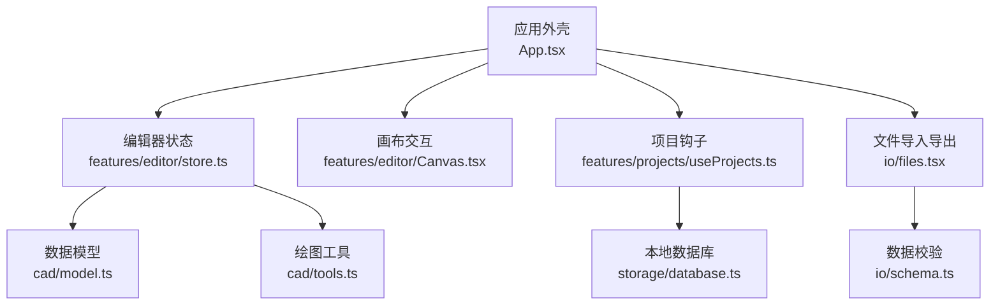
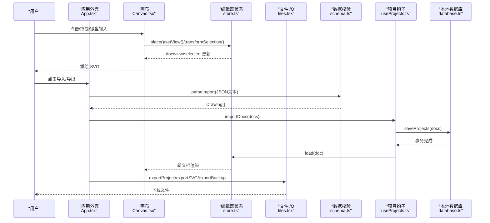
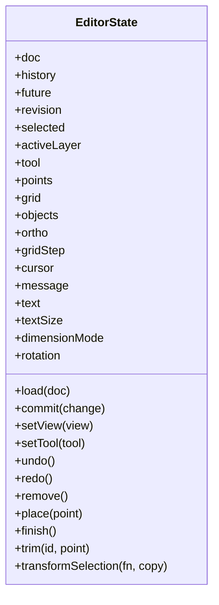
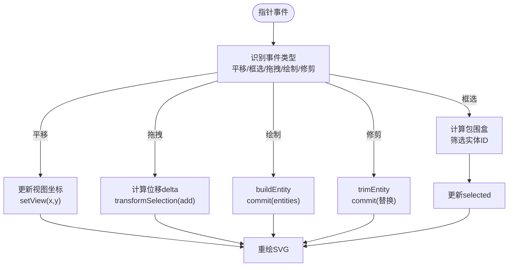
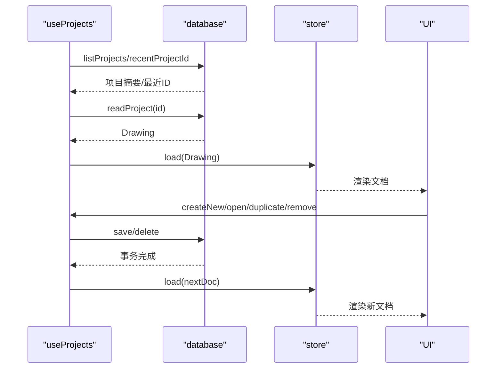
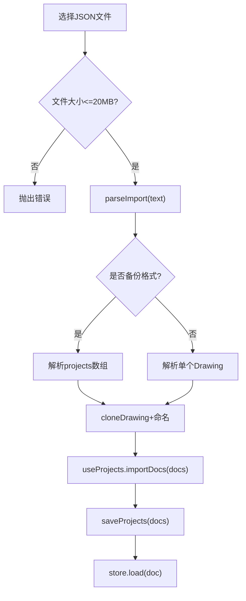
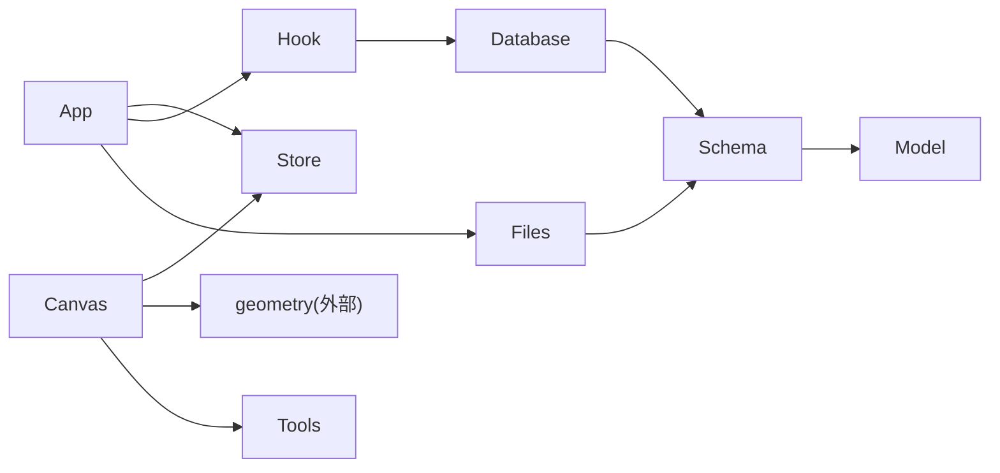

# 数据流设计

<cite>
**本文引用的文件**   
- [App.tsx](file://src/app/App.tsx)
- [store.ts](file://src/features/editor/store.ts)
- [Canvas.tsx](file://src/features/editor/Canvas.tsx)
- [useProjects.ts](file://src/features/projects/useProjects.ts)
- [files.tsx](file://src/io/files.tsx)
- [schema.ts](file://src/io/schema.ts)
- [database.ts](file://src/storage/database.ts)
- [model.ts](file://src/cad/model.ts)
- [tools.ts](file://src/cad/tools.ts)
</cite>

## 目录
1. [引言](#引言)
2. [项目结构](#项目结构)
3. [核心组件](#核心组件)
4. [架构总览](#架构总览)
5. [详细组件分析](#详细组件分析)
6. [依赖关系分析](#依赖关系分析)
7. [性能考虑](#性能考虑)
8. [故障排查指南](#故障排查指南)
9. [结论](#结论)

## 引言
本文面向 web-cad 的数据流设计，系统性说明单向数据流从用户交互到状态更新再到视图渲染的完整路径。重点包括：
- Zustand store 中的 actions、派生状态与副作用处理
- 文件 I/O 数据流：JSON 导入导出与 IndexedDB 持久化之间的转换
- 错误处理机制与数据验证流程
- 关键数据流转图与性能优化策略（如增量更新、按需渲染）

本设计强调“单一事实来源”和“不可变更新”，通过 store 作为唯一状态中心，UI 仅消费状态并触发 actions，所有副作用在统一入口中编排。

## 项目结构
web-cad 采用按功能域组织的结构：
- app：应用外壳与全局 UI 布局
- features/editor：编辑器核心状态与画布交互
- features/projects：项目列表与生命周期管理
- io：文件格式与导入导出逻辑
- storage：IndexedDB 持久化封装
- cad：几何计算、实体模型与工具函数

**图表来源**
- [App.tsx:20-32](file://src/app/App.tsx#L20-L32)
- [store.ts:1-15](file://src/features/editor/store.ts#L1-L15)
- [Canvas.tsx:1-21](file://src/features/editor/Canvas.tsx#L1-L21)
- [useProjects.ts:1-12](file://src/features/projects/useProjects.ts#L1-L12)
- [database.ts:1-5](file://src/storage/database.ts#L1-L5)
- [files.tsx:1-4](file://src/io/files.tsx#L1-L4)
- [schema.ts:1-2](file://src/io/schema.ts#L1-L2)
- [model.ts:1-11](file://src/cad/model.ts#L1-L11)
- [tools.ts:1-3](file://src/cad/tools.ts#L1-L3)

**章节来源**
- [App.tsx:1-329](file://src/app/App.tsx#L1-L329)
- [store.ts:1-324](file://src/features/editor/store.ts#L1-L324)
- [Canvas.tsx:1-652](file://src/features/editor/Canvas.tsx#L1-L652)
- [useProjects.ts:1-208](file://src/features/projects/useProjects.ts#L1-L208)
- [files.tsx:1-63](file://src/io/files.tsx#L1-L63)
- [schema.ts:1-134](file://src/io/schema.ts#L1-L134)
- [database.ts:1-90](file://src/storage/database.ts#L1-L90)
- [model.ts:1-142](file://src/cad/model.ts#L1-L142)
- [tools.ts:1-126](file://src/cad/tools.ts#L1-L126)

## 核心组件
- 应用外壳 App：负责顶层 UI、菜单、导入导出按钮、错误提示与忙态控制，并将用户操作委托给 store 与 projects hook。
- 编辑器 store：基于 Zustand 的单例状态，包含文档、历史栈、选择集、工具、光标等；提供 load、commit、setView、undo/redo、remove、place、finish、trim、transformSelection 等 actions。
- 画布 Canvas：监听指针事件、键盘快捷键、滚轮缩放，驱动 store 的状态变更，并渲染 SVG 图形、网格、标尺与预览。
- 项目钩子 useProjects：管理项目列表、打开/新建/复制/删除、导入、备份与自动保存；协调 IndexedDB 与内存临时模式。
- 文件 I/O files：导出项目 JSON、SVG 矢量图与全部备份；下载文件。
- 数据校验 schema：使用 Zod 定义 Drawing 与 Entity 的结构约束，支持单项目与备份格式解析。
- 存储 database：封装 IndexedDB 连接、对象存储升级、读写事务、最近项目记录与排序。
- 模型 model：Drawing、Entity、Layer、View、Tool 类型定义与工厂函数。
- 工具 tools：根据工具类型构建实体，并提供交互提示。

**章节来源**
- [App.tsx:34-329](file://src/app/App.tsx#L34-L329)
- [store.ts:17-316](file://src/features/editor/store.ts#L17-L316)
- [Canvas.tsx:32-652](file://src/features/editor/Canvas.tsx#L32-L652)
- [useProjects.ts:15-208](file://src/features/projects/useProjects.ts#L15-L208)
- [files.tsx:6-62](file://src/io/files.tsx#L6-L62)
- [schema.ts:4-134](file://src/io/schema.ts#L4-L134)
- [database.ts:12-90](file://src/storage/database.ts#L12-L90)
- [model.ts:1-142](file://src/cad/model.ts#L1-L142)
- [tools.ts:5-126](file://src/cad/tools.ts#L5-L126)

## 架构总览
下图展示从用户交互到状态更新再到视图渲染的单向数据流，以及文件 I/O 与持久化的集成点。

**图表来源**
- [Canvas.tsx:196-328](file://src/features/editor/Canvas.tsx#L196-L328)
- [store.ts:79-101](file://src/features/editor/store.ts#L79-L101)
- [App.tsx:300-308](file://src/app/App.tsx#L300-L308)
- [schema.ts:105-134](file://src/io/schema.ts#L105-L134)
- [useProjects.ts:181-185](file://src/features/projects/useProjects.ts#L181-L185)
- [database.ts:45-63](file://src/storage/database.ts#L45-L63)
- [files.tsx:18-62](file://src/io/files.tsx#L18-L62)

## 详细组件分析

### 编辑器状态与动作（Zustand store）
- 状态字段：doc、history、future、revision、selected、activeLayer、tool、points、grid、objects、ortho、gridStep、cursor、message、text、textSize、dimensionMode、rotation。
- 关键动作：
  - load：加载文档并重置历史、选择、工具等。
  - commit：不可变更新文档，附加更新时间戳，维护撤销栈，递增 revision 以触发增量更新。
  - setView：更新视图坐标与缩放，同时递增 revision。
  - undo/redo：在 history/future 之间移动，保持 view 一致，清理选择与临时点。
  - remove：删除选中实体，清空选择。
  - transformSelection：对选中实体执行变换或复制，内部调用 geometry 工具。
  - place/finish：根据当前工具与点数构建实体，写入 entities。
  - trim：基于可见实体进行修剪，替换目标实体为修剪结果。
- 派生状态：
  - selected 过滤出可见且未锁定的图层上的实体。
  - editableSelection 辅助函数确保只编辑可编辑的实体。
- 副作用处理：
  - 所有业务副作用（如消息提示、层检查、几何计算）集中在 store actions 内，避免分散在 UI 组件中。
  - 数据合法性通过 drawingSchema.safeParse 在 commit 时校验，非法则设置 message 并拒绝更新。

**图表来源**
- [store.ts:17-47](file://src/features/editor/store.ts#L17-L47)
- [store.ts:48-316](file://src/features/editor/store.ts#L48-L316)

**章节来源**
- [store.ts:17-316](file://src/features/editor/store.ts#L17-L316)

### 画布交互与渲染（Canvas）
- 事件处理：
  - 指针按下/移动/抬起：区分平移、框选、拖拽、绘制与修剪。
  - 滚轮缩放：围绕鼠标位置调整 scale 与偏移。
  - 键盘快捷键：撤销/重做、全选、工具切换、删除、完成折线。
- 世界坐标与屏幕坐标转换：screenToWorld/worldToScreen 用于精确拾取与对齐。
- 吸附与网格：snap 结合 gridStep、ortho、对象吸附与上一落点。
- 预览与实时反馈：根据工具与 points 生成预览实体，并在 SVG 中显示。
- 渲染管线：
  - 过滤可见实体，按选中状态与拖拽位移计算最终显示实体。
  - 绘制网格、原点轴、标尺、锚点与预览。
  - 通过 key={e.id} 实现 React 增量更新。

**图表来源**
- [Canvas.tsx:196-328](file://src/features/editor/Canvas.tsx#L196-L328)
- [Canvas.tsx:443-511](file://src/features/editor/Canvas.tsx#L443-L511)
- [store.ts:187-315](file://src/features/editor/store.ts#L187-L315)

**章节来源**
- [Canvas.tsx:53-179](file://src/features/editor/Canvas.tsx#L53-L179)
- [Canvas.tsx:180-328](file://src/features/editor/Canvas.tsx#L180-L328)
- [Canvas.tsx:329-652](file://src/features/editor/Canvas.tsx#L329-L652)

### 项目生命周期与持久化（useProjects）
- 初始化：
  - 读取最近项目 ID 与项目列表，若不存在则创建默认图纸并保存到 IndexedDB。
  - 将最新文档载入 store，并刷新项目列表。
- 自动保存：
  - 监听 doc 与 revision 变化，延迟 flush 写入 IndexedDB。
  - 页面关闭或隐藏时强制 flush。
- 临时模式：
  - 当 IndexedDB 不可用时，切换到内存 Map 缓存，提示用户导出备份。
- 项目操作：
  - open/createNew/duplicate/remove/importDocs/backup 均先 flush 当前文档，再写库并 load 新文档。

**图表来源**
- [useProjects.ts:74-116](file://src/features/projects/useProjects.ts#L74-L116)
- [useProjects.ts:117-143](file://src/features/projects/useProjects.ts#L117-L143)
- [useProjects.ts:144-191](file://src/features/projects/useProjects.ts#L144-L191)
- [database.ts:42-90](file://src/storage/database.ts#L42-L90)

**章节来源**
- [useProjects.ts:15-208](file://src/features/projects/useProjects.ts#L15-L208)
- [database.ts:12-90](file://src/storage/database.ts#L12-L90)

### 文件 I/O 与数据校验（files 与 schema）
- 导入流程：
  - App 接收文件文本，校验大小后调用 parseImport。
  - parseImport 判断是否为备份格式，分别解析为 Drawing[]。
  - 克隆并命名导入文档，返回供 useProjects.importDocs 写入。
- 导出流程：
  - exportProject：导出当前文档为 JSON。
  - exportSVG：基于可见实体渲染 SVG 字符串并下载。
  - exportBackup：打包所有项目为备份 JSON。
- 数据校验：
  - drawingSchema 严格约束版本、ID、名称、时间、单位、图层、实体、视图等。
  - 自定义校验确保图层与实体 ID 唯一，实体引用有效图层。
  - 备份格式校验项目数量与 ID 唯一性。

**图表来源**
- [App.tsx:300-308](file://src/app/App.tsx#L300-L308)
- [schema.ts:105-134](file://src/io/schema.ts#L105-L134)
- [useProjects.ts:181-185](file://src/features/projects/useProjects.ts#L181-L185)
- [database.ts:45-63](file://src/storage/database.ts#L45-L63)

**章节来源**
- [files.tsx:6-62](file://src/io/files.tsx#L6-L62)
- [schema.ts:4-134](file://src/io/schema.ts#L4-L134)
- [App.tsx:300-308](file://src/app/App.tsx#L300-L308)

### 数据模型与工具（model 与 tools）
- 模型：
  - Point/Layer/Entity/Drawing/View/Tool 类型定义。
  - uid 生成唯一 ID，createDrawing 创建默认文档，cloneDrawing 深拷贝并重写 ID。
- 工具：
  - buildEntity 根据工具类型与点数构造实体，包含直线、矩形、圆、圆弧、折线、文字、尺寸标注。
  - hint 提供各工具的交互提示文案。

**章节来源**
- [model.ts:1-142](file://src/cad/model.ts#L1-L142)
- [tools.ts:5-126](file://src/cad/tools.ts#L5-L126)

## 依赖关系分析
- App 依赖 store、hooks、io 与 components，承担 UI 编排与错误边界。
- Canvas 依赖 store 与 geometry/tools，负责交互与渲染。
- useProjects 依赖 database 与 store，负责项目生命周期与持久化。
- files 依赖 react-dom/server 与 components，负责导出。
- schema 依赖 model，负责数据校验。
- database 依赖 idb 与 schema，负责持久化。

**图表来源**
- [App.tsx:20-32](file://src/app/App.tsx#L20-L32)
- [Canvas.tsx:1-21](file://src/features/editor/Canvas.tsx#L1-L21)
- [useProjects.ts:1-12](file://src/features/projects/useProjects.ts#L1-L12)
- [files.tsx:1-4](file://src/io/files.tsx#L1-L4)
- [schema.ts:1-2](file://src/io/schema.ts#L1-L2)
- [database.ts:1-5](file://src/storage/database.ts#L1-L5)

**章节来源**
- [App.tsx:1-329](file://src/app/App.tsx#L1-L329)
- [Canvas.tsx:1-652](file://src/features/editor/Canvas.tsx#L1-L652)
- [useProjects.ts:1-208](file://src/features/projects/useProjects.ts#L1-L208)
- [files.tsx:1-63](file://src/io/files.tsx#L1-L63)
- [schema.ts:1-134](file://src/io/schema.ts#L1-L134)
- [database.ts:1-90](file://src/storage/database.ts#L1-L90)

## 性能考虑
- 增量更新：
  - store.commit 与 setView 递增 revision，配合 React 的 key 与 selector 实现最小化重渲染。
  - Canvas 使用 key={e.id} 渲染实体，避免全量重建。
- 按需渲染：
  - 仅渲染可见且非锁定图层上的实体，减少 DOM/SVG 节点数。
  - 预览实体仅在 points 存在或变换工具激活时计算与渲染。
- 交互优化：
  - 使用 ResizeObserver 监听容器尺寸，避免频繁测量。
  - 滚轮缩放使用指数缩放与视口中心对齐，提升体验。
  - 吸附与网格计算基于 eligible 集合，限制计算范围。
- 虚拟滚动：
  - 当前实现未使用虚拟滚动；对于大规模实体场景，建议引入虚拟滚动或视口裁剪，仅渲染可视区域内的实体。
- 批量写入：
  - useProjects.flush 合并多次修改，节流写入 IndexedDB，降低 I/O 压力。
  - database.saveProjects 使用事务并行写入多个对象存储，提高吞吐。

[本节为通用性能指导，不直接分析具体文件]

## 故障排查指南
- 导入失败：
  - 文件超过 20 MB：App 与 schema 均进行大小校验，抛出错误。
  - 非 JSON 或格式不匹配：parseImport 捕获 JSON 解析异常，抛出明确错误信息。
  - 备份项目 ID 重复：schema 校验失败，抛出错误。
- 保存失败：
  - IndexedDB 不可用：useProjects 进入临时模式，提示用户导出备份。
  - 事务失败：flush 捕获异常并设置状态与错误信息，提供重试入口。
- 数据越界：
  - commit 中 drawingSchema.safeParse 失败时设置 message，阻止无效状态更新。
- 交互异常：
  - 工具提示与消息通过 store.message 与 Canvas 的工具提示区域显示，便于定位问题。

**章节来源**
- [App.tsx:43-64](file://src/app/App.tsx#L43-L64)
- [schema.ts:105-134](file://src/io/schema.ts#L105-L134)
- [useProjects.ts:48-73](file://src/features/projects/useProjects.ts#L48-L73)
- [store.ts:79-101](file://src/features/editor/store.ts#L79-L101)

## 结论
web-cad 的数据流设计遵循严格的单向流原则：用户交互触发 store actions，store 进行不可变更新与校验，UI 消费状态并渲染。文件 I/O 与持久化通过统一的 schema 与 database 模块对接，保证数据一致性与可靠性。通过增量更新、按需渲染与批量写入等策略，系统在交互流畅度与稳定性之间取得平衡。未来可在大规模实体场景下引入虚拟滚动与视口裁剪，进一步提升性能。