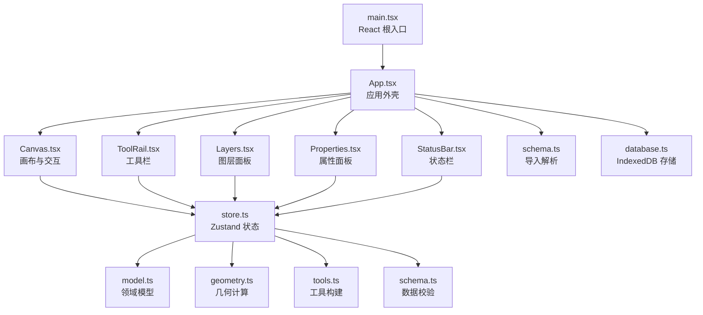
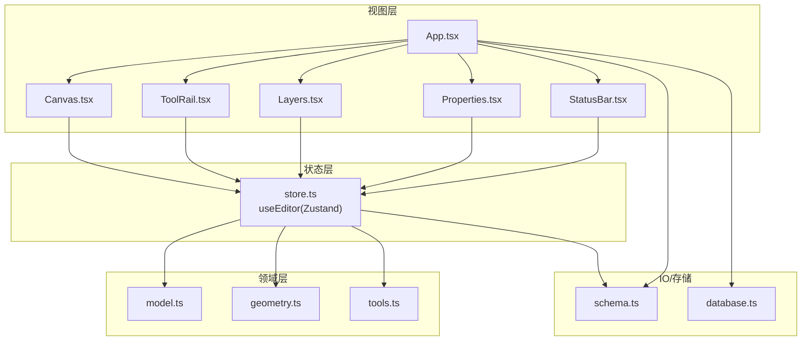
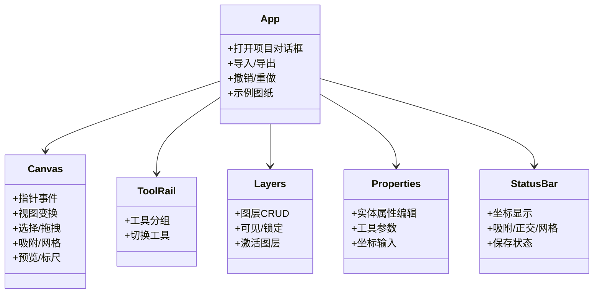
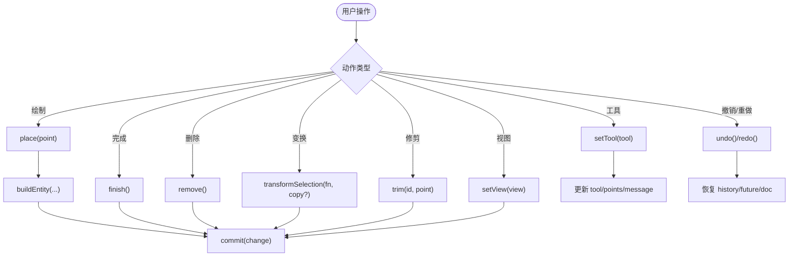
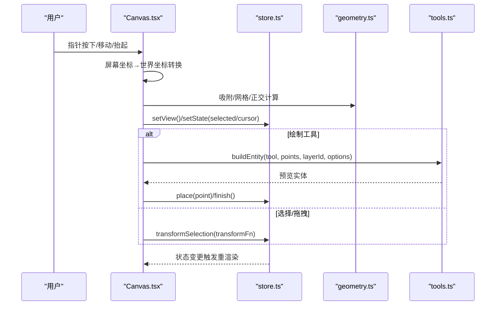
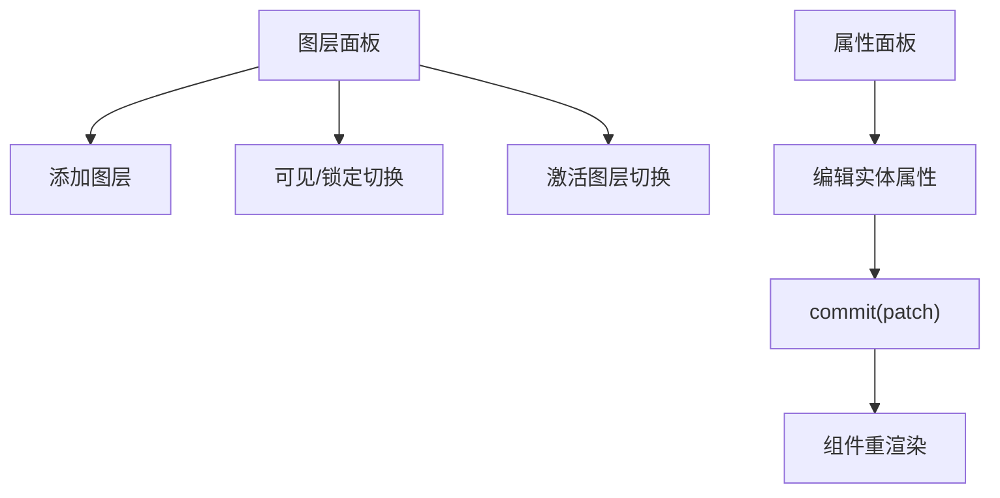
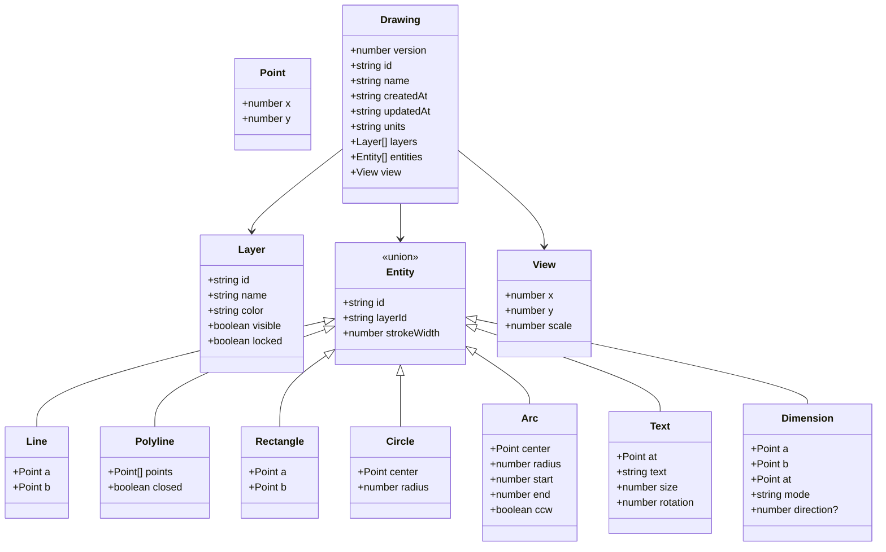
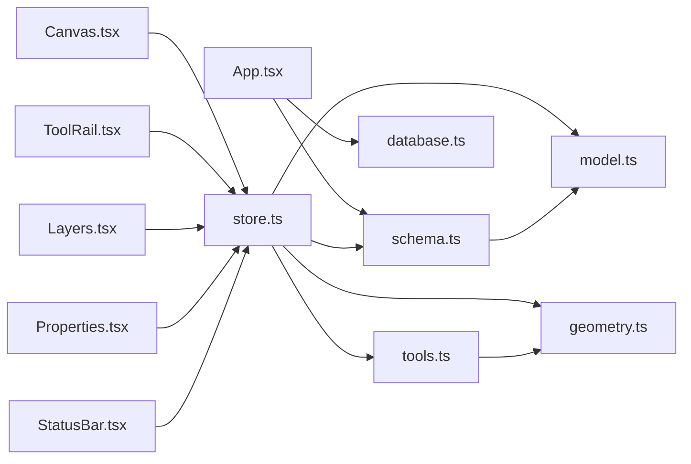

# 架构设计

<cite>
**本文引用的文件**   
- [main.tsx](file://src/main.tsx)
- [App.tsx](file://src/app/App.tsx)
- [Canvas.tsx](file://src/features/editor/Canvas.tsx)
- [ToolRail.tsx](file://src/features/editor/ToolRail.tsx)
- [Layers.tsx](file://src/features/editor/Layers.tsx)
- [Properties.tsx](file://src/features/editor/Properties.tsx)
- [StatusBar.tsx](file://src/features/editor/StatusBar.tsx)
- [store.ts](file://src/features/editor/store.ts)
- [model.ts](file://src/cad/model.ts)
- [geometry.ts](file://src/cad/geometry.ts)
- [tools.ts](file://src/cad/tools.ts)
- [schema.ts](file://src/io/schema.ts)
- [database.ts](file://src/storage/database.ts)
- [package.json](file://package.json)
</cite>

## 目录
1. [简介](#简介)
2. [项目结构](#项目结构)
3. [核心组件](#核心组件)
4. [架构总览](#架构总览)
5. [详细组件分析](#详细组件分析)
6. [依赖关系分析](#依赖关系分析)
7. [性能与可扩展性](#性能与可扩展性)
8. [故障排查指南](#故障排查指南)
9. [结论](#结论)

## 简介
本文件为 web-cad CAD 设计工具的架构设计文档，面向初学者与有经验的开发者。文档从系统架构、组件层次、数据流、状态管理、CAD 引擎分层、技术决策与权衡、边界与扩展性等方面进行全面说明，并辅以架构图与交互时序图，帮助读者快速理解“React + Zustand + SVG 绘图”的 MVVM 风格实现。

## 项目结构
仓库采用按功能域划分的目录组织：
- src/app: 应用外壳与全局布局（App）
- src/features/editor: 编辑器 UI 与状态（Canvas、ToolRail、Layers、Properties、StatusBar、store）
- src/cad: CAD 领域模型与几何计算（model、geometry、tools、trim）
- src/io: 导入导出与数据校验（files、schema）
- src/storage: 本地持久化（idb）
- src/components: 通用 UI 组件（EntityShape、HelpDialog、Modal、NumberField）
- main.tsx: React 根入口

图表来源
- [main.tsx:1-6](file://src/main.tsx#L1-L6)
- [App.tsx:1-329](file://src/app/App.tsx#L1-L329)
- [Canvas.tsx:1-652](file://src/features/editor/Canvas.tsx#L1-L652)
- [ToolRail.tsx:1-96](file://src/features/editor/ToolRail.tsx#L1-L96)
- [Layers.tsx:1-163](file://src/features/editor/Layers.tsx#L1-L163)
- [Properties.tsx:1-394](file://src/features/editor/Properties.tsx#L1-L394)
- [StatusBar.tsx:1-74](file://src/features/editor/StatusBar.tsx#L1-L74)
- [store.ts:1-324](file://src/features/editor/store.ts#L1-L324)
- [model.ts:1-142](file://src/cad/model.ts#L1-L142)
- [geometry.ts:1-443](file://src/cad/geometry.ts#L1-L443)
- [tools.ts:1-126](file://src/cad/tools.ts#L1-L126)
- [schema.ts:1-134](file://src/io/schema.ts#L1-L134)
- [database.ts:1-48](file://src/storage/database.ts#L1-L48)

章节来源
- [main.tsx:1-6](file://src/main.tsx#L1-L6)
- [package.json:1-53](file://package.json#L1-L53)

## 核心组件
- App 外壳：负责顶层布局、菜单、导入导出、项目对话框、忙态遮罩与错误提示；组合 Canvas、ToolRail、Layers、Properties、StatusBar。
- Canvas：SVG 画布，处理指针事件、视图变换、选择框选、拖拽移动、吸附与网格、预览图形、标尺与缩放控制。
- ToolRail：工具分组与快捷键提示，切换当前工具。
- Layers：图层增删改、可见/锁定控制、激活图层切换。
- Properties：选中实体属性编辑、工具参数配置、坐标精确输入。
- StatusBar：坐标显示、吸附/正交开关、网格间距、保存状态与重试。
- store（Zustand）：统一维护 Drawing、历史栈、选中项、工具、光标、视图等状态，提供 commit、undo/redo、place、finish、trim、transformSelection 等方法。
- CAD 模型与几何：定义 Entity/Drawing/View/Tool 等类型，提供点线圆弧几何运算、包围盒、锚点、相交、变换、吸附等算法。
- 工具构建：根据工具与点序列生成具体 Entity。
- 数据校验与导入：Zod schema 校验 Drawing 与备份格式，parseImport 返回克隆后的图纸集合。
- 持久化：基于 idb 的 IndexedDB 封装，维护 projects/documents/settings 对象存储。

章节来源
- [App.tsx:1-329](file://src/app/App.tsx#L1-L329)
- [Canvas.tsx:1-652](file://src/features/editor/Canvas.tsx#L1-L652)
- [ToolRail.tsx:1-96](file://src/features/editor/ToolRail.tsx#L1-L96)
- [Layers.tsx:1-163](file://src/features/editor/Layers.tsx#L1-L163)
- [Properties.tsx:1-394](file://src/features/editor/Properties.tsx#L1-L394)
- [StatusBar.tsx:1-74](file://src/features/editor/StatusBar.tsx#L1-L74)
- [store.ts:1-324](file://src/features/editor/store.ts#L1-L324)
- [model.ts:1-142](file://src/cad/model.ts#L1-L142)
- [geometry.ts:1-443](file://src/cad/geometry.ts#L1-L443)
- [tools.ts:1-126](file://src/cad/tools.ts#L1-L126)
- [schema.ts:1-134](file://src/io/schema.ts#L1-L134)
- [database.ts:1-48](file://src/storage/database.ts#L1-L48)

## 架构总览
本项目采用“UI 层（React）— 状态层（Zustand）— 领域层（CAD 模型/几何/工具）— IO/存储”的分层架构，遵循 MVVM 思想：
- Model：Drawing/Entity/View/Tool 等数据结构与工厂方法。
- View：React 组件树（App → Canvas/ToolRail/Layers/Properties/StatusBar）。
- ViewModel：Zustand store 暴露的状态与动作，连接 UI 与领域逻辑。

图表来源
- [App.tsx:1-329](file://src/app/App.tsx#L1-L329)
- [Canvas.tsx:1-652](file://src/features/editor/Canvas.tsx#L1-L652)
- [ToolRail.tsx:1-96](file://src/features/editor/ToolRail.tsx#L1-L96)
- [Layers.tsx:1-163](file://src/features/editor/Layers.tsx#L1-L163)
- [Properties.tsx:1-394](file://src/features/editor/Properties.tsx#L1-L394)
- [StatusBar.tsx:1-74](file://src/features/editor/StatusBar.tsx#L1-L74)
- [store.ts:1-324](file://src/features/editor/store.ts#L1-L324)
- [model.ts:1-142](file://src/cad/model.ts#L1-L142)
- [geometry.ts:1-443](file://src/cad/geometry.ts#L1-L443)
- [tools.ts:1-126](file://src/cad/tools.ts#L1-L126)
- [schema.ts:1-134](file://src/io/schema.ts#L1-L134)
- [database.ts:1-48](file://src/storage/database.ts#L1-L48)

## 详细组件分析

### 组件树与职责
- App：编排子组件、处理导入导出、项目管理与忙态/错误提示。
- Canvas：渲染 SVG、处理指针事件、视图变换、选择/拖拽、吸附/网格、预览与标尺。
- ToolRail：展示工具组与快捷键，切换工具。
- Layers：图层 CRUD、可见/锁定、激活图层。
- Properties：选中实体属性编辑、工具参数、坐标精确输入。
- StatusBar：坐标显示、吸附/正交/网格开关、网格间距、保存状态。

图表来源
- [App.tsx:1-329](file://src/app/App.tsx#L1-L329)
- [Canvas.tsx:1-652](file://src/features/editor/Canvas.tsx#L1-L652)
- [ToolRail.tsx:1-96](file://src/features/editor/ToolRail.tsx#L1-L96)
- [Layers.tsx:1-163](file://src/features/editor/Layers.tsx#L1-L163)
- [Properties.tsx:1-394](file://src/features/editor/Properties.tsx#L1-L394)
- [StatusBar.tsx:1-74](file://src/features/editor/StatusBar.tsx#L1-L74)

章节来源
- [App.tsx:1-329](file://src/app/App.tsx#L1-L329)
- [Canvas.tsx:1-652](file://src/features/editor/Canvas.tsx#L1-L652)
- [ToolRail.tsx:1-96](file://src/features/editor/ToolRail.tsx#L1-L96)
- [Layers.tsx:1-163](file://src/features/editor/Layers.tsx#L1-L163)
- [Properties.tsx:1-394](file://src/features/editor/Properties.tsx#L1-L394)
- [StatusBar.tsx:1-74](file://src/features/editor/StatusBar.tsx#L1-L74)

### 状态管理（Zustand）
- 状态字段：doc、history、future、revision、selected、activeLayer、tool、points、grid、objects、ortho、gridStep、cursor、message、text、textSize、dimensionMode、rotation。
- 关键动作：load、commit、setView、setTool、undo、redo、remove、place、finish、trim、transformSelection。
- 不可变更新：通过 structuredClone 深拷贝 doc，再经 Zod 校验后提交，保证状态一致性。
- 历史栈：保留最近 99 条历史，撤销/重做时恢复 view 与 activeLayer。

图表来源
- [store.ts:1-324](file://src/features/editor/store.ts#L1-L324)
- [tools.ts:1-126](file://src/cad/tools.ts#L1-L126)
- [schema.ts:1-134](file://src/io/schema.ts#L1-L134)

章节来源
- [store.ts:1-324](file://src/features/editor/store.ts#L1-L324)

### 画布交互流程（Canvas）
- 滚轮缩放：以鼠标位置为中心调整 scale，保持世界坐标稳定。
- 键盘快捷键：Space 平移、Ctrl/Cmd+Z/Y 撤销重做、A 全选、Esc 取消、Delete/Backspace 删除、Enter 完成折线、字母键快捷切换工具。
- 指针事件：区分平移、框选、拖拽、绘制、修剪；支持 Shift 多选。
- 吸附与网格：优先对象吸附，其次网格对齐，支持正交模式。
- 预览：根据当前工具与 points 计算预览实体，用于实时反馈。
- 标尺与网格：动态计算刻度步长，绘制网格与标尺。

图表来源
- [Canvas.tsx:1-652](file://src/features/editor/Canvas.tsx#L1-L652)
- [store.ts:1-324](file://src/features/editor/store.ts#L1-L324)
- [geometry.ts:1-443](file://src/cad/geometry.ts#L1-L443)
- [tools.ts:1-126](file://src/cad/tools.ts#L1-L126)

章节来源
- [Canvas.tsx:1-652](file://src/features/editor/Canvas.tsx#L1-L652)

### 图层与属性面板
- Layers：新增/删除图层、设置颜色与可见/锁定、切换激活图层；当图层被隐藏或锁定时自动清理相关选中项。
- Properties：根据选中实体类型渲染对应字段（起点/终点/圆心/半径/角度/文字内容/尺寸标注方向等），支持直接修改属性并通过 commit 更新。

图表来源
- [Layers.tsx:1-163](file://src/features/editor/Layers.tsx#L1-L163)
- [Properties.tsx:1-394](file://src/features/editor/Properties.tsx#L1-L394)
- [store.ts:1-324](file://src/features/editor/store.ts#L1-L324)

章节来源
- [Layers.tsx:1-163](file://src/features/editor/Layers.tsx#L1-L163)
- [Properties.tsx:1-394](file://src/features/editor/Properties.tsx#L1-L394)

### CAD 核心引擎分层
- 模型层（model.ts）：定义 Point、Layer、Entity（line/polyline/rectangle/circle/arc/text/dimension）、View、Drawing、Tool，并提供 uid、createDrawing、cloneDrawing。
- 几何层（geometry.ts）：向量运算、极坐标、屏幕/世界坐标转换、圆弧构造、锚点与包围盒、吸附 snap、旋转/镜像/变换、线段/圆相交 intersections。
- 工具层（tools.ts）：工具名称映射、hint 提示、buildEntity 根据工具与点序列构造实体。

图表来源
- [model.ts:1-142](file://src/cad/model.ts#L1-L142)

章节来源
- [model.ts:1-142](file://src/cad/model.ts#L1-L142)
- [geometry.ts:1-443](file://src/cad/geometry.ts#L1-L443)
- [tools.ts:1-126](file://src/cad/tools.ts#L1-L126)

## 依赖关系分析
- 外部依赖：react/react-dom（UI 框架）、zustand（状态管理）、zod（数据校验）、lucide-react（图标）、idb（IndexedDB 封装）。
- 模块耦合：
  - App 依赖 io/schema 进行导入解析，依赖 storage/database 进行项目持久化。
  - Canvas/ToolRail/Layers/Properties/StatusBar 均依赖 store.ts 获取/更新状态。
  - store.ts 依赖 cad/model、cad/geometry、cad/tools、io/schema。
  - geometry.ts 仅依赖 model.ts 的类型定义，保持纯函数与无副作用。
  - tools.ts 依赖 geometry.ts 与 model.ts。
  - schema.ts 依赖 model.ts 的 cloneDrawing。

图表来源
- [App.tsx:1-329](file://src/app/App.tsx#L1-L329)
- [Canvas.tsx:1-652](file://src/features/editor/Canvas.tsx#L1-L652)
- [ToolRail.tsx:1-96](file://src/features/editor/ToolRail.tsx#L1-L96)
- [Layers.tsx:1-163](file://src/features/editor/Layers.tsx#L1-L163)
- [Properties.tsx:1-394](file://src/features/editor/Properties.tsx#L1-L394)
- [StatusBar.tsx:1-74](file://src/features/editor/StatusBar.tsx#L1-L74)
- [store.ts:1-324](file://src/features/editor/store.ts#L1-L324)
- [model.ts:1-142](file://src/cad/model.ts#L1-L142)
- [geometry.ts:1-443](file://src/cad/geometry.ts#L1-L443)
- [tools.ts:1-126](file://src/cad/tools.ts#L1-L126)
- [schema.ts:1-134](file://src/io/schema.ts#L1-L134)
- [database.ts:1-48](file://src/storage/database.ts#L1-L48)

章节来源
- [package.json:1-53](file://package.json#L1-L53)
- [store.ts:1-324](file://src/features/editor/store.ts#L1-L324)

## 性能与可扩展性

### 性能特性
- 渲染优化：Canvas 使用 SVG 原生元素与 pattern 网格，避免频繁 DOM 重建；预览实体仅在必要时计算与渲染。
- 状态更新：Zustand 细粒度订阅，仅更新必要组件；commit 前结构化克隆与 Zod 校验，避免脏数据导致重绘。
- 几何计算：geometry.ts 提供高效向量与几何算法，snap/bounds/intersections 等函数在交互路径中按需调用。
- 历史栈限制：最多保留 99 条历史，防止内存膨胀。

### 可扩展性与插件设计建议
- 工具扩展：在 tools.ts 的 toolNames 与 buildEntity 中注册新工具，并在 ToolRail 与 Canvas 的快捷键/提示中补充；store.ts 的 place/finish 分支可复用。
- 实体扩展：在 model.ts 的 Entity 联合类型中添加新实体，并在 geometry.ts 的 anchors/bounds/segments/transform 中补齐行为。
- 视图扩展：在 store.ts 的 EditorState 中增加视图相关字段（如主题、单位制），并在 StatusBar/Properties 中暴露配置。
- 插件化建议：将工具、实体、视图配置抽象为插件接口，由 store 加载与调度；IoC 容器统一管理插件生命周期。
- 存储扩展：在 database.ts 中扩展对象存储（settings 已预留 key-value），支持多租户或云端同步。

[本节为通用指导，不直接分析具体文件]

## 故障排查指南
- 导入失败：检查 JSON 是否满足 schema.ts 的 drawingSchema/backup 校验；文件大小超过 20 MB 会抛出错误。
- 数据范围异常：commit 中的 Zod 校验失败会设置 message 提示；请检查数值范围与实体数量上限。
- 图层问题：若目标图层被隐藏或锁定，绘制/修剪会被拒绝；请在 Layers 面板中调整。
- 吸附异常：确认 StatusBar 中网格/对象吸附/正交开关与网格间距设置是否符合预期。
- 保存状态：StatusBar 显示持久化状态，点击重试按钮可触发 flush 保存。

章节来源
- [schema.ts:1-134](file://src/io/schema.ts#L1-L134)
- [store.ts:1-324](file://src/features/editor/store.ts#L1-L324)
- [Layers.tsx:1-163](file://src/features/editor/Layers.tsx#L1-L163)
- [StatusBar.tsx:1-74](file://src/features/editor/StatusBar.tsx#L1-L74)

## 结论
web-cad 采用清晰的 MVVM 分层：React 组件作为视图，Zustand store 作为视图模型，CAD 模型/几何/工具构成领域层，IO 与存储位于最外层。该架构在保证交互流畅的同时，具备良好的可扩展性与可测试性。通过工具与实体的模块化设计，未来可平滑扩展更多 CAD 能力；通过 IndexedDB 与 schema 校验，确保数据安全与一致性。