# 编辑器架构设计

<cite>
**本文引用的文件**   
- [App.tsx](file://src/app/App.tsx)
- [store.ts](file://src/features/editor/store.ts)
- [Canvas.tsx](file://src/features/editor/Canvas.tsx)
- [Layers.tsx](file://src/features/editor/Layers.tsx)
- [Properties.tsx](file://src/features/editor/Properties.tsx)
- [ToolRail.tsx](file://src/features/editor/ToolRail.tsx)
- [StatusBar.tsx](file://src/features/editor/StatusBar.tsx)
- [model.ts](file://src/cad/model.ts)
- [geometry.ts](file://src/cad/geometry.ts)
- [tools.ts](file://src/cad/tools.ts)
- [trim.ts](file://src/cad/trim.ts)
</cite>

## 目录
1. [引言](#引言)
2. [项目结构](#项目结构)
3. [核心组件](#核心组件)
4. [架构总览](#架构总览)
5. [详细组件分析](#详细组件分析)
6. [依赖关系分析](#依赖关系分析)
7. [性能与可扩展性](#性能与可扩展性)
8. [故障排查指南](#故障排查指南)
9. [结论](#结论)
10. [附录：新增工具与属性面板实践](#附录新增工具与属性面板实践)

## 引言
本设计文档面向 web-cad 编辑器的架构说明，重点阐述基于 Zustand 的状态管理、命令历史（撤销/重做）、React 组件树层次、用户交互到几何计算的完整链路，以及视图变换与图层管理的设计模式。同时提供可操作的扩展指南，帮助开发者快速添加新的编辑工具与属性面板。

## 项目结构
仓库采用“功能域 + 领域模型”的划分方式：
- src/app：应用外壳与全局布局
- src/features/editor：编辑器核心 UI 与状态
- src/cad：二维几何、实体建模、工具构建与修剪算法
- src/components：通用 UI 组件
- src/io、src/storage：导入导出与本地存储
- tests：端到端与单元测试

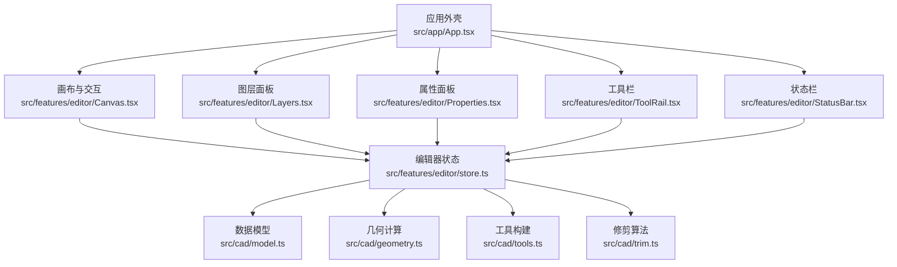

**图表来源**
- [App.tsx:23-31](file://src/app/App.tsx#L23-L31)
- [Canvas.tsx:1-22](file://src/features/editor/Canvas.tsx#L1-L22)
- [store.ts:1-15](file://src/features/editor/store.ts#L1-L15)
- [model.ts:1-61](file://src/cad/model.ts#L1-L61)

**章节来源**
- [App.tsx:34-329](file://src/app/App.tsx#L34-L329)

## 核心组件
- 应用外壳 App：负责顶层布局、菜单、导入导出、示例图纸加载、忙态与错误提示。
- 编辑器状态 store：基于 Zustand 的单源状态，包含文档、视图、选择、工具、历史等；提供 commit、undo、redo、setView、place、transformSelection 等方法。
- 画布 Canvas：处理鼠标/键盘事件、视图缩放平移、框选/拖拽、吸附与网格、预览绘制、坐标轴与标尺。
- 图层 Layers：增删改图层、可见性与锁定控制，联动选择集清理。
- 属性面板 Properties：按选中实体动态渲染字段，支持精确数值输入与工具参数配置。
- 工具栏 ToolRail：分组展示工具，绑定快捷键与名称映射。
- 状态栏 StatusBar：显示光标坐标、吸附开关、网格间距、保存状态。

**章节来源**
- [App.tsx:34-329](file://src/app/App.tsx#L34-L329)
- [store.ts:17-324](file://src/features/editor/store.ts#L17-L324)
- [Canvas.tsx:32-652](file://src/features/editor/Canvas.tsx#L32-L652)
- [Layers.tsx:14-163](file://src/features/editor/Layers.tsx#L14-L163)
- [Properties.tsx:16-394](file://src/features/editor/Properties.tsx#L16-L394)
- [ToolRail.tsx:59-96](file://src/features/editor/ToolRail.tsx#L59-L96)
- [StatusBar.tsx:4-74](file://src/features/editor/StatusBar.tsx#L4-L74)

## 架构总览
编辑器采用“单向数据流 + 不可变更新”的模式：
- React 组件通过 useEditor 订阅 store 中的局部状态。
- 用户交互在 Canvas 中捕获，调用 store 的方法进行状态变更。
- store.commit 对当前文档执行结构化克隆与校验，生成新状态并推入历史栈。
- undo/redo 在 history/future 双栈之间移动状态，保持视图不变但恢复文档内容。
- 几何计算集中在 geometry.ts，工具构建在 tools.ts，修剪逻辑在 trim.ts。

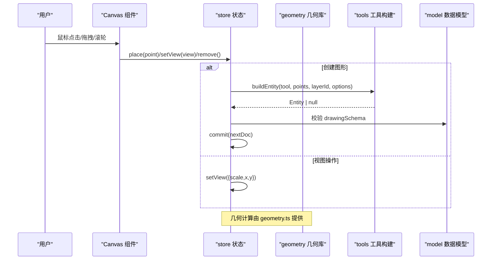

**图表来源**
- [Canvas.tsx:196-263](file://src/features/editor/Canvas.tsx#L196-L263)
- [store.ts:79-101](file://src/features/editor/store.ts#L79-L101)
- [tools.ts:49-125](file://src/cad/tools.ts#L49-L125)
- [geometry.ts:31-42](file://src/cad/geometry.ts#L31-L42)

**章节来源**
- [store.ts:17-324](file://src/features/editor/store.ts#L17-L324)
- [Canvas.tsx:32-652](file://src/features/editor/Canvas.tsx#L32-L652)

## 详细组件分析

### 状态管理 store（Zustand）
- 数据结构
  - doc: Drawing | null，当前文档
  - history/future: Drawing[]，撤销/重做双栈
  - selected: string[]，选中实体 ID
  - activeLayer/tool/points/grid/objects/ortho/gridStep/cursor/message/text/textSize/dimensionMode/rotation：编辑上下文与工具参数
- 关键方法
  - load：载入文档，重置历史与选择
  - commit：深拷贝+校验后更新文档，追加历史，清空未来
  - undo/redo：在历史/未来间移动状态，保留当前视图
  - setView：更新视图（缩放/平移）
  - place/finish：根据工具与点数构建实体并提交
  - transformSelection：对选中实体批量变换（移动/复制/旋转/镜像）
  - remove/trim：删除或修剪实体
- 复杂度与约束
  - commit 使用 structuredClone 与 zod 校验，保证状态一致性
  - 历史栈限制长度（最近 99 项），避免内存膨胀
  - 所有变更均返回新对象，符合不可变更新原则

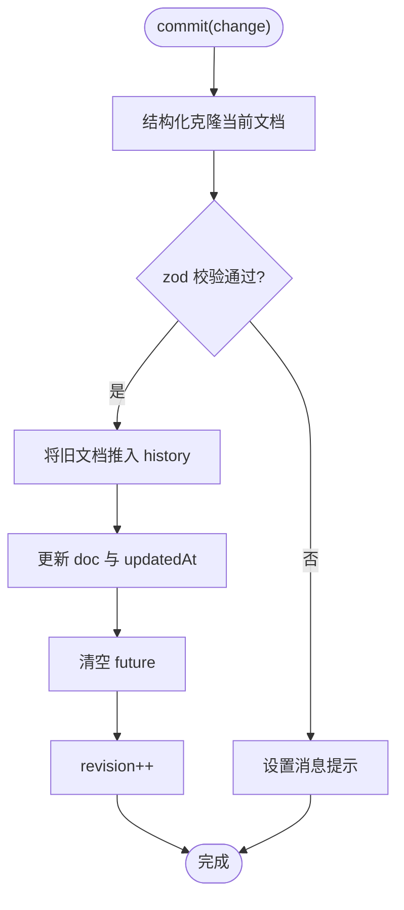

**图表来源**
- [store.ts:79-101](file://src/features/editor/store.ts#L79-L101)

**章节来源**
- [store.ts:17-324](file://src/features/editor/store.ts#L17-L324)

### 用户交互到几何计算链路
- 事件入口
  - Canvas.onPointerDown：区分平移（中键/空格）、工具绘制、选择/框选、修剪
  - Canvas.onPointerMove：更新光标位置、吸附结果、实时预览
  - Canvas.onPointerUp：提交拖拽位移、完成框选
  - 键盘：Ctrl/Cmd+Z/Y 撤销重做、A 全选、Esc 取消、Delete 删除、Enter 完成折线、字母键切换工具
- 视图变换
  - 滚轮缩放：以鼠标位置为中心缩放，调整 x/y 保持视觉锚点
  - 拖拽平移：按住空格或中键拖动更新 view.x/view.y
  - 适配全部：计算可见实体包围盒，自动设置 scale 与中心
- 吸附与网格
  - snap：对象吸附优先，其次网格对齐，支持正交模式与基准点
- 几何计算
  - geometry.ts 提供 screen/world 坐标转换、向量运算、包围盒、锚点、线段相交、圆弧构造、变换与镜像
  - tools.ts 根据工具与点序列构建实体
  - trim.ts 基于交点与点击位置决定移除区段

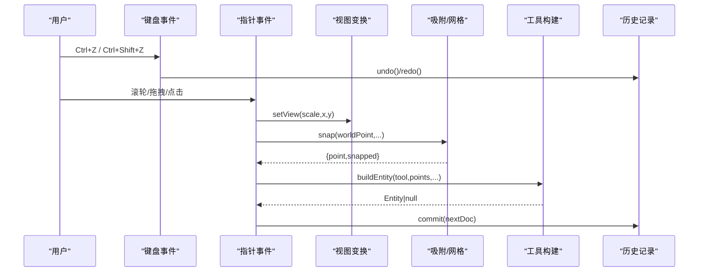

**图表来源**
- [Canvas.tsx:62-179](file://src/features/editor/Canvas.tsx#L62-L179)
- [Canvas.tsx:180-328](file://src/features/editor/Canvas.tsx#L180-L328)
- [geometry.ts:31-42](file://src/cad/geometry.ts#L31-L42)
- [geometry.ts:191-245](file://src/cad/geometry.ts#L191-L245)
- [tools.ts:49-125](file://src/cad/tools.ts#L49-L125)
- [store.ts:79-101](file://src/features/editor/store.ts#L79-L101)

**章节来源**
- [Canvas.tsx:32-652](file://src/features/editor/Canvas.tsx#L32-L652)
- [geometry.ts:1-443](file://src/cad/geometry.ts#L1-L443)
- [tools.ts:1-126](file://src/cad/tools.ts#L1-L126)

### 视图变换系统
- 缩放
  - 指数缩放因子 Math.exp(-deltaY*0.0015)，范围 0.01~100
  - 以鼠标位置为锚点，计算缩放前后世界坐标差值，补偿 view.x/view.y
- 平移
  - 拖拽时根据屏幕像素差除以 scale 换算为世界坐标差
- 适配
  - 遍历可见实体 bounds，计算 minX/minY/maxX/maxY，取居中与最大安全缩放

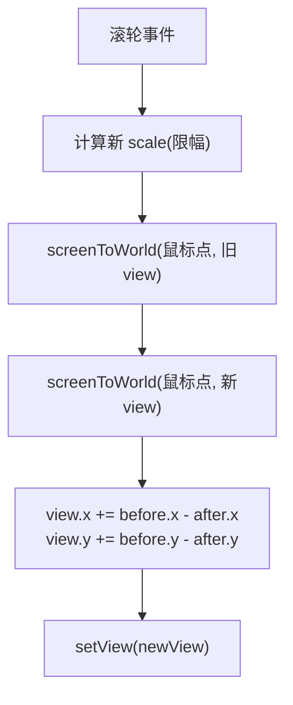

**图表来源**
- [Canvas.tsx:66-93](file://src/features/editor/Canvas.tsx#L66-L93)
- [geometry.ts:31-42](file://src/cad/geometry.ts#L31-L42)

**章节来源**
- [Canvas.tsx:62-93](file://src/features/editor/Canvas.tsx#L62-L93)
- [Canvas.tsx:329-354](file://src/features/editor/Canvas.tsx#L329-L354)

### 图层管理系统
- 设计模式
  - 每个 Layer 有 id/name/color/visible/locked
  - 新建/删除/改名/颜色/可见性/锁定均通过 store.commit 更新
  - 当图层被隐藏或锁定时，自动清理该图层上的选中实体，防止误操作
- 渲染影响
  - Canvas 仅渲染 visible=true 的图层实体
  - locked=true 的图层降低透明度，禁止选择与编辑

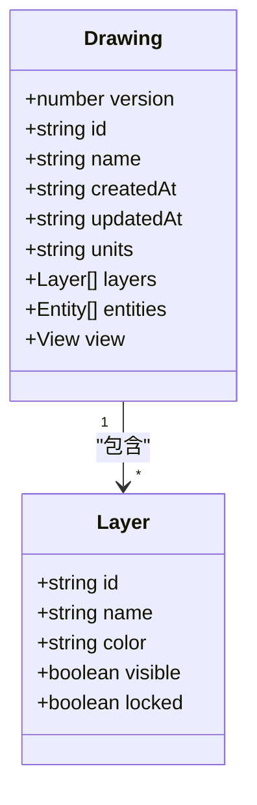

**图表来源**
- [model.ts:5-11](file://src/cad/model.ts#L5-L11)
- [model.ts:51-61](file://src/cad/model.ts#L51-L61)

**章节来源**
- [Layers.tsx:14-163](file://src/features/editor/Layers.tsx#L14-L163)
- [model.ts:5-11](file://src/cad/model.ts#L5-L11)
- [model.ts:51-61](file://src/cad/model.ts#L51-L61)

### 命令历史系统（撤销/重做）
- 实现要点
  - commit 每次将旧 doc 推入 history，清空 future
  - undo 从 history 弹出作为新 doc，push 当前 doc 到 future
  - redo 从 future 弹出作为新 doc，push 当前 doc 到 history
  - 回退/前进时保留当前 view，避免视图抖动
  - 清理 selected/points，避免残留状态
- 边界条件
  - 空历史/未来直接返回
  - 活跃图层不存在时回退到首个图层

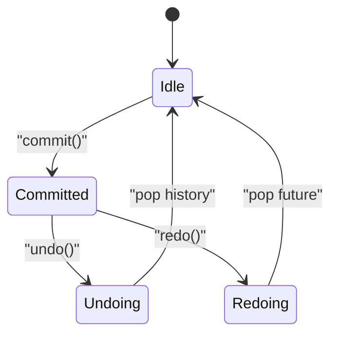

**图表来源**
- [store.ts:112-148](file://src/features/editor/store.ts#L112-L148)

**章节来源**
- [store.ts:79-148](file://src/features/editor/store.ts#L79-L148)

### 修剪与几何计算
- 修剪流程
  - 收集目标实体与所有可见边界的交点
  - 直线：按投影参数 t 排序，根据点击位置决定移除区间
  - 圆/圆弧：按角度参数化，确定切分区间并生成新弧
- 几何基础
  - 线段相交、线与圆相交、圆弧三点构造、包围盒、锚点、旋转变换、镜像点

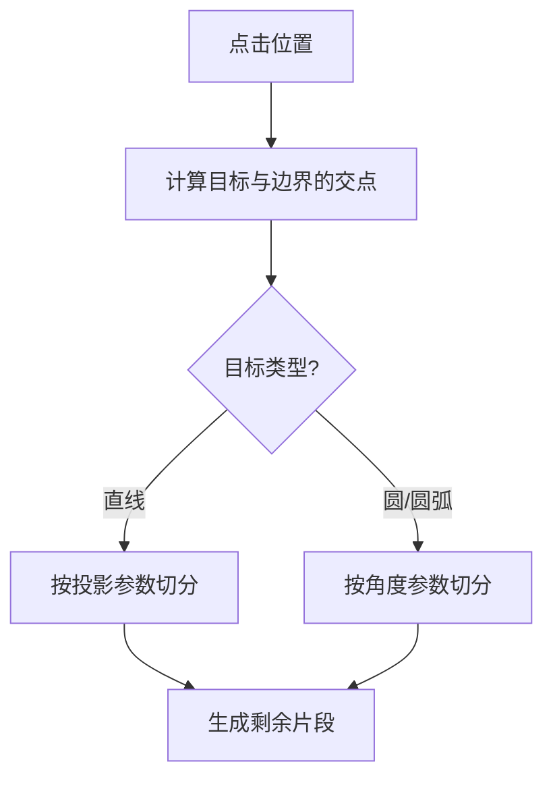

**图表来源**
- [trim.ts:21-128](file://src/cad/trim.ts#L21-L128)
- [geometry.ts:361-442](file://src/cad/geometry.ts#L361-L442)

**章节来源**
- [trim.ts:1-129](file://src/cad/trim.ts#L1-L129)
- [geometry.ts:1-443](file://src/cad/geometry.ts#L1-L443)

## 依赖关系分析
- 组件耦合
  - App 聚合 ToolRail/Canvas/Layers/Properties/StatusBar，并通过 useEditor 共享状态
  - Canvas 强依赖 geometry/tools，store 提供高层语义方法
  - Layers/Properties 通过 store.commit 修改文档结构
- 外部依赖
  - Zustand：轻量状态管理
  - lucide-react：图标
  - zod：数据校验
  - canvas/SVG：渲染

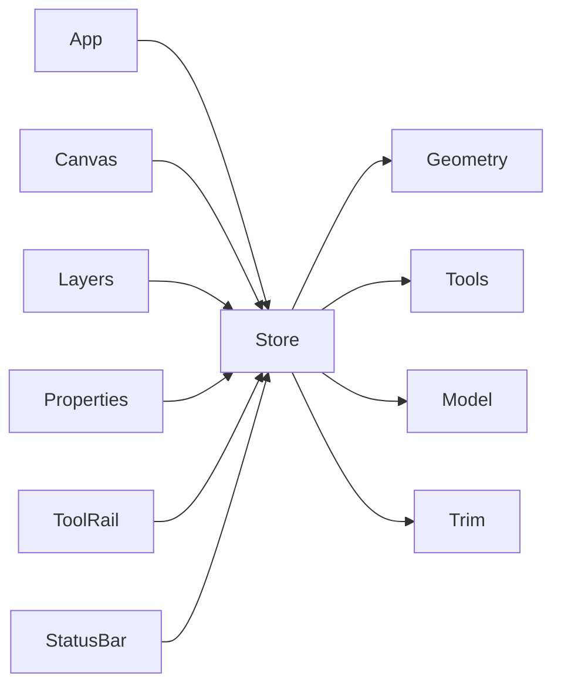

**图表来源**
- [App.tsx:23-31](file://src/app/App.tsx#L23-L31)
- [store.ts:1-15](file://src/features/editor/store.ts#L1-L15)

**章节来源**
- [App.tsx:34-329](file://src/app/App.tsx#L34-L329)
- [store.ts:1-15](file://src/features/editor/store.ts#L1-L15)

## 性能与可扩展性
- 性能
  - 使用 structuredClone 与 zod 校验确保状态一致，代价是较大文档时的序列化开销
  - 历史栈限制长度，避免无限增长
  - 吸附与包围盒计算在交互路径上，建议对大规模场景考虑空间索引
- 可扩展性
  - 新增工具：在 model.ts 的 Tool 联合类型中添加新工具名，在 tools.ts 的 toolNames/buildEntity 中注册
  - 新增属性：在 Properties.tsx 中按实体类型分支渲染对应字段
  - 新增几何能力：在 geometry.ts 中扩展函数，并在 store/Canvas 中复用

[本节为通用指导，不直接分析具体文件]

## 故障排查指南
- 无法创建图形
  - 检查当前图层是否可见且未锁定
  - 检查 points 数量是否满足工具要求
  - 查看 store.message 提示信息
- 撤销/重做无效
  - 确认 history/future 是否为空
  - 检查是否在对话框或输入框内触发了快捷键
- 视图异常
  - 检查 setView 的参数是否越界（scale 范围）
  - 确认屏幕尺寸变化后 ResizeObserver 已触发
- 吸附不准
  - 关闭对象吸附或网格吸附测试
  - 检查 ortho 模式与基准点设置

**章节来源**
- [store.ts:187-264](file://src/features/editor/store.ts#L187-L264)
- [Canvas.tsx:94-179](file://src/features/editor/Canvas.tsx#L94-L179)
- [Canvas.tsx:53-61](file://src/features/editor/Canvas.tsx#L53-L61)

## 结论
web-cad 编辑器以 Zustand 单源状态为核心，结合不可变更新与双向历史栈，实现了稳定可靠的撤销/重做机制。Canvas 统一处理交互与视图变换，geometry/tools/trim 提供清晰的几何能力分层。图层与属性面板通过 store.commit 与文档模型紧密协作，形成高内聚、低耦合的可扩展架构。

[本节为总结性内容，不直接分析具体文件]

## 附录：新增工具与属性面板实践

### 添加新编辑工具
步骤概览：
1. 在 model.ts 的 Tool 联合类型中添加新工具名
2. 在 tools.ts 的 toolNames 与 buildEntity 中注册工具名与构建逻辑
3. 在 ToolRail.tsx 的工具组中添加按钮与快捷键
4. 在 Canvas.tsx 的键盘映射与工具提示 hint 中补充行为
5. 在 store.ts 的 place/finish 中处理新工具的点序列与最终实体构建
6. 在 Properties.tsx 中为新实体类型渲染属性字段

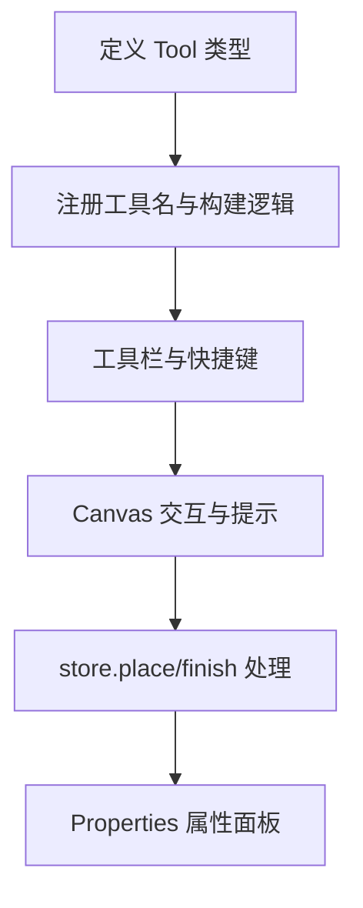

**图表来源**
- [model.ts:62-75](file://src/cad/model.ts#L62-L75)
- [tools.ts:5-18](file://src/cad/tools.ts#L5-L18)
- [tools.ts:49-125](file://src/cad/tools.ts#L49-L125)
- [ToolRail.tsx:21-58](file://src/features/editor/ToolRail.tsx#L21-L58)
- [Canvas.tsx:149-165](file://src/features/editor/Canvas.tsx#L149-L165)
- [store.ts:187-286](file://src/features/editor/store.ts#L187-L286)
- [Properties.tsx:16-394](file://src/features/editor/Properties.tsx#L16-L394)

**章节来源**
- [model.ts:62-75](file://src/cad/model.ts#L62-L75)
- [tools.ts:1-126](file://src/cad/tools.ts#L1-L126)
- [ToolRail.tsx:59-96](file://src/features/editor/ToolRail.tsx#L59-L96)
- [Canvas.tsx:149-165](file://src/features/editor/Canvas.tsx#L149-L165)
- [store.ts:187-286](file://src/features/editor/store.ts#L187-L286)
- [Properties.tsx:16-394](file://src/features/editor/Properties.tsx#L16-L394)

### 添加新属性面板字段
步骤概览：
1. 在 model.ts 的 Entity 联合类型中添加新字段
2. 在 Properties.tsx 中按实体类型分支渲染输入控件
3. 通过 update(patch) 调用 store.commit 持久化变更
4. 如需工具级参数，在 Properties 的工具属性区域增加 NumberField 或 Select

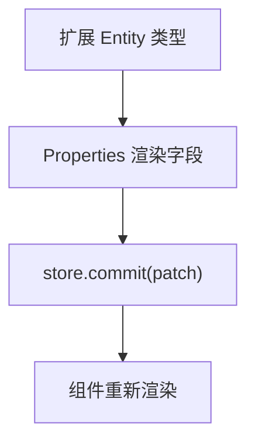

**图表来源**
- [model.ts:18-45](file://src/cad/model.ts#L18-L45)
- [Properties.tsx:29-43](file://src/features/editor/Properties.tsx#L29-L43)

**章节来源**
- [model.ts:18-45](file://src/cad/model.ts#L18-L45)
- [Properties.tsx:29-43](file://src/features/editor/Properties.tsx#L29-L43)