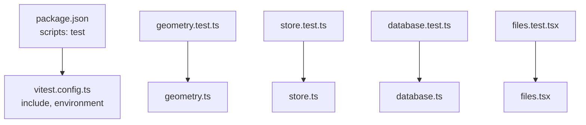
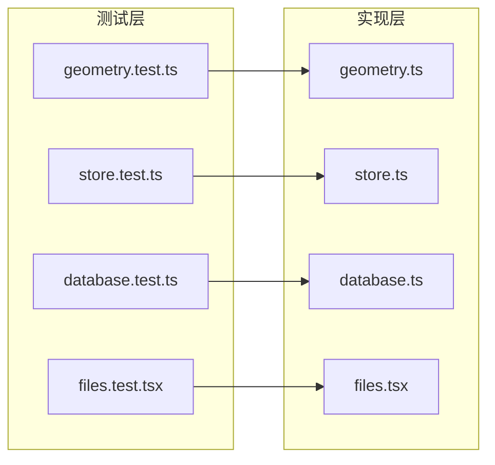
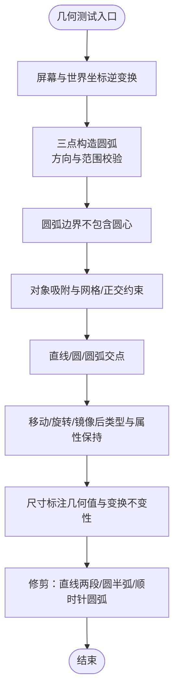
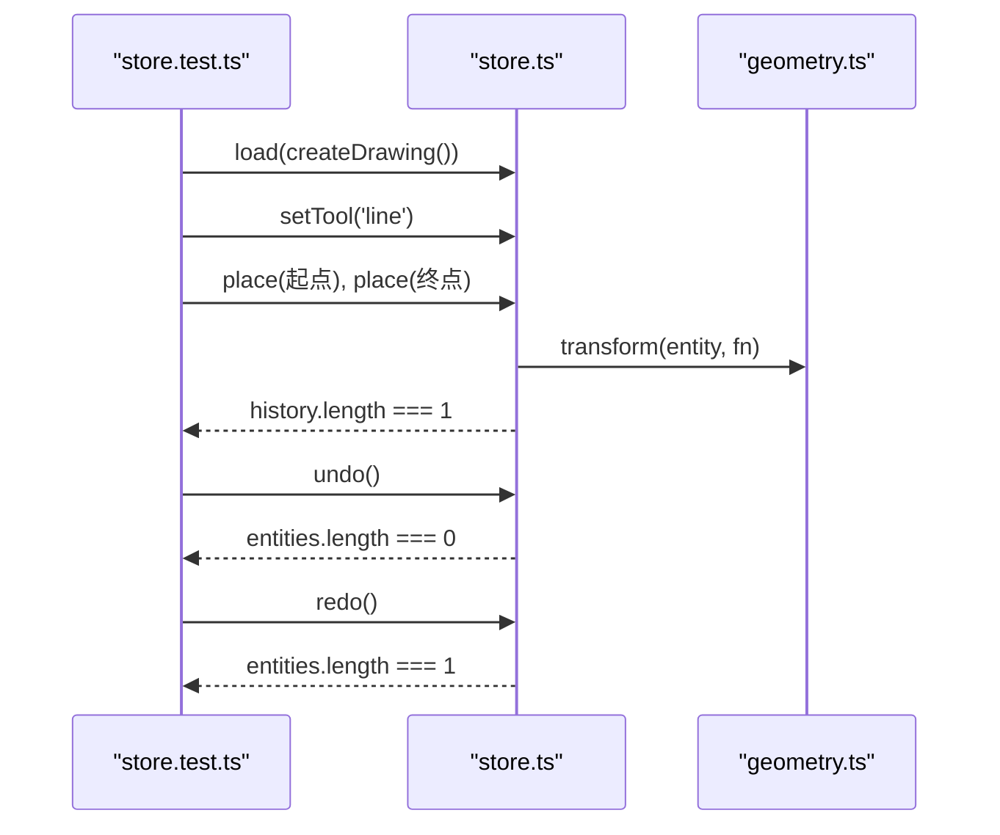
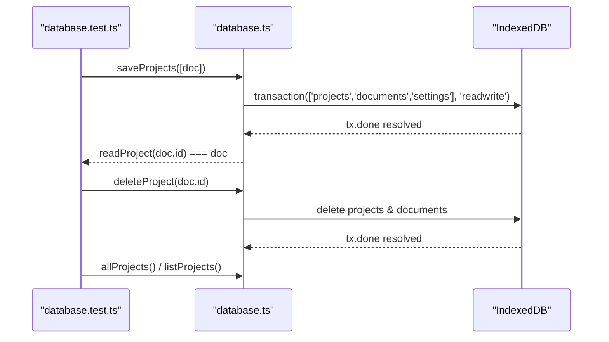
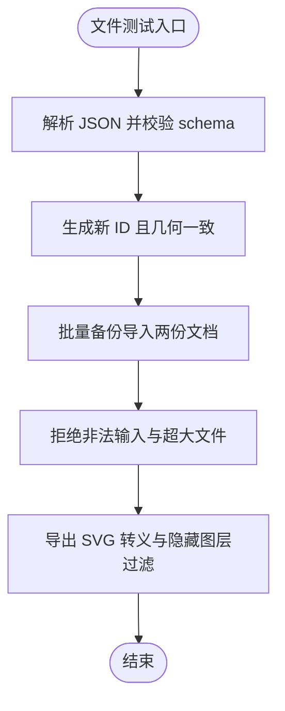
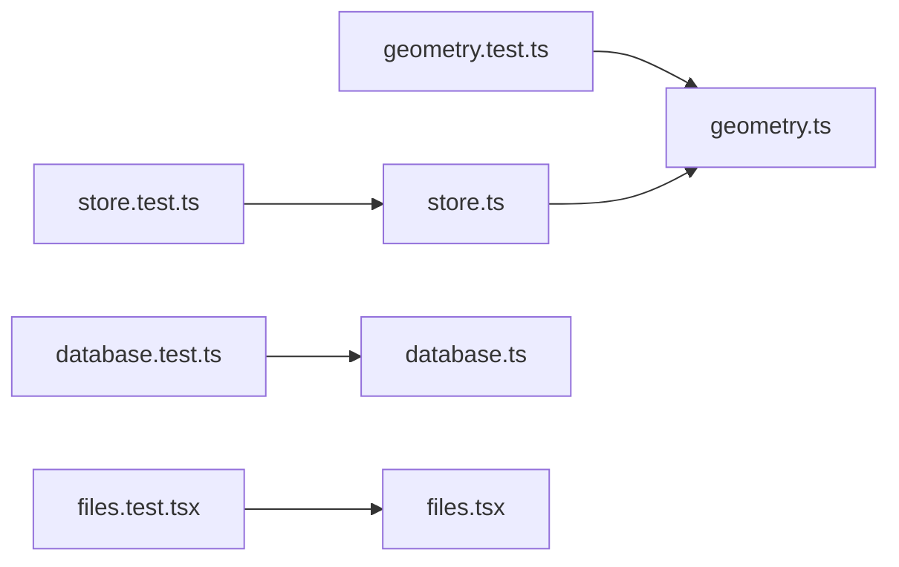

# 单元测试

<cite>
**本文引用的文件**   
- [package.json](file://package.json)
- [vitest.config.ts](file://vitest.config.ts)
- [geometry.test.ts](file://src/cad/geometry.test.ts)
- [geometry.ts](file://src/cad/geometry.ts)
- [store.test.ts](file://src/features/editor/store.test.ts)
- [store.ts](file://src/features/editor/store.ts)
- [database.test.ts](file://src/storage/database.test.ts)
- [database.ts](file://src/storage/database.ts)
- [files.test.tsx](file://src/io/files.test.tsx)
- [files.tsx](file://src/io/files.tsx)
</cite>

## 目录
1. [引言](#引言)
2. [项目结构](#项目结构)
3. [核心组件](#核心组件)
4. [架构总览](#架构总览)
5. [详细组件分析](#详细组件分析)
6. [依赖关系分析](#依赖关系分析)
7. [性能与可测性建议](#性能与可测性建议)
8. [故障排查指南](#故障排查指南)
9. [结论](#结论)
10. [附录：测试覆盖率与最佳实践](#附录测试覆盖率与最佳实践)

## 引言
本文面向 web-cad 项目的单元测试，围绕以下目标展开：
- 说明 Vitest 在本项目中的配置与使用方式
- 给出几何计算模块的测试用例编写方法与验证策略
- 阐述基于 Zustand 的状态管理 store 的测试策略
- 展示 IndexedDB 数据库操作的测试方法，包括事务、回滚与一致性校验
- 解释如何测试异步函数、Mock 外部依赖与构造测试数据
- 提供具体测试代码路径示例，覆盖几何算法正确性、状态变更准确性与数据库操作有效性
- 补充测试覆盖率配置与最佳实践指导

## 项目结构
本项目采用功能域组织方式，测试文件与源码就近放置，便于理解上下文与依赖关系。关键测试文件如下：
- 几何计算：[geometry.test.ts](file://src/cad/geometry.test.ts)
- 编辑器状态管理：[store.test.ts](file://src/features/editor/store.test.ts)
- 本地存储（IndexedDB）：[database.test.ts](file://src/storage/database.test.ts)
- 文件导入导出：[files.test.tsx](file://src/io/files.test.tsx)

Vitest 通过配置文件启用 React 插件，并限定测试文件匹配规则。脚本命令统一在包管理中定义。

**图表来源**
- [package.json:9-15](file://package.json#L9-L15)
- [vitest.config.ts:4-11](file://vitest.config.ts#L4-L11)

**章节来源**
- [package.json:9-15](file://package.json#L9-L15)
- [vitest.config.ts:4-11](file://vitest.config.ts#L4-L11)

## 核心组件
本节聚焦三类被测单元：
- 几何计算模块：坐标变换、吸附、交点、修剪等
- 编辑器状态管理：绘图、撤销重做、图层锁定、选择与变换
- 本地存储：IndexedDB 读写、事务、摘要同步、批量导入校验

这些组件分别对应测试文件与实现文件，后续章节将逐一拆解其测试策略与关键点。

**章节来源**
- [geometry.test.ts:1-298](file://src/cad/geometry.test.ts#L1-L298)
- [store.test.ts:1-99](file://src/features/editor/store.test.ts#L1-L99)
- [database.test.ts:1-63](file://src/storage/database.test.ts#L1-L63)

## 架构总览
下图展示了测试与实现的映射关系，以及关键依赖方向。

**图表来源**
- [geometry.test.ts:1-298](file://src/cad/geometry.test.ts#L1-L298)
- [geometry.ts:1-443](file://src/cad/geometry.ts#L1-L443)
- [store.test.ts:1-99](file://src/features/editor/store.test.ts#L1-L99)
- [store.ts:1-324](file://src/features/editor/store.ts#L1-L324)
- [database.test.ts:1-63](file://src/storage/database.test.ts#L1-L63)
- [database.ts:1-90](file://src/storage/database.ts#L1-L90)
- [files.test.tsx:1-107](file://src/io/files.test.tsx#L1-L107)
- [files.tsx:1-63](file://src/io/files.tsx#L1-L63)

## 详细组件分析

### 几何计算模块测试
几何模块包含大量数值计算与边界条件处理，测试重点在于：
- 坐标逆变换的正确性
- 圆弧构造与方向判定
- 对象吸附与正交约束
- 直线、圆与圆弧的交点计算
- 图形变换（移动、旋转、镜像）后的类型与属性保持
- 尺寸标注几何值与旋转/镜像不变性
- 修剪逻辑对直线、圆的分段与方向处理

**图表来源**
- [geometry.test.ts:35-240](file://src/cad/geometry.test.ts#L35-L240)
- [geometry.ts:31-42](file://src/cad/geometry.ts#L31-L42)
- [geometry.ts:43-72](file://src/cad/geometry.ts#L43-L72)
- [geometry.ts:191-245](file://src/cad/geometry.ts#L191-L245)
- [geometry.ts:361-442](file://src/cad/geometry.ts#L361-L442)
- [geometry.ts:253-328](file://src/cad/geometry.ts#L253-L328)
- [geometry.ts:81-111](file://src/cad/geometry.ts#L81-L111)

测试要点与建议：
- 使用精确比较与容差断言（例如浮点数接近相等）
- 针对圆弧方向与角度归一化进行充分覆盖
- 对吸附容差、网格步长、正交约束组合场景进行矩阵式用例设计
- 对裁剪结果的方向与端点一致性进行断言

**章节来源**
- [geometry.test.ts:35-240](file://src/cad/geometry.test.ts#L35-L240)
- [geometry.ts:31-42](file://src/cad/geometry.ts#L31-L42)
- [geometry.ts:43-72](file://src/cad/geometry.ts#L43-L72)
- [geometry.ts:191-245](file://src/cad/geometry.ts#L191-L245)
- [geometry.ts:361-442](file://src/cad/geometry.ts#L361-L442)
- [geometry.ts:253-328](file://src/cad/geometry.ts#L253-L328)
- [geometry.ts:81-111](file://src/cad/geometry.ts#L81-L111)

### 编辑器状态管理测试
编辑器状态由 Zustand store 管理，测试关注：
- 完整绘图仅生成一次历史，撤销/重做恢复一致
- 移动、复制、删除为可撤销命令
- 图层锁定后禁止新建、删除或变换
- 撤销图层创建后当前图层仍有效
- 拒绝非法数值及悬空图层引用

**图表来源**
- [store.test.ts:6-20](file://src/features/editor/store.test.ts#L6-L20)
- [store.ts:48-101](file://src/features/editor/store.ts#L48-L101)
- [geometry.ts:253-328](file://src/cad/geometry.ts#L253-L328)

测试要点与建议：
- 使用 beforeEach 重置状态，确保用例隔离
- 通过 getState 直接读取状态，避免渲染开销
- 对不可变更新与历史栈长度进行断言
- 对图层锁定与可见性分支进行覆盖

**章节来源**
- [store.test.ts:6-99](file://src/features/editor/store.test.ts#L6-L99)
- [store.ts:48-324](file://src/features/editor/store.ts#L48-L324)

### 数据库操作测试
数据库层基于 IndexedDB，测试关注：
- 文档与摘要同步保存，重复保存不重复创建
- 复制项目为新 ID，删除同时移除摘要与文档
- 批量导入全部校验后再写入，不留下部分数据
- 事务中途失败时回滚两个 store

**图表来源**
- [database.test.ts:24-61](file://src/storage/database.test.ts#L24-L61)
- [database.ts:45-89](file://src/storage/database.ts#L45-L89)

测试要点与建议：
- 使用 fake-indexeddb 在 Node 环境模拟 IndexedDB
- 在每个用例前清理所有 objectStore，保证测试隔离
- 对事务失败与回滚行为进行断言
- 对批量导入的数据校验与原子性进行覆盖

**章节来源**
- [database.test.ts:1-63](file://src/storage/database.test.ts#L1-L63)
- [database.ts:1-90](file://src/storage/database.ts#L1-L90)

### 文件导入导出测试
文件模块负责 JSON 与 SVG 的导入导出，测试关注：
- JSON 往返保留几何并生成新 ID
- 批量备份导入两份完整文档
- 拒绝未知版本、无效图层引用、重复 ID 和坏 JSON
- 拒绝重复项目 ID、非有限数值和超大文件
- 导出 SVG 正确转义文字与项目名，并排除隐藏图层

**图表来源**
- [files.test.tsx:12-106](file://src/io/files.test.tsx#L12-L106)
- [files.tsx:31-62](file://src/io/files.tsx#L31-L62)

测试要点与建议：
- 使用 fixture 构造最小可用文档
- 对 schema 校验与错误消息进行断言
- 对 XSS 防护（HTML 转义）进行覆盖
- 对文件大小限制与重复 ID 检测进行边界测试

**章节来源**
- [files.test.tsx:12-106](file://src/io/files.test.tsx#L12-L106)
- [files.tsx:31-62](file://src/io/files.tsx#L31-L62)

## 依赖关系分析
- geometry.test.ts 依赖 geometry.ts 的纯函数，无外部副作用，适合快速、稳定的单元测试
- store.test.ts 依赖 store.ts 的 Zustand store，间接依赖 geometry.ts 与 model.ts，测试需关注状态一致性
- database.test.ts 依赖 database.ts 与 IndexedDB，通过 fake-indexeddb 在 Node 环境运行
- files.test.tsx 依赖 files.tsx 与 react-dom/server，用于服务端渲染 SVG

**图表来源**
- [geometry.test.ts:1-298](file://src/cad/geometry.test.ts#L1-L298)
- [store.test.ts:1-99](file://src/features/editor/store.test.ts#L1-L99)
- [database.test.ts:1-63](file://src/storage/database.test.ts#L1-L63)
- [files.test.tsx:1-107](file://src/io/files.test.tsx#L1-L107)

**章节来源**
- [geometry.test.ts:1-298](file://src/cad/geometry.test.ts#L1-L298)
- [store.test.ts:1-99](file://src/features/editor/store.test.ts#L1-L99)
- [database.test.ts:1-63](file://src/storage/database.test.ts#L1-L63)
- [files.test.tsx:1-107](file://src/io/files.test.tsx#L1-L107)

## 性能与可测性建议
- 几何计算为纯函数，建议按功能拆分更多小函数，提升单测粒度与复用性
- 编辑器 store 的 commit 流程已包含 schema 校验，建议在复杂变换中增加中间态快照断言
- IndexedDB 测试应尽量减少真实 IO，使用 fake-indexeddb 并确保每个用例前后清理
- 文件导出涉及 DOM 与 React 服务端渲染，建议在 CI 中单独运行相关用例，避免浏览器环境差异

[本节为通用建议，不直接分析具体文件]

## 故障排查指南
常见问题与定位思路：
- 几何数值误差：使用接近相等断言，检查 EPS 容差与角度归一化
- 吸附异常：检查网格步长、对象锚点与正交约束的组合参数
- 撤销重做不一致：确认历史栈长度与 activeLayer 的有效性
- IndexedDB 事务失败：检查事务是否 await tx.done，确认回滚后数据为空
- SVG 导出 XSS：确认 HTML 实体转义与隐藏图层过滤逻辑

**章节来源**
- [geometry.test.ts:35-240](file://src/cad/geometry.test.ts#L35-L240)
- [store.test.ts:12-99](file://src/features/editor/store.test.ts#L12-L99)
- [database.test.ts:52-61](file://src/storage/database.test.ts#L52-L61)
- [files.test.tsx:84-106](file://src/io/files.test.tsx#L84-L106)

## 结论
本项目的测试覆盖了核心几何算法、编辑器状态管理与本地存储三大领域。通过 Vitest 与 fake-indexeddb，实现了稳定、可重复的单元测试。建议在后续迭代中：
- 持续完善边界用例与异常路径
- 引入测试覆盖率统计与阈值
- 对复杂交互流程补充端到端测试（Playwright）

[本节为总结性内容，不直接分析具体文件]

## 附录：测试覆盖率与最佳实践
- 覆盖率配置
  - 可在 vitest.config.ts 中添加 coverage 配置项，指定 reporter 与阈值
  - 推荐开启 Istanbul 报告，并在 CI 中阻断低于阈值的提交
- 最佳实践
  - 测试命名清晰，描述业务意图而非实现细节
  - 每个用例只验证一个行为，保持断言单一职责
  - 使用 beforeEach 初始化与清理测试数据
  - 对外部依赖（IndexedDB、文件系统、网络）进行 Mock 或替换
  - 对异步函数使用 async/await 与 expect().rejects.toThrow()
  - 对几何计算使用容差断言，避免浮点误差导致的不稳定

[本节为通用指导，不直接分析具体文件]