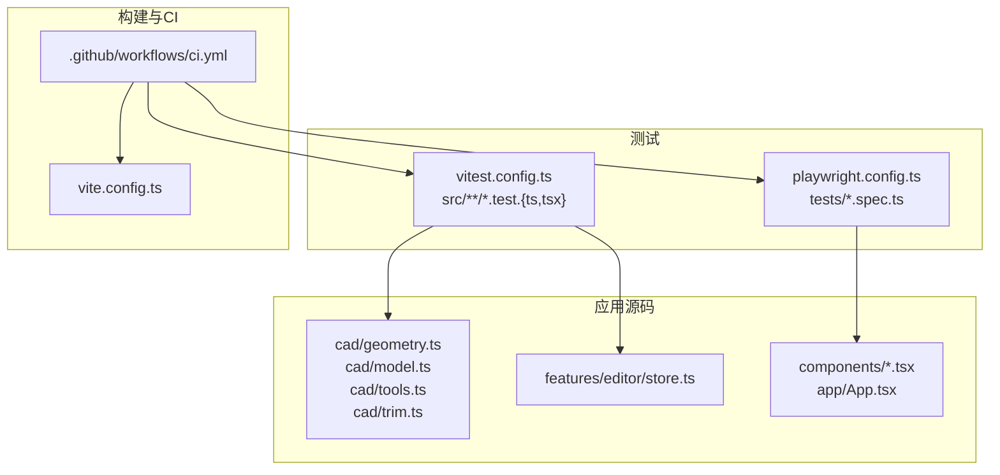
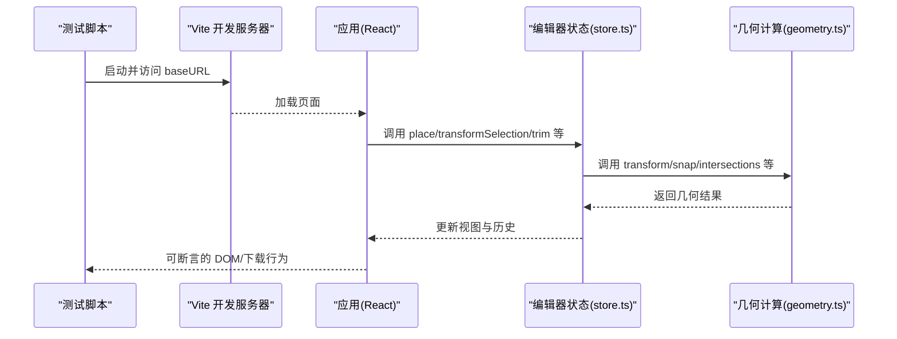
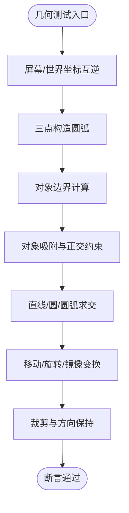
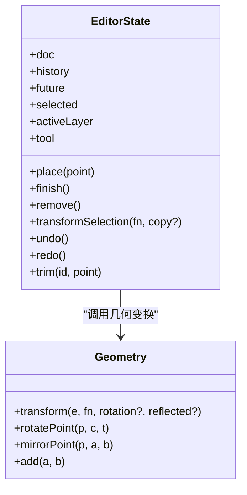
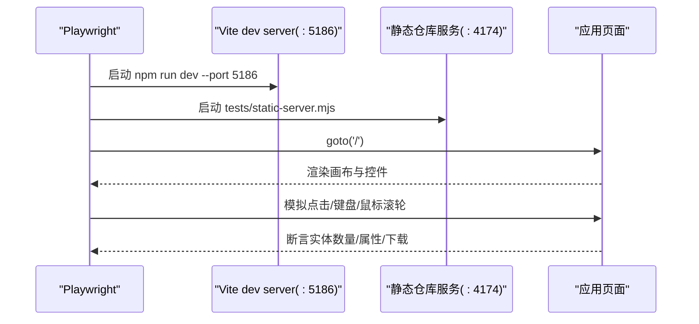
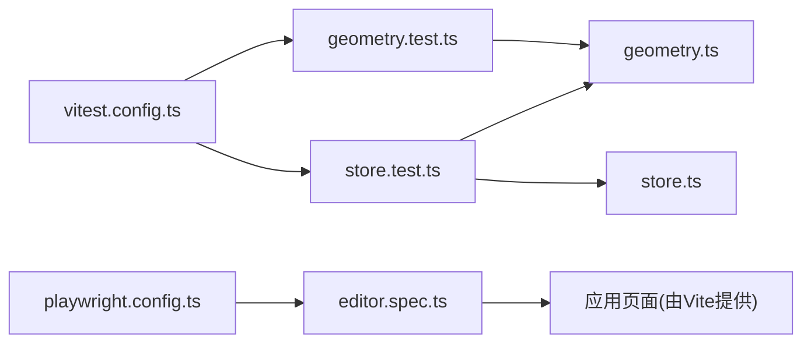

# 测试策略

<cite>
**本文引用的文件**   
- [package.json](file://package.json)
- [vitest.config.ts](file://vitest.config.ts)
- [playwright.config.ts](file://playwright.config.ts)
- [vite.config.ts](file://vite.config.ts)
- [ci.yml](file://.github/workflows/ci.yml)
- [geometry.test.ts](file://src/cad/geometry.test.ts)
- [geometry.ts](file://src/cad/geometry.ts)
- [store.test.ts](file://src/features/editor/store.test.ts)
- [store.ts](file://src/features/editor/store.ts)
- [editor.spec.ts](file://tests/editor.spec.ts)
</cite>

## 目录
1. [引言](#引言)
2. [项目结构](#项目结构)
3. [核心组件](#核心组件)
4. [架构总览](#架构总览)
5. [详细组件分析](#详细组件分析)
6. [依赖关系分析](#依赖关系分析)
7. [性能与压力测试策略](#性能与压力测试策略)
8. [测试最佳实践与覆盖率要求](#测试最佳实践与覆盖率要求)
9. [故障排查指南](#故障排查指南)
10. [结论](#结论)

## 引言
本测试策略文档面向 web-cad 项目的单元测试、端到端测试、持续集成与质量保障。目标包括：
- 明确 Vitest 单元测试框架的配置与使用方式，覆盖几何计算、工具逻辑与状态管理。
- 说明 Playwright 端到端测试的配置与用例编写方法。
- 给出测试环境搭建、异步测试、Mock 数据与测试数据管理的最佳实践。
- 定义代码覆盖率基线与提升路径。
- 提供性能测试与压力测试的实施建议。
- 梳理 CI 流水线中的检查、测试与构建步骤。

## 项目结构
仓库采用分层组织：
- src/cad：几何计算、模型与裁剪等核心 CAD 算法。
- src/features/editor：编辑器状态管理与业务命令（撤销重做、变换、修剪等）。
- tests：Playwright E2E 测试用例。
- vitest.config.ts / playwright.config.ts：测试框架配置。
- .github/workflows/ci.yml：CI 流水线。

**图表来源**
- [vitest.config.ts:1-12](file://vitest.config.ts#L1-L12)
- [playwright.config.ts:1-34](file://playwright.config.ts#L1-L34)
- [vite.config.ts:1-11](file://vite.config.ts#L1-L11)
- [ci.yml:1-31](file://.github/workflows/ci.yml#L1-L31)

**章节来源**
- [vitest.config.ts:1-12](file://vitest.config.ts#L1-L12)
- [playwright.config.ts:1-34](file://playwright.config.ts#L1-L34)
- [vite.config.ts:1-11](file://vite.config.ts#L1-L11)
- [ci.yml:1-31](file://.github/workflows/ci.yml#L1-L31)

## 核心组件
- 单元测试（Vitest）
  - 入口配置位于 vitest.config.ts，启用 React 插件，测试文件匹配规则为 src/**/*.test.{ts,tsx}，运行环境为 node。
  - 当前已有几何计算测试与编辑器状态测试。
- 端到端测试（Playwright）
  - 入口配置位于 playwright.config.ts，测试目录为 tests，浏览器视口固定，失败保留 trace，自动启动开发服务器与静态资源服务。
  - 已有完整的编辑器交互、导入导出、离线单文件等场景用例。
- 持续集成（GitHub Actions）
  - ci.yml 执行 lint、类型检查、单元测试、构建与 E2E 测试，并在失败时上传 Playwright 报告。

**章节来源**
- [vitest.config.ts:1-12](file://vitest.config.ts#L1-L12)
- [playwright.config.ts:1-34](file://playwright.config.ts#L1-L34)
- [ci.yml:1-31](file://.github/workflows/ci.yml#L1-L31)

## 架构总览
下图展示从测试到应用的调用链路与依赖关系。

**图表来源**
- [playwright.config.ts:16-33](file://playwright.config.ts#L16-L33)
- [store.ts:187-315](file://src/features/editor/store.ts#L187-L315)
- [geometry.ts:191-442](file://src/cad/geometry.ts#L191-L442)

## 详细组件分析

### 单元测试：几何计算测试
几何模块包含大量纯函数，适合以输入输出为中心进行断言。现有测试覆盖了坐标变换、圆弧构造、边界计算、吸附、交点、变换与修剪等关键路径。

**图表来源**
- [geometry.test.ts:35-240](file://src/cad/geometry.test.ts#L35-L240)
- [geometry.ts:31-42](file://src/cad/geometry.ts#L31-L42)
- [geometry.ts:55-72](file://src/cad/geometry.ts#L55-L72)
- [geometry.ts:161-189](file://src/cad/geometry.ts#L161-L189)
- [geometry.ts:191-245](file://src/cad/geometry.ts#L191-L245)
- [geometry.ts:253-328](file://src/cad/geometry.ts#L253-L328)
- [geometry.ts:401-442](file://src/cad/geometry.ts#L401-L442)

编写要点与建议：
- 对数值比较使用容差断言，避免浮点误差导致不稳定。
- 针对边界情况（共线、相切、零角度圆弧）补充用例。
- 将复杂几何流程拆分为多个小用例，便于定位回归问题。

**章节来源**
- [geometry.test.ts:1-298](file://src/cad/geometry.test.ts#L1-L298)
- [geometry.ts:1-443](file://src/cad/geometry.ts#L1-L443)

### 单元测试：编辑器状态管理测试
编辑器状态基于 Zustand，封装了绘图、选择、变换、修剪、撤销重做等命令，并通过 schema 校验保证数据合法性。

**图表来源**
- [store.ts:17-47](file://src/features/editor/store.ts#L17-L47)
- [store.ts:160-233](file://src/features/editor/store.ts#L160-L233)
- [geometry.ts:246-336](file://src/cad/geometry.ts#L246-L336)

编写要点与建议：
- 使用 beforeEach 重置状态，确保用例隔离。
- 对不可变更新与历史栈长度进行断言，验证撤销重做一致性。
- 对非法输入（负半径、悬空图层引用）进行拒绝分支断言。
- 对图层锁定/隐藏等权限控制增加用例。

**章节来源**
- [store.test.ts:1-99](file://src/features/editor/store.test.ts#L1-L99)
- [store.ts:67-148](file://src/features/editor/store.ts#L67-L148)
- [store.ts:149-233](file://src/features/editor/store.ts#L149-L233)
- [store.ts:287-315](file://src/features/editor/store.ts#L287-L315)

### 端到端测试：Playwright 配置与用例
Playwright 配置关键点：
- 测试目录 tests，禁用并行，单 worker，CI 下重试。
- 固定视口 1440x960，失败保留 trace。
- 自动启动两个 webServer：开发服务器与静态仓库服务。
- 通过 baseURL 访问应用。

**图表来源**
- [playwright.config.ts:4-33](file://playwright.config.ts#L4-L33)
- [editor.spec.ts:28-50](file://tests/editor.spec.ts#L28-L50)
- [editor.spec.ts:94-125](file://tests/editor.spec.ts#L94-L125)

用例覆盖范围：
- 绘制、属性编辑、撤销重做、刷新恢复。
- JSON 导入不覆盖原项目、SVG 导出。
- 锁定图层限制操作、非法导入保护。
- 鼠标绘制、平移缩放、尺寸标注。
- 精确坐标的移动、复制、旋转、镜像。
- 折线、三点圆弧、文字绘制与属性更新。
- 圆修剪为圆弧、一次撤销恢复。
- 复制项目、批量备份导入、最近项目恢复。
- IndexedDB 不可用时的临时模式与导出能力。
- 保存失败提示与重试恢复。
- 普通构建在子路径加载、单 HTML 离线可用。

**章节来源**
- [playwright.config.ts:1-34](file://playwright.config.ts#L1-L34)
- [editor.spec.ts:1-317](file://tests/editor.spec.ts#L1-L317)

## 依赖关系分析
- 测试与源码耦合
  - 单元测试直接依赖 geometry.ts 与 store.ts 的导出接口。
  - E2E 通过浏览器 DOM 与下载事件断言用户可见行为。
- 外部依赖
  - 运行时依赖：react、zustand、idb、zod 等。
  - 测试依赖：vitest、@playwright/test、fake-indexeddb。

**图表来源**
- [geometry.test.ts:1-19](file://src/cad/geometry.test.ts#L1-L19)
- [store.test.ts:1-6](file://src/features/editor/store.test.ts#L1-L6)
- [editor.spec.ts:1-6](file://tests/editor.spec.ts#L1-L6)
- [vitest.config.ts:1-12](file://vitest.config.ts#L1-L12)
- [playwright.config.ts:1-34](file://playwright.config.ts#L1-L34)

**章节来源**
- [package.json:22-46](file://package.json#L22-L46)
- [vitest.config.ts:1-12](file://vitest.config.ts#L1-L12)
- [playwright.config.ts:1-34](file://playwright.config.ts#L1-L34)

## 性能与压力测试策略
当前仓库未内置性能基准或压力测试任务。建议在以下维度逐步完善：
- 几何计算性能
  - 对 intersections、snap、transform 等热点函数建立基准用例，统计不同实体规模下的耗时。
  - 关注大折线、多圆/圆弧相交场景的性能退化。
- 渲染与交互性能
  - 使用 Playwright 的 performance 指标或浏览器开发者工具采集 FPS、长任务、主线程阻塞。
  - 对大规模图纸的平移缩放、实时吸附进行体验评估。
- 压力测试
  - 生成含数千实体的图纸，验证导入/导出、撤销重做、筛选与渲染的稳定性。
  - 结合 CI 设置超时与内存阈值，防止回归。
- 自动化与回归
  - 将性能用例纳入 nightly 任务，对比历史基线，异常告警。

[本节为通用指导，不涉及具体文件]

## 测试最佳实践与覆盖率要求
- 单元测试
  - 每个公共函数至少一个正向用例；对边界条件、异常输入补充用例。
  - 使用 toBeCloseTo 处理浮点比较；对数组/对象结构使用结构化断言。
  - 对副作用（如 setState）仅断言最终状态变化，避免内部实现细节耦合。
- 端到端测试
  - 优先断言用户可见结果（DOM 文本、元素数量、下载文件名），而非内部状态。
  - 使用稳定的选择器（data-testid、role、label），减少脆弱性。
  - 对异步操作使用显式等待（如 ready 辅助函数）。
- Mock 与测试数据
  - 对 IndexedDB 等外部存储，可使用 fake-indexeddb 或在 E2E 中注入错误模拟异常路径。
  - 将常用测试数据抽取为工厂函数，提高可读性与复用性。
- 覆盖率要求
  - 建议设定行覆盖率≥80%、分支覆盖率≥70%、函数覆盖率≥85%、语句覆盖率≥80%。
  - 对核心几何与状态管理模块设定更高阈值（行≥90%、分支≥80%）。
  - 在 CI 中引入覆盖率门槛，低于阈值则失败。

[本节为通用指导，不涉及具体文件]

## 故障排查指南
- Vitest 找不到测试文件
  - 确认测试文件命名符合 include 规则（src/**/*.test.{ts,tsx}）。
  - 检查 vitest.config.ts 的 include 与 environment 配置。
- Playwright 无法连接应用
  - 检查 playwright.config.ts 的 baseURL 与 webServer 端口是否一致。
  - 确认 CI 已安装 Chromium 并正确启动开发服务器与静态服务。
- 异步断言不稳定
  - 使用显式等待（如等待保存状态文案出现），避免随机时序问题。
- IndexedDB 相关错误
  - 在 E2E 中通过注入错误或使用 fake-indexeddb 复现异常路径。
- 构建产物路径问题
  - 普通构建与单 HTML 构建分别验证 baseURL 与相对路径加载。

**章节来源**
- [vitest.config.ts:8-11](file://vitest.config.ts#L8-L11)
- [playwright.config.ts:16-33](file://playwright.config.ts#L16-L33)
- [editor.spec.ts:231-270](file://tests/editor.spec.ts#L231-L270)

## 结论
本项目已具备清晰的单元测试与端到端测试基础：
- Vitest 聚焦几何计算与编辑器状态的正确性。
- Playwright 覆盖完整用户工作流与异常路径。
- CI 流水线统一执行检查、测试与构建，并产出 E2E 报告。
后续建议：
- 补充性能基准与压力测试，纳入夜间任务。
- 引入覆盖率门槛与可视化报告，持续提升质量基线。
- 完善 Mock 与测试数据管理，降低用例维护成本。