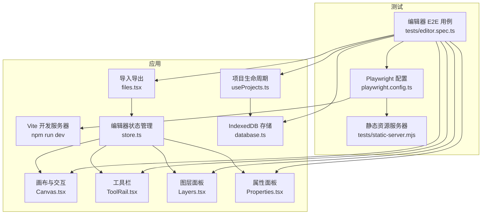
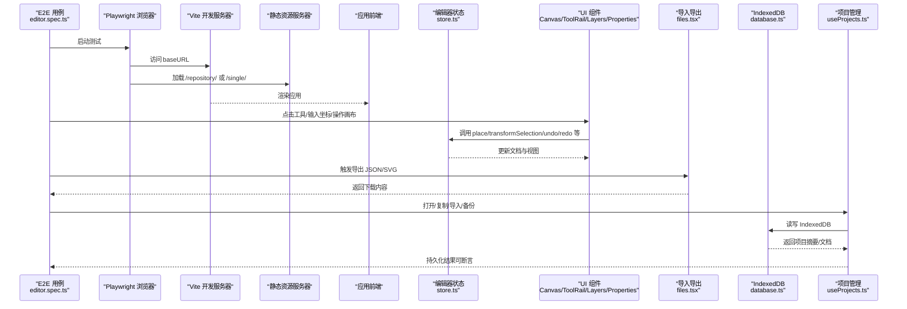
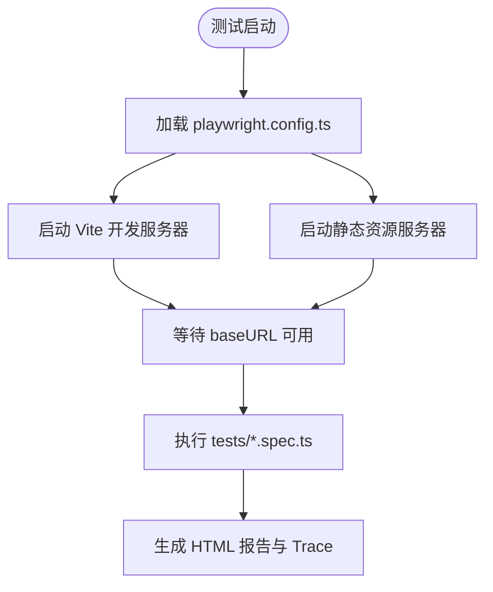
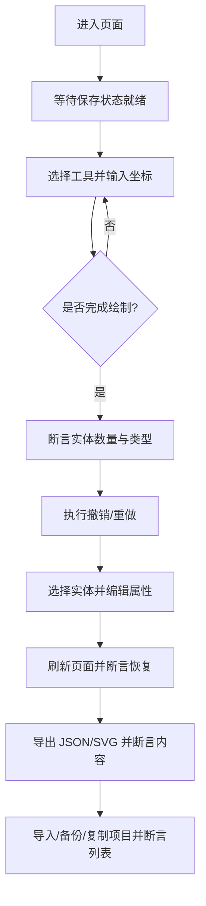
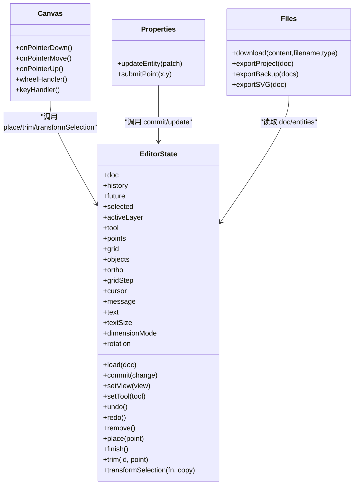
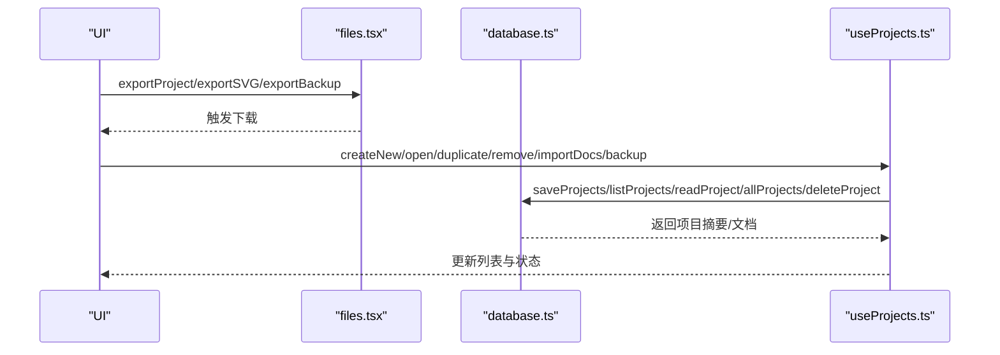
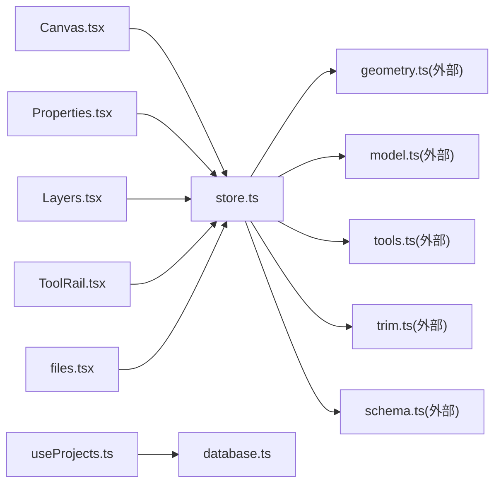

# 端到端测试

<cite>
**本文引用的文件**   
- [playwright.config.ts](file://playwright.config.ts)
- [tests/editor.spec.ts](file://tests/editor.spec.ts)
- [tests/static-server.mjs](file://tests/static-server.mjs)
- [package.json](file://package.json)
- [src/features/editor/store.ts](file://src/features/editor/store.ts)
- [src/features/editor/Canvas.tsx](file://src/features/editor/Canvas.tsx)
- [src/features/editor/ToolRail.tsx](file://src/features/editor/ToolRail.tsx)
- [src/features/editor/Layers.tsx](file://src/features/editor/Layers.tsx)
- [src/features/editor/Properties.tsx](file://src/features/editor/Properties.tsx)
- [src/io/files.tsx](file://src/io/files.tsx)
- [src/storage/database.ts](file://src/storage/database.ts)
- [src/features/projects/useProjects.ts](file://src/features/projects/useProjects.ts)
</cite>

## 目录
1. [引言](#引言)
2. [项目结构](#项目结构)
3. [核心组件](#核心组件)
4. [架构总览](#架构总览)
5. [详细组件分析](#详细组件分析)
6. [依赖关系分析](#依赖关系分析)
7. [性能与兼容性测试策略](#性能与兼容性测试策略)
8. [故障排查指南](#故障排查指南)
9. [结论](#结论)

## 引言
本文件面向 web-cad 项目的端到端测试，目标是帮助读者快速搭建 Playwright 测试环境、编写编辑器功能的 E2E 用例、理解界面交互与数据持久化验证方式，并给出跨浏览器兼容性与性能测试的实施建议。文档基于仓库中现有的 Playwright 配置、测试脚本与应用代码进行说明，确保所有实践均可在现有工程内直接落地。

## 项目结构
web-cad 的 E2E 测试位于 tests 目录，使用 Playwright Test 框架；应用前端由 Vite 提供开发服务器，Playwright 通过 webServer 自动启动开发服务与静态资源服务，以覆盖标准构建和单文件离线构建两种部署形态。

图表来源
- [playwright.config.ts:4-33](file://playwright.config.ts#L4-L33)
- [tests/editor.spec.ts:1-317](file://tests/editor.spec.ts#L1-L317)
- [tests/static-server.mjs:5-41](file://tests/static-server.mjs#L5-L41)
- [src/features/editor/store.ts:17-47](file://src/features/editor/store.ts#L17-L47)
- [src/features/editor/Canvas.tsx:32-652](file://src/features/editor/Canvas.tsx#L32-L652)
- [src/features/editor/ToolRail.tsx:59-96](file://src/features/editor/ToolRail.tsx#L59-L96)
- [src/features/editor/Layers.tsx:14-163](file://src/features/editor/Layers.tsx#L14-L163)
- [src/features/editor/Properties.tsx:16-394](file://src/features/editor/Properties.tsx#L16-L394)
- [src/io/files.tsx:6-62](file://src/io/files.tsx#L6-L62)
- [src/storage/database.ts:18-90](file://src/storage/database.ts#L18-L90)
- [src/features/projects/useProjects.ts:15-208](file://src/features/projects/useProjects.ts#L15-L208)

章节来源
- [playwright.config.ts:4-33](file://playwright.config.ts#L4-L33)
- [tests/editor.spec.ts:1-317](file://tests/editor.spec.ts#L1-L317)
- [tests/static-server.mjs:5-41](file://tests/static-server.mjs#L5-L41)
- [package.json:9-20](file://package.json#L9-L20)

## 核心组件
本节聚焦 E2E 测试的关键支撑：Playwright 配置、编辑器状态与 UI 组件、导入导出与持久化。

- Playwright 配置
  - 测试目录：tests
  - 并行与重试：关闭并行，CI 环境下重试
  - 报告：列表与 HTML 报告
  - 运行环境：baseURL、视口、trace 保留失败轨迹、可选浏览器通道
  - Web 服务器：同时启动 Vite 开发服务与静态资源服务，分别用于在线构建与离线单文件构建

- 编辑器状态与交互
  - store.ts 维护绘图文档、历史栈、视图、工具、点序列等状态，并提供绘制、变换、撤销重做等方法
  - Canvas.tsx 处理鼠标、滚轮、键盘事件，实现平移缩放、框选、拖拽、预览与网格吸附
  - ToolRail.tsx 暴露选择、绘制、注释、修改四类工具按钮
  - Layers.tsx 管理图层可见性、锁定、颜色与名称
  - Properties.tsx 提供精确坐标输入、实体属性编辑与工具参数设置

- 导入导出与持久化
  - files.tsx 提供 JSON/SVG 下载与备份导出
  - database.ts 封装 IndexedDB 读写，包含项目摘要、文档与设置对象库
  - useProjects.ts 负责项目打开、创建、复制、删除、导入、备份与自动保存流程

章节来源
- [playwright.config.ts:4-33](file://playwright.config.ts#L4-L33)
- [src/features/editor/store.ts:17-324](file://src/features/editor/store.ts#L17-L324)
- [src/features/editor/Canvas.tsx:32-652](file://src/features/editor/Canvas.tsx#L32-L652)
- [src/features/editor/ToolRail.tsx:59-96](file://src/features/editor/ToolRail.tsx#L59-L96)
- [src/features/editor/Layers.tsx:14-163](file://src/features/editor/Layers.tsx#L14-L163)
- [src/features/editor/Properties.tsx:16-394](file://src/features/editor/Properties.tsx#L16-L394)
- [src/io/files.tsx:6-62](file://src/io/files.tsx#L6-L62)
- [src/storage/database.ts:18-90](file://src/storage/database.ts#L18-L90)
- [src/features/projects/useProjects.ts:15-208](file://src/features/projects/useProjects.ts#L15-L208)

## 架构总览
下图展示 E2E 测试从用例到应用的状态流转与数据落盘路径。

图表来源
- [tests/editor.spec.ts:28-317](file://tests/editor.spec.ts#L28-L317)
- [playwright.config.ts:16-33](file://playwright.config.ts#L16-L33)
- [src/features/editor/store.ts:79-315](file://src/features/editor/store.ts#L79-L315)
- [src/features/editor/Canvas.tsx:62-179](file://src/features/editor/Canvas.tsx#L62-L179)
- [src/io/files.tsx:6-62](file://src/io/files.tsx#L6-L62)
- [src/storage/database.ts:42-90](file://src/storage/database.ts#L42-L90)
- [src/features/projects/useProjects.ts:39-185](file://src/features/projects/useProjects.ts#L39-L185)

## 详细组件分析

### Playwright 配置与运行环境
- 测试入口与目录
  - testDir 指向 tests，便于集中管理 E2E 用例
- 执行策略
  - fullyParallel 为 false，workers 为 1，避免并发导致的时序问题
  - retries 在 CI 环境启用，提高稳定性
- 报告与调试
  - 输出 list 与 html 报告
  - trace 在失败时保留，便于回放定位
- 运行上下文
  - baseURL 指向本地开发端口
  - viewport 固定为 1440x960，保证断言稳定
  - channel 支持通过环境变量指定浏览器通道
- Web 服务器
  - 第一个 server 启动 Vite 开发服务，端口 5186
  - 第二个 server 启动 Node 静态服务器，提供 /repository/ 与 /single/ 两个路径，分别对应标准构建与单文件构建产物

图表来源
- [playwright.config.ts:4-33](file://playwright.config.ts#L4-L33)
- [tests/static-server.mjs:5-41](file://tests/static-server.mjs#L5-L41)

章节来源
- [playwright.config.ts:4-33](file://playwright.config.ts#L4-L33)
- [tests/static-server.mjs:5-41](file://tests/static-server.mjs#L5-L41)
- [package.json:9-20](file://package.json#L9-L20)

### 编辑器功能 E2E 用例设计
用例覆盖以下关键场景：
- 绘制直线、属性编辑、撤销重做、刷新恢复
- JSON 导入不覆盖原项目、SVG 可导出
- 锁定图层禁止选择与绘图、非法导入不改变图纸
- 鼠标绘制、平移缩放与尺寸标注
- 移动、复制、旋转、镜像使用精确坐标
- 折线、三点圆弧和文字可绘制并更新属性
- 圆修剪为圆弧，完整操作一次撤销
- 复制项目、批量备份导入和最近项目刷新恢复
- IndexedDB 不可用时显示临时模式，依然可导出
- 保存失败明确提示，导出和重试仍可使用
- 普通构建在仓库子路径可加载
- 单 HTML 仅有一个文件，file:// 离线绘图、保存与导入导出

用例编写要点：
- 用户交互模拟
  - 通过 getByRole/getByLabel/getByTestId 定位按钮、输入框与画布
  - 使用 mouse.click/mouse.wheel/mouse.move 模拟鼠标操作
  - 使用 keyboard.press/down/up 模拟快捷键（如 Ctrl/Cmd+A、Space）
- 界面元素定位
  - 画布 data-testid="cad-canvas"
  - 实体 data-entity 与 data-type 属性
  - 工具按钮 aria-label 与 title
  - 属性面板输入框 aria-label
- 数据持久化验证
  - 通过导出 JSON 断言 entities 数量与几何属性
  - 通过“我的图纸”列表断言项目数量
  - 通过 IndexedDB 异常注入与恢复事件验证错误分支

图表来源
- [tests/editor.spec.ts:28-317](file://tests/editor.spec.ts#L28-L317)
- [src/features/editor/Canvas.tsx:406-582](file://src/features/editor/Canvas.tsx#L406-L582)
- [src/features/editor/Properties.tsx:306-351](file://src/features/editor/Properties.tsx#L306-L351)
- [src/io/files.tsx:6-62](file://src/io/files.tsx#L6-L62)

章节来源
- [tests/editor.spec.ts:28-317](file://tests/editor.spec.ts#L28-L317)

### 编辑器状态与交互流程
- 状态模型
  - doc、history、future、selected、tool、points、view 等字段描述当前文档、历史栈、选中项、工具与视图
- 关键方法
  - commit：校验数据后写入文档并推进历史栈
  - setView：更新视图缩放与平移
  - undo/redo：在 history/future 之间切换
  - transformSelection：对选中实体执行移动、复制、旋转、镜像
  - place/finish：根据工具与点数构建实体
  - trim：按点击位置裁剪目标实体
- 交互链路
  - Canvas 捕获指针事件，计算世界坐标，调用 store.place/trim/transformSelection
  - 键盘事件绑定快捷键，控制工具切换、撤销重做、全选、删除、完成绘制
  - 滚轮事件调整缩放并保持光标处缩放中心

图表来源
- [src/features/editor/store.ts:17-324](file://src/features/editor/store.ts#L17-L324)
- [src/features/editor/Canvas.tsx:62-179](file://src/features/editor/Canvas.tsx#L62-L179)
- [src/features/editor/Properties.tsx:29-43](file://src/features/editor/Properties.tsx#L29-L43)
- [src/io/files.tsx:6-62](file://src/io/files.tsx#L6-L62)

章节来源
- [src/features/editor/store.ts:79-315](file://src/features/editor/store.ts#L79-L315)
- [src/features/editor/Canvas.tsx:62-179](file://src/features/editor/Canvas.tsx#L62-L179)
- [src/features/editor/Properties.tsx:29-43](file://src/features/editor/Properties.tsx#L29-L43)

### 导入导出与持久化流程
- 导入导出
  - JSON：序列化当前文档，触发浏览器下载
  - SVG：将可见实体渲染为 SVG 字符串并下载
  - 备份：导出所有项目为统一格式
- 持久化
  - IndexedDB 对象库：projects、documents、settings
  - 事务批量写入，记录最近项目 ID
  - 读取时进行 schema 校验
- 项目生命周期
  - 自动保存：监听文档变更，延迟 flush 写入
  - 临时模式：IndexedDB 不可用时回退内存存储
  - 错误处理：保存失败时提示并允许重试

图表来源
- [src/io/files.tsx:6-62](file://src/io/files.tsx#L6-L62)
- [src/storage/database.ts:42-90](file://src/storage/database.ts#L42-L90)
- [src/features/projects/useProjects.ts:39-185](file://src/features/projects/useProjects.ts#L39-L185)

章节来源
- [src/io/files.tsx:6-62](file://src/io/files.tsx#L6-L62)
- [src/storage/database.ts:42-90](file://src/storage/database.ts#L42-L90)
- [src/features/projects/useProjects.ts:39-185](file://src/features/projects/useProjects.ts#L39-L185)

### 测试数据准备与环境搭建
- 环境搭建
  - 安装依赖：npm install
  - 启动开发服务器：npm run dev
  - 构建产物：npm run build:standard 与 npm run build:single
  - 运行 E2E：npm run test:e2e
- 测试数据
  - 通过 setInputFiles 构造 JSON 文件流，模拟导入
  - 通过 waitForEvent('download') 捕获导出文件并解析断言
  - 通过 addInitScript 注入 IndexedDB 不可用场景
  - 通过 page.evaluate 拦截 IDBObjectStore.prototype.put 模拟保存失败
- 结果分析
  - HTML 报告查看步骤截图与 Trace
  - 断言失败时检查 UI 文本、实体数量、JSON 结构与 IndexedDB 状态

章节来源
- [package.json:9-20](file://package.json#L9-L20)
- [tests/editor.spec.ts:21-27](file://tests/editor.spec.ts#L21-L27)
- [tests/editor.spec.ts:231-270](file://tests/editor.spec.ts#L231-L270)

## 依赖关系分析
- 模块耦合
  - Canvas 强依赖 store 的状态与方法，并通过 geometry 工具函数进行坐标转换
  - Properties 与 Layers 通过 store.commit 更新文档与图层
  - useProjects 依赖 storage/database 进行持久化，并与 store.load 联动
  - files.tsx 依赖 React 服务端渲染能力生成 SVG
- 外部依赖
  - idb：IndexedDB 封装
  - zod：数据结构校验
  - zustand：状态管理
  - lucide-react：图标
- 潜在循环依赖
  - store 与 components 通过 Zustand 解耦，无直接循环引用
  - io 与 storage 均依赖 model 与 schema，但彼此独立

图表来源
- [src/features/editor/Canvas.tsx:1-21](file://src/features/editor/Canvas.tsx#L1-L21)
- [src/features/editor/Properties.tsx:1-5](file://src/features/editor/Properties.tsx#L1-L5)
- [src/features/editor/Layers.tsx:1-12](file://src/features/editor/Layers.tsx#L1-L12)
- [src/features/editor/ToolRail.tsx:1-19](file://src/features/editor/ToolRail.tsx#L1-L19)
- [src/features/projects/useProjects.ts:1-13](file://src/features/projects/useProjects.ts#L1-L13)
- [src/io/files.tsx:1-5](file://src/io/files.tsx#L1-L5)
- [src/features/editor/store.ts:1-15](file://src/features/editor/store.ts#L1-L15)

章节来源
- [src/features/editor/store.ts:1-15](file://src/features/editor/store.ts#L1-L15)
- [src/features/editor/Canvas.tsx:1-21](file://src/features/editor/Canvas.tsx#L1-L21)
- [src/features/editor/Properties.tsx:1-5](file://src/features/editor/Properties.tsx#L1-L5)
- [src/features/editor/Layers.tsx:1-12](file://src/features/editor/Layers.tsx#L1-L12)
- [src/features/editor/ToolRail.tsx:1-19](file://src/features/editor/ToolRail.tsx#L1-L19)
- [src/features/projects/useProjects.ts:1-13](file://src/features/projects/useProjects.ts#L1-L13)
- [src/io/files.tsx:1-5](file://src/io/files.tsx#L1-L5)

## 性能与兼容性测试策略
- 跨浏览器兼容性
  - 通过 playwright.config.ts 的 channel 环境变量指定不同浏览器通道（如 chromium/firefox/webkit），在 CI 中并行执行多浏览器套件
  - 固定视口与 baseURL，确保断言在不同浏览器下一致
- 性能测试
  - 使用 Trace 与 HTML 报告分析耗时步骤
  - 针对大量实体绘制与变换场景，增加断言 view.scale 与 entities 数量变化，验证交互响应
  - 结合浏览器开发者工具的 Performance 面板，观察长任务与布局抖动
- 离线与子路径部署
  - 通过静态服务器提供 /repository/ 与 /single/ 路径，验证标准构建与单文件构建均可正常加载
  - 在 file:// 协议下禁用网络请求，验证离线绘图、保存与导入导出

章节来源
- [playwright.config.ts:16-33](file://playwright.config.ts#L16-L33)
- [tests/static-server.mjs:5-41](file://tests/static-server.mjs#L5-L41)
- [tests/editor.spec.ts:272-317](file://tests/editor.spec.ts#L272-L317)

## 故障排查指南
- 常见问题
  - 保存失败：IndexedDB 配额不足或不可用，需导出备份并清理空间
  - 导入失败：JSON 结构不合法，应检查版本与字段
  - 锁定图层：无法选择与绘图，需解锁或切换图层
  - 离线模式：IndexedDB 不可用时显示临时编辑提示，需手动导出
- 定位方法
  - 查看 HTML 报告中的步骤截图与 Trace
  - 检查控制台错误与 pageerror 事件
  - 通过 addInitScript 与 evaluate 注入异常，复现边界条件
  - 断言 save-status 文本与 alert 提示信息

章节来源
- [tests/editor.spec.ts:231-270](file://tests/editor.spec.ts#L231-L270)
- [src/features/projects/useProjects.ts:48-73](file://src/features/projects/useProjects.ts#L48-L73)
- [src/storage/database.ts:36-40](file://src/storage/database.ts#L36-L40)

## 结论
web-cad 的 E2E 测试以 Playwright 为核心，围绕编辑器交互、导入导出与 IndexedDB 持久化展开。通过稳定的配置、丰富的用例与清晰的组件职责，能够覆盖主流用户操作流程与边界场景。建议在 CI 中扩展多浏览器套件，并结合 Trace 与性能面板持续优化交互体验与稳定性。