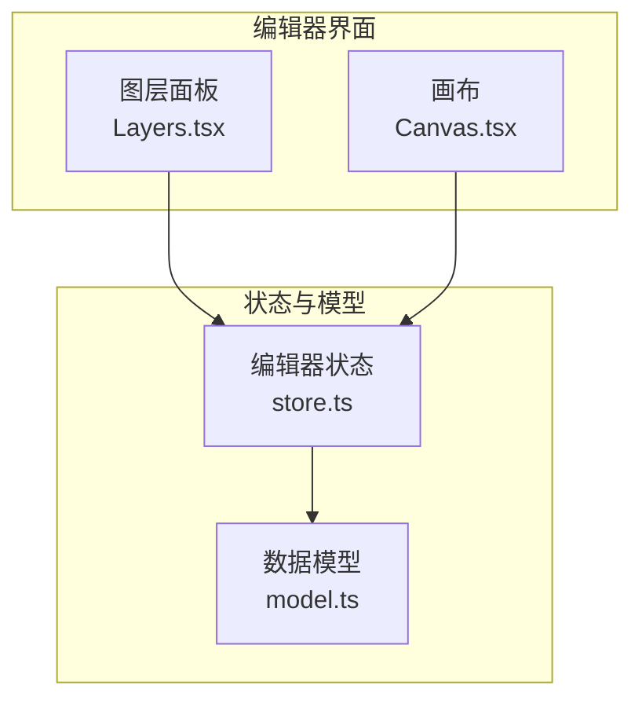
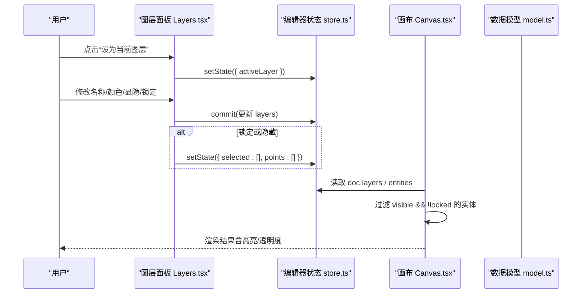
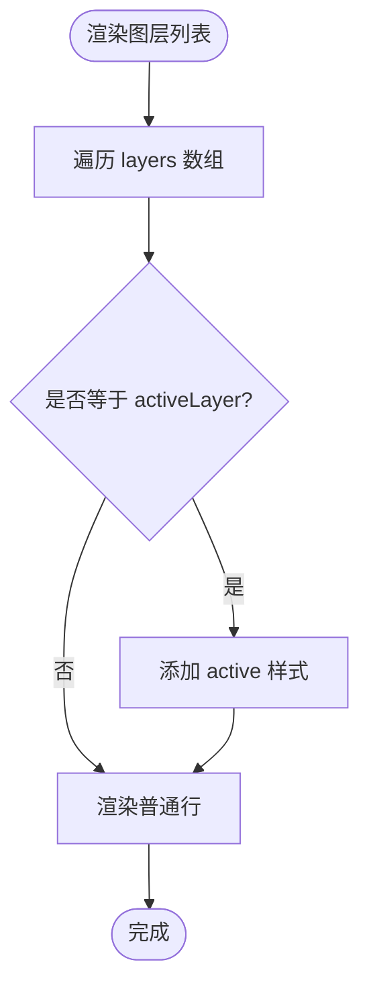
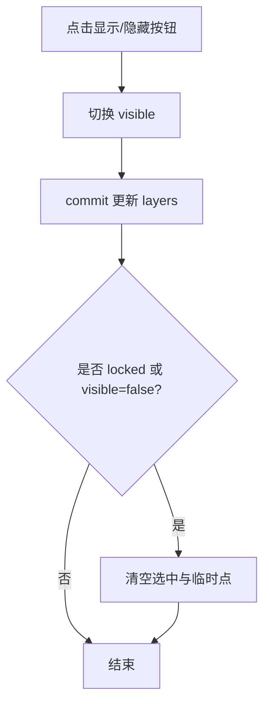
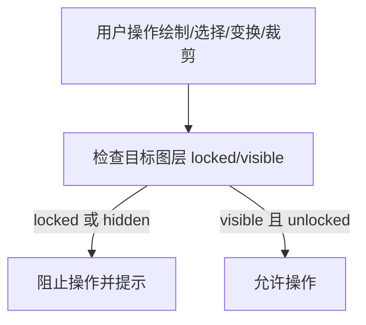
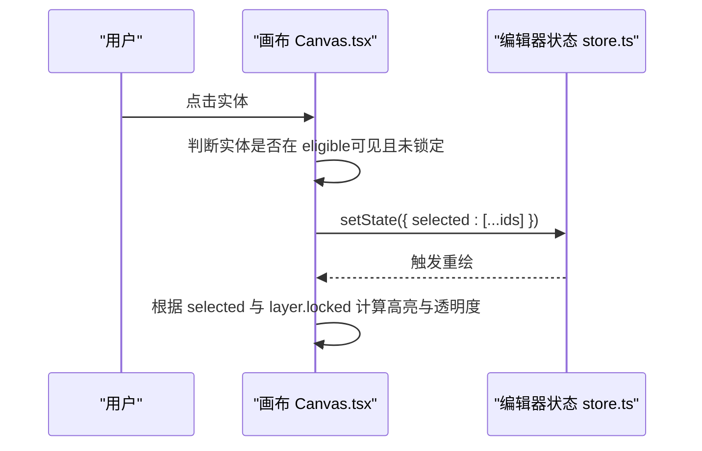
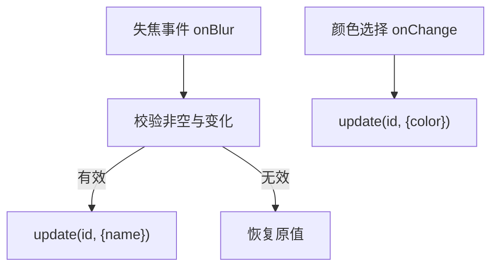
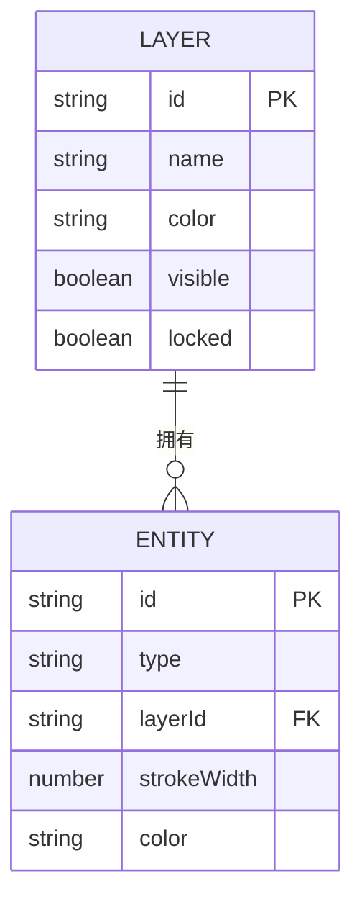
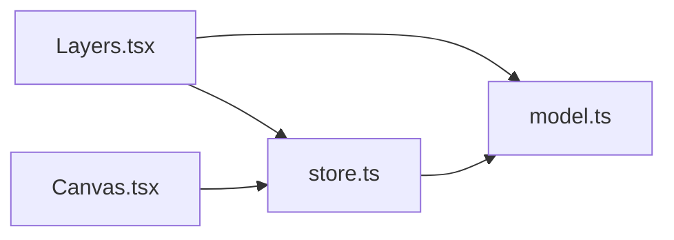

# 图层管理

<cite>
**本文引用的文件**   
- [Layers.tsx](file://src/features/editor/Layers.tsx)
- [store.ts](file://src/features/editor/store.ts)
- [Canvas.tsx](file://src/features/editor/Canvas.tsx)
- [model.ts](file://src/cad/model.ts)
</cite>

## 目录
1. [简介](#简介)
2. [项目结构](#项目结构)
3. [核心组件](#核心组件)
4. [架构总览](#架构总览)
5. [详细组件分析](#详细组件分析)
6. [依赖关系分析](#依赖关系分析)
7. [性能与优化建议](#性能与优化建议)
8. [故障排查指南](#故障排查指南)
9. [结论](#结论)

## 简介
本文面向 web-cad 的图层管理子系统，系统性说明图层列表渲染、可见性与锁定控制、选择与高亮、属性编辑、以及与实体的关联和过滤逻辑。文档同时给出最佳实践与性能优化建议，帮助开发者在扩展或维护时保持行为一致与性能稳定。

## 项目结构
图层管理涉及三个关键位置：
- 图层面板 UI：负责展示图层列表、提供增删改查交互
- 编辑器状态：集中管理图纸数据、当前活动图层、选中实体等
- 画布渲染：根据图层可见性与锁定状态过滤并绘制实体

图表来源
- [Layers.tsx:14-160](file://src/features/editor/Layers.tsx#L14-L160)
- [Canvas.tsx:42-48](file://src/features/editor/Canvas.tsx#L42-L48)
- [store.ts:17-47](file://src/features/editor/store.ts#L17-L47)
- [model.ts:5-11](file://src/cad/model.ts#L5-L11)

章节来源
- [Layers.tsx:14-160](file://src/features/editor/Layers.tsx#L14-L160)
- [Canvas.tsx:42-48](file://src/features/editor/Canvas.tsx#L42-L48)
- [store.ts:17-47](file://src/features/editor/store.ts#L17-L47)
- [model.ts:5-11](file://src/cad/model.ts#L5-L11)

## 核心组件
- 图层面板（Layers）：渲染图层列表，支持添加、删除、命名、颜色设置、显示/隐藏切换、锁定/解锁、设为当前图层。
- 编辑器状态（store）：统一维护 Drawing 数据、activeLayer、selected、工具状态、撤销重做历史；提供 commit、setTool、place、transformSelection 等方法。
- 画布（Canvas）：基于 activeLayer 与图层可见性/锁定状态过滤实体进行绘制，处理选择、拖拽、框选、预览等交互。
- 数据模型（model）：定义 Layer、Entity、Drawing 等类型，以及默认图纸创建与克隆逻辑。

章节来源
- [Layers.tsx:14-160](file://src/features/editor/Layers.tsx#L14-L160)
- [store.ts:17-47](file://src/features/editor/store.ts#L17-L47)
- [Canvas.tsx:42-48](file://src/features/editor/Canvas.tsx#L42-L48)
- [model.ts:5-11](file://src/cad/model.ts#L5-L11)

## 架构总览
图层管理的整体流程如下：
- 用户在图层面板操作（新增、改名、改色、显隐、锁定、删除、设为当前图层）。
- 图层面板通过 store.commit 更新 layers 数组，必要时同步更新 selected 与 activeLayer。
- 画布在渲染时依据每个实体的 layerId 查找对应图层，按 visible 与 locked 决定显示与可编辑性。
- 选择与变换操作受 editableSelection 约束，仅允许对“可见且未锁定”的实体进行操作。

图表来源
- [Layers.tsx:19-76](file://src/features/editor/Layers.tsx#L19-L76)
- [store.ts:79-101](file://src/features/editor/store.ts#L79-L101)
- [Canvas.tsx:42-48](file://src/features/editor/Canvas.tsx#L42-L48)
- [model.ts:51-61](file://src/cad/model.ts#L51-L61)

## 详细组件分析

### 图层列表渲染逻辑
- 信息展示：每行显示图层的彩色圆点、名称输入框、颜色选择器、显示/隐藏按钮、锁定/解锁按钮、删除按钮。
- 颜色标识：彩色圆点使用图层 color 字段作为背景色，用于直观区分图层。
- 层级排序：图层列表顺序即 layers 数组顺序，无额外排序逻辑；当前活动图层所在行会附加 active 样式类以高亮。
- 当前活动图层：通过 activeLayer 与 l.id 比较，为行添加 active 样式。

图表来源
- [Layers.tsx:89-105](file://src/features/editor/Layers.tsx#L89-L105)

章节来源
- [Layers.tsx:89-105](file://src/features/editor/Layers.tsx#L89-L105)

### 图层可见性控制机制
- 单图层切换：点击眼睛图标切换 visible 布尔值，并通过 update 提交到 store。
- 批量操作：当前实现未提供批量显隐开关，但可通过多次调用 update 或扩展批量方法实现。
- 影响范围：当图层被隐藏或锁定时，自动清空与该图层相关的选中项与临时点，避免误操作。

图表来源
- [Layers.tsx:19-39](file://src/features/editor/Layers.tsx#L19-L39)

章节来源
- [Layers.tsx:19-39](file://src/features/editor/Layers.tsx#L19-L39)

### 图层锁定功能与编辑权限控制
- 锁定状态管理：图层 locked 字段控制是否可编辑；锁定后实体透明度降低，不可交互。
- 编辑权限控制：
  - 绘制：若当前活动图层 locked 或不可见，阻止绘制并提示。
  - 选择与变换：editableSelection 仅返回可见且未锁定实体的 id，从而限制删除、移动、复制、旋转、镜像等操作。
  - 裁剪：仅对目标图层可见且未锁定的实体执行裁剪。

图表来源
- [store.ts:235-239](file://src/features/editor/store.ts#L235-L239)
- [store.ts:317-323](file://src/features/editor/store.ts#L317-L323)
- [store.ts:287-305](file://src/features/editor/store.ts#L287-L305)
- [Canvas.tsx:443-460](file://src/features/editor/Canvas.tsx#L443-L460)

章节来源
- [store.ts:235-239](file://src/features/editor/store.ts#L235-L239)
- [store.ts:317-323](file://src/features/editor/store.ts#L317-L323)
- [store.ts:287-305](file://src/features/editor/store.ts#L287-L305)
- [Canvas.tsx:443-460](file://src/features/editor/Canvas.tsx#L443-L460)

### 图层选择与高亮显示
- 活动图层标识：图层面板中彩色圆点所在行即为当前绘图图层；画布上选中实体高亮显示。
- 选择规则：仅可选择“可见且未锁定”的实体；多选支持 Shift 键累加/取消。
- 高亮表现：选中实体边框加粗，锚点矩形显示；锁定图层实体透明度降低。

图表来源
- [Canvas.tsx:44-48](file://src/features/editor/Canvas.tsx#L44-L48)
- [Canvas.tsx:227-235](file://src/features/editor/Canvas.tsx#L227-L235)
- [Canvas.tsx:443-460](file://src/features/editor/Canvas.tsx#L443-L460)

章节来源
- [Canvas.tsx:44-48](file://src/features/editor/Canvas.tsx#L44-L48)
- [Canvas.tsx:227-235](file://src/features/editor/Canvas.tsx#L227-L235)
- [Canvas.tsx:443-460](file://src/features/editor/Canvas.tsx#L443-L460)

### 图层属性编辑功能
- 名称修改：失焦时校验非空与变化，提交 name 更新。
- 颜色设置：通过颜色选择器直接更新 color。
- 透明度调整：当前图层层面无透明度字段；实体透明度由 layer.locked 控制（锁定后降低透明度），如需独立透明度可在 Layer 模型扩展 alpha 字段并在渲染时应用。

图表来源
- [Layers.tsx:106-125](file://src/features/editor/Layers.tsx#L106-L125)

章节来源
- [Layers.tsx:106-125](file://src/features/editor/Layers.tsx#L106-L125)

### 图层与实体的关联关系
- 归属关系：每个 Entity 包含 layerId，指向其所属图层。
- 过滤逻辑：
  - 画布渲染：仅渲染 visible=true 的图层上的实体；locked 图层实体仍可渲染但透明度降低且不可交互。
  - 选择与变换：editableSelection 仅返回可见且未锁定实体的 id。
  - 裁剪：仅考虑可见几何作为边界，目标实体需可见且未锁定。

图表来源
- [model.ts:5-11](file://src/cad/model.ts#L5-L11)
- [model.ts:12-45](file://src/cad/model.ts#L12-L45)
- [Canvas.tsx:44-48](file://src/features/editor/Canvas.tsx#L44-L48)
- [store.ts:317-323](file://src/features/editor/store.ts#L317-L323)

章节来源
- [model.ts:5-11](file://src/cad/model.ts#L5-L11)
- [model.ts:12-45](file://src/cad/model.ts#L12-L45)
- [Canvas.tsx:44-48](file://src/features/editor/Canvas.tsx#L44-L48)
- [store.ts:317-323](file://src/features/editor/store.ts#L317-L323)

## 依赖关系分析
- Layers.tsx 依赖 store.ts 提供的 useEditor、commit、setState，以及 model.ts 的 Layer 类型与 uid。
- Canvas.tsx 依赖 store.ts 的 doc、activeLayer、selected、tool 等状态，以及 geometry 工具函数。
- store.ts 依赖 model.ts 的 Drawing、Entity、Point、Tool 类型与 uid，以及 schema 校验。

图表来源
- [Layers.tsx:1-12](file://src/features/editor/Layers.tsx#L1-L12)
- [Canvas.tsx:1-21](file://src/features/editor/Canvas.tsx#L1-L21)
- [store.ts:1-15](file://src/features/editor/store.ts#L1-L15)
- [model.ts:1-11](file://src/cad/model.ts#L1-L11)

章节来源
- [Layers.tsx:1-12](file://src/features/editor/Layers.tsx#L1-L12)
- [Canvas.tsx:1-21](file://src/features/editor/Canvas.tsx#L1-L21)
- [store.ts:1-15](file://src/features/editor/store.ts#L1-L15)
- [model.ts:1-11](file://src/cad/model.ts#L1-L11)

## 性能与优化建议
- 减少不必要的重渲染：
  - 图层面板的 update 仅在 name/color/visible/locked 变化时提交，已实现最小化变更。
  - 建议在批量操作（如批量显隐）时使用单次 commit 合并多个图层变更，避免多次状态更新。
- 提升选择与过滤效率：
  - 当前 eligible 与 filtered 在每次渲染时计算，适合中小规模图纸；当实体数量较大时可引入索引（layerId -> entities）以减少查找成本。
- 优化锁定与可见性对交互的影响：
  - 锁定图层实体仍参与命中检测但不可交互，已用透明度和 hit-target 控制；可考虑将锁定图层从命中树中移除以降低事件开销。
- 预览与变换：
  - 预览实体在绘制前构建一次，避免重复计算；对于复杂变换（旋转/镜像）可缓存中间结果。
- 撤销/重做：
  - 历史记录保留最近 99 次，避免内存膨胀；确保 activeLayer 在回滚时有效性校验，已实现。

[本节为通用指导，不直接分析具体文件]

## 故障排查指南
- 无法在当前图层绘制：
  - 检查当前活动图层是否 locked 或 visible=false；若是，切换到其他图层。
  - 相关逻辑参考绘制入口与图层检查。
- 无法删除或变换实体：
  - 确认实体所在图层可见且未锁定；editableSelection 会过滤掉不符合条件的实体。
- 删除图层后活动图层异常：
  - 删除图层时会重新设置 activeLayer 为剩余图层之一；若出现异常，检查撤销/重做后的 activeLayer 有效性逻辑。
- 数据校验失败：
  - commit 会对新数据进行 schema 校验，非法数值或悬空引用会被拒绝并提示；检查实体与图层引用一致性。

章节来源
- [store.ts:235-239](file://src/features/editor/store.ts#L235-L239)
- [store.ts:317-323](file://src/features/editor/store.ts#L317-L323)
- [store.ts:112-147](file://src/features/editor/store.ts#L112-L147)
- [store.ts:79-101](file://src/features/editor/store.ts#L79-L101)

## 结论
web-cad 的图层管理通过清晰的职责划分与集中式状态管理实现了稳定的图层可见性、锁定控制、选择高亮与属性编辑。图层与实体的关联通过 layerId 建立，渲染与交互均遵循可见性与锁定规则。建议在大规模图纸场景下引入索引与批量化更新以提升性能，同时保持现有行为的一致性与可维护性。