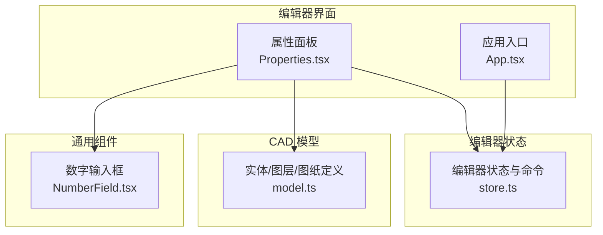
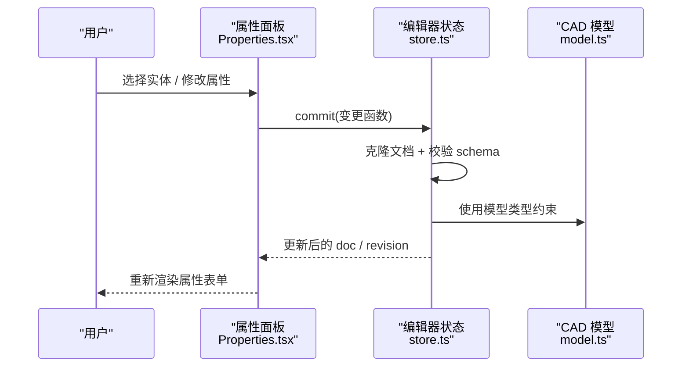
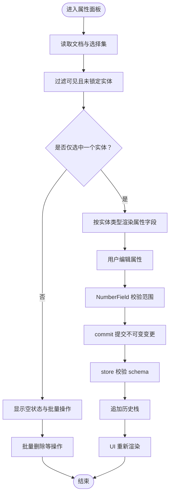
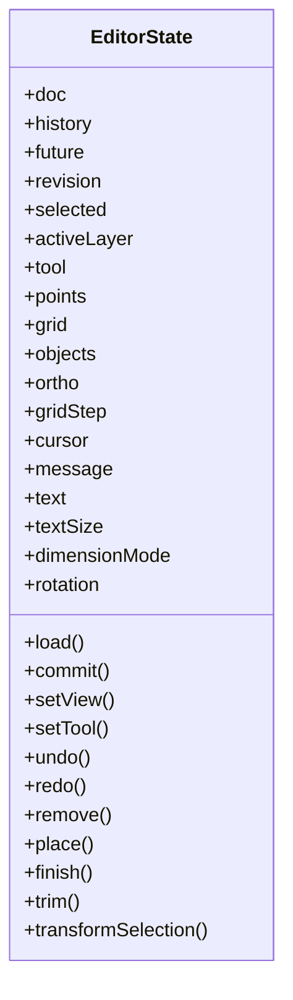
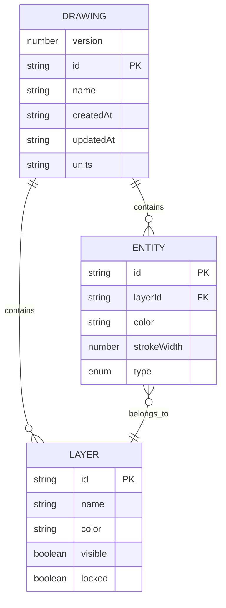
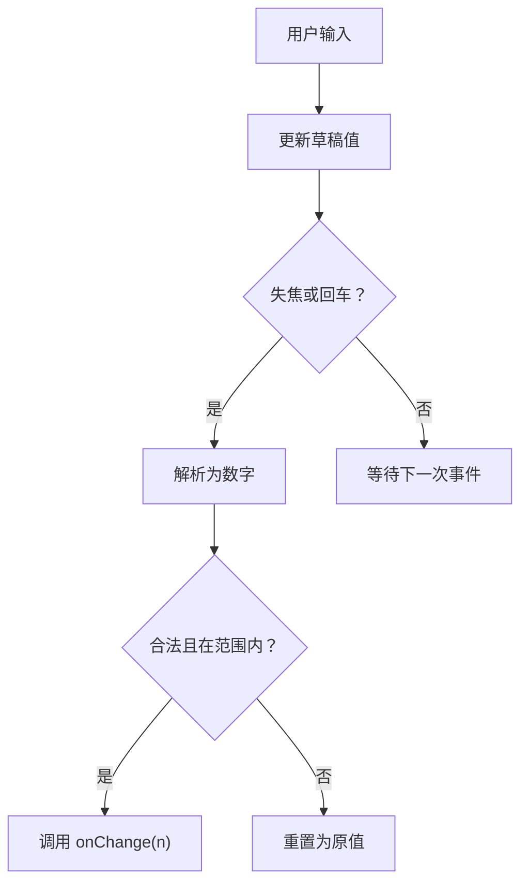
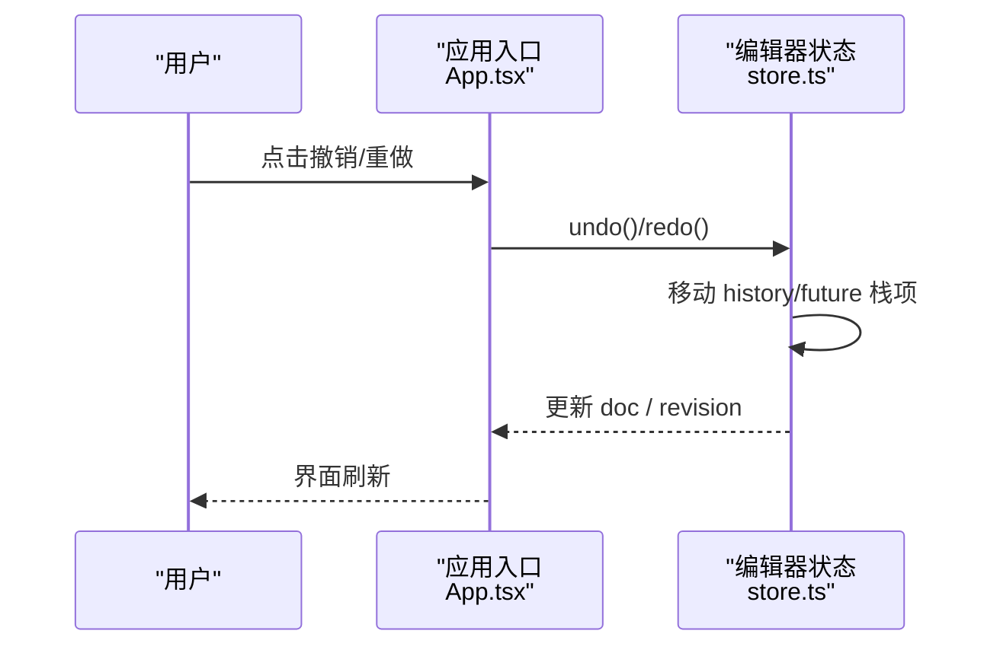
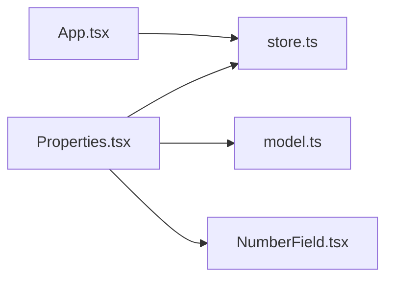

# 属性面板

<cite>
**本文引用的文件**   
- [Properties.tsx](file://src/features/editor/Properties.tsx)
- [store.ts](file://src/features/editor/store.ts)
- [model.ts](file://src/cad/model.ts)
- [NumberField.tsx](file://src/components/NumberField.tsx)
- [App.tsx](file://src/app/App.tsx)
</cite>

## 目录
1. [简介](#简介)
2. [项目结构](#项目结构)
3. [核心组件](#核心组件)
4. [架构总览](#架构总览)
5. [详细组件分析](#详细组件分析)
6. [依赖关系分析](#依赖关系分析)
7. [性能考虑](#性能考虑)
8. [故障排查指南](#故障排查指南)
9. [结论](#结论)
10. [附录：扩展与自定义](#附录扩展与自定义)

## 简介
本文件为 web-cad 的“属性面板”组件提供系统化文档。内容覆盖以下目标：
- 动态渲染机制：根据选中实体类型显示对应属性字段。
- 属性编辑器实现：输入验证、实时更新与数据绑定。
- 批量编辑能力：多实体同步修改与差异处理现状说明。
- 撤销重做支持：历史记录管理与状态回滚。
- 与 CAD 模型的同步机制：实时更新与冲突解决策略。
- 不同类型实体的属性展示：几何属性、样式属性与元数据。
- 扩展指南：如何扩展属性面板与自定义属性类型。

## 项目结构
属性面板位于编辑器功能模块中，依赖全局编辑器状态与 CAD 模型定义，并通过通用数字输入组件完成数值校验与交互。

**图表来源**
- [Properties.tsx:1-394](file://src/features/editor/Properties.tsx#L1-L394)
- [store.ts:1-324](file://src/features/editor/store.ts#L1-L324)
- [model.ts:1-142](file://src/cad/model.ts#L1-L142)
- [NumberField.tsx:1-48](file://src/components/NumberField.tsx#L1-L48)
- [App.tsx:193-236](file://src/app/App.tsx#L193-L236)

**章节来源**
- [Properties.tsx:1-394](file://src/features/editor/Properties.tsx#L1-L394)
- [store.ts:1-324](file://src/features/editor/store.ts#L1-L324)
- [model.ts:1-142](file://src/cad/model.ts#L1-L142)
- [NumberField.tsx:1-48](file://src/components/NumberField.tsx#L1-L48)
- [App.tsx:193-236](file://src/app/App.tsx#L193-L236)

## 核心组件
- 属性面板 Properties：负责根据当前选中实体渲染属性表单，触发更新并调用编辑器状态提交。
- 编辑器状态 store：维护文档、历史栈、选择集、工具参数等，并提供撤销重做、删除、变换等命令。
- 模型 model：定义实体联合类型、图层、视图与图纸结构，是属性面板的数据契约。
- 数字输入 NumberField：封装数值输入、范围校验与失焦提交流程。
- 应用入口 App：提供撤销/重做按钮，驱动 store 的命令执行。

**章节来源**
- [Properties.tsx:1-394](file://src/features/editor/Properties.tsx#L1-L394)
- [store.ts:1-324](file://src/features/editor/store.ts#L1-L324)
- [model.ts:1-142](file://src/cad/model.ts#L1-L142)
- [NumberField.tsx:1-48](file://src/components/NumberField.tsx#L1-L48)
- [App.tsx:193-236](file://src/app/App.tsx#L193-L236)

## 架构总览
属性面板通过读取编辑器状态中的文档与选择集，动态渲染对应实体的属性字段；用户修改后，通过 store.commit 提交不可变变更，由 store 进行数据校验、写入历史栈并更新视图。

**图表来源**
- [Properties.tsx:29-43](file://src/features/editor/Properties.tsx#L29-L43)
- [store.ts:79-101](file://src/features/editor/store.ts#L79-L101)
- [model.ts:18-61](file://src/cad/model.ts#L18-L61)

## 详细组件分析

### 属性面板 Properties.tsx
- 动态渲染机制
  - 从 store 获取 doc 与 selected，过滤出可见且未锁定的已选实体集合。
  - 仅当选中数量为 1 时渲染该实体的属性表单；否则显示空状态与批量操作提示。
  - 根据实体类型（line/polyline/rectangle/circle/arc/text/dimension）条件渲染对应字段。
- 属性编辑器实现
  - 通用字段：图层、颜色、线宽。
  - 几何字段：起点/终点/圆心/半径/角度/位置点等，按实体类型选择性出现。
  - 文本字段：文字内容、高度、旋转角度。
  - 折线字段：闭合开关与逐点编辑。
  - 标注字段：方向模式切换。
  - 所有数值输入均通过 NumberField 进行范围校验与失焦提交。
- 数据绑定与更新
  - 内部 update(patch) 将 patch 合并到当前实体，并通过 s.commit 提交不可变更新。
  - 提交后 store 会校验数据合法性并追加历史，随后触发 UI 重渲染。
- 批量编辑现状
  - 当前属性面板在多选时不渲染具体属性表单，仅提供“删除所选”等批量操作。
  - 若需多实体属性同步修改，可在 store.transformSelection 基础上扩展统一属性映射逻辑。

**图表来源**
- [Properties.tsx:21-43](file://src/features/editor/Properties.tsx#L21-L43)
- [Properties.tsx:78-254](file://src/features/editor/Properties.tsx#L78-L254)
- [NumberField.tsx:18-27](file://src/components/NumberField.tsx#L18-L27)
- [store.ts:79-101](file://src/features/editor/store.ts#L79-L101)

**章节来源**
- [Properties.tsx:1-394](file://src/features/editor/Properties.tsx#L1-L394)
- [NumberField.tsx:1-48](file://src/components/NumberField.tsx#L1-L48)

### 编辑器状态 store.ts
- 撤销重做支持
  - history/future 双栈管理历史状态，commit 时保存旧状态并清空 future。
  - undo/redo 恢复 doc，同时保留当前 view 缩放平移，避免视图抖动。
  - 每次变更递增 revision，便于子组件感知变化。
- 批量变换
  - transformSelection 对选中实体集合应用变换函数，支持复制生成新实体。
  - editableSelection 确保仅对可见且未锁定层上的实体进行操作。
- 数据校验
  - commit 内使用 drawingSchema.safeParse 校验变更后文档，失败则提示错误信息。
- 与属性面板的协作
  - Properties 通过 s.commit 提交单实体属性变更；store 保证一致性、可撤销性与可视化反馈。

**图表来源**
- [store.ts:17-47](file://src/features/editor/store.ts#L17-L47)

**章节来源**
- [store.ts:79-101](file://src/features/editor/store.ts#L79-L101)
- [store.ts:112-148](file://src/features/editor/store.ts#L112-L148)
- [store.ts:149-186](file://src/features/editor/store.ts#L149-L186)
- [store.ts:317-323](file://src/features/editor/store.ts#L317-L323)

### 模型 model.ts
- 实体联合类型 Entity：以 type 区分不同几何与标注实体，包含公共 Base 字段（id、layerId、color、strokeWidth）。
- 图层 Layer：控制可见性、锁定与默认颜色。
- 图纸 Drawing：包含版本、名称、时间戳、单位、图层、实体列表与视图。
- 工具 Tool：枚举绘图与编辑工具，供属性面板的工具精确输入区使用。

**图表来源**
- [model.ts:1-61](file://src/cad/model.ts#L1-L61)

**章节来源**
- [model.ts:1-142](file://src/cad/model.ts#L1-L142)

### 数字输入 NumberField.tsx
- 输入验证
  - 失焦或回车时提交，校验是否为有限数且在 min/max 范围内。
  - 非法值自动回退为原值，避免脏数据污染。
- 实时体验
  - 使用 draft 状态缓冲输入，减少频繁 onChange 触发的性能开销。
  - 格式化显示保留四位小数，提升可读性。

**图表来源**
- [NumberField.tsx:16-27](file://src/components/NumberField.tsx#L16-L27)

**章节来源**
- [NumberField.tsx:1-48](file://src/components/NumberField.tsx#L1-L48)

### 撤销重做与历史管理
- 触发方式
  - 应用工具栏提供撤销/重做按钮，直接调用 store.undo/redo。
- 行为细节
  - 撤销/重做时保留当前视图（view），避免视图跳变。
  - 自动清理 selection 与 points，防止状态不一致。
  - 活跃图层 activeLayer 在历史恢复时尝试保持，不存在则回退到首层。

**图表来源**
- [App.tsx:193-236](file://src/app/App.tsx#L193-L236)
- [store.ts:112-148](file://src/features/editor/store.ts#L112-L148)

**章节来源**
- [App.tsx:193-236](file://src/app/App.tsx#L193-L236)
- [store.ts:112-148](file://src/features/editor/store.ts#L112-L148)

## 依赖关系分析
- Properties 依赖 store 提供的 doc、selected、commit、remove 等方法。
- Properties 依赖 NumberField 进行数值输入校验。
- Properties 依赖 model 的类型定义，确保渲染字段与数据结构一致。
- App 通过 store 暴露的 undo/redo 方法驱动撤销重做。

**图表来源**
- [Properties.tsx:1-6](file://src/features/editor/Properties.tsx#L1-L6)
- [store.ts:1-15](file://src/features/editor/store.ts#L1-L15)
- [model.ts:1-17](file://src/cad/model.ts#L1-L17)
- [NumberField.tsx:1-15](file://src/components/NumberField.tsx#L1-L15)
- [App.tsx:193-236](file://src/app/App.tsx#L193-L236)

**章节来源**
- [Properties.tsx:1-394](file://src/features/editor/Properties.tsx#L1-L394)
- [store.ts:1-324](file://src/features/editor/store.ts#L1-L324)
- [model.ts:1-142](file://src/cad/model.ts#L1-L142)
- [NumberField.tsx:1-48](file://src/components/NumberField.tsx#L1-L48)
- [App.tsx:193-236](file://src/app/App.tsx#L193-L236)

## 性能考虑
- 只读选择过滤：属性面板每次渲染都会过滤已选实体，建议在大型图纸中结合 memoization 优化。
- 数值输入缓冲：NumberField 使用草稿状态减少频繁 state 更新。
- 不可变更新：store.commit 使用结构化克隆与不可变更新，利于历史快照与增量对比。
- 视图隔离：撤销重做保留 view，避免不必要的重绘。

[本节为通用指导，不直接分析具体文件]

## 故障排查指南
- 数据超出允许范围
  - 现象：提交属性后提示“数据超出允许范围”。
  - 原因：drawingSchema 校验失败。
  - 处理：检查数值范围、实体数量或非法字段。
- 无法编辑图层
  - 现象：新建或删除受限时提示“当前图层隐藏或已锁定”。
  - 原因：activeLayer 不可编辑。
  - 处理：切换到可见且未锁定的图层。
- 撤销重做无效
  - 现象：点击撤销/重做无响应。
  - 原因：history/future 为空。
  - 处理：先执行一次有效变更后再撤销/重做。

**章节来源**
- [store.ts:79-101](file://src/features/editor/store.ts#L79-L101)
- [store.ts:235-238](file://src/features/editor/store.ts#L235-L238)
- [store.ts:112-148](file://src/features/editor/store.ts#L112-L148)

## 结论
属性面板通过类型驱动的动态渲染与 store 的不可变更新机制，实现了安全、可撤销的属性编辑流程。当前多选场景下不提供属性同步编辑，但可通过扩展 store 的批量变换能力实现。整体架构清晰，扩展点明确，适合进一步扩展自定义属性类型与批量编辑能力。

[本节为总结性内容，不直接分析具体文件]

## 附录：扩展与自定义

### 扩展属性面板
- 新增实体类型
  - 在 model.ts 中扩展 Entity 联合类型，添加新的 type 分支与字段。
  - 在 Properties.tsx 中添加对应类型的条件渲染与字段编辑逻辑。
- 新增通用属性
  - 在 Properties.tsx 的公共属性区域增加字段，并通过 update(patch) 提交。
- 自定义输入控件
  - 基于 NumberField 的模式，封装新的输入组件，并在 Properties.tsx 中使用。

**章节来源**
- [model.ts:18-45](file://src/cad/model.ts#L18-L45)
- [Properties.tsx:78-254](file://src/features/editor/Properties.tsx#L78-L254)
- [NumberField.tsx:1-48](file://src/components/NumberField.tsx#L1-L48)

### 批量编辑与差异处理
- 现状
  - 多选时不渲染属性表单，仅提供删除等批量操作。
- 建议方案
  - 在 store 中新增 batchUpdate(ids, patches) 接口，对选中实体应用相同 patch。
  - 在 Properties.tsx 中多选模式下渲染“公共属性”编辑区，调用 batchUpdate 提交。
  - 差异处理：对每个实体分别计算 patch，避免覆盖非公共字段。

**章节来源**
- [store.ts:160-186](file://src/features/editor/store.ts#L160-L186)
- [Properties.tsx:21-28](file://src/features/editor/Properties.tsx#L21-L28)

### 属性变更的撤销重做
- 机制
  - 所有通过 store.commit 的变更都会被记录到 history 栈，支持撤销重做。
- 注意事项
  - 避免在 commit 之外直接修改 doc，否则不会进入历史栈。
  - 视图相关变更（如 setView）不进入历史栈，如需纳入历史，可扩展 store 的视图快照策略。

**章节来源**
- [store.ts:79-101](file://src/features/editor/store.ts#L79-L101)
- [store.ts:112-148](file://src/features/editor/store.ts#L112-L148)

### 与 CAD 模型的同步机制
- 实时更新
  - Properties 通过 s.commit 提交变更，store 更新 doc 与 revision，触发 UI 重渲染。
- 冲突解决
  - 通过不可变更新与 schema 校验保证数据一致性。
  - 图层可见/锁定状态在渲染与编辑前进行检查，避免非法操作。

**章节来源**
- [Properties.tsx:29-43](file://src/features/editor/Properties.tsx#L29-L43)
- [store.ts:79-101](file://src/features/editor/store.ts#L79-L101)
- [store.ts:317-323](file://src/features/editor/store.ts#L317-L323)