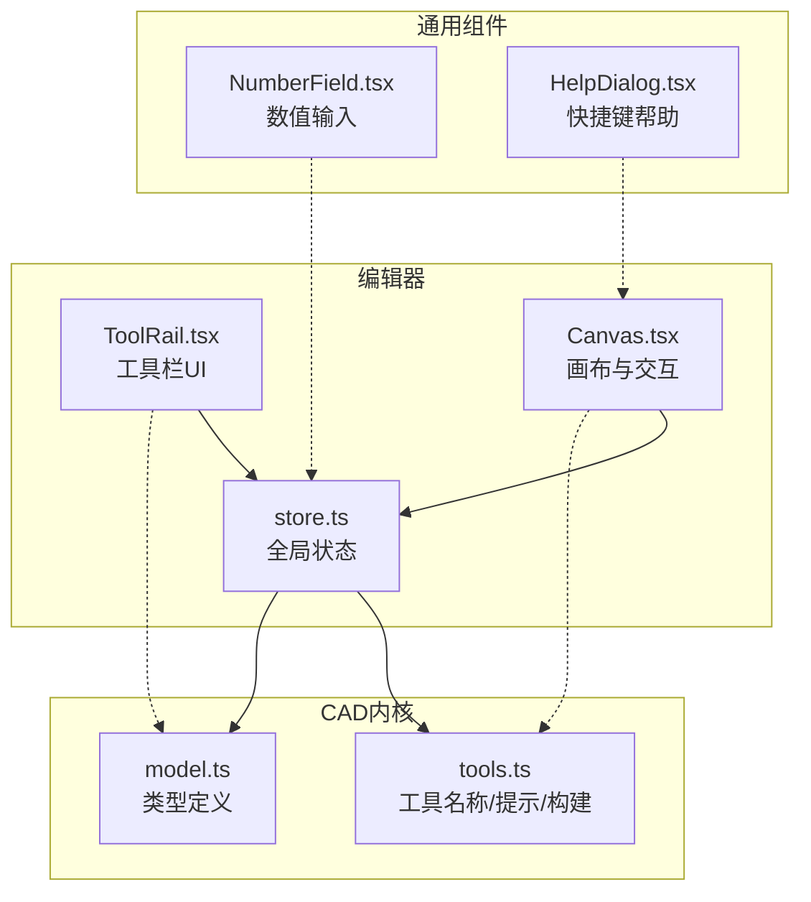
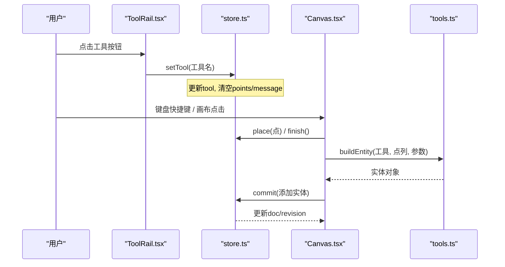
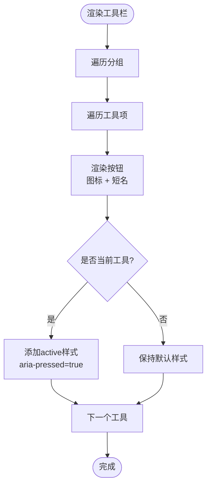
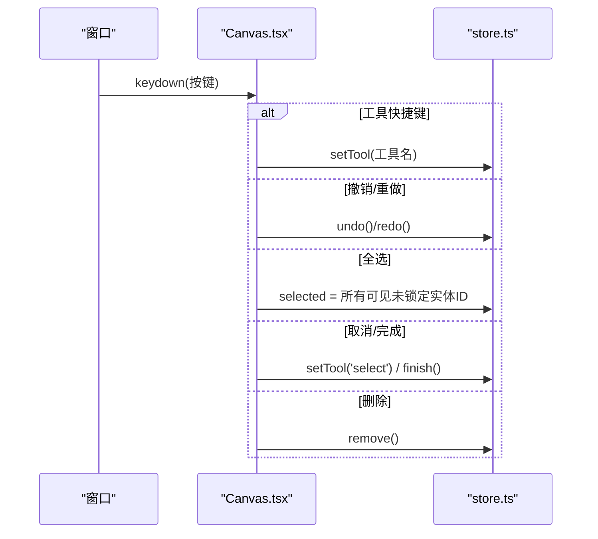
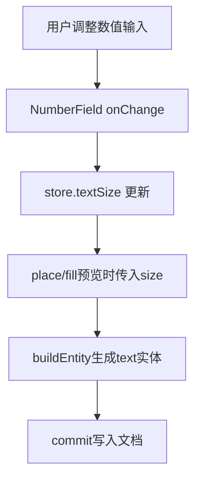
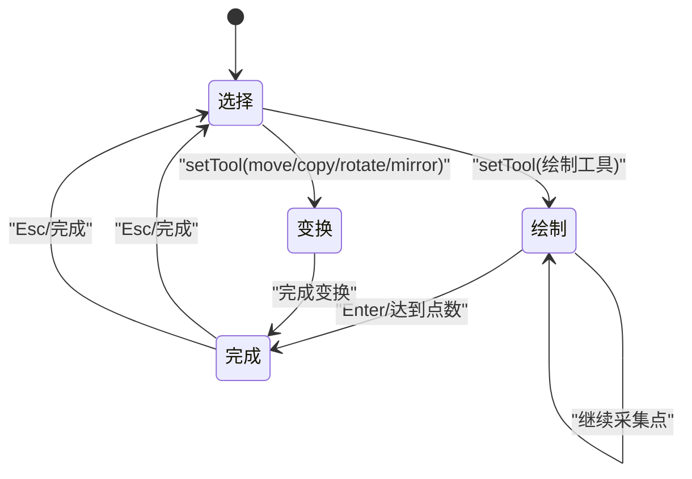
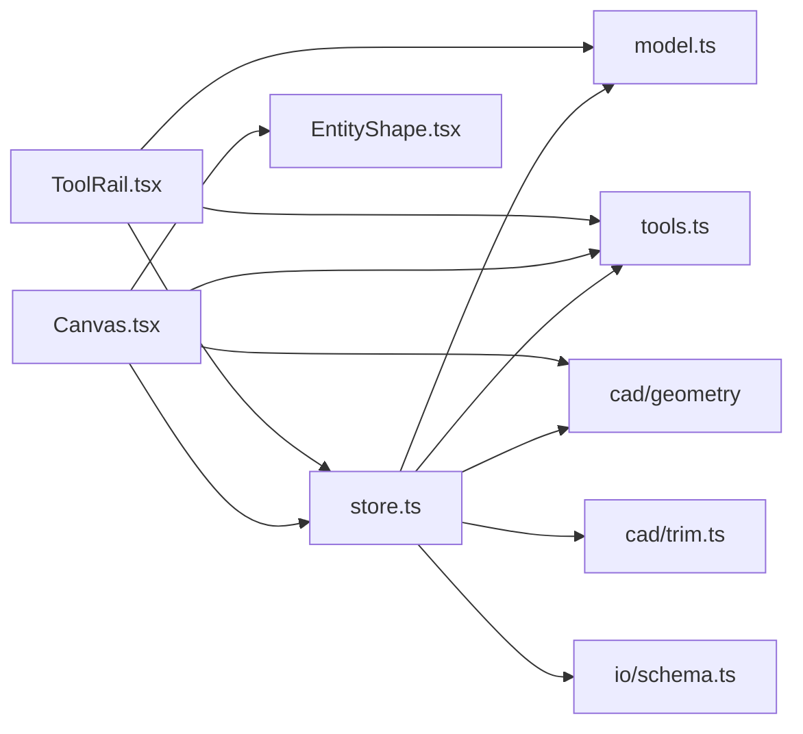

# 工具栏界面

<cite>
**本文引用的文件**   
- [ToolRail.tsx](file://src/features/editor/ToolRail.tsx)
- [Canvas.tsx](file://src/features/editor/Canvas.tsx)
- [store.ts](file://src/features/editor/store.ts)
- [tools.ts](file://src/cad/tools.ts)
- [model.ts](file://src/cad/model.ts)
- [NumberField.tsx](file://src/components/NumberField.tsx)
- [HelpDialog.tsx](file://src/components/HelpDialog.tsx)
</cite>

## 目录
1. [简介](#简介)
2. [项目结构](#项目结构)
3. [核心组件](#核心组件)
4. [架构总览](#架构总览)
5. [详细组件分析](#详细组件分析)
6. [依赖关系分析](#依赖关系分析)
7. [性能与可访问性](#性能与可访问性)
8. [故障排查指南](#故障排查指南)
9. [结论](#结论)
10. [附录：扩展开发指南](#附录扩展开发指南)

## 简介
本文件面向 web-cad 的工具栏界面，系统性说明左侧工具栏的布局与分组、按钮渲染逻辑、快捷键系统、激活状态视觉反馈、参数动态配置、工具互斥与状态同步机制，并提供扩展新工具的实践建议。文档以代码为依据，结合流程图与时序图帮助读者快速理解实现细节。

## 项目结构
工具栏相关能力分布在以下模块：
- 工具栏 UI：左侧工具条分组与按钮渲染
- 画布交互：键盘事件监听、工具切换、绘制流程
- 全局状态：当前工具、临时点序列、文本大小、标注模式等
- 工具元数据：工具名称映射、提示文案、实体构建逻辑
- 数据类型：工具类型、实体类型、视图与图层模型
- 数值输入：通用数字输入控件（用于文字大小等参数）
- 帮助弹窗：快捷键汇总展示

图表来源
- [ToolRail.tsx:1-95](file://src/features/editor/ToolRail.tsx#L1-L95)
- [Canvas.tsx:94-179](file://src/features/editor/Canvas.tsx#L94-L179)
- [store.ts:17-47](file://src/features/editor/store.ts#L17-L47)
- [tools.ts:5-48](file://src/cad/tools.ts#L5-L48)
- [model.ts:62-75](file://src/cad/model.ts#L62-L75)

章节来源
- [ToolRail.tsx:1-95](file://src/features/editor/ToolRail.tsx#L1-L95)
- [Canvas.tsx:94-179](file://src/features/editor/Canvas.tsx#L94-L179)
- [store.ts:17-47](file://src/features/editor/store.ts#L17-L47)
- [tools.ts:5-48](file://src/cad/tools.ts#L5-L48)
- [model.ts:62-75](file://src/cad/model.ts#L62-L75)

## 核心组件
- ToolRail：工具栏分组与按钮渲染，负责显示图标、短名、快捷键提示，并触发工具切换。
- Canvas：画布交互层，集中处理键盘事件、鼠标手势、预览与绘制流程，驱动工具状态变化。
- store：基于 Zustand 的全局状态，维护当前工具、临时点、文本大小、标注模式、旋转角度等。
- tools：工具名称映射、操作提示、根据工具与点序列构建实体对象。
- model：工具类型、实体类型、视图与图层等基础类型定义。
- NumberField：通用数值输入组件，用于实时调整如文字大小等参数。
- HelpDialog：快捷键帮助弹窗，汇总常用快捷键。

章节来源
- [ToolRail.tsx:21-95](file://src/features/editor/ToolRail.tsx#L21-L95)
- [Canvas.tsx:94-179](file://src/features/editor/Canvas.tsx#L94-L179)
- [store.ts:17-47](file://src/features/editor/store.ts#L17-L47)
- [tools.ts:5-48](file://src/cad/tools.ts#L5-L48)
- [model.ts:62-75](file://src/cad/model.ts#L62-L75)
- [NumberField.tsx:1-48](file://src/components/NumberField.tsx#L1-L48)
- [HelpDialog.tsx:1-34](file://src/components/HelpDialog.tsx#L1-L34)

## 架构总览
工具栏与画布通过全局状态协同工作：
- 工具栏点击或键盘快捷键触发 setTool，更新当前工具并清空临时点与消息。
- 画布根据当前工具与用户输入计算预览与最终实体，调用 buildEntity 生成实体后提交到文档。
- 工具提示由 hint 函数根据工具与已采集点数动态返回。
- 工具类型与实体类型在 model 中统一定义，保证类型安全。

图表来源
- [ToolRail.tsx:60-78](file://src/features/editor/ToolRail.tsx#L60-L78)
- [Canvas.tsx:138-165](file://src/features/editor/Canvas.tsx#L138-L165)
- [store.ts:111-111](file://src/features/editor/store.ts#L111-L111)
- [store.ts:187-264](file://src/features/editor/store.ts#L187-L264)
- [tools.ts:49-125](file://src/cad/tools.ts#L49-L125)

## 详细组件分析

### 工具栏布局与分组管理
- 分组定义：选择、绘制、注释、修改四大组，每组包含若干工具项。
- 工具项结构：包含工具名、图标组件、可选快捷键键名。
- 渲染逻辑：遍历分组与工具项，为每个工具渲染一个按钮；当当前工具等于该工具时，按钮附加 active 样式类，同时设置 aria-pressed 为 true。
- 标题与提示：title 属性显示工具中文名与快捷键提示；aria-label 提供无障碍标签。
- 底部标识：显示“2D”作为工具栏页脚。

图表来源
- [ToolRail.tsx:21-58](file://src/features/editor/ToolRail.tsx#L21-L58)
- [ToolRail.tsx:60-95](file://src/features/editor/ToolRail.tsx#L60-L95)

章节来源
- [ToolRail.tsx:21-95](file://src/features/editor/ToolRail.tsx#L21-L95)

### 工具按钮渲染逻辑
- 图标显示：使用 lucide-react 图标组件，统一尺寸与描边宽度。
- 状态指示：通过 className 条件判断是否为 active，配合 CSS 高亮选中态。
- 禁用状态：当前未实现按钮禁用逻辑；如需禁用，可在工具项结构中增加 disabled 字段并在渲染时应用相应样式与交互拦截。
- 工具提示：title 显示工具中文名称与快捷键提示；辅助功能标签 aria-label 使用工具中文名。

章节来源
- [ToolRail.tsx:67-88](file://src/features/editor/ToolRail.tsx#L67-L88)

### 快捷键支持系统
- 键盘事件监听：Canvas 组件在窗口上注册 keydown/keyup/blur 事件，排除对话框与输入框场景，避免冲突。
- 工具切换快捷键：非修饰键的单字母绑定 v/l/p/r/c/a/t/d/m 分别对应 select/line/polyline/rectangle/circle/arc/text/dimension/move。
- 撤销重做：Ctrl/Cmd+Z 撤销，Shift+Ctrl/Cmd+Z 或 Ctrl/Cmd+Y 重做。
- 全选：Ctrl/Cmd+A 选择所有可见且未锁定的图形。
- 取消与完成：Esc 取消绘制并回到选择工具；Enter 完成折线绘制。
- 删除：Delete/Backspace 删除所选图形。
- 平移：Space 按住或中键拖动进行画布平移。

图表来源
- [Canvas.tsx:94-179](file://src/features/editor/Canvas.tsx#L94-L179)
- [store.ts:111-111](file://src/features/editor/store.ts#L111-L111)
- [store.ts:112-148](file://src/features/editor/store.ts#L112-L148)
- [store.ts:149-186](file://src/features/editor/store.ts#L149-L186)

章节来源
- [Canvas.tsx:94-179](file://src/features/editor/Canvas.tsx#L94-L179)
- [HelpDialog.tsx:3-13](file://src/components/HelpDialog.tsx#L3-L13)

### 工具激活状态的视觉反馈
- 选中高亮：ToolRail 按钮在 tool === name 时添加 active 样式类，CSS 控制高亮效果。
- 工具提示：title 显示工具中文名与快捷键提示；aria-label 提供无障碍标签。
- 画布提示：Canvas 底部工具提示区域显示 hint(tool, points.length) 的动态提示，必要时显示 Esc 取消提示。

章节来源
- [ToolRail.tsx:67-88](file://src/features/editor/ToolRail.tsx#L67-L88)
- [tools.ts:20-48](file://src/cad/tools.ts#L20-L48)
- [Canvas.tsx:644-648](file://src/features/editor/Canvas.tsx#L644-L648)

### 工具参数的动态配置
- 文本大小：store 中维护 textSize，buildEntity 在创建 text 实体时使用 size 参数。
- 标注模式：store 中维护 dimensionMode，buildEntity 在创建 dimension 实体时使用 mode 参数。
- 旋转角度：store 中维护 rotation，move/copy/rotate/mirror 变换时参与计算。
- 数值输入：NumberField 提供受控输入，支持范围校验与失焦提交，可用于调整 textSize 等参数。

图表来源
- [store.ts:63-66](file://src/features/editor/store.ts#L63-L66)
- [tools.ts:49-77](file://src/cad/tools.ts#L49-L77)
- [NumberField.tsx:16-27](file://src/components/NumberField.tsx#L16-L27)

章节来源
- [store.ts:63-66](file://src/features/editor/store.ts#L63-L66)
- [tools.ts:49-77](file://src/cad/tools.ts#L49-L77)
- [NumberField.tsx:1-48](file://src/components/NumberField.tsx#L1-L48)

### 工具间的互斥逻辑与状态同步
- 互斥逻辑：当前仅有一个活跃工具，setTool 会覆盖之前的 tool 值，并清空 points 与 message，确保绘制流程重置。
- 状态同步：ToolRail 与 Canvas 均订阅 store.tool，任何一处变更都会同步反映到 UI。
- 绘制流程：不同工具对 points 数量有不同要求（如 polyline 至少两点，arc/dimension 三点），store.place 与 finish 根据工具类型分支处理。
- 变换工具：move/copy/rotate/mirror 需要预先选择图形，否则给出提示信息。

图表来源
- [store.ts:111-111](file://src/features/editor/store.ts#L111-L111)
- [store.ts:187-264](file://src/features/editor/store.ts#L187-L264)
- [store.ts:265-286](file://src/features/editor/store.ts#L265-L286)

章节来源
- [store.ts:111-111](file://src/features/editor/store.ts#L111-L111)
- [store.ts:187-286](file://src/features/editor/store.ts#L187-L286)

## 依赖关系分析
- ToolRail 依赖：
  - lucide-react 图标库
  - cad/model 中的 Tool 类型
  - cad/tools 中的 toolNames
  - features/editor/store 中的 useEditor
- Canvas 依赖：
  - cad/geometry 几何计算
  - cad/tools 中的 buildEntity/hint
  - components/EntityShape 实体渲染
  - features/editor/store 中的 useEditor
- store 依赖：
  - cad/model 类型
  - cad/geometry 几何计算
  - cad/tools 中的 buildEntity
  - cad/trim 修剪逻辑
  - io/schema 数据校验

图表来源
- [ToolRail.tsx:1-19](file://src/features/editor/ToolRail.tsx#L1-L19)
- [Canvas.tsx:1-21](file://src/features/editor/Canvas.tsx#L1-L21)
- [store.ts:1-15](file://src/features/editor/store.ts#L1-L15)

章节来源
- [ToolRail.tsx:1-19](file://src/features/editor/ToolRail.tsx#L1-L19)
- [Canvas.tsx:1-21](file://src/features/editor/Canvas.tsx#L1-L21)
- [store.ts:1-15](file://src/features/editor/store.ts#L1-L15)

## 性能与可访问性
- 性能
  - 工具栏渲染简单高效，无复杂计算。
  - 画布交互采用 ResizeObserver 与事件委托，减少重复监听。
  - 预览实体仅在 points 存在时计算，避免多余开销。
- 可访问性
  - 工具按钮提供 aria-label 与 aria-pressed，提升屏幕阅读器体验。
  - 快捷键帮助弹窗列出常用组合键，便于用户学习。
  - 数值输入组件提供 label 与 aria-label，增强表单可访问性。

章节来源
- [ToolRail.tsx:67-88](file://src/features/editor/ToolRail.tsx#L67-L88)
- [HelpDialog.tsx:3-13](file://src/components/HelpDialog.tsx#L3-L13)
- [NumberField.tsx:28-45](file://src/components/NumberField.tsx#L28-L45)

## 故障排查指南
- 工具无法切换
  - 检查 store.setTool 是否被正确调用；确认 ToolRail 按钮 onClick 是否绑定 setTool。
  - 确认 KeyboardEvent 未被输入框或对话框拦截。
- 快捷键无效
  - 确认 Canvas 的 keydown 监听是否生效；检查是否在 dialog 打开或容器 inert 状态下。
  - 核对快捷键映射表是否包含目标键位。
- 绘制失败
  - 检查 points 数量是否符合工具要求；查看 buildEntity 返回值是否为 null。
  - 查看 store.message 是否有错误提示。
- 参数不生效
  - 确认 store.textSize/dimensionMode 是否正确更新。
  - 检查 NumberField 的 onChange 是否调用 store 更新方法。

章节来源
- [Canvas.tsx:94-179](file://src/features/editor/Canvas.tsx#L94-L179)
- [store.ts:187-264](file://src/features/editor/store.ts#L187-L264)
- [tools.ts:49-125](file://src/cad/tools.ts#L49-L125)

## 结论
工具栏界面通过清晰的分组与统一的渲染逻辑，提供了直观的工具选择入口；画布层集中处理键盘与指针事件，驱动工具状态与绘制流程；全局状态统一管理工具、参数与历史，确保多组件间状态一致。整体设计简洁、可扩展性强，适合进一步扩展更多工具与参数。

## 附录：扩展开发指南
- 新增工具步骤
  - 在 model.ts 的 Tool 联合类型中添加新工具名。
  - 在 tools.ts 的 toolNames 中添加中文名称映射。
  - 在 ToolRail.tsx 的 groups 中添加分组与工具项（含 icon 与可选 key）。
  - 在 tools.ts 的 buildEntity 中实现新工具的实体构建逻辑。
  - 在 store.ts 的 place/finish 中处理新工具的点序列与完成逻辑。
  - 在 Canvas.tsx 的键盘映射中添加快捷键（可选）。
  - 在 tools.ts 的 hint 中为新工具添加分步提示。
- 最佳实践
  - 保持工具互斥：setTool 应清空 points 与 message，避免状态污染。
  - 参数校验：使用 drawingSchema 校验数据合法性，防止异常数据进入文档。
  - 可访问性：为新工具按钮提供 aria-label 与 title，必要时提供键盘快捷键。
  - 预览一致性：预览实体与最终实体构建逻辑保持一致，避免视觉差异。
  - 错误提示：在无效输入或不可编辑图层时，通过 store.message 反馈给用户。

章节来源
- [model.ts:62-75](file://src/cad/model.ts#L62-L75)
- [tools.ts:5-19](file://src/cad/tools.ts#L5-L19)
- [ToolRail.tsx:21-58](file://src/features/editor/ToolRail.tsx#L21-L58)
- [tools.ts:49-125](file://src/cad/tools.ts#L49-L125)
- [store.ts:187-286](file://src/features/editor/store.ts#L187-L286)
- [Canvas.tsx:149-165](file://src/features/editor/Canvas.tsx#L149-L165)
- [tools.ts:20-48](file://src/cad/tools.ts#L20-L48)