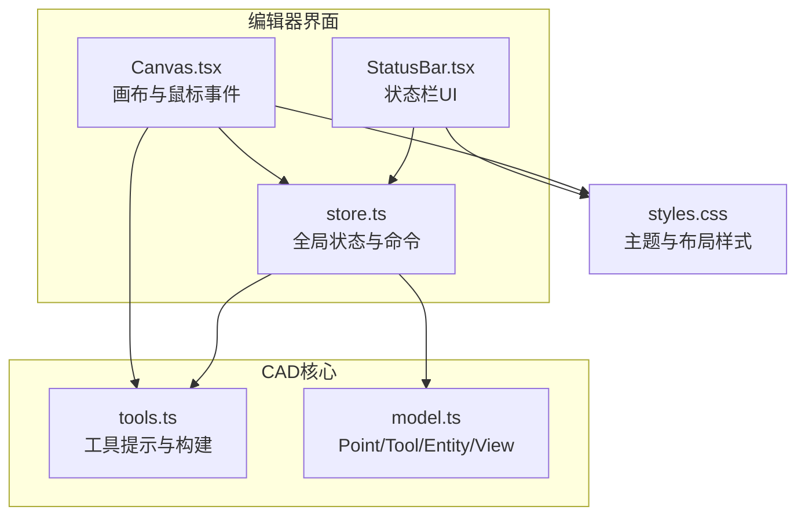
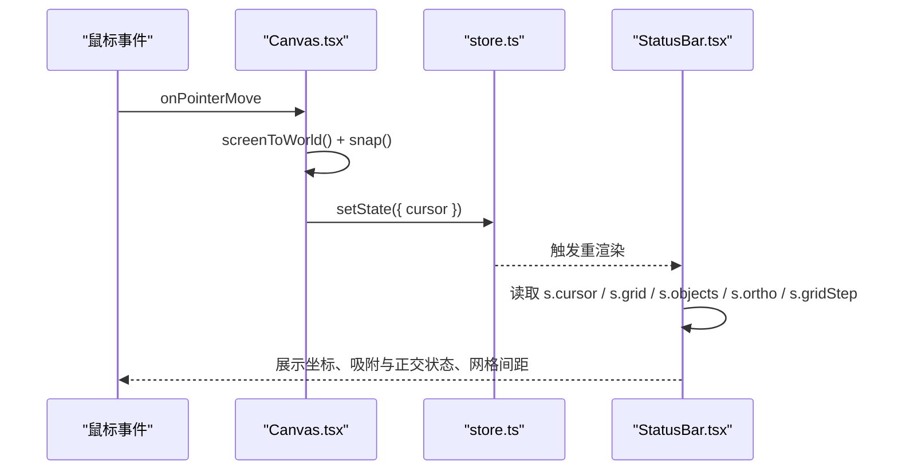
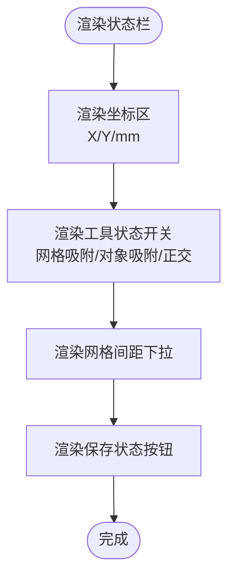
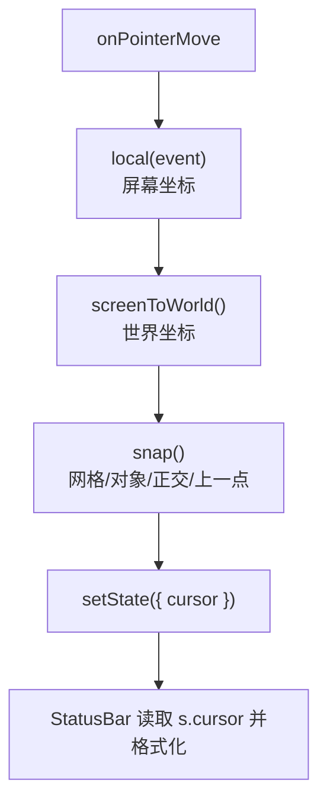
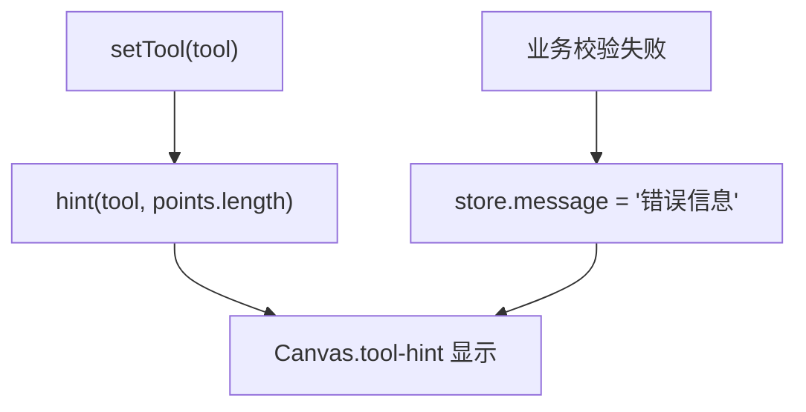
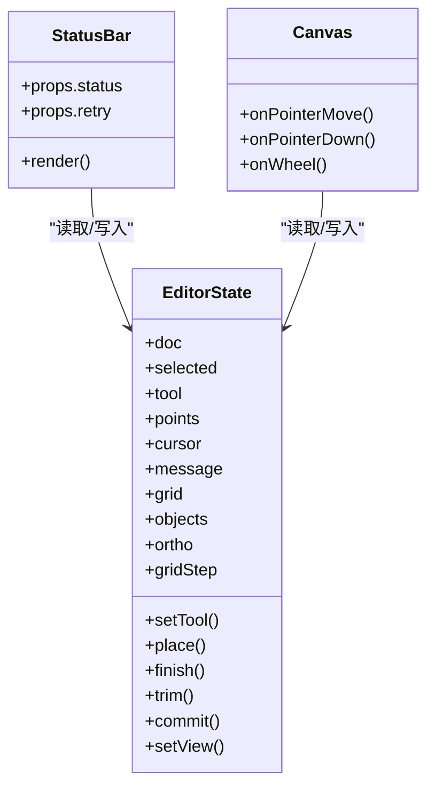
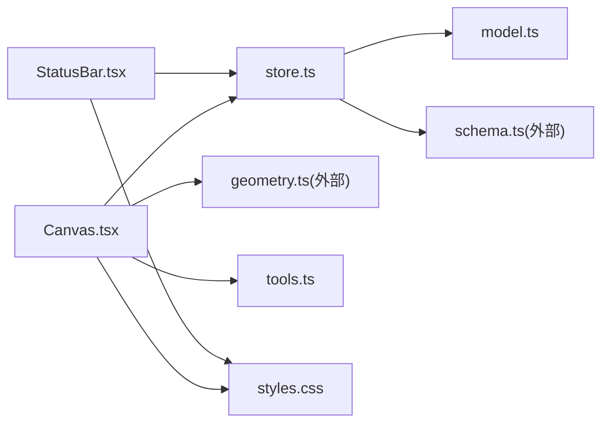

# 状态栏

<cite>
**本文引用的文件**   
- [StatusBar.tsx](file://src/features/editor/StatusBar.tsx)
- [store.ts](file://src/features/editor/store.ts)
- [Canvas.tsx](file://src/features/editor/Canvas.tsx)
- [tools.ts](file://src/cad/tools.ts)
- [model.ts](file://src/cad/model.ts)
- [styles.css](file://src/app/styles.css)
</cite>

## 目录
1. [简介](#简介)
2. [项目结构](#项目结构)
3. [核心组件](#核心组件)
4. [架构总览](#架构总览)
5. [详细组件分析](#详细组件分析)
6. [依赖关系分析](#依赖关系分析)
7. [性能与可访问性](#性能与可访问性)
8. [故障排查指南](#故障排查指南)
9. [结论](#结论)
10. [附录：扩展与定制指南](#附录扩展与定制指南)

## 简介
本文件为 web-cad 的状态栏组件提供系统化文档。内容覆盖状态栏的布局与信息展示、坐标系统的实时更新机制、操作提示系统、进度反馈机制、样式主题与可定制性，以及与工具、选择、视图等其它组件的状态同步方式。同时给出扩展开发指南，帮助你在不破坏现有行为的前提下，扩展状态栏的信息显示能力。

## 项目结构
状态栏相关代码主要分布在以下位置：
- 状态栏 UI：src/features/editor/StatusBar.tsx
- 编辑器全局状态与业务逻辑：src/features/editor/store.ts
- 画布交互与鼠标跟踪：src/features/editor/Canvas.tsx
- 工具名称与操作提示：src/cad/tools.ts
- 数据模型与类型定义：src/cad/model.ts
- 样式主题：src/app/styles.css

图表来源
- [Canvas.tsx:18-21](file://src/features/editor/Canvas.tsx#L18-L21)
- [StatusBar.tsx:1-3](file://src/features/editor/StatusBar.tsx#L1-L3)
- [store.ts:1-15](file://src/features/editor/store.ts#L1-L15)
- [tools.ts:1-4](file://src/cad/tools.ts#L1-L4)
- [model.ts:1-11](file://src/cad/model.ts#L1-L11)
- [styles.css:772-831](file://src/app/styles.css#L772-L831)

章节来源
- [StatusBar.tsx:1-74](file://src/features/editor/StatusBar.tsx#L1-L74)
- [store.ts:17-47](file://src/features/editor/store.ts#L17-L47)
- [Canvas.tsx:18-21](file://src/features/editor/Canvas.tsx#L18-L21)
- [tools.ts:5-48](file://src/cad/tools.ts#L5-L48)
- [model.ts:1-11](file://src/cad/model.ts#L1-L11)
- [styles.css:772-831](file://src/app/styles.css#L772-L831)

## 核心组件
- 状态栏（StatusBar）：负责展示坐标、吸附与正交开关、网格间距选择以及保存状态按钮。
- 编辑器状态（store）：集中管理光标坐标、工具、选择、图层、消息、视图等全局状态，并提供命令方法。
- 画布（Canvas）：处理鼠标移动、点击、拖拽、滚轮缩放等交互，更新光标坐标并驱动预览绘制。
- 工具提示（tools）：根据当前工具与已采集点数生成用户引导文案。
- 数据模型（model）：定义 Point、Tool、Entity、View 等基础类型。
- 样式（styles.css）：定义状态栏布局、颜色、字体与交互态样式。

章节来源
- [StatusBar.tsx:4-74](file://src/features/editor/StatusBar.tsx#L4-L74)
- [store.ts:17-47](file://src/features/editor/store.ts#L17-L47)
- [Canvas.tsx:32-43](file://src/features/editor/Canvas.tsx#L32-L43)
- [tools.ts:5-48](file://src/cad/tools.ts#L5-L48)
- [model.ts:1-11](file://src/cad/model.ts#L1-L11)
- [styles.css:772-831](file://src/app/styles.css#L772-L831)

## 架构总览
状态栏通过订阅全局 store 中的 cursor、grid、objects、ortho、gridStep 等字段进行渲染；画布在鼠标移动时计算世界坐标并写入 store.cursor；工具提示由 tools.hint 基于当前工具与已采集点数生成；错误与引导消息统一存储在 store.message 中，供画布区域与状态栏共同消费。

图表来源
- [Canvas.tsx:264-280](file://src/features/editor/Canvas.tsx#L264-L280)
- [store.ts:48-66](file://src/features/editor/store.ts#L48-L66)
- [StatusBar.tsx:11-24](file://src/features/editor/StatusBar.tsx#L11-L24)

## 详细组件分析

### 状态栏布局与信息展示
- 坐标区：显示 X、Y 坐标值与单位 mm，数值保留两位小数。
- 工具状态切换：网格吸附、对象吸附、正交模式三个开关按钮，选中态以 active 类标识。
- 网格间距下拉：可选 1/5/10/20/50 mm。
- 保存状态按钮：右侧对齐，显示保存状态文本并提供重试回调。

图表来源
- [StatusBar.tsx:13-70](file://src/features/editor/StatusBar.tsx#L13-L70)
- [styles.css:772-831](file://src/app/styles.css#L772-L831)

章节来源
- [StatusBar.tsx:13-70](file://src/features/editor/StatusBar.tsx#L13-L70)
- [styles.css:772-831](file://src/app/styles.css#L772-L831)

### 坐标系统的实时更新
- 鼠标移动时，Canvas 将屏幕坐标转换为世界坐标，并结合吸附规则（网格、对象、正交、上一点）计算最终光标位置。
- 计算结果写入 store.cursor，状态栏实时读取并格式化输出。
- 坐标格式化为两位小数，单位为毫米。

图表来源
- [Canvas.tsx:180-195](file://src/features/editor/Canvas.tsx#L180-L195)
- [Canvas.tsx:264-280](file://src/features/editor/Canvas.tsx#L264-L280)
- [StatusBar.tsx:14-24](file://src/features/editor/StatusBar.tsx#L14-L24)

章节来源
- [Canvas.tsx:180-195](file://src/features/editor/Canvas.tsx#L180-L195)
- [Canvas.tsx:264-280](file://src/features/editor/Canvas.tsx#L264-L280)
- [StatusBar.tsx:14-24](file://src/features/editor/StatusBar.tsx#L14-L24)

### 操作提示系统
- 工具使用说明：Canvas 顶部提示区优先显示 store.message，否则使用 tools.hint(tool, points.length) 生成引导文案。
- 错误消息：当图形构建失败、图层不可编辑或几何无效时，store 设置 message 提示用户。
- 用户引导：不同工具的 hint 文案随已采集点数变化，动态指导下一步操作。

图表来源
- [tools.ts:20-48](file://src/cad/tools.ts#L20-L48)
- [store.ts:111-111](file://src/features/editor/store.ts#L111-L111)
- [store.ts:255-257](file://src/features/editor/store.ts#L255-L257)
- [store.ts:269-272](file://src/features/editor/store.ts#L269-L272)
- [store.ts:303-305](file://src/features/editor/store.ts#L303-L305)
- [Canvas.tsx:644-648](file://src/features/editor/Canvas.tsx#L644-L648)

章节来源
- [tools.ts:20-48](file://src/cad/tools.ts#L20-L48)
- [store.ts:111-111](file://src/features/editor/store.ts#L111-L111)
- [store.ts:255-257](file://src/features/editor/store.ts#L255-L257)
- [store.ts:269-272](file://src/features/editor/store.ts#L269-L272)
- [store.ts:303-305](file://src/features/editor/store.ts#L303-L305)
- [Canvas.tsx:644-648](file://src/features/editor/Canvas.tsx#L644-L648)

### 进度反馈机制
- 保存状态：状态栏右侧按钮显示保存状态文本，并提供重试回调。
- 操作状态指示：store.message 用于表达临时性错误与引导信息，在操作完成后清空。
- 加载提示：当前实现未包含全局加载遮罩；如需增强，可在 store 中增加 loading 字段并在 UI 层展示。

章节来源
- [StatusBar.tsx:67-70](file://src/features/editor/StatusBar.tsx#L67-L70)
- [store.ts:85-88](file://src/features/editor/store.ts#L85-L88)
- [store.ts:255-257](file://src/features/editor/store.ts#L255-L257)
- [store.ts:269-272](file://src/features/editor/store.ts#L269-L272)
- [store.ts:303-305](file://src/features/editor/store.ts#L303-L305)

### 状态栏的可定制性
- 显示内容配置：
  - 坐标：固定显示 X/Y 与单位 mm，可通过 store.cursor 控制。
  - 工具状态：grid、objects、ortho 布尔开关，gridStep 数值选择。
  - 保存状态：外部传入 status 文本与 retry 回调。
- 样式主题：
  - 状态栏容器、坐标区、开关按钮、下拉框、保存按钮均有独立样式类。
  - 激活态通过 .active 类切换高亮背景与文字色。
  - 颜色、字号、行高、间距均可在 styles.css 中调整。

章节来源
- [StatusBar.tsx:13-70](file://src/features/editor/StatusBar.tsx#L13-L70)
- [styles.css:772-831](file://src/app/styles.css#L772-L831)

### 与其他组件的状态同步
- 工具状态：store.tool 变更会清空 points 与 message，Canvas 根据 tool 决定交互行为与预览绘制。
- 选择状态：store.selected 影响实体高亮、锚点显示与变换操作；状态栏不直接显示选择数量，但可通过扩展添加。
- 视图状态：store.doc.view 控制平移与缩放；状态栏不直接显示缩放比例，但可通过扩展添加。
- 光标状态：store.cursor 由 Canvas 实时更新，状态栏实时展示。

图表来源
- [store.ts:17-47](file://src/features/editor/store.ts#L17-L47)
- [store.ts:48-66](file://src/features/editor/store.ts#L48-L66)
- [Canvas.tsx:32-43](file://src/features/editor/Canvas.tsx#L32-L43)
- [StatusBar.tsx:11-12](file://src/features/editor/StatusBar.tsx#L11-L12)

章节来源
- [store.ts:17-47](file://src/features/editor/store.ts#L17-L47)
- [store.ts:48-66](file://src/features/editor/store.ts#L48-L66)
- [Canvas.tsx:32-43](file://src/features/editor/Canvas.tsx#L32-L43)
- [StatusBar.tsx:11-12](file://src/features/editor/StatusBar.tsx#L11-L12)

## 依赖关系分析
- StatusBar 依赖 useEditor 获取全局状态，并通过 useEditor.setState 修改 grid、objects、ortho、gridStep。
- Canvas 依赖 geometry 工具进行坐标转换与吸附计算，依赖 tools.buildEntity 与 tools.hint 进行图形构建与提示生成。
- store 依赖 model 类型定义与 io/schema 校验，依赖 geometry 与 tools 执行业务逻辑。
- 样式依赖 styles.css 提供的类名与主题变量。

图表来源
- [StatusBar.tsx:1-3](file://src/features/editor/StatusBar.tsx#L1-L3)
- [Canvas.tsx:18-21](file://src/features/editor/Canvas.tsx#L18-L21)
- [store.ts:1-15](file://src/features/editor/store.ts#L1-L15)
- [tools.ts:1-4](file://src/cad/tools.ts#L1-L4)
- [model.ts:1-11](file://src/cad/model.ts#L1-L11)
- [styles.css:772-831](file://src/app/styles.css#L772-L831)

章节来源
- [StatusBar.tsx:1-3](file://src/features/editor/StatusBar.tsx#L1-L3)
- [Canvas.tsx:18-21](file://src/features/editor/Canvas.tsx#L18-L21)
- [store.ts:1-15](file://src/features/editor/store.ts#L1-L15)
- [tools.ts:1-4](file://src/cad/tools.ts#L1-L4)
- [model.ts:1-11](file://src/cad/model.ts#L1-L11)
- [styles.css:772-831](file://src/app/styles.css#L772-L831)

## 性能与可访问性
- 性能：
  - 坐标更新仅在 onPointerMove 时发生，避免不必要的重渲染。
  - 吸附计算在 Canvas 内部完成，状态栏仅消费最终 cursor，降低耦合。
  - 建议对高频更新路径做节流或防抖（如需要），以减少渲染压力。
- 可访问性：
  - 状态开关按钮使用 aria-pressed 表示选中态。
  - 网格间距下拉框提供 aria-label。
  - 建议在扩展中添加更多语义化属性，如 role="status" 与 aria-live 区域，便于读屏器播报。

章节来源
- [StatusBar.tsx:26-55](file://src/features/editor/StatusBar.tsx#L26-L55)
- [Canvas.tsx:264-280](file://src/features/editor/Canvas.tsx#L264-L280)

## 故障排查指南
- 坐标不更新：
  - 检查 Canvas.onPointerMove 是否被正确绑定。
  - 确认 store.cursor 是否在 move 回调中被更新。
- 吸附异常：
  - 检查 store.grid、store.objects、store.ortho、store.gridStep 是否正确设置。
  - 确认 snap 参数传递顺序与可用实体列表。
- 工具提示不显示：
  - 检查 store.message 是否为空，若为空则应回退到 tools.hint。
  - 确认当前 tool 与 points.length 是否符合预期。
- 保存状态无响应：
  - 检查外部传入的 retry 回调是否有效。
  - 确认 status 文本是否被正确渲染。

章节来源
- [Canvas.tsx:264-280](file://src/features/editor/Canvas.tsx#L264-L280)
- [tools.ts:20-48](file://src/cad/tools.ts#L20-L48)
- [StatusBar.tsx:67-70](file://src/features/editor/StatusBar.tsx#L67-L70)

## 结论
状态栏是 web-cad 的关键信息面板，负责呈现坐标、工具状态与保存状态。它与画布和全局状态紧密协作，确保用户在绘图过程中的每一步都能获得清晰的反馈。通过合理的状态管理与样式组织，状态栏具备良好的可扩展性与主题定制能力。

## 附录：扩展与定制指南

### 扩展显示内容
- 新增显示项：
  - 在 store 中新增字段（例如 zoom、selectionCount）。
  - 在 StatusBar 中读取该字段并渲染。
  - 在 Canvas 或其他组件中更新该字段。
- 示例路径参考：
  - 新增状态字段与更新：[store.ts:48-66](file://src/features/editor/store.ts#L48-L66)
  - 状态栏渲染扩展：[StatusBar.tsx:13-70](file://src/features/editor/StatusBar.tsx#L13-L70)

### 自定义信息显示
- 使用 store.message 作为通用提示通道：
  - 在业务逻辑中设置 message 表达错误或引导。
  - 在 Canvas.tool-hint 区域优先显示 message。
- 示例路径参考：
  - 设置错误消息：[store.ts:85-88](file://src/features/editor/store.ts#L85-L88)
  - 提示区渲染：[Canvas.tsx:644-648](file://src/features/editor/Canvas.tsx#L644-L648)

### 样式主题定制
- 修改状态栏外观：
  - 调整 .status-bar、.coordinates、.status-switches、.save-status 等类名样式。
  - 使用 CSS 变量统一管理颜色与尺寸（推荐）。
- 示例路径参考：
  - 状态栏样式：[styles.css:772-831](file://src/app/styles.css#L772-L831)

### 与工具、选择、视图联动
- 工具联动：
  - setTool 会清空 points 与 message，确保提示与输入状态一致。
- 选择联动：
  - selected 数组控制实体高亮与变换操作。
- 视图联动：
  - view 控制平移与缩放，影响坐标换算与预览绘制。
- 示例路径参考：
  - 工具切换：[store.ts:111-111](file://src/features/editor/store.ts#L111-L111)
  - 选择与变换：[store.ts:149-186](file://src/features/editor/store.ts#L149-L186)
  - 视图更新：[store.ts:102-110](file://src/features/editor/store.ts#L102-L110)