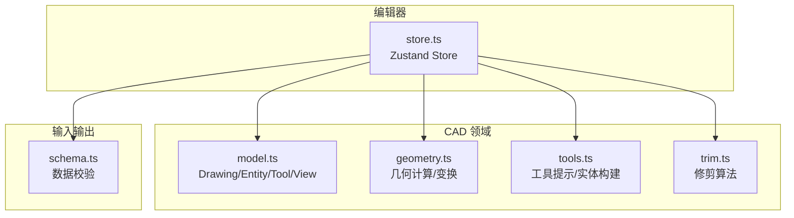
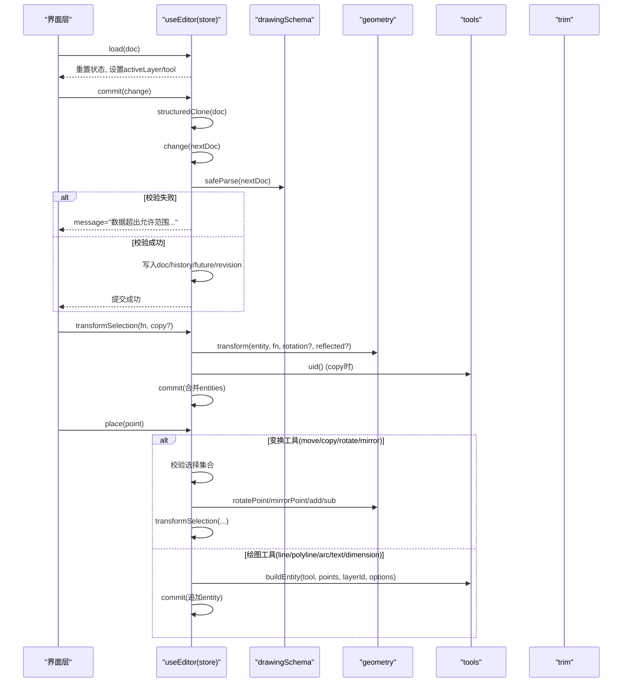
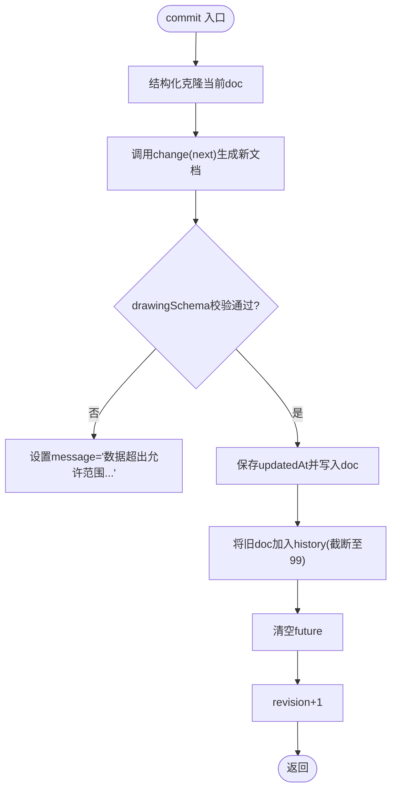
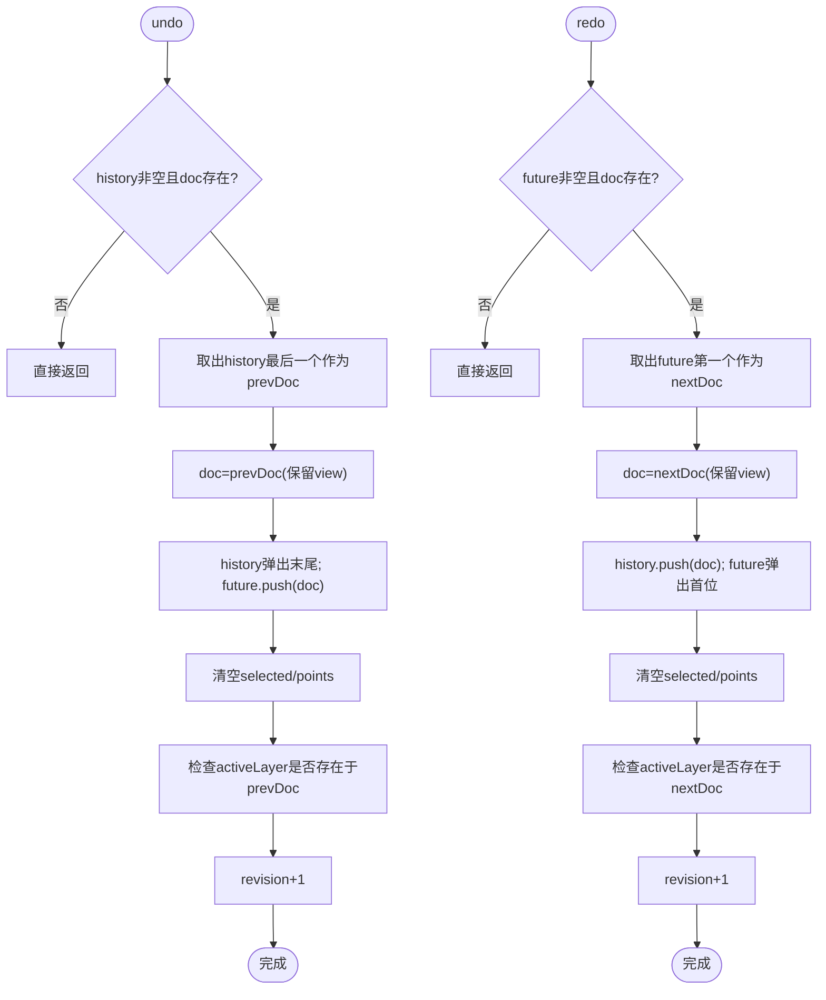
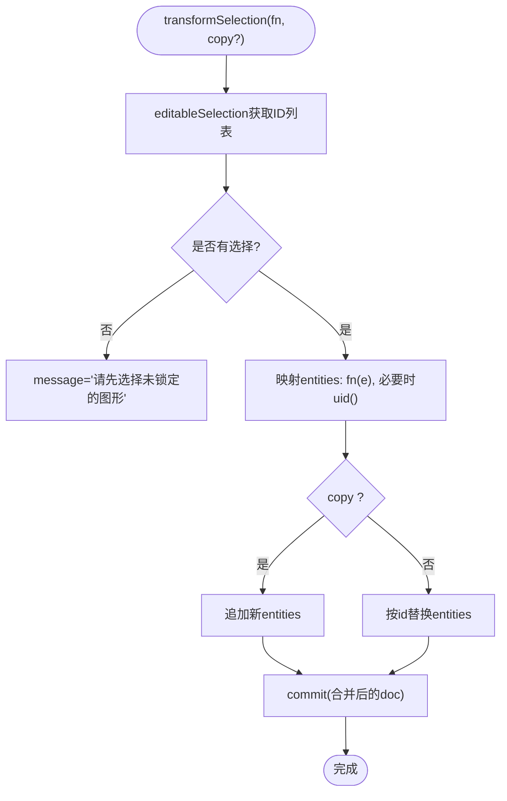
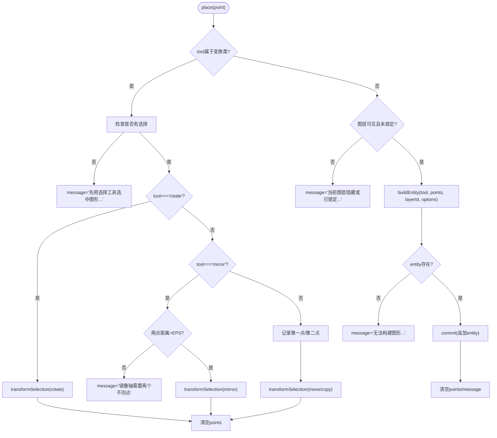
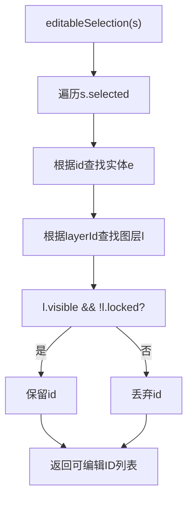
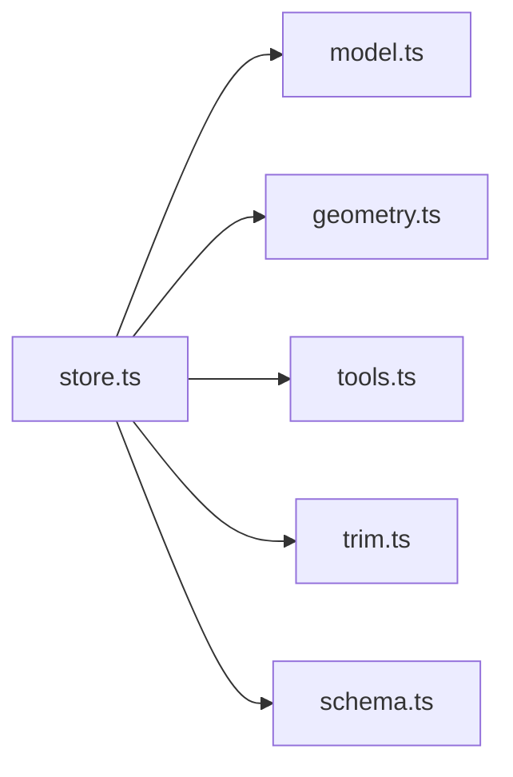

# 状态管理

<cite>
**本文引用的文件**   
- [store.ts](file://src/features/editor/store.ts)
- [model.ts](file://src/cad/model.ts)
- [tools.ts](file://src/cad/tools.ts)
- [geometry.ts](file://src/cad/geometry.ts)
- [trim.ts](file://src/cad/trim.ts)
- [schema.ts](file://src/io/schema.ts)
- [store.test.ts](file://src/features/editor/store.test.ts)
</cite>

## 目录
1. [引言](#引言)
2. [项目结构](#项目结构)
3. [核心组件](#核心组件)
4. [架构总览](#架构总览)
5. [详细组件分析](#详细组件分析)
6. [依赖关系分析](#依赖关系分析)
7. [性能考虑](#性能考虑)
8. [故障排查指南](#故障排查指南)
9. [结论](#结论)

## 引言
本文面向 web-cad 编辑器的状态管理系统，系统性解析基于 Zustand 的 store 设计模式。文档围绕 EditorState 接口定义、状态字段与 Actions/reducers 实现展开，深入说明数据流架构（load、commit、undo/redo）、历史管理机制（history/future 数组维护策略）、选择系统（selected 管理与 editableSelection 过滤逻辑）、工具状态管理（tool 切换、points 收集与 place 流程），以及几何变换操作（transformSelection 与 copy 参数处理）。同时提供流程图与时序图辅助理解，并给出错误处理与边界情况的实践建议。

## 项目结构
编辑器状态管理位于 features/editor 模块，核心为 store.ts；CAD 领域模型与几何计算分别位于 cad/model.ts、cad/geometry.ts、cad/tools.ts、cad/trim.ts；数据校验使用 io/schema.ts；行为验证由 store.test.ts 覆盖。

图表来源
- [store.ts:1-15](file://src/features/editor/store.ts#L1-L15)
- [model.ts:1-61](file://src/cad/model.ts#L1-L61)
- [geometry.ts:1-10](file://src/cad/geometry.ts#L1-L10)
- [tools.ts:1-19](file://src/cad/tools.ts#L1-L19)
- [schema.ts:1-200](file://src/io/schema.ts#L1-L200)

章节来源
- [store.ts:1-324](file://src/features/editor/store.ts#L1-L324)
- [model.ts:1-142](file://src/cad/model.ts#L1-L142)
- [tools.ts:1-126](file://src/cad/tools.ts#L1-L126)
- [geometry.ts:1-443](file://src/cad/geometry.ts#L1-L443)

## 核心组件
- EditorState：描述编辑器全局状态与可执行动作，包含文档、历史、视图、工具、选择、几何点等。
- useEditor：Zustand store 创建器，封装所有状态更新逻辑（actions/reducers）。
- 领域模型：Drawing、Entity、Layer、Tool、View 等类型定义。
- 几何与工具：几何变换、交点计算、实体构建、工具提示等。
- 数据校验：drawingSchema 对 commit 后的新文档进行安全校验。

章节来源
- [store.ts:17-47](file://src/features/editor/store.ts#L17-L47)
- [model.ts:1-75](file://src/cad/model.ts#L1-L75)
- [geometry.ts:253-328](file://src/cad/geometry.ts#L253-L328)
- [tools.ts:49-125](file://src/cad/tools.ts#L49-L125)
- [schema.ts:1-200](file://src/io/schema.ts#L1-L200)

## 架构总览
编辑器采用“不可变数据 + 命令式 actions”的模式：
- load：加载图纸，重置历史与选择，初始化活跃图层与工具。
- commit：接收变更函数，克隆当前 doc，应用变更，校验后持久化到 history，清空 future。
- undo/redo：在 history 与 future 之间移动状态，保持 view 一致，清理临时选择与 points。
- setView/setTool：轻量状态更新，触发 revision 递增以驱动渲染。
- remove/transformSelection/place/finish/trim：业务动作，组合 geometry/tools/trim 完成具体操作。

图表来源
- [store.ts:67-101](file://src/features/editor/store.ts#L67-L101)
- [store.ts:160-186](file://src/features/editor/store.ts#L160-L186)
- [store.ts:187-264](file://src/features/editor/store.ts#L187-L264)
- [geometry.ts:246-336](file://src/cad/geometry.ts#L246-L336)
- [tools.ts:49-125](file://src/cad/tools.ts#L49-L125)

## 详细组件分析

### EditorState 接口与状态字段
- 文档与版本
  - doc: Drawing | null，当前活动文档。
  - revision: number，用于驱动重渲染的版本号。
- 历史与撤销
  - history: Drawing[]，历史快照栈（最多保留最近 99 个）。
  - future: Drawing[]，重做栈。
- 选择与图层
  - selected: string[]，选中实体 ID 列表。
  - activeLayer: string，当前活跃图层 ID。
- 工具与交互
  - tool: Tool，当前工具枚举。
  - points: Point[]，工具多点输入缓存（如折线、圆弧、尺寸标注）。
  - grid/objects/ortho/gridStep/cursor/message/text/textSize/dimensionMode/rotation：视图与工具配置。
- Actions
  - load、commit、setView、setTool、undo、redo、remove、place、finish、trim、transformSelection。

章节来源
- [store.ts:17-47](file://src/features/editor/store.ts#L17-L47)
- [model.ts:18-75](file://src/cad/model.ts#L18-L75)

### 数据流与核心操作

#### load
- 作用：加载新文档，清空历史与未来，重置选择、工具、消息，并设置初始活跃图层。
- 关键点：
  - 将 history/future/selected/points/message 置空。
  - 根据 doc.layers[0] 设置 activeLayer。
  - 将 tool 设为 'select'。

章节来源
- [store.ts:67-78](file://src/features/editor/store.ts#L67-L78)

#### commit
- 作用：统一的状态变更入口，负责深拷贝、应用变更、校验、入栈历史、清空未来、递增 revision。
- 关键点：
  - 使用 structuredClone 避免共享引用。
  - drawingSchema.safeParse 校验数据结构与数值范围。
  - 若校验失败，设置 message 并拒绝提交。
  - 成功则保存 updatedAt，并将旧 doc 推入 history（限制长度），清空 future。

图表来源
- [store.ts:79-101](file://src/features/editor/store.ts#L79-L101)
- [schema.ts:1-200](file://src/io/schema.ts#L1-L200)

章节来源
- [store.ts:79-101](file://src/features/editor/store.ts#L79-L101)

#### undo / redo
- 作用：在 history 与 future 之间移动状态，恢复或重放文档快照。
- 关键点：
  - 保持 view 不变，仅替换 entities/layers 等文档内容。
  - 清空 selected 与 points，避免状态不一致。
  - 调整 activeLayer：若原活跃图层在新快照中不存在，回退到新快照的第一个图层。
  - 递增 revision。

图表来源
- [store.ts:112-148](file://src/features/editor/store.ts#L112-L148)

章节来源
- [store.ts:112-148](file://src/features/editor/store.ts#L112-L148)

#### remove
- 作用：删除选中的可编辑实体。
- 关键点：
  - 使用 editableSelection 过滤出可见且未锁定的实体。
  - 通过 commit 从 entities 中移除对应 ID。
  - 清空 selected。

章节来源
- [store.ts:149-159](file://src/features/editor/store.ts#L149-L159)

#### transformSelection
- 作用：对选中实体执行几何变换，支持复制模式。
- 关键点：
  - 若无有效选择，设置 message 提示。
  - 遍历选中实体，应用 fn(e) 得到新实体。
  - 当 copy=true 时，为新实体分配新 id，并将结果追加到 entities；否则原地替换。
  - 通过 commit 提交变更。

图表来源
- [store.ts:160-186](file://src/features/editor/store.ts#L160-L186)
- [geometry.ts:253-328](file://src/cad/geometry.ts#L253-L328)

章节来源
- [store.ts:160-186](file://src/features/editor/store.ts#L160-L186)

#### place
- 作用：统一的点击落点处理，区分变换工具与绘图工具。
- 关键点：
  - 变换工具（move/copy/rotate/mirror）：
    - 校验是否已选择实体。
    - rotate：以 point 为旋转中心，结合 rotation 角度执行旋转。
    - mirror：需要两个不同点，计算镜像轴角度。
    - move/copy：记录基准点，第二次点击确定目标点，计算位移向量。
    - 最终调用 transformSelection 完成变换，copy 模式下复制实体。
  - 绘图工具（line/polyline/rectangle/circle/arc/text/dimension）：
    - 校验当前图层是否可见且未锁定。
    - 根据工具类型决定需要的点数（text=1，arc/dimension=3，其他=2）。
    - 使用 tools.buildEntity 构建实体，并通过 commit 追加到 entities。
    - 完成后清空 points 与 message。

图表来源
- [store.ts:187-264](file://src/features/editor/store.ts#L187-L264)
- [tools.ts:49-125](file://src/cad/tools.ts#L49-L125)
- [geometry.ts:246-336](file://src/cad/geometry.ts#L246-L336)

章节来源
- [store.ts:187-264](file://src/features/editor/store.ts#L187-L264)

#### finish
- 作用：结束折线绘制，将 points 转为 polyline 实体并提交。
- 关键点：
  - 仅在 tool==='polyline' 且 points.length>=2 时生效。
  - 校验图层可见性与锁定状态。
  - 使用 buildEntity('polyline', ...) 构建实体并提交。

章节来源
- [store.ts:265-286](file://src/features/editor/store.ts#L265-L286)

#### trim
- 作用：对目标实体进行修剪，依据点击位置移除指定区段。
- 关键点：
  - 查找目标实体及其图层，校验可见性与锁定。
  - 使用 trimEntity(target, visibleEntities, point) 计算修剪结果。
  - 若无效，设置 message 提示。
  - 成功则用 trimmed 替换原实体，并清空 selected 与 message。

章节来源
- [store.ts:287-315](file://src/features/editor/store.ts#L287-L315)

### 历史管理机制
- history：保存每次 commit 前的旧 doc，最多保留 99 条，防止无限增长。
- future：每次 commit 清空 future，确保撤销后再编辑不会误重放。
- undo/redo：
  - 保持 view 不变，避免撤销/重做导致视图跳变。
  - 清理 selected 与 points，避免残留状态影响后续操作。
  - 智能修复 activeLayer：若原活跃图层在新快照中不存在，自动回退到首个图层。

章节来源
- [store.ts:79-101](file://src/features/editor/store.ts#L79-L101)
- [store.ts:112-148](file://src/features/editor/store.ts#L112-L148)

### 选择系统与 editableSelection
- selected：存储被选中的实体 ID 列表。
- editableSelection：过滤出可见且未锁定的实体 ID，确保删除与变换只作用于可编辑对象。
- 典型用法：
  - remove：先过滤再删除。
  - transformSelection：先过滤再变换。
  - place 的变换分支：校验是否有可编辑选择。

图表来源
- [store.ts:317-323](file://src/features/editor/store.ts#L317-L323)

章节来源
- [store.ts:317-323](file://src/features/editor/store.ts#L317-L323)

### 工具状态管理
- tool：当前工具枚举，控制 place 的行为分支。
- points：工具多点输入缓存，随工具需求累积（如折线、圆弧、尺寸标注）。
- setTool：切换工具时清空 points 与 message，保证状态干净。
- hint：工具提示文案，帮助引导用户操作。

章节来源
- [store.ts:111-111](file://src/features/editor/store.ts#L111-L111)
- [tools.ts:5-48](file://src/cad/tools.ts#L5-L48)

### 几何变换操作
- transform：针对不同类型实体（line/rectangle/polyline/circle/arc/text/dimension）进行点级变换，处理旋转与镜像的特殊逻辑。
- rotatePoint：绕中心点旋转点坐标。
- mirrorPoint：关于直线（两点）镜像点坐标。
- transformSelection：组合上述能力，批量变换选中实体，支持 copy 模式。

章节来源
- [geometry.ts:246-336](file://src/cad/geometry.ts#L246-L336)
- [store.ts:160-186](file://src/features/editor/store.ts#L160-L186)

## 依赖关系分析
- store.ts 依赖：
  - model.ts：Drawing/Entity/Layer/Tool/View 类型与 createDrawing/cloneDrawing/uid。
  - geometry.ts：add/sub/mul/dot/cross/distance/angle/rotatePoint/mirrorPoint/transform 等。
  - tools.ts：buildEntity 与 toolNames/hint。
  - trim.ts：trimEntity 修剪算法。
  - schema.ts：drawingSchema 数据校验。
- 耦合与内聚：
  - store.ts 作为协调者，低耦合地调用领域函数，保持高内聚的状态管理职责。
  - geometry.ts 与 tools.ts 纯函数为主，便于测试与复用。

图表来源
- [store.ts:1-15](file://src/features/editor/store.ts#L1-L15)
- [model.ts:1-142](file://src/cad/model.ts#L1-L142)
- [geometry.ts:1-443](file://src/cad/geometry.ts#L1-L443)
- [tools.ts:1-126](file://src/cad/tools.ts#L1-L126)
- [trim.ts:1-200](file://src/cad/trim.ts#L1-L200)
- [schema.ts:1-200](file://src/io/schema.ts#L1-L200)

章节来源
- [store.ts:1-324](file://src/features/editor/store.ts#L1-L324)

## 性能考虑
- 历史栈上限：history 切片保留最近 99 条，避免内存膨胀。
- 结构化克隆：commit 使用 structuredClone 避免浅拷贝导致的副作用。
- 批量变换：transformSelection 一次性映射 entities，减少多次 setState 开销。
- 视图一致性：undo/redo 保留 view，避免频繁重算视口。
- 几何计算优化：geometry.ts 使用 EPS 容差与向量化运算，减少浮点误差与分支判断。

[本节为通用指导，不直接分析具体文件]

## 故障排查指南
- 数据校验失败
  - 现象：commit 后 entities 为空，history 无新增，message 提示“数据超出允许范围”。
  - 原因：drawingSchema 校验失败（如非法数值、悬空图层引用）。
  - 处理：检查实体属性（半径、层引用等），确保符合 schema 约束。
- 图层锁定/隐藏
  - 现象：无法新建或删除实体，message 提示“当前图层隐藏或已锁定”。
  - 处理：切换到可见且未锁定的图层。
- 变换工具缺少选择
  - 现象：message 提示“先用选择工具选中图形，再进行变换”。
  - 处理：先使用 select 工具选择实体。
- 镜像轴无效
  - 现象：message 提示“镜像轴需要两个不同点”。
  - 处理：确保两次点击的点不重合。
- 无法构建图形
  - 现象：message 提示“无法构建图形：请检查点的位置或文字内容”。
  - 处理：检查 points 数量与有效性（如 text 非空、arc 三点不共线等）。

章节来源
- [store.ts:79-101](file://src/features/editor/store.ts#L79-L101)
- [store.ts:187-264](file://src/features/editor/store.ts#L187-L264)
- [store.test.ts:80-97](file://src/features/editor/store.test.ts#L80-L97)

## 结论
本状态管理系统以 Zustand 为核心，通过不可变数据与命令式 actions 实现了清晰的数据流与强大的撤销重做能力。EditorState 将文档、历史、选择、工具与几何变换解耦，配合 geometry/tools/trim 等纯函数模块，保证了可扩展性与可测试性。实践中应严格遵循 commit 的数据校验、合理使用 editableSelection 保护可编辑对象，并在复杂变换操作中注意 copy 参数的语义与历史栈的管理策略。