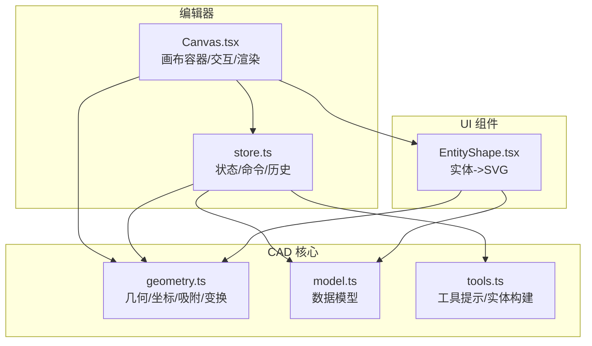
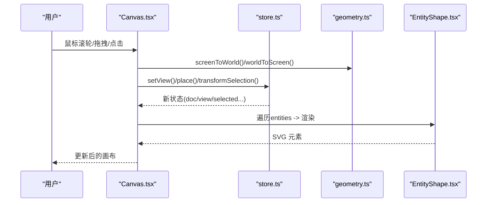
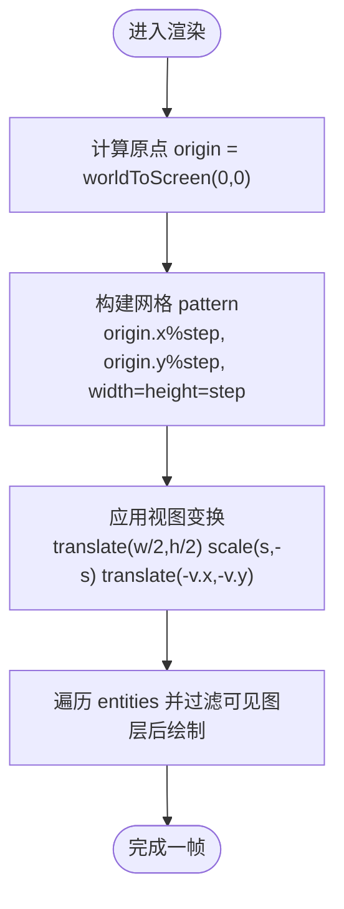
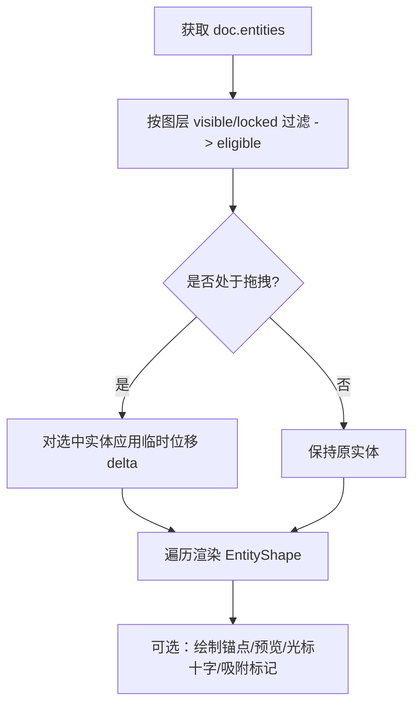
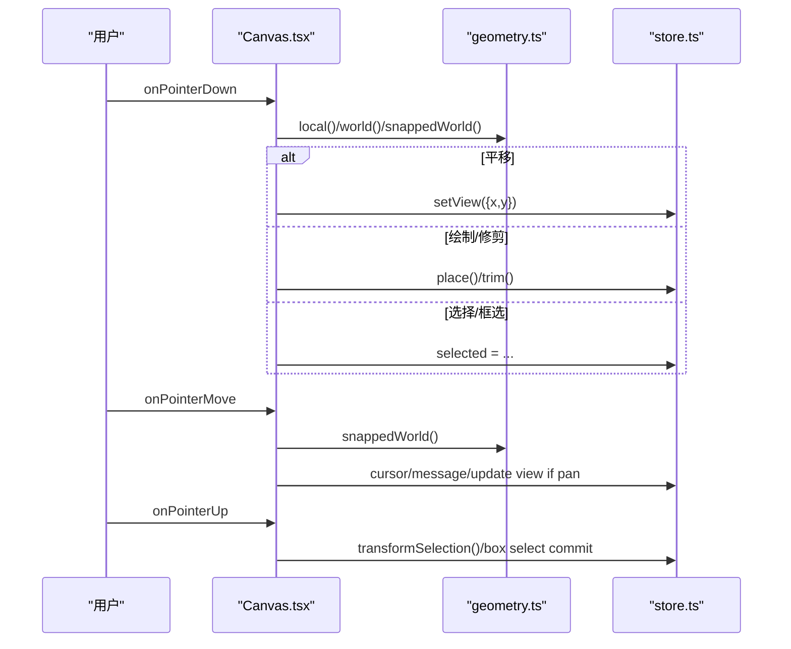
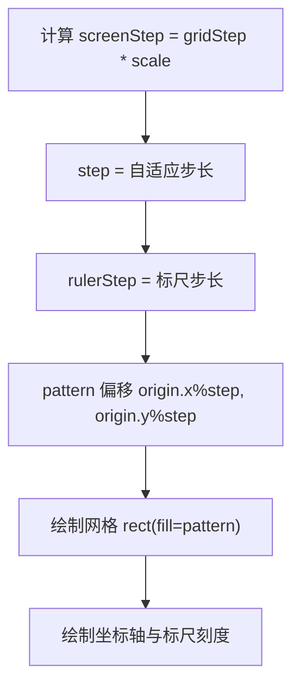
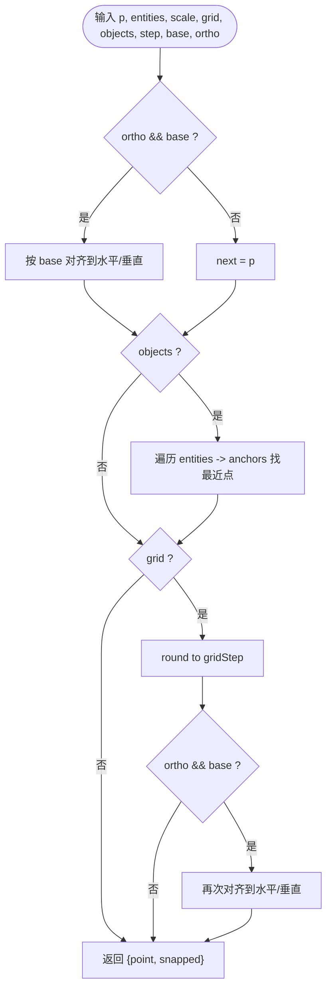
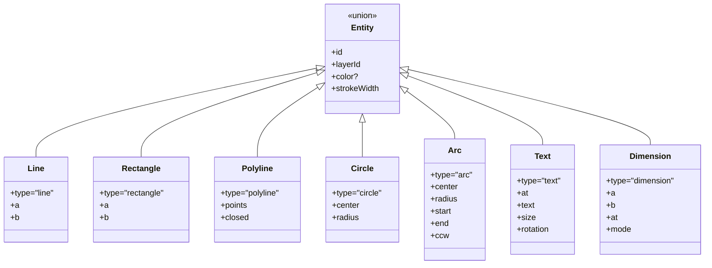
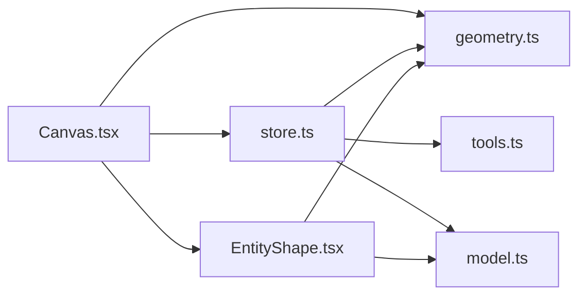

# 画布渲染

<cite>
**本文引用的文件**   
- [Canvas.tsx](file://src/features/editor/Canvas.tsx)
- [geometry.ts](file://src/cad/geometry.ts)
- [model.ts](file://src/cad/model.ts)
- [tools.ts](file://src/cad/tools.ts)
- [EntityShape.tsx](file://src/components/EntityShape.tsx)
- [store.ts](file://src/features/editor/store.ts)
</cite>

## 目录
1. [简介](#简介)
2. [项目结构](#项目结构)
3. [核心组件](#核心组件)
4. [架构总览](#架构总览)
5. [详细组件分析](#详细组件分析)
6. [依赖关系分析](#依赖关系分析)
7. [性能考量](#性能考量)
8. [故障排查指南](#故障排查指南)
9. [结论](#结论)
10. [附录：配置与扩展点](#附录配置与扩展点)

## 简介
本文面向 web-cad 的画布渲染子系统，系统性说明 SVG 渲染引擎的实现原理、视图变换（缩放/平移）、坐标系统转换、图形绘制流程、用户交互处理、网格与吸附机制、性能优化策略以及可配置项与扩展点。目标是帮助开发者快速理解并在此基础上进行二次开发或集成。

## 项目结构
本仓库采用按功能域组织的结构，画布渲染相关代码主要分布在以下位置：
- features/editor/Canvas.tsx：画布容器、事件监听、视图控制、网格与标尺绘制、预览与选择交互
- cad/geometry.ts：几何计算、坐标转换、吸附、包围盒、实体变换等
- cad/model.ts：数据模型定义（实体、图层、视图、图纸）
- cad/tools.ts：工具提示与实体构建逻辑
- components/EntityShape.tsx：实体到 SVG 元素的映射
- features/editor/store.ts：编辑器状态管理（选中、历史、视图、工具流）

**图表来源**
- [Canvas.tsx:1-652](file://src/features/editor/Canvas.tsx#L1-L652)
- [geometry.ts:1-443](file://src/cad/geometry.ts#L1-L443)
- [model.ts:1-142](file://src/cad/model.ts#L1-L142)
- [tools.ts:1-126](file://src/cad/tools.ts#L1-L126)
- [EntityShape.tsx:1-96](file://src/components/EntityShape.tsx#L1-L96)
- [store.ts:1-324](file://src/features/editor/store.ts#L1-L324)

**章节来源**
- [Canvas.tsx:1-652](file://src/features/editor/Canvas.tsx#L1-L652)
- [model.ts:1-142](file://src/cad/model.ts#L1-L142)

## 核心组件
- 画布容器与渲染管线：Canvas.tsx 负责 SVG 根节点、视图变换、网格/标尺、实体遍历与可见性过滤、预览与选择交互。
- 几何与坐标系统：geometry.ts 提供 screenToWorld/worldToScreen 坐标转换、bounds/anchors 几何辅助、snap 吸附、transform 实体变换。
- 数据模型：model.ts 定义 Entity/Layer/View/Drawing 等类型，统一数据结构。
- 工具与实体构建：tools.ts 根据工具与输入点生成对应 Entity，并提供工具提示。
- 实体形状渲染：EntityShape.tsx 将 Entity 映射为 line/rect/path/text 等 SVG 元素。
- 编辑器状态：store.ts 维护 doc/history/future/selected/tool/points/grid/ortho 等状态，并提供 setView/place/transformSelection/trim 等命令。

**章节来源**
- [Canvas.tsx:1-652](file://src/features/editor/Canvas.tsx#L1-L652)
- [geometry.ts:1-443](file://src/cad/geometry.ts#L1-L443)
- [model.ts:1-142](file://src/cad/model.ts#L1-L142)
- [tools.ts:1-126](file://src/cad/tools.ts#L1-L126)
- [EntityShape.tsx:1-96](file://src/components/EntityShape.tsx#L1-L96)
- [store.ts:1-324](file://src/features/editor/store.ts#L1-L324)

## 架构总览
画布渲染采用“状态驱动 + 纯几何函数”的分层架构：
- 状态层（store.ts）：保存文档、视图、选中集、工具状态等，提供不可变更新方法。
- 几何层（geometry.ts）：无副作用的数学与几何算法，包括坐标转换、吸附、包围盒、实体变换。
- 渲染层（Canvas.tsx + EntityShape.tsx）：基于 React 与 SVG 将状态映射为可视元素，处理用户交互并调用状态层命令。

**图表来源**
- [Canvas.tsx:62-93](file://src/features/editor/Canvas.tsx#L62-L93)
- [Canvas.tsx:196-328](file://src/features/editor/Canvas.tsx#L196-L328)
- [store.ts:102-110](file://src/features/editor/store.ts#L102-L110)
- [geometry.ts:31-42](file://src/cad/geometry.ts#L31-L42)
- [EntityShape.tsx:1-96](file://src/components/EntityShape.tsx#L1-L96)

## 详细组件分析

### 视图变换系统与坐标系统
- 视图模型 View：包含 x/y 平移与 scale 缩放。
- 屏幕坐标到世界坐标：screenToWorld 以视口中心为原点，考虑缩放与 Y 轴翻转；worldToScreen 为其逆变换。
- SVG 变换：Canvas 使用 transform="translate(w/2,h/2) scale(scale,-scale) translate(-v.x,-v.y)" 实现统一的视图矩阵，所有实体在“世界坐标系”中绘制。

**图表来源**
- [Canvas.tsx:390-442](file://src/features/editor/Canvas.tsx#L390-L442)
- [geometry.ts:31-42](file://src/cad/geometry.ts#L31-L42)

**章节来源**
- [model.ts:46-50](file://src/cad/model.ts#L46-L50)
- [geometry.ts:31-42](file://src/cad/geometry.ts#L31-L42)
- [Canvas.tsx:390-442](file://src/features/editor/Canvas.tsx#L390-L442)

### 图形绘制流程（实体渲染、图层过滤、可见性控制）
- 实体集合 eligible：仅包含所属图层 visible=true 且 locked=false 的实体。
- 渲染时再次按 layer.visible 过滤，locked 图层降低透明度。
- 选中态与移动态：selected 高亮；drag 过程中对实体应用临时位移 delta。
- 预览：根据当前工具与 points/cursor 构建预览实体，并以虚线半透明显示。

**图表来源**
- [Canvas.tsx:44-48](file://src/features/editor/Canvas.tsx#L44-L48)
- [Canvas.tsx:443-497](file://src/features/editor/Canvas.tsx#L443-L497)
- [Canvas.tsx:355-389](file://src/features/editor/Canvas.tsx#L355-L389)

**章节来源**
- [Canvas.tsx:44-48](file://src/features/editor/Canvas.tsx#L44-L48)
- [Canvas.tsx:443-497](file://src/features/editor/Canvas.tsx#L443-L497)
- [Canvas.tsx:355-389](file://src/features/editor/Canvas.tsx#L355-L389)

### 用户交互处理（鼠标事件、点击检测、拖拽）
- 滚轮缩放：以鼠标位置为中心缩放，保持该点在屏幕上的世界坐标不变。
- 键盘快捷键：空格/中键/Shift 控制平移、框选、多选；Ctrl/Cmd+Z/Y 撤销重做；Delete/Backspace 删除；Enter 结束绘制；字母键切换工具。
- 指针事件：
  - down：区分平移、工具绘制、修剪、选择/框选；记录 Gesture 状态。
  - move：更新光标、吸附结果、实时平移或框选预览。
  - up：提交拖拽位移、框选命中、清空手势。
- 命中检测：通过 data-entity 属性与 hit-target 透明路径扩大拾取区域。

**图表来源**
- [Canvas.tsx:62-93](file://src/features/editor/Canvas.tsx#L62-L93)
- [Canvas.tsx:94-179](file://src/features/editor/Canvas.tsx#L94-L179)
- [Canvas.tsx:196-328](file://src/features/editor/Canvas.tsx#L196-L328)
- [store.ts:149-186](file://src/features/editor/store.ts#L149-L186)

**章节来源**
- [Canvas.tsx:62-93](file://src/features/editor/Canvas.tsx#L62-L93)
- [Canvas.tsx:94-179](file://src/features/editor/Canvas.tsx#L94-L179)
- [Canvas.tsx:196-328](file://src/features/editor/Canvas.tsx#L196-L328)

### 网格系统与对齐
- 网格图案：使用 SVG pattern 以 step 为单元重复绘制 L 形网格线，origin 偏移确保随视图滚动。
- 标尺：根据 rulerStep 动态绘制刻度与数值，单位与世界坐标一致。
- 对齐：当 grid=true 时，拖拽增量会按 gridStep 对齐；吸附 snap 也会将点吸附到网格。

**图表来源**
- [Canvas.tsx:390-434](file://src/features/editor/Canvas.tsx#L390-L434)
- [Canvas.tsx:555-581](file://src/features/editor/Canvas.tsx#L555-L581)

**章节来源**
- [Canvas.tsx:390-434](file://src/features/editor/Canvas.tsx#L390-L434)
- [Canvas.tsx:555-581](file://src/features/editor/Canvas.tsx#L555-L581)

### 吸附机制（对象吸附与正交模式）
- 对象吸附：遍历实体的 anchors（端点、中点、圆心、象限点等），寻找最近点，距离阈值 best=10/scale。
- 网格吸附：若 grid=true，将点四舍五入到 gridStep 网格。
- 正交模式：ortho=true 时，限制移动方向为水平或垂直（相对于上一个点 base）。
- 返回 {point, snapped} 供 UI 显示吸附标记。

**图表来源**
- [geometry.ts:191-245](file://src/cad/geometry.ts#L191-L245)

**章节来源**
- [geometry.ts:112-160](file://src/cad/geometry.ts#L112-L160)
- [geometry.ts:191-245](file://src/cad/geometry.ts#L191-L245)
- [Canvas.tsx:184-195](file://src/features/editor/Canvas.tsx#L184-L195)

### 实体渲染（EntityShape）
- 支持 line、rectangle、polyline、circle、arc、text、dimension 七种实体。
- 样式：统一 stroke/fill/strokeWidth/strokeLinecap/strokeLinejoin。
- 尺寸标注：根据 dimensionGeometry 计算投影点、中点、旋转角度与文本值。

**图表来源**
- [model.ts:18-45](file://src/cad/model.ts#L18-L45)
- [EntityShape.tsx:20-95](file://src/components/EntityShape.tsx#L20-L95)

**章节来源**
- [EntityShape.tsx:1-96](file://src/components/EntityShape.tsx#L1-L96)
- [model.ts:18-45](file://src/cad/model.ts#L18-L45)

### 工具与实体构建
- buildEntity：根据 tool 与 points 构造对应 Entity，校验最小长度/面积等有效性。
- hint：根据工具与已输入点数给出用户提示文案。

**章节来源**
- [tools.ts:1-126](file://src/cad/tools.ts#L1-L126)

## 依赖关系分析
- Canvas.tsx 依赖 geometry.ts 的坐标转换、吸附、几何计算；依赖 store.ts 的状态与命令；依赖 EntityShape.tsx 的实体渲染。
- store.ts 依赖 geometry.ts 的变换与几何函数；依赖 tools.ts 的实体构建；依赖 model.ts 的类型与工厂函数。
- EntityShape.tsx 依赖 geometry.ts 的 dimensionGeometry/polar/sweep 等几何函数与 model.ts 的 Entity 类型。

**图表来源**
- [Canvas.tsx:1-21](file://src/features/editor/Canvas.tsx#L1-L21)
- [store.ts:1-15](file://src/features/editor/store.ts#L1-L15)
- [EntityShape.tsx:1-3](file://src/components/EntityShape.tsx#L1-L3)

**章节来源**
- [Canvas.tsx:1-21](file://src/features/editor/Canvas.tsx#L1-L21)
- [store.ts:1-15](file://src/features/editor/store.ts#L1-L15)
- [EntityShape.tsx:1-3](file://src/components/EntityShape.tsx#L1-L3)

## 性能考量
- 增量更新：通过 Zustand 的不可变更新与 revision 计数，仅在状态变化时触发重渲染。
- 视图变换集中化：所有实体在世界坐标系下绘制，避免每帧重复计算复杂变换。
- 可见性过滤提前：在遍历前按图层 visible/locked 过滤 eligible，减少无效渲染。
- 吸附阈值与 scale 相关：best=10/scale 保证在不同缩放级别下的吸附灵敏度稳定。
- 网格与标尺按需绘制：利用 pattern 与步进计算减少 DOM 节点数量。
- 建议优化方向：
  - 对大量实体场景引入空间索引（如四叉树）加速 bounds 与吸附计算。
  - 对预览与选中态使用轻量级 path 缓存。
  - 对 text/dimension 等复杂实体进行懒渲染与离屏缓存。

[本节为通用性能建议，不直接分析具体文件]

## 故障排查指南
- 无法缩放/平移：检查 wheel 事件绑定与 setView 调用；确认 view.scale 未越界（0.01~100）。
- 实体不可见：确认图层 visible=true 且 locked=false；检查 entity.layerId 是否存在。
- 吸附异常：确认 grid/objects/ortho 开关与 gridStep 设置；检查 anchors 是否覆盖目标几何。
- 框选无效：检查 hit-target 与 data-entity 属性是否正确传递；确认 eligible 过滤逻辑。
- 工具绘制失败：查看 tools.ts 的 buildEntity 返回值与提示 message；确认输入点数量与有效性。

**章节来源**
- [Canvas.tsx:62-93](file://src/features/editor/Canvas.tsx#L62-L93)
- [Canvas.tsx:44-48](file://src/features/editor/Canvas.tsx#L44-L48)
- [geometry.ts:191-245](file://src/cad/geometry.ts#L191-L245)
- [tools.ts:49-125](file://src/cad/tools.ts#L49-L125)

## 结论
本画布渲染子系统以清晰的职责分层与纯几何函数为核心，结合 React + SVG 实现了高效的二维 CAD 绘图体验。通过完善的视图变换、坐标转换、网格与吸附机制，以及丰富的工具与交互，能够满足常见的工程制图需求。后续可在空间索引、渲染缓存与复杂实体优化方面进一步提升大规模图形的性能表现。

[本节为总结性内容，不直接分析具体文件]

## 附录：配置与扩展点
- 视图控制
  - setView(view): 设置视图平移与缩放，用于缩放、适配全部图形等。
- 工具与绘制
  - setTool(tool): 切换工具，清空 points 与 message。
  - place(point): 根据工具与 points 构建实体并提交。
  - finish(): 完成折线绘制。
  - trim(id, point): 基于可见边界修剪目标实体。
- 选择与变换
  - transformSelection(fn, copy?): 对选中实体执行变换（移动/复制/旋转/镜像）。
  - remove(): 删除选中实体。
- 网格与吸附
  - grid: 启用网格吸附。
  - objects: 启用对象吸附。
  - ortho: 启用正交模式。
  - gridStep: 网格步长。
- 其他
  - activeLayer: 当前活动图层。
  - selected: 选中实体 ID 列表。
  - points: 工具绘制过程中的点序列。
  - cursor: 光标世界坐标。
  - message: 用户提示信息。
  - text/textSize/dimensionMode/rotation: 文字与标注相关参数。

**章节来源**
- [store.ts:17-47](file://src/features/editor/store.ts#L17-L47)
- [store.ts:48-316](file://src/features/editor/store.ts#L48-L316)
- [Canvas.tsx:329-354](file://src/features/editor/Canvas.tsx#L329-L354)