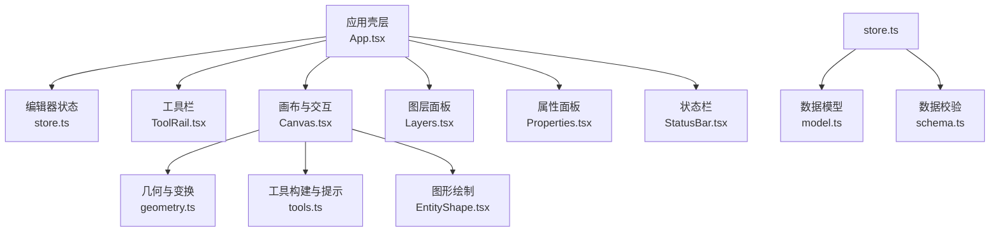
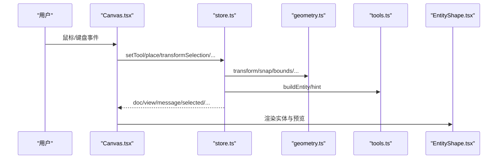
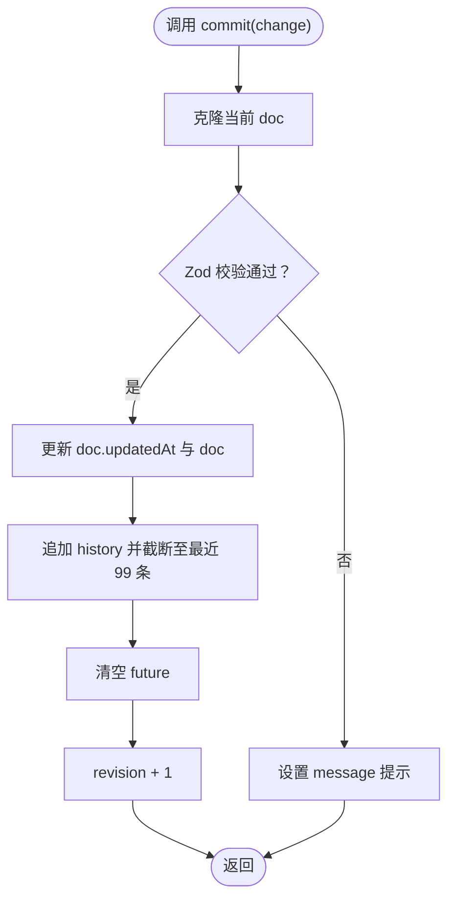
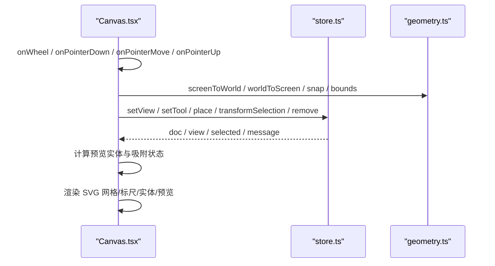
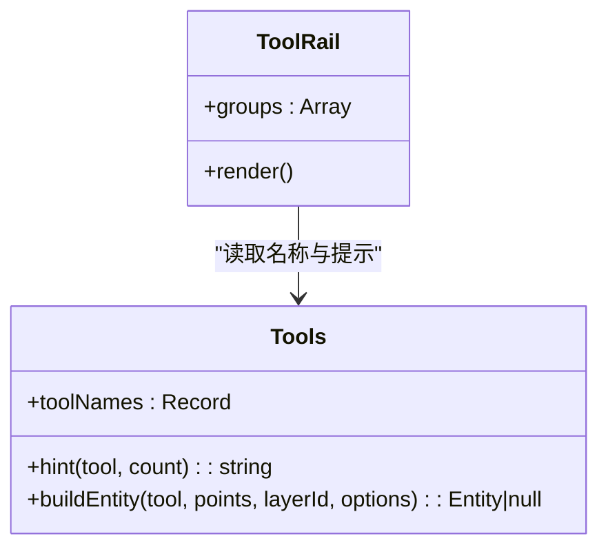
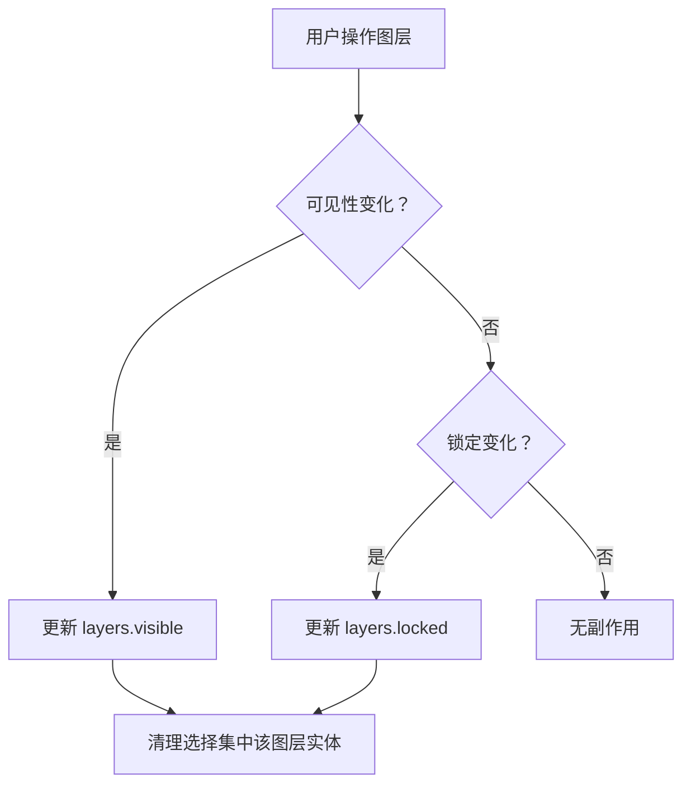
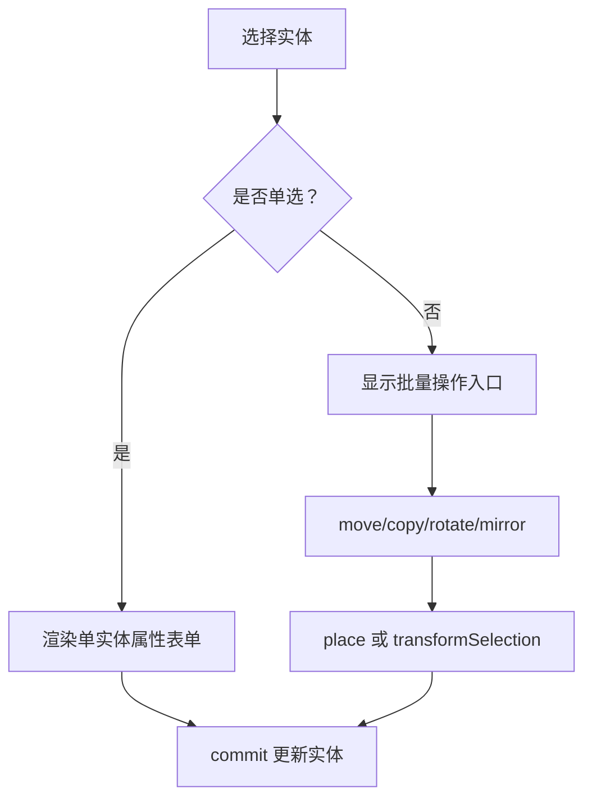
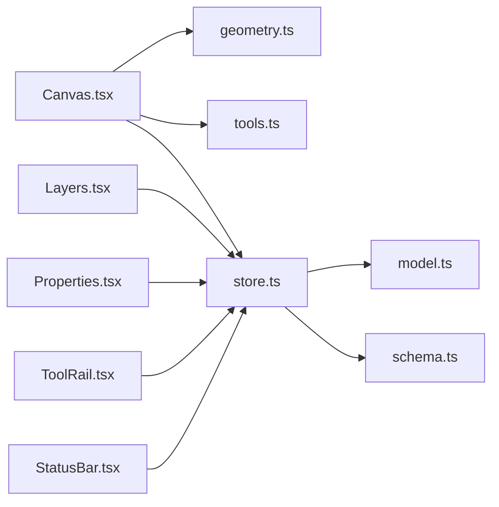

# 编辑器功能

<cite>
**本文引用的文件**   
- [App.tsx](file://src/app/App.tsx)
- [store.ts](file://src/features/editor/store.ts)
- [Canvas.tsx](file://src/features/editor/Canvas.tsx)
- [ToolRail.tsx](file://src/features/editor/ToolRail.tsx)
- [Layers.tsx](file://src/features/editor/Layers.tsx)
- [Properties.tsx](file://src/features/editor/Properties.tsx)
- [StatusBar.tsx](file://src/features/editor/StatusBar.tsx)
- [model.ts](file://src/cad/model.ts)
- [tools.ts](file://src/cad/tools.ts)
- [geometry.ts](file://src/cad/geometry.ts)
- [EntityShape.tsx](file://src/components/EntityShape.tsx)
- [schema.ts](file://src/io/schema.ts)
</cite>

## 目录
1. [引言](#引言)
2. [项目结构](#项目结构)
3. [核心组件](#核心组件)
4. [架构总览](#架构总览)
5. [详细组件分析](#详细组件分析)
6. [依赖关系分析](#依赖关系分析)
7. [性能与可维护性](#性能与可维护性)
8. [故障排查指南](#故障排查指南)
9. [结论](#结论)
10. [附录：使用示例与配置项](#附录使用示例与配置项)

## 引言
本文件面向 web-cad 编辑器的使用者与维护者，系统性说明基于 Zustand 的状态管理、画布渲染与视图变换、工具栏分组与快捷键、图层可见性与锁定、属性面板实时预览与批量编辑、状态栏提示与进度反馈等能力。文档同时给出关键流程图与架构图，帮助读者快速理解数据流与控制流，并提供常见问题的定位思路。

## 项目结构
编辑器采用“功能域 + 通用能力”的分层组织方式：
- 应用壳层 App.tsx 负责顶层布局、菜单、导入导出、错误横幅与模态框。
- features/editor 包含编辑器核心 UI 与状态：Canvas、ToolRail、Layers、Properties、StatusBar 与 store。
- cad 提供几何计算、实体建模、工具构建与修剪逻辑。
- components 提供通用图形绘制组件 EntityShape。
- io 提供 JSON 导入导出与 schema 校验。
- storage 与 projects 提供本地项目存储与交互。

**图表来源**
- [App.tsx:23-32](file://src/app/App.tsx#L23-L32)
- [store.ts:1-15](file://src/features/editor/store.ts#L1-L15)
- [Canvas.tsx:1-21](file://src/features/editor/Canvas.tsx#L1-L21)
- [ToolRail.tsx:1-19](file://src/features/editor/ToolRail.tsx#L1-L19)
- [Layers.tsx:1-12](file://src/features/editor/Layers.tsx#L1-L12)
- [Properties.tsx:1-5](file://src/features/editor/Properties.tsx#L1-L5)
- [StatusBar.tsx:1-3](file://src/features/editor/StatusBar.tsx#L1-L3)
- [geometry.ts:1-2](file://src/cad/geometry.ts#L1-L2)
- [tools.ts:1-3](file://src/cad/tools.ts#L1-L3)
- [EntityShape.tsx:1-2](file://src/components/EntityShape.tsx#L1-L2)
- [model.ts:1-11](file://src/cad/model.ts#L1-L11)
- [schema.ts:1-3](file://src/io/schema.ts#L1-L3)

**章节来源**
- [App.tsx:34-329](file://src/app/App.tsx#L34-L329)

## 核心组件
- 状态管理 store.ts：基于 Zustand 的单一状态源，封装文档、历史栈、选择集、当前工具、光标、消息、视图等；提供 load、commit、setView、setTool、undo/redo、remove、place、finish、trim、transformSelection 等方法。
- 画布 Canvas.tsx：SVG 渲染、视图变换、滚轮缩放、拖拽平移、框选、吸附、键盘快捷键、工具预览、标尺与网格。
- 工具栏 ToolRail.tsx：按“选择/绘制/注释/修改”分组展示工具，支持快捷键映射与名称显示。
- 图层面板 Layers.tsx：新增、删除、重命名、颜色设置、显示/隐藏、锁定/解锁，联动选择集清理。
- 属性面板 Properties.tsx：单实体属性编辑、多实体批量操作（移动/复制/旋转/镜像）、精确坐标输入、工具参数区。
- 状态栏 StatusBar.tsx：坐标显示、网格吸附/对象吸附/正交开关、网格间距、保存状态与重试。

**章节来源**
- [store.ts:17-47](file://src/features/editor/store.ts#L17-L47)
- [Canvas.tsx:32-42](file://src/features/editor/Canvas.tsx#L32-L42)
- [ToolRail.tsx:21-58](file://src/features/editor/ToolRail.tsx#L21-L58)
- [Layers.tsx:14-39](file://src/features/editor/Layers.tsx#L14-L39)
- [Properties.tsx:16-43](file://src/features/editor/Properties.tsx#L16-L43)
- [StatusBar.tsx:4-10](file://src/features/editor/StatusBar.tsx#L4-L10)

## 架构总览
编辑器以 Zustand store 为唯一可信状态源，UI 组件通过 useEditor 订阅所需字段并触发 Actions。CAD 内核（geometry、tools、model）提供纯函数式几何运算与实体构造，io/schema 负责数据校验与导入解析。

**图表来源**
- [Canvas.tsx:94-179](file://src/features/editor/Canvas.tsx#L94-L179)
- [store.ts:79-186](file://src/features/editor/store.ts#L79-L186)
- [geometry.ts:31-42](file://src/cad/geometry.ts#L31-L42)
- [tools.ts:49-125](file://src/cad/tools.ts#L49-L125)
- [EntityShape.tsx:4-95](file://src/components/EntityShape.tsx#L4-L95)

## 详细组件分析

### 基于 Zustand 的状态管理系统
- 状态设计
  - 文档与视图：doc、view、layers、entities、units。
  - 历史与撤销：history、future、revision。
  - 选择与工具：selected、tool、points、message。
  - 辅助选项：grid、objects、ortho、gridStep、cursor、text/textSize/dimensionMode/rotation。
- Actions/reducers
  - load：加载图纸并重置部分状态。
  - commit：不可变更新，Zod 校验后入 history，清空 future，递增 revision。
  - setView：仅更新 view 并递增 revision。
  - setTool：切换工具并清空 points/message。
  - undo/redo：在 history/future 间迁移，保持 view 不变，清理选择与临时点。
  - remove：过滤已选且可编辑实体。
  - transformSelection：对选中实体执行 fn 变换，支持 copy 模式生成新实体。
  - place：根据 tool 与 points 数量构建实体或完成 move/copy/rotate/mirror。
  - finish：完成折线绘制。
  - trim：基于点击位置与可见实体边界进行修剪。
- 可编辑选择约束
  - editableSelection 仅保留所在图层 visible 且未 locked 的实体。

**图表来源**
- [store.ts:79-101](file://src/features/editor/store.ts#L79-L101)

**章节来源**
- [store.ts:17-47](file://src/features/editor/store.ts#L17-L47)
- [store.ts:67-186](file://src/features/editor/store.ts#L67-L186)
- [store.ts:187-316](file://src/features/editor/store.ts#L187-L316)
- [store.ts:317-323](file://src/features/editor/store.ts#L317-L323)

### 画布渲染与视图变换系统
- 视图变换
  - screenToWorld/worldToScreen 实现屏幕坐标与世界坐标互转。
  - SVG g 节点使用 translate(scale, -scale) 与 translate(-v.x, -v.y) 组合实现缩放与平移。
- 交互流程
  - 滚轮缩放：以鼠标位置为中心调整 scale，并补偿 x/y 偏移。
  - 拖拽平移：中键或按住空格拖动时更新 view.x/view.y。
  - 框选与多选：Shift+点击多选，空白处拖拽框选。
  - 吸附：snap 支持网格吸附、对象锚点吸附、正交对齐。
  - 工具预览：根据 tool 与 points 动态构建预览实体。
  - 标尺与网格：根据 scale 动态计算步长与刻度。
- 渲染管线
  - 过滤可见且非锁定的实体，渲染 EntityShape。
  - 选中实体高亮并显示锚点。
  - 拖拽中的实体即时预览位移。
  - 工具绘制过程中的点与十字准星。

**图表来源**
- [Canvas.tsx:53-93](file://src/features/editor/Canvas.tsx#L53-L93)
- [Canvas.tsx:94-179](file://src/features/editor/Canvas.tsx#L94-L179)
- [Canvas.tsx:180-328](file://src/features/editor/Canvas.tsx#L180-L328)
- [Canvas.tsx:390-581](file://src/features/editor/Canvas.tsx#L390-L581)
- [geometry.ts:31-42](file://src/cad/geometry.ts#L31-L42)
- [geometry.ts:191-245](file://src/cad/geometry.ts#L191-L245)

**章节来源**
- [Canvas.tsx:32-42](file://src/features/editor/Canvas.tsx#L32-L42)
- [Canvas.tsx:53-93](file://src/features/editor/Canvas.tsx#L53-L93)
- [Canvas.tsx:94-179](file://src/features/editor/Canvas.tsx#L94-L179)
- [Canvas.tsx:180-328](file://src/features/editor/Canvas.tsx#L180-L328)
- [Canvas.tsx:390-581](file://src/features/editor/Canvas.tsx#L390-L581)

### 工具栏界面：工具分组与快捷键
- 分组策略
  - 选择：select。
  - 绘制：line、polyline、rectangle、circle、arc。
  - 注释：text、dimension。
  - 修改：move、copy、rotate、mirror、trim。
- 快捷键映射
  - V/L/P/R/C/A/T/D/M 对应各工具。
  - Ctrl/Cmd+Z/Y 撤销/重做，Ctrl/Cmd+A 全选，Esc 取消，Delete/Backspace 删除，Enter 完成。
- 工具提示
  - hint 根据 tool 与 points 长度返回引导文案。

**图表来源**
- [ToolRail.tsx:21-58](file://src/features/editor/ToolRail.tsx#L21-L58)
- [tools.ts:5-48](file://src/cad/tools.ts#L5-L48)

**章节来源**
- [ToolRail.tsx:21-96](file://src/features/editor/ToolRail.tsx#L21-L96)
- [tools.ts:5-48](file://src/cad/tools.ts#L5-L48)

### 图层管理：可见性与锁定机制
- 可见性控制
  - 图层 visible=false 时不渲染实体，也不参与选择与绘制。
  - 属性面板中将实体移动到不可见/锁定图层会被禁用。
- 锁定机制
  - 图层 locked=true 时实体半透明，禁止编辑与变换。
  - 选择集在图层被锁定或隐藏时自动清理相关 ID。
- 图层操作
  - 新增最多 100 个图层，默认颜色与可见性。
  - 删除图层时若存在实体需二次确认，并同步删除关联实体。

**图表来源**
- [Layers.tsx:19-39](file://src/features/editor/Layers.tsx#L19-L39)
- [Layers.tsx:40-76](file://src/features/editor/Layers.tsx#L40-L76)

**章节来源**
- [Layers.tsx:14-163](file://src/features/editor/Layers.tsx#L14-L163)

### 属性面板：实时预览与批量编辑
- 单实体编辑
  - 图层、颜色、线宽、几何参数（起点/终点/圆心/半径/角度/闭合等）。
  - text 类型支持内容、高度、旋转。
  - dimension 类型支持方向模式。
- 批量编辑
  - 支持移动、复制、旋转、镜像等变换。
  - 精确坐标输入表单，提交后调用 place 插入点。
- 工具参数区
  - rotate 角度、text 内容与大小、dimension 方向、圆半径输入、折线完成按钮。

**图表来源**
- [Properties.tsx:16-43](file://src/features/editor/Properties.tsx#L16-L43)
- [Properties.tsx:78-233](file://src/features/editor/Properties.tsx#L78-L233)
- [Properties.tsx:255-389](file://src/features/editor/Properties.tsx#L255-L389)

**章节来源**
- [Properties.tsx:16-394](file://src/features/editor/Properties.tsx#L16-L394)

### 状态栏：操作提示与进度反馈
- 坐标显示：实时显示 cursor.x/cursor.y。
- 辅助开关：网格吸附、对象吸附、正交模式，网格间距下拉。
- 保存状态：显示持久化状态并提供立即保存/重试按钮。

**章节来源**
- [StatusBar.tsx:4-74](file://src/features/editor/StatusBar.tsx#L4-L74)

## 依赖关系分析
- 组件耦合
  - Canvas 强依赖 geometry 与 tools，间接依赖 model 与 schema。
  - store 聚合所有业务动作，对外暴露最小 API。
  - Layers/Properties 通过 commit 与 store 通信，避免直接操作 DOM。
- 外部依赖
  - zod 用于数据校验与导入解析。
  - lucide-react 提供图标。
- 潜在循环
  - 组件与 store 单向依赖，无循环引用。
  - CAD 内核为纯函数模块，无状态依赖。

**图表来源**
- [Canvas.tsx:1-21](file://src/features/editor/Canvas.tsx#L1-L21)
- [store.ts:1-15](file://src/features/editor/store.ts#L1-L15)
- [model.ts:1-11](file://src/cad/model.ts#L1-L11)
- [schema.ts:1-3](file://src/io/schema.ts#L1-L3)

**章节来源**
- [Canvas.tsx:1-21](file://src/features/editor/Canvas.tsx#L1-L21)
- [store.ts:1-15](file://src/features/editor/store.ts#L1-L15)

## 性能与可维护性
- 渲染优化
  - 使用 ResizeObserver 监听容器尺寸，减少不必要的重排。
  - 预览实体仅在必要时构建，避免频繁计算。
  - 网格与标尺按 scale 动态计算步长，降低绘制开销。
- 状态更新
  - commit 限制 history 长度为 99，避免内存膨胀。
  - 使用 structuredClone 深拷贝，确保不可变更新。
- 几何计算
  - 大量使用 EPS 容差比较，提高数值稳定性。
  - 将复杂几何逻辑集中在 geometry.ts，便于测试与复用。
- 可维护性
  - 工具名与提示分离到 tools.ts，便于扩展与本地化。
  - 数据模型与 schema 解耦，便于版本演进。

[本节为通用建议，无需代码来源]

## 故障排查指南
- 导入失败
  - 检查文件格式是否为 Forma CAD 导出的 JSON，大小不超过 20 MB。
  - 查看错误横幅提示，通常由 Zod 校验失败引起。
- 无法绘制
  - 确认当前图层可见且未锁定。
  - 检查工具提示与 points 数量是否符合要求。
- 变换无效
  - 先选择未锁定的图形，再进行移动/复制/旋转/镜像。
  - 镜像轴需要两个不同点。
- 撤销/重做异常
  - 确认 history/future 非空。
  - 注意 activeLayer 在回退时会尝试保持原图层，否则回退到首个可用图层。

**章节来源**
- [App.tsx:43-64](file://src/app/App.tsx#L43-L64)
- [store.ts:112-148](file://src/features/editor/store.ts#L112-L148)
- [store.ts:187-264](file://src/features/editor/store.ts#L187-L264)
- [schema.ts:105-133](file://src/io/schema.ts#L105-L133)

## 结论
web-cad 编辑器通过 Zustand 统一管理状态，结合纯函数几何库与 SVG 渲染，实现了高效、可扩展的二维绘图体验。工具栏分组清晰、快捷键完善，图层管理与属性面板提供了精细的控制能力，状态栏提供实时反馈。整体架构职责清晰、依赖简单，适合持续迭代与扩展。

[本节为总结性内容，无需代码来源]

## 附录：使用示例与配置项

### 常用操作流程
- 新建图纸
  - 点击“新建”，或使用示例图纸快速体验。
- 绘制直线
  - 选择“直线”工具或按 L，点击起点与终点。
- 绘制矩形
  - 选择“矩形”工具或按 R，点击对角两点。
- 绘制圆
  - 选择“圆”工具或按 C，点击圆心与圆周点，或在属性面板输入半径。
- 标注尺寸
  - 选择“尺寸标注”工具或按 D，依次点击两测量点与标注位置。
- 移动/复制/旋转/镜像
  - 选择目标实体，切换到对应工具，按提示点击基准点与目标点。
- 修剪
  - 选择“修剪”工具，点击要移除的区段。

**章节来源**
- [App.tsx:65-82](file://src/app/App.tsx#L65-L82)
- [tools.ts:20-48](file://src/cad/tools.ts#L20-L48)
- [Canvas.tsx:94-179](file://src/features/editor/Canvas.tsx#L94-L179)

### 配置项速查
- 视图
  - view.x、view.y、view.scale：平移与缩放。
- 工具
  - tool：当前工具。
  - rotation：旋转角度（度）。
  - text、textSize：文字内容与高度。
  - dimensionMode：标注方向（水平/垂直/对齐）。
- 辅助
  - grid：网格吸附。
  - objects：对象吸附。
  - ortho：正交模式。
  - gridStep：网格间距（mm）。
- 选择与历史
  - selected：选中实体 ID 列表。
  - history/future：撤销/重做栈。
  - revision：版本号。

**章节来源**
- [store.ts:17-47](file://src/features/editor/store.ts#L17-L47)
- [model.ts:46-75](file://src/cad/model.ts#L46-L75)