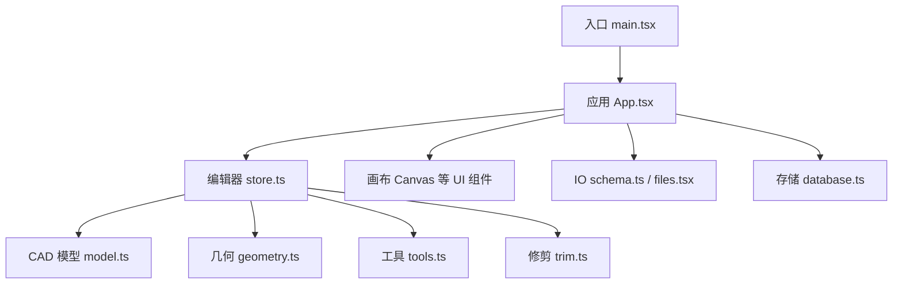
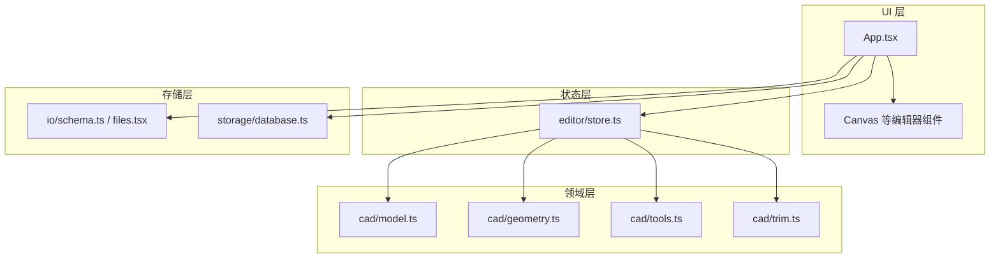
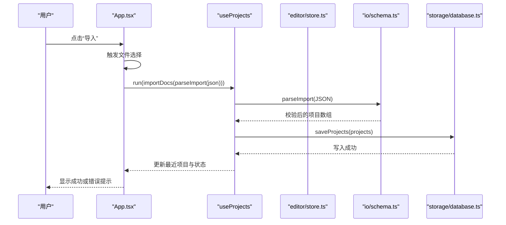
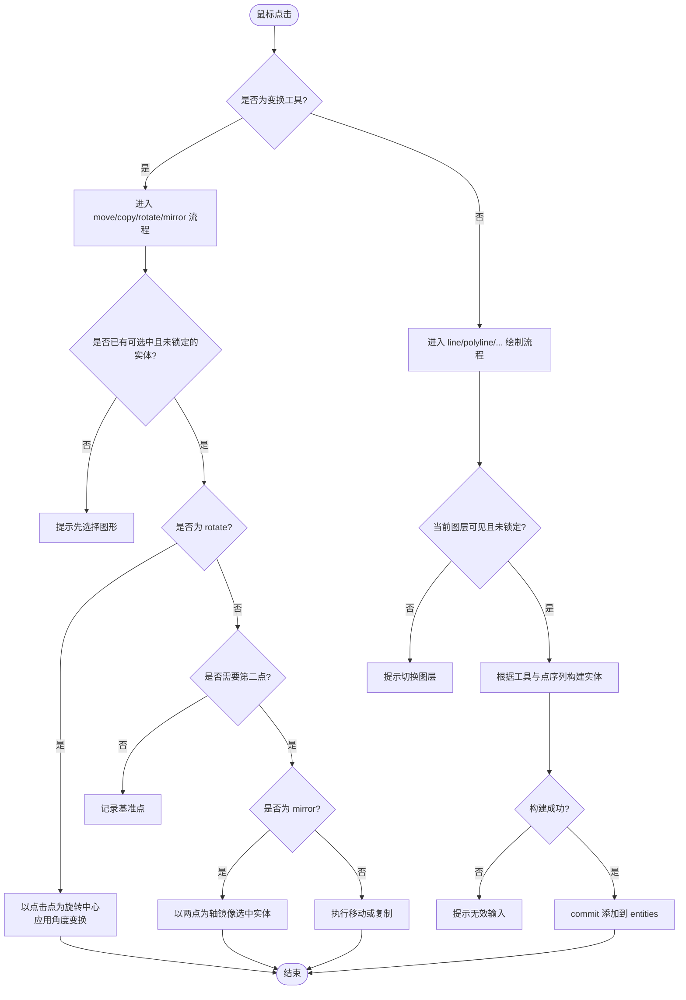
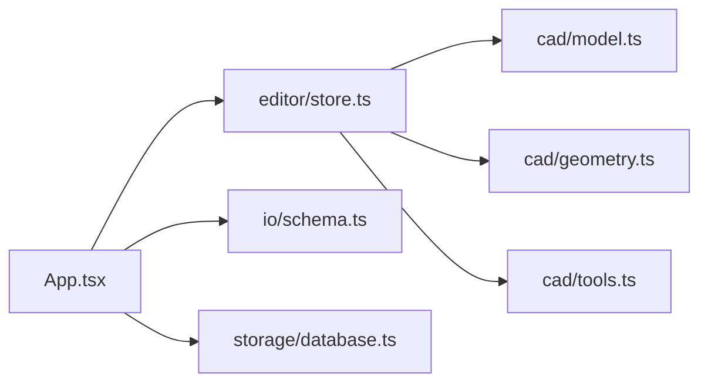

# 项目概述

<cite>
**本文引用的文件**   
- [package.json](file://package.json)
- [main.tsx](file://src/main.tsx)
- [App.tsx](file://src/app/App.tsx)
- [model.ts](file://src/cad/model.ts)
- [geometry.ts](file://src/cad/geometry.ts)
- [tools.ts](file://src/cad/tools.ts)
- [store.ts](file://src/features/editor/store.ts)
- [database.ts](file://src/storage/database.ts)
- [schema.ts](file://src/io/schema.ts)
</cite>

## 目录
1. [简介](#简介)
2. [项目结构](#项目结构)
3. [核心组件](#核心组件)
4. [架构总览](#架构总览)
5. [详细组件分析](#详细组件分析)
6. [依赖关系分析](#依赖关系分析)
7. [性能与可扩展性](#性能与可扩展性)
8. [快速开始](#快速开始)
9. [故障排查](#故障排查)
10. [结论](#结论)

## 简介
web-cad 是一个基于 React 的 Web 端二维 CAD 设计工具，面向工程师、设计师和初学者，提供直观的几何绘制与编辑能力。它支持直线、多段线、矩形、圆、圆弧等基础图元创建，并提供选择、移动、复制、旋转、镜像、修剪等常用编辑操作。数据采用本地优先策略，使用 IndexedDB 在浏览器中持久化，强调隐私与离线可用性。

技术栈包括：
- TypeScript + React 19
- Zustand 状态管理
- IndexedDB（通过 idb）本地存储
- Vite 构建工具链
- Zod 数据校验
- Lucide 图标库

本概述既为初学者提供概念性理解，也为有经验的开发者梳理代码结构与关键流程。

## 项目结构
仓库采用按功能域组织的目录结构，核心模块如下：
- src/app：应用外壳与全局样式
- src/cad：CAD 领域模型、几何计算、工具构建与修剪逻辑
- src/features/editor：编辑器 UI 与状态管理（画布、图层、属性、状态栏、工具条）
- src/features/projects：项目对话框与项目列表 Hook
- src/io：导入导出与 JSON Schema 校验
- src/storage：IndexedDB 封装与项目持久化
- tests：端到端测试与静态服务器脚本

图表来源
- [main.tsx:1-6](file://src/main.tsx#L1-L6)
- [App.tsx:1-329](file://src/app/App.tsx#L1-L329)
- [store.ts:1-324](file://src/features/editor/store.ts#L1-L324)
- [model.ts:1-142](file://src/cad/model.ts#L1-L142)
- [geometry.ts:1-443](file://src/cad/geometry.ts#L1-L443)
- [tools.ts:1-126](file://src/cad/tools.ts#L1-L126)
- [schema.ts:1-65](file://src/io/schema.ts#L1-L65)
- [database.ts:1-90](file://src/storage/database.ts#L1-L90)

章节来源
- [main.tsx:1-6](file://src/main.tsx#L1-L6)
- [package.json:1-52](file://package.json#L1-L52)

## 核心组件
- 应用外壳与交互入口
  - 负责渲染根组件、顶部工具栏、文档标题、导入导出菜单、撤销重做、示例图纸、侧边面板开关、错误提示、忙碌遮罩、项目对话框与帮助对话框。
- 编辑器状态（Zustand）
  - 维护当前图纸、历史栈、选中项、活跃图层、工具、光标、网格/对象吸附、正交模式、文本与标注参数等；提供加载、提交变更、视图控制、工具切换、撤销重做、放置图元、完成折线、修剪、批量变换等方法。
- CAD 领域模型
  - 定义点、图层、实体（直线、多段线、矩形、圆、圆弧、文字、尺寸标注）、视图、绘图、工具类型、唯一 ID 生成、新建/克隆图纸等。
- 几何引擎
  - 提供向量运算、坐标转换、弧段判断、锚点与包围盒、吸附、旋转、镜像、线段求交、圆与线段求交、两圆求交等。
- 工具构建器
  - 根据当前工具与已采集的点序列构造具体实体，并给出各工具的交互提示。
- IO 与持久化
  - 使用 Zod 对导入/导出的 JSON 进行严格校验；IndexedDB 保存项目摘要与完整文档，支持最近项目、列出、读取、备份与删除。

章节来源
- [App.tsx:1-329](file://src/app/App.tsx#L1-L329)
- [store.ts:1-324](file://src/features/editor/store.ts#L1-L324)
- [model.ts:1-142](file://src/cad/model.ts#L1-L142)
- [geometry.ts:1-443](file://src/cad/geometry.ts#L1-L443)
- [tools.ts:1-126](file://src/cad/tools.ts#L1-L126)
- [schema.ts:1-65](file://src/io/schema.ts#L1-L65)
- [database.ts:1-90](file://src/storage/database.ts#L1-L90)

## 架构总览
系统采用“UI 层 + 状态层 + 领域层 + 存储层”的分层架构：
- UI 层：React 组件（App、Canvas、Layers、Properties、ToolRail、StatusBar 等）
- 状态层：Zustand store 集中管理编辑上下文与命令式方法
- 领域层：CAD 模型、几何算法、工具构建与修剪
- 存储层：IndexedDB 封装，配合 Zod 校验保证数据一致性

图表来源
- [App.tsx:1-329](file://src/app/App.tsx#L1-L329)
- [store.ts:1-324](file://src/features/editor/store.ts#L1-L324)
- [model.ts:1-142](file://src/cad/model.ts#L1-L142)
- [geometry.ts:1-443](file://src/cad/geometry.ts#L1-L443)
- [tools.ts:1-126](file://src/cad/tools.ts#L1-L126)
- [schema.ts:1-65](file://src/io/schema.ts#L1-L65)
- [database.ts:1-90](file://src/storage/database.ts#L1-L90)

## 详细组件分析

### 应用外壳与用户工作区（App.tsx）
职责要点：
- 集成项目对话框、帮助对话框、导入导出、撤销重做、示例图纸、侧边面板切换
- 通过 useEditor 获取编辑状态，调用 commit、undo、redo、setTool 等方法驱动编辑
- 通过 useProjects 管理本地项目，处理导入校验与错误提示
- 暴露导出选项：项目 JSON、矢量 SVG、全部图纸备份

关键流程（导入）：

图表来源
- [App.tsx:146-213](file://src/app/App.tsx#L146-L213)
- [App.tsx:294-311](file://src/app/App.tsx#L294-L311)
- [schema.ts:1-65](file://src/io/schema.ts#L1-L65)
- [database.ts:45-63](file://src/storage/database.ts#L45-L63)

章节来源
- [App.tsx:1-329](file://src/app/App.tsx#L1-L329)

### 编辑器状态（editor/store.ts）
职责要点：
- 维护 doc、history、future、selected、activeLayer、tool、points、grid、objects、ortho、cursor、message、text、textSize、dimensionMode、rotation
- 提供 load、commit、setView、setTool、undo、redo、remove、place、finish、trim、transformSelection
- place 根据工具类型分派：变换类（move/copy/rotate/mirror）与绘制类（line/polyline/rectangle/circle/arc/text/dimension）
- transformSelection 统一处理选中实体的变换与可选复制
- trim 调用 trimEntity 实现修剪，仅可见图形作为边界

关键流程（绘制与变换）：

图表来源
- [store.ts:187-286](file://src/features/editor/store.ts#L187-L286)
- [tools.ts:49-125](file://src/cad/tools.ts#L49-L125)
- [geometry.ts:246-336](file://src/cad/geometry.ts#L246-L336)

章节来源
- [store.ts:1-324](file://src/features/editor/store.ts#L1-L324)

### CAD 领域模型（model.ts）
- Point、Layer、Entity（联合类型）、View、Drawing、Tool 等类型定义
- uid 生成、createDrawing 初始化默认图层与视图、cloneDrawing 深拷贝并重建 ID

章节来源
- [model.ts:1-142](file://src/cad/model.ts#L1-L142)

### 几何引擎（geometry.ts）
- 向量与角度运算、屏幕/世界坐标互转
- 弧段判定、三点圆弧构造、锚点与包围盒
- 吸附 snap（对象吸附、网格吸附、正交约束）
- 旋转、镜像、通用变换 transform
- 线段求交、线与圆求交、两圆求交 intersections

章节来源
- [geometry.ts:1-443](file://src/cad/geometry.ts#L1-L443)

### 工具构建器（tools.ts）
- toolNames 映射工具到中文名称
- hint 返回不同工具的交互提示
- buildEntity 根据工具与点序列构造实体，包含 text、size、mode 等参数

章节来源
- [tools.ts:1-126](file://src/cad/tools.ts#L1-L126)

### IO 与数据校验（schema.ts）
- 使用 Zod 定义有限数、点、颜色、基础字段与实体判别联合类型
- 覆盖 line、rectangle、polyline、circle、arc、text、dimension 等实体结构

章节来源
- [schema.ts:1-65](file://src/io/schema.ts#L1-L65)

### 本地存储（database.ts）
- 使用 idb 打开 IndexedDB，定义 projects、documents、settings 三个对象存储
- 提供 saveProjects、listProjects、readProject、allProjects、deleteProject、recentProjectId 等方法
- 所有读写均经过 drawingSchema 校验，确保数据一致性

章节来源
- [database.ts:1-90](file://src/storage/database.ts#L1-L90)

## 依赖关系分析
- 运行时依赖
  - react/react-dom：UI 框架
  - zustand：轻量状态管理
  - idb：IndexedDB 异步封装
  - zod：JSON Schema 校验
  - lucide-react：图标资源
- 开发依赖
  - vite：构建与开发服务器
  - typescript：类型检查
  - vitest/playwright：单元测试与端到端测试
  - eslint：代码规范

图表来源
- [App.tsx:1-329](file://src/app/App.tsx#L1-L329)
- [store.ts:1-324](file://src/features/editor/store.ts#L1-L324)
- [model.ts:1-142](file://src/cad/model.ts#L1-L142)
- [geometry.ts:1-443](file://src/cad/geometry.ts#L1-L443)
- [tools.ts:1-126](file://src/cad/tools.ts#L1-L126)
- [schema.ts:1-65](file://src/io/schema.ts#L1-L65)
- [database.ts:1-90](file://src/storage/database.ts#L1-L90)

章节来源
- [package.json:1-52](file://package.json#L1-L52)

## 性能与可扩展性
- 状态更新
  - 使用 structuredClone 与不可变更新，避免意外共享引用；commit 前用 Zod 校验，减少脏数据导致的重绘。
- 几何计算
  - 大量使用向量化运算与 EPS 容差，提升数值稳定性；anchors/bounds 用于命中检测与包围盒优化。
- 存储
  - IndexedDB 事务批量写入，减少磁盘抖动；所有写入前校验，保障数据一致性。
- 可扩展方向
  - 新增图元：扩展 Entity 联合类型与 schema，补充 tools.buildEntity 与 geometry 相关计算。
  - 新工具：在 store.place 与 tools.hint/buildEntity 中添加分支，必要时扩展 geometry 算法。
  - 主题与国际化：在 App 层注入配置，结合现有 icon 与文案结构扩展。

[本节为通用指导，不直接分析具体文件]

## 快速开始

### 环境要求
- Node.js：^22.22.2 或 >=24.15.0
- 现代浏览器（支持 IndexedDB、ESM）

### 安装步骤
1. 安装依赖
   - npm install
2. 启动开发服务器
   - npm run dev
3. 预览构建产物
   - npm run preview

### 基本使用方法
- 新建图纸：点击顶部“新建”，或在“我的图纸”中创建新项目
- 绘制图形：选择左侧工具栏中的直线、多段线、矩形、圆、圆弧、文字、尺寸标注等工具，按提示点击画布
- 编辑图形：使用选择工具选中图形，然后使用移动、复制、旋转、镜像、修剪等工具进行操作
- 图层管理：右侧“设计面板”中管理图层可见性与锁定状态
- 导入导出：支持导入 Forma CAD 导出的 JSON，导出项目 JSON、SVG 或打包备份全部本地项目
- 撤销重做：通过顶部按钮或快捷键（Ctrl/Cmd+Z、Shift+Ctrl/Cmd+Z）回退/重做

章节来源
- [package.json:9-20](file://package.json#L9-L20)
- [App.tsx:138-213](file://src/app/App.tsx#L138-L213)
- [App.tsx:216-255](file://src/app/App.tsx#L216-L255)
- [App.tsx:294-311](file://src/app/App.tsx#L294-L311)

## 故障排查
- 导入失败
  - 现象：导入时报错“导入数据不合法”
  - 原因：JSON 不符合 schema 定义或版本不匹配
  - 解决：确认使用 Forma CAD 导出的版本 1 JSON，并检查文件大小不超过 20 MB
- 无法绘制
  - 现象：点击画布无响应或提示“当前图层隐藏或已锁定”
  - 原因：当前图层不可编辑
  - 解决：切换到可见且未锁定的图层
- 修剪无效
  - 现象：提示“没有有效交点，或目标不是直线、圆、圆弧”
  - 原因：目标图元类型不支持或无可视边界
  - 解决：确保目标为直线、圆或圆弧，并确保其他可见图形可作为修剪边界
- 本地数据丢失
  - 现象：清理站点数据后项目消失
  - 说明：所有数据保存在浏览器本地，清理站点数据会清除 IndexedDB
  - 建议：定期导出备份

章节来源
- [App.tsx:43-64](file://src/app/App.tsx#L43-L64)
- [App.tsx:300-311](file://src/app/App.tsx#L300-L311)
- [store.ts:235-238](file://src/features/editor/store.ts#L235-L238)
- [store.ts:287-315](file://src/features/editor/store.ts#L287-L315)
- [database.ts:18-40](file://src/storage/database.ts#L18-L40)

## 结论
web-cad 将 React 前端、Zustand 状态管理与 IndexedDB 本地存储有机结合，提供了稳定、可演进的二维 CAD 工作流。其清晰的领域建模与几何算法为后续扩展（更多图元、工具与可视化增强）奠定了坚实基础。对于初学者，可从“新建—绘制—编辑—导出”的基本路径上手；对于开发者，建议从 store 与 tools 入手，逐步理解几何与交互的耦合方式。

[本节为总结性内容，不直接分析具体文件]