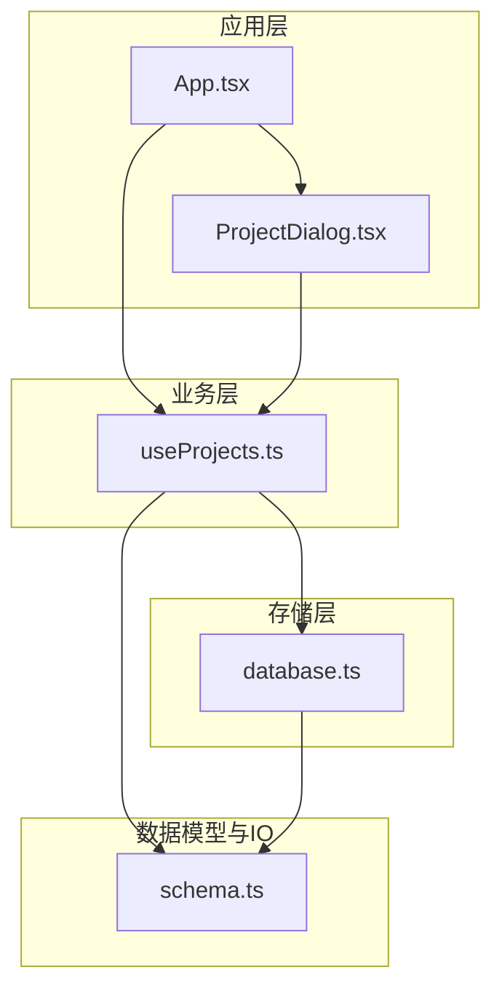
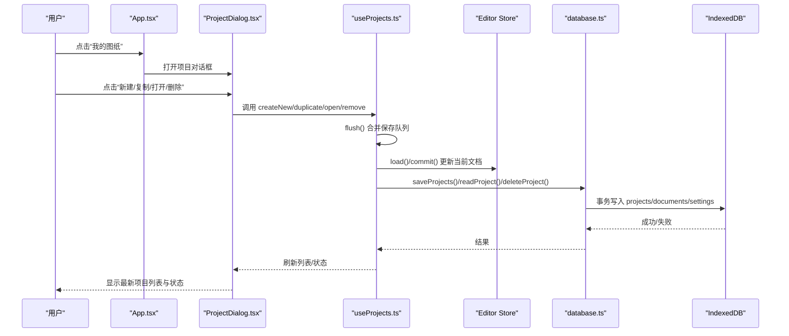
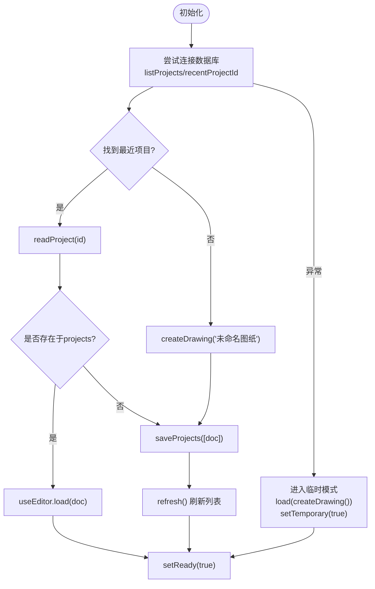
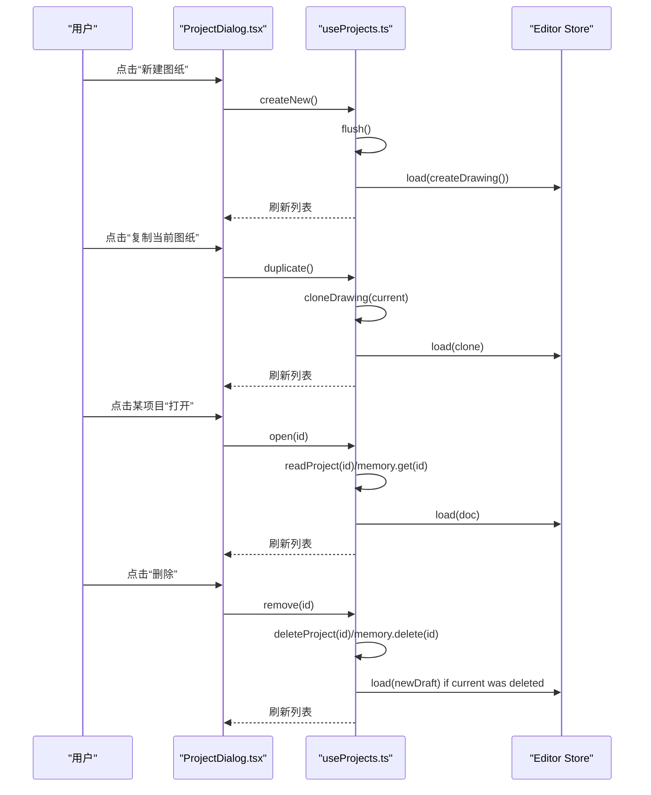
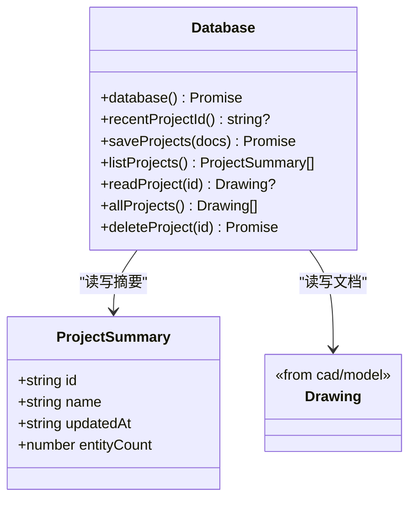
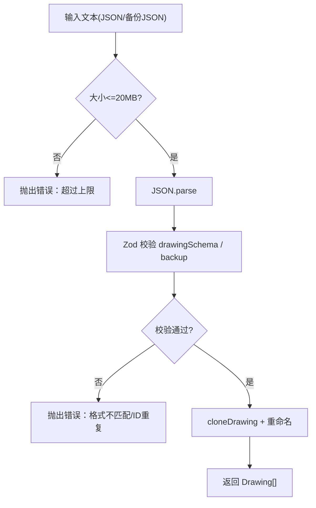
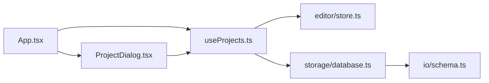

# 项目管理

<cite>
**本文引用的文件**   
- [useProjects.ts](file://src/features/projects/useProjects.ts)
- [ProjectDialog.tsx](file://src/features/projects/ProjectDialog.tsx)
- [database.ts](file://src/storage/database.ts)
- [schema.ts](file://src/io/schema.ts)
- [App.tsx](file://src/app/App.tsx)
</cite>

## 目录
1. [简介](#简介)
2. [项目结构](#项目结构)
3. [核心组件](#核心组件)
4. [架构总览](#架构总览)
5. [详细组件分析](#详细组件分析)
6. [依赖关系分析](#依赖关系分析)
7. [性能与可靠性](#性能与可靠性)
8. [故障排查指南](#故障排查指南)
9. [结论](#结论)
10. [附录：CRUD 操作示例与错误处理](#附录crud-操作示例与错误处理)

## 简介
本章节面向 web-cad 的项目管理功能，聚焦以下目标：
- 项目生命周期管理：创建、打开、保存、删除、复制、导入、备份。
- useProjects 钩子的实现与状态跟踪机制。
- ProjectDialog 组件的列表展示、操作界面与交互流程。
- 项目数据的 CRUD 操作与错误处理策略。
- 与底层存储层的集成方式与数据同步机制。
- 项目版本管理与数据迁移方案。

## 项目结构
本项目采用“特性优先”的组织方式，项目管理相关代码位于 features/projects 下，并与 storage、io、app 等模块协作：
- features/projects：项目管理逻辑（useProjects）与 UI（ProjectDialog）。
- storage：IndexedDB 封装与持久化接口。
- io：数据校验与导入导出。
- app：应用入口，聚合编辑器、项目管理与 IO 能力。

图表来源
- [App.tsx:29-32](file://src/app/App.tsx#L29-L32)
- [ProjectDialog.tsx:1-11](file://src/features/projects/ProjectDialog.tsx#L1-L11)
- [useProjects.ts:1-13](file://src/features/projects/useProjects.ts#L1-L13)
- [database.ts:1-5](file://src/storage/database.ts#L1-L5)
- [schema.ts:1-3](file://src/io/schema.ts#L1-L3)

章节来源
- [App.tsx:29-32](file://src/app/App.tsx#L29-L32)
- [ProjectDialog.tsx:1-11](file://src/features/projects/ProjectDialog.tsx#L1-L11)
- [useProjects.ts:1-13](file://src/features/projects/useProjects.ts#L1-L13)
- [database.ts:1-5](file://src/storage/database.ts#L1-L5)
- [schema.ts:1-3](file://src/io/schema.ts#L1-L3)

## 核心组件
- useProjects：提供项目状态、自动保存、打开/新建/复制/删除/导入/备份等能力，并协调编辑器状态与本地存储。
- ProjectDialog：以模态窗口展示项目列表，支持新建、复制当前图纸、打开、删除等操作。
- database：基于 IndexedDB 的持久化封装，提供项目摘要、文档读写、最近项目记录、批量保存与删除。
- schema：使用 Zod 定义 Drawing 数据结构与导入备份格式，负责数据校验与解析。
- App：聚合编辑器、项目管理与 IO，提供全局错误处理、忙态控制与用户交互入口。

章节来源
- [useProjects.ts:15-207](file://src/features/projects/useProjects.ts#L15-L207)
- [ProjectDialog.tsx:12-100](file://src/features/projects/ProjectDialog.tsx#L12-L100)
- [database.ts:6-90](file://src/storage/database.ts#L6-L90)
- [schema.ts:66-133](file://src/io/schema.ts#L66-L133)
- [App.tsx:34-64](file://src/app/App.tsx#L34-L64)

## 架构总览
下图展示了从用户操作到持久化的完整调用链，以及临时模式与 IndexedDB 不可用时的降级路径。

图表来源
- [App.tsx:110-117](file://src/app/App.tsx#L110-L117)
- [ProjectDialog.tsx:19-90](file://src/features/projects/ProjectDialog.tsx#L19-L90)
- [useProjects.ts:39-73](file://src/features/projects/useProjects.ts#L39-L73)
- [useProjects.ts:144-180](file://src/features/projects/useProjects.ts#L144-L180)
- [database.ts:45-89](file://src/storage/database.ts#L45-L89)

## 详细组件分析

### useProjects 钩子
职责与行为
- 初始化：读取最近项目或首个项目，加载到编辑器；若 IndexedDB 不可用则进入临时编辑模式。
- 自动保存：监听 doc/revision 变化，防抖后通过 flush 将当前文档保存到存储或内存。
- 页面关闭/隐藏时触发保存，避免丢失未保存内容。
- 提供 open/createNew/duplicate/remove/importDocs/backup 等方法。
- 维护临时模式标记 temporary 与 ready 状态，用于 UI 提示与禁用交互。

关键状态
- projects：项目摘要列表。
- status：用户可见的状态提示（如“已保存到本地”“临时编辑 · 请导出备份”）。
- temporary：是否处于内存临时模式。
- ready：初始化完成标志。
- error：错误信息，供 UI 展示。

并发与一致性
- 使用 queue 串行化写操作，避免竞态条件。
- 通过 structuredClone 深拷贝文档，防止引用污染。
- 在临时模式下，所有变更保存在内存 Map 中，并提供 backup 导出。

图表来源
- [useProjects.ts:74-116](file://src/features/projects/useProjects.ts#L74-L116)

章节来源
- [useProjects.ts:15-207](file://src/features/projects/useProjects.ts#L15-L207)

### ProjectDialog 组件
职责与行为
- 展示项目列表，包含名称、实体数量、更新时间与当前标识。
- 提供“新建图纸”“复制当前图纸”“打开”“删除”按钮。
- 通过 run 包装异步操作，统一处理忙态与错误。
- 底部提示临时模式与跨环境迁移建议。

交互要点
- 删除前弹出确认框，防止误删。
- 当前打开的项目行高亮显示。
- 所有操作受 busy 状态保护，避免重复提交。

图表来源
- [ProjectDialog.tsx:19-90](file://src/features/projects/ProjectDialog.tsx#L19-L90)
- [useProjects.ts:144-180](file://src/features/projects/useProjects.ts#L144-L180)

章节来源
- [ProjectDialog.tsx:12-100](file://src/features/projects/ProjectDialog.tsx#L12-L100)

### 存储层 database
职责与行为
- 封装 IndexedDB 连接、对象库与升级策略。
- 提供 saveProjects/listProjects/readProject/allProjects/deleteProject/recentProjectId 等接口。
- 在保存时同时更新 settings.recent 指向最近项目。
- 删除时原子性删除 projects 与 documents 两个对象库中的条目。

数据模型
- ProjectSummary：id/name/updatedAt/entityCount。
- CADDatabase：包含 projects、documents、settings 三个对象库。

图表来源
- [database.ts:6-16](file://src/storage/database.ts#L6-L16)
- [database.ts:18-41](file://src/storage/database.ts#L18-L41)
- [database.ts:42-90](file://src/storage/database.ts#L42-L90)

章节来源
- [database.ts:6-90](file://src/storage/database.ts#L6-L90)

### 数据模型与导入 schema
职责与行为
- 使用 Zod 严格校验 Drawing 结构与导入备份格式。
- 限制字段范围、唯一性与引用完整性（图层与实体 ID）。
- parseImport 支持单项目 JSON 与多项目备份 JSON，并进行大小与 ID 唯一性检查。

版本与迁移
- Drawing.version 固定为 1，便于未来扩展。
- 导入时对名称追加“· 导入”后缀以避免冲突。
- 备份格式 format/version/projects 明确，便于后续迁移工具扩展。

图表来源
- [schema.ts:66-104](file://src/io/schema.ts#L66-L104)
- [schema.ts:105-133](file://src/io/schema.ts#L105-L133)

章节来源
- [schema.ts:66-133](file://src/io/schema.ts#L66-L133)

### 应用入口 App
职责与行为
- 统一管理忙态与错误提示，集中捕获 ZodError 与通用 Error。
- 提供导入文件入口，调用 parseImport 与 p.importDocs。
- 导出功能包括项目 JSON、SVG 与全部备份。
- 渲染 ProjectDialog 与 StatusBar，展示项目状态与重试入口。

章节来源
- [App.tsx:34-64](file://src/app/App.tsx#L34-L64)
- [App.tsx:146-213](file://src/app/App.tsx#L146-L213)
- [App.tsx:293-325](file://src/app/App.tsx#L293-L325)

## 依赖关系分析
- App 依赖 useProjects 与 ProjectDialog，并通过 run 统一处理异步与错误。
- useProjects 依赖 editor store（获取/设置当前文档）、storage.database（持久化）、cad.model（创建/克隆）。
- database 依赖 io.schema 进行数据校验。
- ProjectDialog 仅消费 useProjects 暴露的方法与状态，保持 UI 薄层。

图表来源
- [App.tsx:29-32](file://src/app/App.tsx#L29-L32)
- [useProjects.ts:1-13](file://src/features/projects/useProjects.ts#L1-L13)
- [database.ts:1-5](file://src/storage/database.ts#L1-L5)

章节来源
- [App.tsx:29-32](file://src/app/App.tsx#L29-L32)
- [useProjects.ts:1-13](file://src/features/projects/useProjects.ts#L1-L13)
- [database.ts:1-5](file://src/storage/database.ts#L1-L5)

## 性能与可靠性
- 自动保存防抖：对 doc/revision 变化进行 600ms 防抖，减少频繁 I/O。
- 写操作队列：通过 Promise 队列串行化保存，避免并发写导致的覆盖问题。
- 结构化克隆：使用 structuredClone 深拷贝文档，避免共享引用导致的数据污染。
- IndexedDB 降级：当数据库不可用时进入临时模式，保证编辑可用，但需导出备份。
- 页面事件保护：beforeunload 与 visibilitychange 触发保存，降低意外关闭风险。
- 批量事务：saveProjects 与 deleteProject 使用事务确保一致性。

[本节为通用性能讨论，不涉及具体文件分析]

## 故障排查指南
常见问题与定位
- 导入失败：
  - 可能原因：文件格式不合法、超出 20MB、ID 重复。
  - 处理：App.run 捕获 ZodError 并给出友好提示；可重新选择正确格式的 JSON。
- 保存失败：
  - 可能原因：IndexedDB 不可用或磁盘空间不足。
  - 处理：useProjects.flush 捕获异常并设置错误提示；UI 提供重试按钮。
- 临时模式：
  - 现象：提示“临时编辑 · 请导出备份”，关闭页面前务必导出。
  - 处理：使用“全部图纸备份”导出 JSON，或在其他浏览器/设备重新导入。

错误传播路径
- 导入：App.run -> parseImport -> p.importDocs -> useProjects.write -> database.saveProjects。
- 保存：useProjects.flush -> write -> database.saveProjects。
- 删除：useProjects.remove -> database.deleteProject。

章节来源
- [App.tsx:43-64](file://src/app/App.tsx#L43-L64)
- [useProjects.ts:48-73](file://src/features/projects/useProjects.ts#L48-L73)
- [schema.ts:105-133](file://src/io/schema.ts#L105-L133)

## 结论
web-cad 的项目管理以 useProjects 为核心，结合 ProjectDialog 提供直观的操作界面，并通过 database 与 IndexedDB 实现可靠的本地持久化。系统具备自动保存、并发控制、错误降级与导入导出能力，满足日常二维绘图项目的创建、打开、保存、删除与迁移需求。未来可在 schema 中扩展 version 与迁移逻辑，以支持数据结构演进。

[本节为总结性内容，不涉及具体文件分析]

## 附录：CRUD 操作示例与错误处理

- 创建项目
  - 入口：App 顶部“新建”按钮或 ProjectDialog “新建图纸”。
  - 流程：run(p.createNew) -> flush -> createDrawing -> saveProjects -> load -> refresh。
  - 错误处理：run 捕获异常并设置 p.error；UI 显示错误横幅。

- 打开项目
  - 入口：ProjectDialog 项目行“打开”。
  - 流程：run(p.open(id)) -> flush -> readProject/memory.get -> write([doc]) -> load -> refresh。
  - 错误处理：同创建；若读取失败，编辑器不会切换。

- 保存项目
  - 触发：doc/revision 变化防抖、页面隐藏/关闭。
  - 流程：flush -> write([current]) -> saveProjects -> refresh。
  - 错误处理：flush 捕获异常并设置错误提示；UI 提供重试。

- 删除项目
  - 入口：ProjectDialog 项目行“删除”。
  - 流程：run(p.remove(id)) -> flush -> deleteProject/memory.delete -> 若删除的是当前项目则创建新草稿 -> refresh。
  - 错误处理：run 捕获异常并设置错误提示。

- 复制项目
  - 入口：ProjectDialog “复制当前图纸”。
  - 流程：run(p.duplicate) -> flush -> cloneDrawing -> write([clone]) -> load -> refresh。
  - 错误处理：同创建。

- 导入项目
  - 入口：App “导入”按钮。
  - 流程：parseImport(file.text) -> p.importDocs(docs) -> write(docs) -> load(docs[0])。
  - 错误处理：parseImport 抛出格式/大小/ID 重复错误；App.run 捕获并提示。

- 备份项目
  - 入口：App “全部图纸备份”。
  - 流程：p.backup() -> exportBackup(projects)。
  - 说明：临时模式下导出内存中的所有项目；正常模式导出 IndexedDB 中所有文档。

章节来源
- [App.tsx:146-213](file://src/app/App.tsx#L146-L213)
- [ProjectDialog.tsx:19-90](file://src/features/projects/ProjectDialog.tsx#L19-L90)
- [useProjects.ts:154-191](file://src/features/projects/useProjects.ts#L154-L191)
- [schema.ts:105-133](file://src/io/schema.ts#L105-L133)